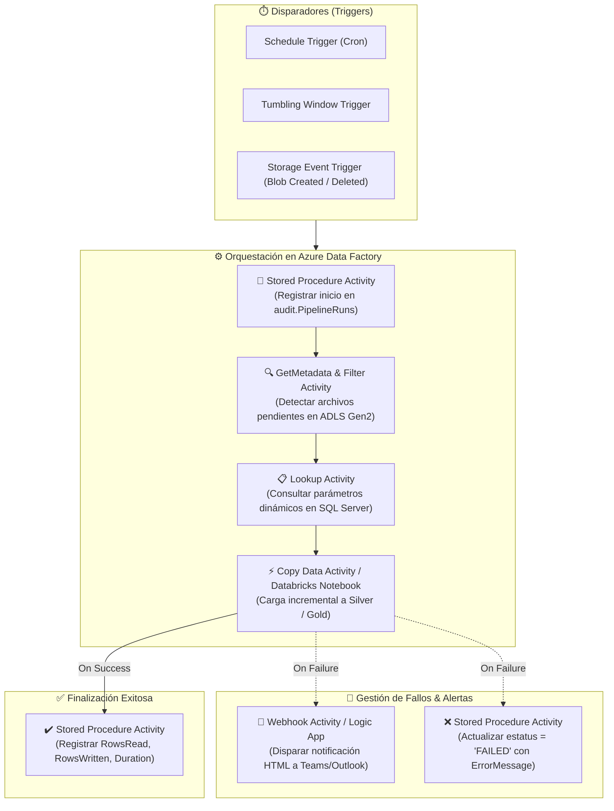

# Azure Data Factory (ADF) & Synapse: Laboratorios & Escenarios Empresariales

> "Orquestación escalable en la nube de Azure: pipelines orientados a metadatos, alertas automatizadas con Logic Apps, auditoría mediante Stored Procedures y patrones de ejecución resiliente."

---

## ☁️ Arquitectura de Orquestación en Azure

Azure Data Factory (ADF) es el servicio de integración y orquestación de datos completamente administrado y sin servidor de Microsoft Azure. Permite componer flujos híbridos y multi-nube coordinando servicios de almacenamiento (**Azure Data Lake Storage Gen2**), procesamiento (**Databricks, HDInsight, Synapse SQL Pools**) y automatización (**Azure Logic Apps, Functions**).



---

## 📖 Libros & Referencias Recomendadas

### 1. *Data Engineering on Azure* — Vlad Riscutia
*Diseño e implementación de plataformas de datos robustas, seguras y escalables en Microsoft Azure.*

!!! quote "Patrones Clave de Producción"
    - **Separación de Control Flow y Data Flow:** ADF destaca como motor de orquestación de flujo de control (*Control Flow*). Las transformaciones pesadas deben delegarse a motores distribuidos nativos (Azure Databricks, Spark en Synapse o Stored Procedures en SQL Dedicado).
    - **Pipelines Conducidos por Metadatos (Metadata-Driven):** En lugar de crear 500 pipelines individuales para 500 tablas, se diseña un único pipeline genérico parametrizado que consulta una tabla de configuración y orquesta la copia de forma dinámica mediante bucles `ForEach`.

---

## 🛠️ Escenarios Empresariales Implementados

A continuación se detallan los 3 escenarios basados en producción disponibles en el repositorio:

### 1. Enviar Alertas por Email vía Webhook & Logic Apps
- **Objetivo:** Notificar de inmediato al equipo de DataOps cuando un pipeline crítico falla, enviando detalles exactos: nombre del pipeline, Run ID, timestamp y mensaje de excepción retornado por Azure.
- **Componentes:** Azure Data Factory Webhook / Web Activity + Azure Logic App (disparador HTTP POST con conector Office 365 Outlook).
- **Template JSON:** [`azure/adf/scenario-based-pipelines/00-webhookEmailSimple.json`](azure/adf/scenario-based-pipelines/00-webhookEmailSimple.json)

```json
{
  "name": "WebhookSendEmailOnFailure",
  "type": "WebActivity",
  "typeProperties": {
    "url": "https://prod-logicapp.eastus.logic.azure.com/workflows/...",
    "method": "POST",
    "headers": { "Content-Type": "application/json" },
    "body": {
      "DataFactoryName": "@pipeline().DataFactory",
      "PipelineName": "@pipeline().Pipeline",
      "RunId": "@pipeline().RunId",
      "ErrorMessage": "@activity('CopyData_Transactions').error.message"
    }
  }
}
```

---

### 2. Lookup Dinámico de Usuarios & Envío Personalizado
- **Objetivo:** Consultar dinámicamente destinatarios y parámetros desde una tabla de base de datos relacional para distribuir reportes sin quemar correos en duro en el pipeline.
- **Componentes:** ADF Lookup Activity + SQL Server / Azure SQL Database.
- **Template JSON:** [`azure/adf/scenario-based-pipelines/01-sqlServerLookupActivity.json`](azure/adf/scenario-based-pipelines/01-sqlServerLookupActivity.json)

---

### 3. Auditoría Formal de Ejecuciones con Stored Procedures
- **Objetivo:** Escribir en una tabla `audit.PipelineExecutionLog` el historial de cada lote procesado, permitiendo generar tableros de SLA y telemetría de fallos en Power BI.
- **Componentes:** Stored Procedure Activity invocando `sp_LogPipelineRun`.
- **Template JSON:** [`azure/adf/scenario-based-pipelines/02-storedProcedureLookupActivity.json`](azure/adf/scenario-based-pipelines/02-storedProcedureLookupActivity.json)

```sql
CREATE PROCEDURE audit.sp_LogPipelineRun
    @RunId VARCHAR(100),
    @PipelineName VARCHAR(200),
    @Status VARCHAR(50),
    @RowsRead BIGINT = NULL,
    @RowsWritten BIGINT = NULL,
    @ErrorMessage NVARCHAR(MAX) = NULL
AS
BEGIN
    SET NOCOUNT ON;
    MERGE audit.PipelineExecutionLog AS target
    USING (SELECT @RunId AS RunId) AS source
    ON (target.RunId = source.RunId)
    WHEN MATCHED THEN
        UPDATE SET 
            target.Status = @Status,
            target.EndTime = SYSUTCDATETIME(),
            target.RowsRead = ISNULL(@RowsRead, target.RowsRead),
            target.RowsWritten = ISNULL(@RowsWritten, target.RowsWritten),
            target.ErrorMessage = @ErrorMessage
    WHEN NOT MATCHED THEN
        INSERT (RunId, PipelineName, Status, StartTime)
        VALUES (@RunId, @PipelineName, @Status, SYSUTCDATETIME());
END;
```

---

## 🧪 Biblioteca de Actividades & Patrones de Control Flow

Explore los 11 templates parametrizados listos para importar en ADF:

| # | Archivo JSON | Actividad ADF | Patrón de Diseño |
| :---: | :--- | :--- | :--- |
| 00 | [`00-simpleCopyData.json`](azure/adf/activities-pipelines/00-simpleCopyData.json) | **Copy Data** | Movimiento punto a punto entre Blob Storage y Azure SQL |
| 01 | [`01-eventTriggerSchedule.json`](azure/adf/activities-pipelines/01-eventTriggerSchedule.json) | **Triggers** | Disparo reactivo al caer nuevo archivo en contenedor |
| 02 | [`02-filterActivityArray.json`](azure/adf/activities-pipelines/02-filterActivityArray.json) | **Filter** | Filtrado en memoria de listas de archivos JSON/CSV |
| 03 | [`03-forEach.json`](azure/adf/activities-pipelines/03-forEach.json) | **ForEach** | Iteración paralela o secuencial sobre colección de tablas |
| 04 | [`04-masterChildDependency.json`](azure/adf/activities-pipelines/04-masterChildDependency.json) | **Execute Pipeline** | Orquestación padre-hijo modular con paso de parámetros |
| 05 | [`05-metaDataActivity.json`](azure/adf/activities-pipelines/05-metaDataActivity.json) | **GetMetadata** | Comprobación de existencia (`ChildItems`, `Exists`, `Size`) |
| 06 | [`06-parameterizedPipeline.json`](azure/adf/activities-pipelines/06-parameterizedPipeline.json) | **Parameters** | Reusabilidad universal mediante Linked Services dinámicos |
| 07 | [`07-set-append-activity.json`](azure/adf/activities-pipelines/07-set-append-activity.json) | **Set / Append Variable** | Manipulación de acumuladores y banderas booleanas en runtime |
| 08 | [`08-switchActivity.json`](azure/adf/activities-pipelines/08-switchActivity.json) | **Switch** | Ramificación condicional multi-caso por tipo de fuente |
| 09 | [`09-systemVariables.json`](azure/adf/activities-pipelines/09-systemVariables.json) | **System Variables** | Uso de `@pipeline().TriggerTime`, `@pipeline().RunId` |
| 10 | [`10-untilActivity.json`](azure/adf/activities-pipelines/10-untilActivity.json) | **Until Loop** | Polling y reintento activo con condición de salida |

---

<div style="text-align: center; margin: 2rem 0;">
  <a href="../humano-conocimiento/" class="md-button" style="margin-right: 10px;">🧠 Ver Cerebelo & Tronco en 3D</a>
  <a href="../data-engineering/" class="md-button md-button--primary">⚡ Fundamentos de Data Engineering</a>
</div>
