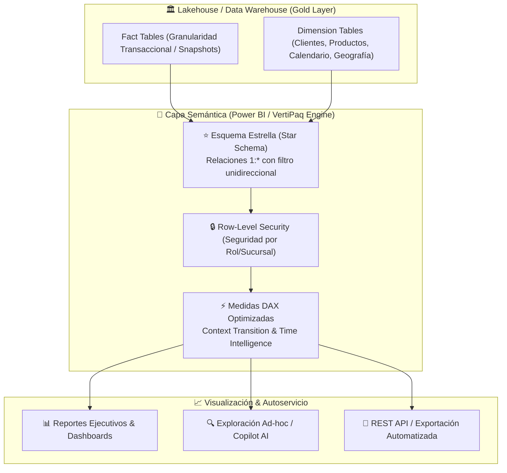

# Business Intelligence, Modelado Dimensional & DAX

> "Transformando datos tabulares crudos en un modelo semántico analítico: rigor dimensional de Kimball, evaluación de contextos DAX y control de versiones con TMDL/PBIP."

---

## 📊 La Capa Semántica Moderna (Semantic Layer)

Las herramientas modernas de Business Intelligence (Power BI, Microsoft Fabric, Superset) ya no actúan como simples generadores de gráficos. En la arquitectura actual, operan como la **Capa Semántica Unificada** del negocio: encapsulan la lógica de métricas corporativas (*Single Source of Truth*), gobiernan el acceso a nivel de fila (*Row-Level Security - RLS*) y entregan consultas de subsegundo gracias a motores de almacenamiento columnar en memoria (como **VertiPaq** en Power BI / Analysis Services).



---

## 📖 Libros & Referencias Fundamentales

### 1. *The Data Warehouse Toolkit (3rd Edition)* — Ralph Kimball & Margy Ross
*La biblia universal del diseño de almacenes de datos y modelado dimensional.*

!!! quote "Los Principios Fundamentales del Modelado Dimensional"
    - **Tablas de Hechos (Fact Tables):** Representan mediciones numéricas de eventos de negocio.
        - **Tipos de Hechos:** Completamente Aditivos (sumables en todas las dimensiones, ej: ingresos), Semi-Aditivos (sumables solo en algunas dimensiones, ej: saldo bancario en el tiempo), y No-Aditivos (ej: ratios, promedios).
        - **Granularidad:** La decisión más crítica del diseño. Debe definirse al nivel más atómico posible (ej: una línea por producto en cada recibo de caja).
    - **Dimensiones de Cambio Lento (Slowly Changing Dimensions - SCD):**
        - **SCD Tipo 1 (Overwrite):** Se sobrescribe el valor antiguo sin guardar historial (fácil mantenimiento, pero pierde la verdad histórica).
        - **SCD Tipo 2 (Add New Row):** Se inserta una nueva fila con llaves subrogadas (*Surrogate Key*), fecha de inicio (*StartDate*), fecha de fin (*EndDate*) y bandera de registro activo (*IsCurrent*). Permite auditar qué atributos estaban vigentes cuando ocurrió la transacción.
        - **SCD Tipo 3 (Add New Column):** Se añade una columna para preservar el valor inmediatamente anterior (`PreviousValue`).
    - **Por qué el Esquema Estrella supera al Snowflake en Power BI:** El motor columnar VertiPaq comprime con mayor eficiencia y resuelve relaciones simples de un solo salto (1 a Muchos) con mucha mayor velocidad que las complejas cadenas de normalización tipo copo de nieve (*Snowflake*).

---

### 2. *The Definitive Guide to DAX (2nd Edition)* — Marco Russo & Alberto Ferrari
*El análisis matemático y operativo más riguroso sobre el motor VertiPaq y el lenguaje DAX.*

!!! quote "La Mecánica Interna de Evaluación de Contextos en DAX"
    - **Row Context (Contexto de Fila):** La fila actual en la que se está evaluando una expresión. Existe automáticamente en columnas calculadas y en iteradores (`SUMX`, `FILTER`, `AVERAGEX`). **El Row Context no filtra el modelo de datos por sí solo.**
    - **Filter Context (Contexto de Filtro):** El conjunto de filtros activos aplicados al modelo de datos por segmentadores (*slicers*), matrices, filtros de página y funciones `CALCULATE()`. **El Filter Context determina qué filas de cada tabla son visibles para el cálculo.**
    - **Context Transition (Transición de Contexto):** Cuando se invoca `CALCULATE()` dentro de un Row Context, **convierte la fila actual en un Filter Context equivalente**, filtrando todas las columnas de la tabla activa por los valores de dicha fila. Es la base del funcionamiento de las medidas dentro de iteradores.

---

## 🧪 Patrones DAX Avanzados en Producción

### 1. Medida de Crecimiento Interanual (YoY %) Segura
```dax
Ventas YoY % = 
VAR VentasActuales = [Total Ventas]
VAR VentasAnioAnterior = 
    CALCULATE(
        [Total Ventas],
        SAMEPERIODLASTYEAR('Dim_Calendario'[Fecha])
    )
RETURN
    DIVIDE(
        VentasActuales - VentasAnioAnterior,
        VentasAnioAnterior,
        BLANK()
    )
```

### 2. Clasificación ABC Dinámica con `KEEPFILTERS`
```dax
Margen Clientes Top 20% = 
VAR Umbral = 0.20
VAR ClientesTop = 
    TOPN(
        COUNTROWS('Dim_Cliente') * Umbral,
        ALLSELECTED('Dim_Cliente'),
        [Total Margen Bruto],
        DESC
    )
RETURN
    CALCULATE(
        [Total Margen Bruto],
        KEEPFILTERS(ClientesTop)
    )
```

---

## 🚀 DevOps Moderno para Power BI: TMDL & Formato PBIP

Históricamente, los archivos `.pbix` binarios eran cajas negras imposibles de versionar con Git. Con la introducción de **PBIP (Power BI Project)** y **TMDL (Tabular Model Definition Language)**, los modelos semánticos se representan en texto plano modular:

- **Estructura Clara en Git:** Cada tabla, partición, rol y medida DAX reside en su propio archivo de texto legible (`.tmdl`).
- **Resolución de Conflictos en Pull Requests:** Las revisiones de código muestran exactamente qué fórmula DAX cambió, qué formato se alteró o qué columna se agregó.
- **Validación Automática en CI/CD:** Herramientas como *Tabular Editor (BPA - Best Practice Analyzer)* validan automáticamente en GitHub Actions que ninguna medida viole estándares de rendimiento antes de desplegar en producción.

---

## 🔗 Navegación & Proyectos de Analítica Directos

Explore los tableros y modelos desarrollados en este repositorio:

<div style="display: grid; grid-template-columns: repeat(auto-fit, minmax(260px, 1fr)); gap: 14px; margin-top: 1.5rem;">
  <a href="../cursos/sena-ia-integracion-datos/aa2-ev03-powerbi/" class="md-button" style="text-align: left; padding: 14px; display: block;">
    <strong>📊 Evidencia Power BI: SENA IA & Datos</strong><br>
    <span style="font-size: 0.8rem; opacity: 0.85;">Modelo Estrella, medidas DAX avanzadas y exportación PBIP/TMDL.</span>
  </a>
  <a href="../microsoft-fabric/" class="md-button" style="text-align: left; padding: 14px; display: block;">
    <strong>☁️ Microsoft Fabric & DirectLake</strong><br>
    <span style="font-size: 0.8rem; opacity: 0.85;">Modelos semánticos sobre Delta Lake sin necesidad de refrescos.</span>
  </a>
  <a href="../humano-conocimiento/" class="md-button md-button--primary" style="text-align: left; padding: 14px; display: block;">
    <strong>🧠 Lóbulo Occipital en 3D</strong><br>
    <span style="font-size: 0.8rem; opacity: 0.85;">Visualizar el centro neuro-analítico en el mapa interactivo.</span>
  </a>
</div>
