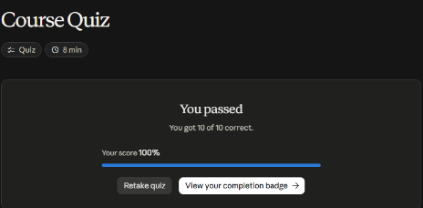
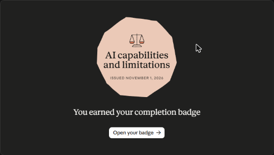

# Claude Academy · AI Capabilities and Limitations

Curso de Anthropic con 13 lecciones, videos cortos y un quiz. El marco 4D de AI Fluency describe las **competencias humanas** para colaborar con la IA. Este curso describe las **propiedades de la máquina** a las que responden esas competencias. Juntos forman un solo sistema.

**Estado:** ✅ Completado · Quiz 10/10 (1 nov 2026) · [Insignia](https://academy.claude.com/verify/7ca9cf740af829262d601880698a4987)

## Qué entendemos por IA

- **Qué es la IA generativa:** **crea contenido nuevo**. La mayoría de la IA del mundo (filtros de spam, recomendaciones, detección de fraude) solo **clasifica u ordena** contenido que ya existe.
- **De qué trata el curso:** de los modelos de texto basados en *transformers*, que producen el contenido **token a token**.
- **Las cuatro propiedades:**
    - predicción del siguiente token;
    - conocimiento;
    - memoria de trabajo;
    - dirigibilidad.
- **Cada propiedad es un continuo:** el mismo mecanismo da la capacidad y el límite.
- **Confianza calibrada:** ubicar la tarea en cada continuo, en lugar de confiar o desconfiar de todo en bloque.
- **Es un conocimiento durable:** las fronteras se mueven con cada modelo, pero las propiedades siguen siendo las mismas.

## Cómo adquiere su «carácter»

| Etapa | Qué produce | Huellas que deja |
|---|---|---|
| **Preentrenamiento** | Un **completador de documentos** que predice «lo que sigue» en enormes volúmenes de texto. No tiene noción de ayudar | — |
| **Ajuste fino (*fine-tuning*)** | Comportamiento de asistente: toma la entrada como una petición, responde en vez de divagar y rechaza lo dañino | **Complacencia** (*sycophancy*), **verbosidad**, **exceso de cautela** ocasional y una **confianza mal calibrada** frente a la fiabilidad real |

**Por qué existen esas huellas:** el ajuste fino usa juicios humanos sobre qué es una buena respuesta, y esos juicios tienen sesgos.

## Las cuatro propiedades

| Propiedad | Zona de capacidad | Zona de límite | Falla típica | Qué la empuja más lejos | Conexión 4D |
|---|---|---|---|---|---|
| **Predicción del siguiente token** | Patrones vistos muchas veces: resumir, reformatear, explicar conceptos comunes | Territorio raro o escaso; distinguir lo «verdadero» de lo que «suena verdadero» | **Inventar datos específicos:** nombres, fechas, cifras, citas, URL | Citas, señales de incertidumbre, generación restringida, ciclos generador–verificador | **Discernimiento** |
| **Conocimiento** | Temas frecuentes, recientes (dentro del entrenamiento) y consistentes | Temas raros, posteriores al corte, de nicho, locales o en disputa | Datos desactualizados, cobertura desigual, sesgo en lo que toma como «normal», no saber atribuir la fuente | Búsqueda web, recuperación (RAG o MCP), herramientas | **Delegación** |
| **Memoria de trabajo** | El material cabe con holgura, la sesión es actual y el contexto es relevante | Documentos o conversaciones muy largos, esperar continuidad entre sesiones, información clave enterrada en el medio | **Un precipicio, no una pendiente:** el texto se trunca en silencio. Además, no aprende de mis correcciones | Memoria, compactación, proyectos, ventanas más grandes, multiagente | **Descripción** |
| **Dirigibilidad** | Instrucciones cortas, concretas y verificables: formato, largo, rol | Cadenas largas de razonamiento, instrucciones abstractas, precisión numérica o lógica | **Deriva del razonamiento** (los errores pequeños se acumulan) y cumplir **la letra y no el espíritu** | *System prompts*, ejecución de código, razonamiento visible, salida estructurada | **Descripción** |

**Las fallas se concentran en lo específico:** cuanto más precisa es una afirmación, más merece verificarse.

## Degradación del contexto

**Más contexto no siempre es mejor.** Pasa lo mismo que en la memoria humana: el **efecto de posición serial** hace que se recuerde mejor el principio y el final, y que se pierda el medio.

**Qué mostró el estudio de Stanford (2023):** si un dato clave queda **en el medio** de un contexto largo, la precisión cae **más de un 30 %** frente a ponerlo al principio o al final.

**Qué hacer:**

- poner lo más importante **al principio y al final**;
- repetir cerca del final las restricciones críticas;
- **curar sin piedad**: cada cosa que se agrega empuja a otras hacia la «zona muerta» del medio.

## Cuando las propiedades chocan

**Las fallas reales suelen venir de dos propiedades a la vez.** Saber cuáles son indica el arreglo.

| Par | Síntoma | Arreglo |
|---|---|---|
| Predicción + Conocimiento | Datos específicos inventados (*alucinaciones*) | Verificar los datos, darle fuentes, activar la búsqueda |
| Memoria de trabajo + Dirigibilidad | La conversación larga se desvía de las instrucciones | Volver a dar el contexto, empezar de nuevo, poner puntos de control |

**Otros arreglos:**

- pasar los cálculos a la **ejecución de código**;
- **invitar a que me contradiga** frente a la complacencia.

**Cuando una instrucción se cumple al pie de la letra pero no sirve:** hay que **reformular la meta**. Repetir la instrucción con más fuerza no cierra la brecha.

## Práctica: mi mapa de tareas

El curso pide listar tareas reales, ubicarlas en cada propiedad y decidir un cambio concreto. Lo apliqué a las tareas con IA de estas semanas:

| Tarea | Propiedad en juego | Riesgo | Mitigación que aplico |
|---|---|---|---|
| Resumir una transcripción de un curso en apuntes | Predicción (zona de capacidad) | Bajo: es un patrón común | Revisar los términos técnicos contra la fuente |
| Responder un quiz con fechas, cifras o nombres | Predicción + Conocimiento | **Alto:** datos específicos | Contrastar con la lección, no con lo que «suena bien» |
| Usar el SDK de MCP más reciente | Conocimiento (posterior al corte) | **Alto:** la API cambió (`FastMCP` → `MCPServer`) | Ejecutar el código y leer el error; consultar la guía de migración |
| Sesiones largas con muchos cursos seguidos | Memoria de trabajo | Medio: se pierden reglas del principio | Reglas en una memoria persistente que se carga en cada sesión |
| «Hazlo más corto» sobre un apunte | Dirigibilidad (letra frente a espíritu) | Medio | Decir la meta: «que se lea en 2 minutos antes del quiz» |
| Cálculos financieros de los cursos de UBITS | Dirigibilidad (precisión numérica) | **Alto** | Pedir el cálculo con código o en una hoja, no «de cabeza» |

**Mi cambio de esta semana:** en toda tarea de varios pasos, **pedir el resultado del paso 2 antes de seguir**, como punto de control contra la deriva del razonamiento.

!!! tip "Para recordar"
    - Ninguna IA es confiable o no confiable en bloque: hay que ubicar la tarea en cada propiedad.
    - **Lo específico se verifica:** nombres, fechas, cifras, citas y URL.
    - El modelo no aprende de mis correcciones; solo ve lo que está en el contexto.
    - Lo crítico va al principio y al final.
    - Dar **meta más formato**, no solo formato.
    - Ante una falla, nombrar el **par de propiedades**, y el arreglo sale solo.

## Evaluación (10/10)

1. Qué hace en el fondo al escribir → **predice el texto que sigue, fragmento a fragmento**.
2. Acorta un correo y quita el punto clave → **decir qué debe lograr el correo y repetir**: meta, no solo formato.
3. Pierde un dato del medio de un informe de 40 páginas → **poner esa parte arriba o trabajar por secciones**.
4. Algo de la semana pasada, sin búsqueda web → **puede no saberlo: tiene fecha de corte**.
5. Una cita que no aparece en ninguna parte → **verificarla o usar una herramienta que muestre fuentes**.
6. Dónde se concentran las alucinaciones → **en lo específico: nombres, fechas, citas y URL**.
7. Lo contradigo y me da la razón al instante → **tiende a ceder porque lo entrenaron para ser útil** (complacencia).
8. Tono seguro y pulido → **dice poco: suena igual de seguro cuando se equivoca**.
9. Chat nuevo sin memoria → **empieza de cero**.
10. Fecha de corte → **sus datos de entrenamiento terminan en una fecha y no sabe lo posterior sin otra fuente**.

## Evidencia

{ width="480" }

{ width="420" }

## Fuentes y aviso legal

- **Fuente:** curso «AI Capabilities and Limitations» de Anthropic Academy (Claude Academy). Sitios oficiales: [anthropic.com/learn](https://www.anthropic.com/learn) · [docs.anthropic.com](https://docs.anthropic.com).
- **Uso:** apuntes personales de estudio, sin fines comerciales y con redacción propia.
- **Sin afiliación:** sitio no oficial, no afiliado ni respaldado por Anthropic. Las marcas pertenecen a sus dueños.
- Más detalles y cómo pedir el retiro de contenido en el [aviso legal](../../aviso-legal.md).
