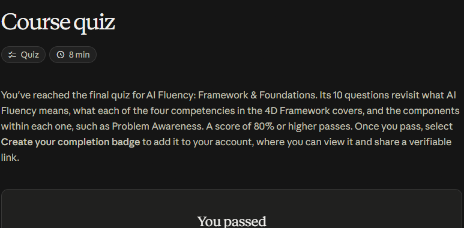
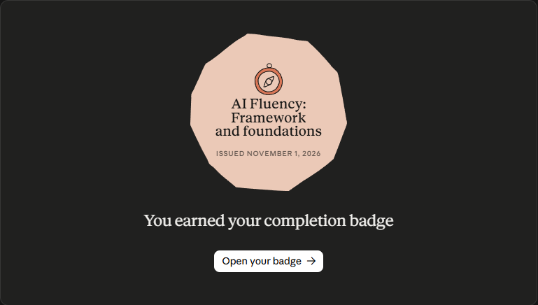

# Claude Academy · AI Fluency: Framework & Foundations

Es un curso de Anthropic con 14 lecciones, videos, ejercicios con Claude y un quiz de 10 preguntas (se aprueba con 80 %). No enseña trucos pasajeros: enseña un **marco durable** para colaborar con la IA de forma **eficaz, eficiente, ética y segura**.

**Estado:** ✅ Completado · Quiz 10/10 (1 nov 2026) · [Insignia](https://academy.claude.com/verify/e0665d61e3c707b7a06003978c981bc5)

## Tres formas de trabajar con IA

| Modo | Qué es |
|---|---|
| **Automatización** | La IA hace una tarea concreta según mis instrucciones |
| **Aumento** | La IA y yo colaboramos como socios para pensar y ejecutar |
| **Agencia** | Configuro a la IA para que trabaje sola en mi nombre. Defino su conocimiento y su comportamiento, no tareas puntuales |

## El marco de las 4D

| Competencia | Qué es | Componentes |
|---|---|---|
| **Delegación** | Decidir qué hago yo, qué hago con la IA y qué hace ella sola | **Conciencia del problema** (mis metas y el trabajo que implican), **conciencia de la plataforma** (qué puede cada sistema) y **delegación de tareas** (repartir según las fortalezas) |
| **Descripción** | Comunicarme con claridad para crear un entorno de colaboración | **Producto** (qué quiero: formato, audiencia, estilo), **proceso** (cómo debe abordarlo) y **desempeño** (cómo debe comportarse: conciso o detallado, crítico o de apoyo) |
| **Discernimiento** | Evaluar con ojo crítico lo que produce | **Producto** (exactitud, pertinencia, coherencia), **proceso** (errores lógicos, vacíos de atención) y **desempeño** (si su estilo de interacción me sirve) |
| **Diligencia** | Hacerme responsable de la colaboración | **Creación** (qué sistema uso y cómo), **transparencia** (decir el papel de la IA a quien deba saberlo) y **despliegue** (verificar y responder por lo que comparto) |

- **Las cuatro aplican en los tres modos.**
- **Descripción y discernimiento forman un ciclo:** describo, evalúo, ajusto y vuelvo a describir.
- **Delegar bien exige dos cosas:** saber del tema y saber qué puede hacer la IA. La meta no es automatizarlo todo, sino la mejor combinación entre persona e IA.

## Fundamentos de la IA generativa

- **Qué la hizo posible:**
    - la arquitectura *transformer*;
    - enormes volúmenes de datos;
    - mucha capacidad de cómputo.
- **Cómo se entrena:**
    - **preentrenamiento:** aprende patrones en miles de millones de ejemplos;
    - **ajuste fino:** aprende a seguir instrucciones y a ser útil.
- **Capacidades:** es versátil, sigue el hilo de la conversación y se conecta con herramientas.
- **Límites:**
    - fecha de corte del conocimiento;
    - alucinaciones;
    - ventana de contexto;
    - razonamiento complejo.

## Seis técnicas de prompting

1. **Dar contexto:** qué quiero, para qué y con qué antecedentes.
2. **Mostrar ejemplos** del formato o estilo esperado.
3. **Fijar restricciones:** formato, largo y requisitos.
4. **Dividir la tarea en pasos.**
5. **Pedirle que piense primero.**
6. **Definir su rol o tono.**

**El «arma secreta»:** pedirle a la propia IA que mejore mi prompt. El prompting es **iterativo** y también colaborativo.

## Práctica: delegación y diligencia en este sitio

### Plan de delegación (proyecto: apuntes y evidencias de los cursos)

| Tarea | Quién | Por qué |
|---|---|---|
| Elegir qué cursos tomar y qué se publica | **Yo** | Son mi criterio y mis metas (conciencia del problema) |
| Iniciar sesión en las plataformas | **Yo** | Mis credenciales no se delegan |
| Extraer transcripciones y lecciones, y tomar capturas | **IA** (automatización) | Es repetitivo y de patrón conocido |
| Redactar los apuntes a partir de la fuente | **Juntos** (aumento) | La IA redacta y yo reviso el enfoque y corrijo |
| Responder los quizzes | **IA, contra el contenido leído** | Siempre se contrasta con la lección, no con lo que «suena bien» |
| Ejercicios prácticos (código, mapas de tareas) | **Juntos** | El código se **ejecuta** para verificarlo, no se da por bueno |
| Enviar correos o aceptar términos | **Yo**, tras revisar | Son acciones hacia afuera e irreversibles |

### Descripción que uso (producto, proceso y desempeño)

- **Producto:** apuntes en español, con tablas y listas, sin errores ni temas del asistente, y cerrados con «Fuentes y aviso legal».
- **Proceso:** primero la fuente completa (transcripción o lección), luego los minutos clave, luego la captura y al final la nota.
- **Desempeño:** avances breves, sin pedir permiso para lo rutinario, pero sí para enviar o publicar hacia terceros.

### Declaración de diligencia

> Estos apuntes los hice en colaboración con Claude (Anthropic), mediante Claude Code. Claude extrajo el contenido de las lecciones, propuso la redacción, tomó las capturas y ejecutó los ejercicios de código. Revisé el contenido, las respuestas de los quizzes y los resultados de las prácticas. La redacción final refleja lo que entendí. Asumo la responsabilidad por su exactitud. Los datos personales (como la cédula en los certificados) se ocultan antes de publicar.

!!! tip "Para recordar"
    - **Delegación** = qué y a quién; **descripción** = cómo lo pido; **discernimiento** = cómo lo evalúo; **diligencia** = de qué respondo.
    - Producto, proceso y desempeño valen tanto al **describir** como al **discernir**.
    - La IA es un **socio de conversación**, no una máquina expendedora.
    - Lo que comparto con otros lo verifico y respondo por ello.

## Evaluación (10/10)

1. Evaluar con ojo crítico salidas, procesos y comportamientos → **Discernimiento**.
2. Comunicar qué quiero, cómo lo quiero y cómo interactuar → **Descripción**.
3. Foco de la Diligencia → **uso responsable, transparencia y rendición de cuentas**.
4. Descripción del producto → **definir con claridad qué quiero que cree o entregue**.
5. Qué es AI Fluency → **trabajar con IA de forma eficaz, eficiente, ética y segura**.
6. Decidir qué hace la IA y qué hago yo → **Delegación**.
7. Las 4D → **Delegación, Descripción, Discernimiento y Diligencia**.
8. Diligencia de transparencia → **ser claro sobre el papel de la IA con quien deba saberlo**.
9. Conciencia del problema → **definir metas y el trabajo necesario antes de involucrar a la IA**.
10. Discernimiento del proceso → **evaluar si su razonamiento y su enfoque son eficaces**.

## Evidencia

{ width="480" }

{ width="420" }

## Fuentes y aviso legal

- **Fuente:** curso «AI Fluency: Framework & Foundations» de Anthropic Academy (Claude Academy). Sitios oficiales: [anthropic.com/learn](https://www.anthropic.com/learn).
- **Uso:** apuntes personales de estudio, sin fines comerciales y con redacción propia.
- **Sin afiliación:** sitio no oficial, no afiliado ni respaldado por Anthropic. Las marcas pertenecen a sus dueños.
- Más detalles y cómo pedir el retiro de contenido en el [aviso legal](../../aviso-legal.md).
