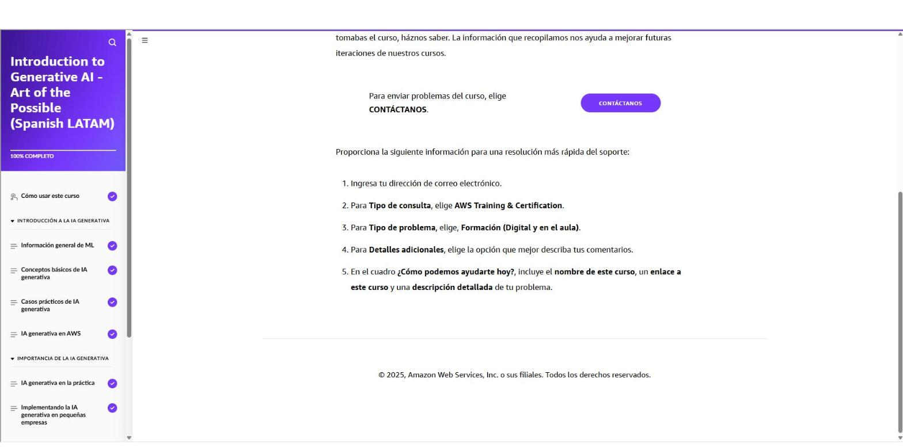

# 01 · Introducción a la IA generativa: el arte de lo posible

Curso de AWS Skill Builder *Introduction to Generative AI – Art of the Possible (Spanish LATAM)*, primera pieza de la ruta «Agentes de IA para todos» en AWS Entrena Bogotá.

!!! info "Estructura del curso"
    10 lecciones en tres bloques: **Introducción a la IA generativa** (lecciones 2-5), **Importancia de la IA generativa** (6-8) y **Cierre** (9-10).

## Información general de ML

**Idea central:** la IA generativa es una rama del *machine learning* (ML) que crea contenido nuevo (texto, imágenes, código, audio, video) a partir de la entrada del usuario.

- **Cómo aprende una máquina:** se entrena un modelo con un conjunto de datos que tiene *características* (entradas) y *etiquetas* (salidas). El algoritmo busca la "fórmula" que relaciona ambas y luego la aplica a datos nuevos para predecir.
- **Amazon y el ML (más de 20 años):** recomendaciones del e-commerce, rutas de robots en centros logísticos, cadena de suministro y pronósticos, Prime Air (drones) y Amazon Go (visión artificial con *deep learning*), Alexa (más de 30 sistemas de ML).
- **Hitos recientes:** 2023 llegan CodeWhisperer y el anuncio de **Amazon Bedrock**; 2024 la familia **Amazon Q** (Q Developer, Q Business).
- **IA generativa vs. ML tradicional:**
    - El *deep learning* usa redes de neuronas artificiales (ej. **Amazon Rekognition** para analizar imágenes y video).
    - La IA generativa es un subconjunto del *deep learning* que se apoya en **modelos fundacionales (FM)**: modelos enormes preentrenados con datos a escala de internet.
    - En ML tradicional se entrena un modelo por tarea con datos etiquetados; con un FM **el mismo modelo se adapta a muchas tareas**.
    - Los **LLM** predicen la siguiente palabra según su posición y contexto en la oración, y así generan contenido.
- **¿Por qué ahora?** Grandes inversiones en tres frentes: equipos más grandes, cómputo y disposición para apostar por ideas ambiciosas.

!!! tip "Para recordar"
    - ML = aprender patrones de datos históricos para predecir sobre datos nuevos.
    - IA generativa ⊂ deep learning ⊂ ML ⊂ IA.
    - FM: un modelo preentrenado, muchas tareas; LLM: predicción de la siguiente palabra.
    - Ejemplo de app generativa: Amazon Q Developer sugiere código en tiempo real.

## Conceptos básicos de IA generativa

La IA generativa crea contenido nuevo (conversaciones, historias, imágenes, video, música, código) gracias a modelos muy grandes preentrenados con colecciones enormes de datos. Se aplica en todas las áreas: ingeniería, marketing, servicio al cliente, finanzas y ventas.

**Aplicaciones comunes (4 grandes grupos)**

| Grupo | Ejemplos |
|---|---|
| Experiencia del cliente | Asistentes virtuales, centros de contacto inteligentes, personalización, moderación de contenido |
| Productividad de empleados | Búsqueda conversacional, creación de contenido, resúmenes, generación de código (Amazon Q Developer); **Amazon QuickSight** genera narrativas visuales con lenguaje natural |
| Creatividad | Arte, música, texto, imágenes, animación, video |
| Operaciones de negocio | Procesamiento inteligente de documentos, asistentes de mantenimiento, control de calidad e inspección visual, datos sintéticos para entrenamiento |

**Beneficios**

1. Personalizar las interacciones con los clientes.
2. Generar contenido novedoso.
3. Adaptar de forma eficiente modelos preentrenados a casos de negocio.
4. Ganar productividad mediante automatización (ej. marketing hace pruebas A/B de imágenes de producto en minutos; desarrolladores generan código repetitivo e integraciones con API usando Q Developer).

!!! tip "Para recordar"
    - La IA generativa aporta valor en experiencia del cliente, productividad, creatividad y operaciones.
    - QuickSight + IA generativa = historias de datos a partir de preguntas en lenguaje natural (útil para mi trabajo en BI).

## Casos prácticos de IA generativa

Se estima que cerca de dos tercios de las ocupaciones en EE. UU. se verán potenciadas por la IA (Goldman Sachs). Se espera una etapa de mucha experimentación y nuevas arquitecturas.

**Seis industrias**

| Industria | Usos destacados |
|---|---|
| Salud | **AWS HealthScribe** (notas clínicas automáticas a partir de la conversación médico-paciente), medicina personalizada, mejora/reconstrucción de imágenes médicas |
| Ciencias de la vida | Descubrimiento de fármacos (nuevas moléculas), predicción del plegamiento de proteínas, biología sintética |
| Servicios financieros | Datos sintéticos para detección de fraude/lavado, simulación de escenarios para portafolios, estrategias de cobranza. Banca: 200-340 mil millones USD/año de valor potencial (McKinsey 2023) |
| Manufactura | Diseño generativo de productos, optimización de procesos, mantenimiento preventivo, ciencia de materiales |
| Retail | Precios óptimos, probadores virtuales, diseño de tiendas, resúmenes de reseñas. Retail y consumo masivo: 400-660 mil millones USD/año (McKinsey 2023) |
| Medios y entretenimiento | Guiones e historias, entornos de realidad virtual, generación de noticias |

**Caso Amazon: "Crear con Alexa"** — niños construyen cuentos animados en Echo Show. Combina varios generadores:

1. **Historia:** un modelo *planificador* expande las elecciones del usuario en palabras clave por escena (plan) y un *generador de texto* escribe el cuento.
2. **Escena:** módulos de NLP resuelven pronombres (ella → la sirena) para ubicar bien los elementos visuales.
3. **Música:** una biblioteca de pistas se combina automáticamente; un modelo texto-a-voz estima la duración y un modelo paralingüístico mide el tono (tranquilo↔emocionante, triste↔feliz).

!!! tip "Para recordar"
    - Cada industria tiene casos concretos; los datos sintéticos aparecen en finanzas y operaciones.
    - Un producto generativo real suele encadenar varios modelos especializados (planificar → generar → ajustar).

## IA generativa en AWS

AWS organiza su oferta de IA generativa en **tres capas**:

| Capa | Qué ofrece |
|---|---|
| **Cómputo** | Chips propios: **AWS Inferentia** (inferencia; la 1.ª generación abarata modelos pequeños) y **AWS Trainium / Inferentia2** (entrenar y desplegar modelos ultragrandes, cientos de miles de millones de parámetros) |
| **Crear tus propios modelos** | **Amazon SageMaker** (con Trainium) para entrenar tu LLM, o **SageMaker JumpStart** para tomar un modelo existente y reentrenarlo con tus datos |
| **Modelos fundacionales** | **Amazon Bedrock**: servicio totalmente administrado que expone por API FM de Amazon (Titan) y de startups líderes; se elige el modelo según el caso |

**Amazon Q Developer** (asistente de código con IA):

- Da recomendaciones en tiempo real dentro del IDE, sin obligar al desarrollador a salir a buscar en internet o foros.
- En el reto de productividad de la versión preliminar: **27 %** más probabilidad de completar la tarea y **57 %** más rápido.
- Accenture reporta hasta **30 %** menos esfuerzo de desarrollo (incorporación de personas, código estándar, lenguajes nuevos, detección de vulnerabilidades).

!!! tip "Para recordar"
    - Cómputo (Inferentia/Trainium) → construir (SageMaker/JumpStart) → consumir FM (Bedrock).
    - Bedrock = la vía más eficiente para crear y escalar apps generativas sin preentrenar un FM propio.
    - Q Developer = productividad del desarrollador dentro del IDE.

## IA generativa en la práctica

Escenario guiado con videos cortos: **AnyCompany**, marca de calzado, lanza un nuevo zapato cómodo para caminar ("London Walker"). Cada video muestra la *petición* (prompt) y el resultado del FM a lo largo del ciclo de lanzamiento:

| Etapa | Caso de uso | Qué se pide al modelo |
|---|---|---|
| 1 | **Resumen de contenido** | Condensar un informe extenso de investigación de mercado en un resumen ejecutivo para la junta |
| 2 | **Generación de contenido (texto web)** | Descripción del producto para el sitio |
| 3 | **Generación de contenido (redes)** | Anuncio para redes sociales reutilizando el contexto de la respuesta anterior en la misma sesión |
| 4 | **Generación de imágenes** | Foto del zapato en Londres sin pagar una sesión fotográfica |
| 5 | **Generación de código** | Con Amazon Q Developer, un script de Python que sube datos de sentimiento a un bucket de **Amazon S3** |
| 6 | **Pregunta y respuesta** | Chatbot del sitio, ajustado con el catálogo y la base de clientes, que responde el número de seguimiento de un pedido |

!!! tip "Para recordar"
    - Un mismo FM sirve a investigación, marketing, ingeniería y servicio al cliente en un solo lanzamiento.
    - El modelo conserva el contexto de la conversación dentro de una sesión.
    - Para responder con datos propios (pedidos, catálogo) el modelo se ajusta o se conecta a esas fuentes.

## Implementando la IA generativa en pequeñas empresas

La IA permite a las pymes competir con organizaciones más grandes.

**Beneficios:** mejor experiencia del cliente (recomendaciones, marketing dirigido, CRM), creación de contenido alineado con la marca sin grandes equipos, y productividad al automatizar tareas manuales.

**Tres pasos para prepararse**

1. **Definir un caso de uso** con un objetivo claro que sirva para medir el éxito.
2. **Crear la estrategia de datos:** datos de clientes, ventas y operación; mapear entradas, adquisición eficiente, *pipelines* de procesamiento de alto rendimiento y controles de calidad de datos.
3. **Elegir herramientas y enfoque:** servicios de AWS sin código / bajo código para no incurrir en costos desproporcionados.

**Aplicaciones prácticas:** creación y optimización de contenido; marketing personalizado; asistentes de atención al cliente; búsqueda semántica en datos no estructurados (entiende la intención, no solo palabras clave); análisis y pronóstico; procesamiento de imagen y video (etiquetado, moderación).

**Soluciones de muestra de AWS:** QnABot en AWS, detección de fraude con procesamiento inteligente de documentos, creador de aplicaciones de IA generativa, IDP acelerado y recomendaciones de e-commerce con Amazon Bedrock.

!!! tip "Para recordar"
    - Caso de uso → estrategia de datos → herramientas. Sin datos de calidad no hay IA útil (¡mi terreno como ingeniero de datos!).
    - La búsqueda generativa interpreta la intención detrás de consultas vagas.

## Consideraciones éticas de la IA generativa

**IA responsable:** prácticas y principios para construir sistemas transparentes y confiables, aplicados en todo el ciclo de vida (diseño, desarrollo, despliegue, monitoreo, evaluación).

**Desafíos propios de la IA generativa**

- **Toxicidad:** contenido ofensivo o inapropiado.
- **Alucinaciones:** afirmaciones plausibles pero falsas.
- **Propiedad intelectual:** reproducción literal de datos de entrenamiento.
- **Plagio y trampa.**
- **Amplificación de sesgos** presentes en los datos.
- **Privacidad:** lo que se envía al modelo puede contener datos personales.

**Tipos de sesgo:** cognitivo, de confirmación, cultural, de conjunto de datos, demográfico, político, lingüístico (predomina el inglés), estadístico, de sistemas y temporal (corte de fecha de los datos).

**Impactos del sesgo:** refuerza prejuicios sociales (estereotipos de profesiones), daña en aplicaciones de alto riesgo (reclutamiento, salud, crédito), crea **bucles de retroalimentación** cuando contenido sesgado entrena a otros modelos, y **erosiona la confianza** de grupos marginados.

**Dimensiones de la IA responsable:** equidad, explicabilidad, privacidad y seguridad, solidez, gobernanza, transparencia, *safety* y controlabilidad. Para IA generativa pesan especialmente:

- **Equidad:** inclusión y no discriminación.
- **Transparencia:** comunicar procesos, capacidades y limitaciones para decidir con información.

**Responsabilidad compartida:** equipos diversos, pruebas robustas, reportes transparentes, y revisar lo que se ingresa al modelo para no filtrar información confidencial ni propiedad intelectual.

!!! tip "Para recordar"
    - Alucinación ≠ toxicidad: una es falsedad plausible, la otra contenido dañino.
    - El sesgo entra por los datos y se amplifica sin juicio humano.
    - Nunca pegar datos confidenciales o personales en un modelo sin evaluar el riesgo.

## Más información

Recursos oficiales enlazados: IA generativa en AWS, Amazon Bedrock, AWS Trainium, AWS Inferentia, **IA agéntica de Amazon** (puente hacia el resto de la ruta) y Amazon SageMaker AI.

---

## Evidencia

Curso completado al **100 %** el 2026-10-24.

