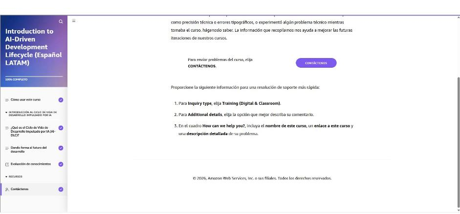

# 02 · Introducción al Ciclo de Vida de Desarrollo Impulsado por IA (AI-DLC)

Curso de AWS Skill Builder *Introduction to AI-Driven Development Lifecycle (Español LATAM)*, unos 15 min, ruta «IA sin Límites».

## ¿Qué es el Ciclo de Vida de Desarrollo Impulsado por IA (AI-DLC)?

- Así como **Agile** trajo la iteración y **DevOps** unió desarrollo y operaciones, la IA abre un nuevo punto de inflexión en la forma de construir software.
- **Problema:** hoy usamos la IA (autocompletar código, detectar errores) dentro de marcos pensados solo para humanos. Seguimos con demasiadas reuniones, decisiones lentas, mucha coordinación y retrabajo.
- **AI-DLC:** la IA pasa de herramienta a **colaborador proactivo**. Inicia discusiones, propone soluciones y pide aclaraciones. Las personas aportan el contexto y toman las decisiones clave.
- **Beneficios buscados:** calidad, innovación, capacidad de respuesta al mercado, velocidad y experiencia del desarrollador.

!!! tip "Para recordar"
    - AI-DLC = la IA como **colaborador proactivo**, no como simple herramienta.
    - La IA propone y pregunta; **el humano aporta contexto y decide**.
    - Pista para la prueba: AI-DLC busca resolver la raíz de las ineficiencias (reuniones, esperas, coordinación, retrabajo), no solo escribir código más rápido.

## Dando forma al futuro del desarrollo

**Tres formas de usar la IA en el desarrollo**

| Modelo | Cómo funciona | Resultado |
|---|---|---|
| **Asistido por IA** | La IA se usa a ratos para tareas puntuales (código, documentación); se mantienen los rituales de siempre (sprint planning, dailies) | Buena calidad, casi sin ganancia de velocidad |
| **Gestionado por IA** | La IA construye de forma autónoma con poca intervención humana | Máxima velocidad aparente, poca calidad; mucho tiempo arreglando código ajeno, y el equipo pierde la conexión con el código |
| **AI-DLC** | La IA participa en cada actividad del SDLC y las personas supervisan y deciden | Velocidad **y** calidad |

**Ciclo central de AI-DLC**

1. Se le da a la IA una tarea (ej. generar requisitos a partir de una intención, o historias de usuario a partir de requisitos).
2. La IA **crea un plan** en lugar de implementar de una vez, y hace **preguntas aclaratorias** en los puntos de decisión.
3. Las personas responden, revisan el plan y aportan el contexto del negocio.
4. La IA **refina el plan**. Se repite hasta que hay una **aprobación explícita**.
5. La IA **ejecuta** y genera los artefactos (diseños, código, pruebas).
6. Las personas **verifican** el resultado y validan la calidad.

Principios: **la IA orquesta** (planificación, descomposición de tareas, propuestas de arquitectura) y **las personas mantienen la responsabilidad** (validación, decisiones, supervisión).

**Colaboración multifuncional:** si cada desarrollador trabaja aislado con la IA aparecen puntos ciegos (seguridad, operación, negocio) que se descubren tarde y generan reuniones y retrabajo. En AI-DLC, producto, desarrollo, seguridad y operaciones trabajan juntos con la IA en sesiones colaborativas y deciden en tiempo real.

**Tres fases**

1. **Iniciación:** de una intención ("queremos un portal KYC") a requisitos detallados y unidades de trabajo.
2. **Construcción:** la IA lidera el diseño, el código y las pruebas. Las personas definen los requisitos no funcionales, la tecnología y la seguridad.
3. **Operación:** la IA gestiona el despliegue y el monitoreo.

!!! tip "Para recordar"
    - Ni «asistido» (lento) ni «gestionado» (baja calidad): AI-DLC equilibra **velocidad y calidad**.
    - Ciclo: **plan → preguntas → refinamiento → aprobación explícita → ejecución → verificación humana**.
    - Fases: **Iniciación, Construcción, Operación**.
    - Pista para la prueba: «la IA orquesta, el humano es responsable». Si una opción dice que la IA decide sola o que la supervisión humana sobra, es falsa.
    - Pista para la prueba: la colaboración **multifuncional** (producto + dev + seguridad + operaciones) evita descubrir problemas tarde.

## Evaluación de conocimientos

Tarjetas de verdadero/falso:

| Afirmación | Respuesta |
|---|---|
| AI-DLC se enfoca solo en generar código | **Falso**: cubre todo el ciclo de vida |
| Lo puede adoptar cualquier organización, grande o pequeña | **Verdadero** |
| AI-DLC aumenta la complejidad del desarrollo | **Falso**: la simplifica con colaboración estructurada |
| La supervisión humana erosiona sus beneficios | **Falso**: es clave para la calidad y el mantenimiento |
| Solo las aplicaciones nativas en la nube se benefician | **Falso**: aplica a cualquier arquitectura |
| AI-DLC no reemplaza a DevOps | La tarjeta lo marca como «Falso» y explica que AI-DLC **evoluciona y amplía** DevOps con IA |

!!! tip "Para recordar"
    - Todo el SDLC, cualquier tamaño de organización y cualquier arquitectura.
    - La supervisión humana es parte del diseño, no un freno.
    - Pista para la prueba: AI-DLC **evoluciona** DevOps con IA; no lo descarta.

---

## Evidencia

Curso completado al **100 %** el 2026-10-24.

## Fuentes y aviso legal

- **Fuente:** ruta *IA sin Límites* de AWS Entrena Bogotá (cursos de AWS Skill Builder). Sitios oficiales: [bogota.awsentrena.com](https://bogota.awsentrena.com) · [skillbuilder.aws](https://skillbuilder.aws).
- **Uso:** apuntes personales de estudio, sin fines comerciales y con redacción propia. Las imágenes del curso son fragmentos breves citados con fines educativos; sus derechos son de sus titulares.
- **Sin afiliación:** sitio no oficial, no afiliado ni respaldado por AWS. Las marcas pertenecen a sus dueños.
- Más detalles y cómo pedir el retiro de contenido en el [aviso legal](../../aviso-legal.md).
