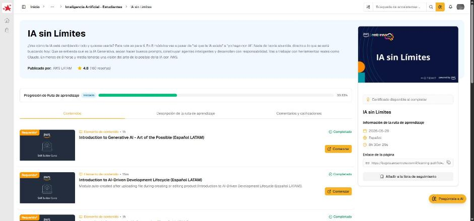

# 03 · Desarrollo de Proyectos de IA Generativa

Curso de AWS Skill Builder *Desarrollo de Proyectos de IA Generativa (Español LATAM)*, ruta «IA sin Límites». Es una sesión grabada (~45 min) con Nazly Ramos. Explica cómo **convertir una idea de IA generativa en un proyecto concreto** con una plantilla tipo *canvas*: la **«Plantilla de proyecto Canvas – GenAI»**.

!!! note "Idea central"
    Antes de construir hay que poder explicar el proyecto en una página: qué producto es, quién lo usa, qué problema resuelve, qué riesgos tiene, por qué vale la pena y qué procesos cambia. El canvas **se diligencia en equipo**, no lo llena una sola persona.

## La plantilla de proyecto Canvas – GenAI

El archivo tiene dos hojas: **Canvas-Explicación** (qué va en cada campo) y **Canvas Formato** (la plantilla en blanco). Tiene cinco bloques:

### 1. Identificación

| Campo | Qué se escribe |
|---|---|
| Equipo desarrollador | Integrantes del equipo |
| Tipo de producto | Por ejemplo **chatbot**, **pipeline automático** o proceso **batch** |

### 2. Principales consumidores

Las **áreas que usarán o recibirán** el producto de datos, distintas del área dueña.

| Campo | Notas |
|---|---|
| Nombre | Opcional: la persona responsable del área o proceso consumidor |
| Área (*) | **Obligatorio**: área o proceso consumidor |
| Cargo | El cargo del responsable, si se conoce |

### 3. Alcance

Preguntas que delimitan el producto:

- **Problemas a resolver:** ¿qué necesidad del usuario se atiende?
- **Propuesta de valor:** ¿qué valor entrega el producto?
- **Diferencial:** ¿qué ofrece frente a otras soluciones?
- **Entradas esperadas** y **salidas esperadas** (datos, documentos, prompts → respuestas, reportes, acciones).
- **Consideraciones de seguridad** que hay que tener en cuenta.
- **Consideraciones éticas** (sesgo, privacidad, transparencia).
- **¿Por qué NO lo deberíamos hacer?** Es un ejercicio explícito de abogado del diablo.

### 4. Priorización

| Campo | Qué se escribe |
|---|---|
| Concepto de viabilidad | ¿Es viable técnica y operativamente? |
| Justificación | Argumentos del concepto |
| Tipo de beneficio | Con la **expectativa aproximada en datos** (ahorro, tiempo, ingresos…) |
| OKR estratégico de la compañía | Solo si el beneficio **no es legal**/regulatorio |
| Descripción del beneficio / caso de negocio | Solo si el beneficio no es legal/regulatorio |

### 5. Procesos asociados / dependencias

Una lista de **procesos o sistemas que se verán afectados**, con la **descripción de qué va a cambiar** en cada uno.

!!! tip "Para recordar"
    - Un proyecto de IA generativa empieza con un **canvas de una página**, no con el modelo.
    - Bloques: **Identificación → Consumidores → Alcance → Priorización → Procesos/Dependencias**.
    - El *alcance* siempre incluye **seguridad**, **ética** y la pregunta **«¿por qué NO hacerlo?»**.
    - La priorización conecta el proyecto con la **viabilidad**, el **beneficio cuantificado** y los **OKR** de la empresa (o con una obligación legal).
    - Pista para la prueba: si preguntan qué definir primero, la respuesta va por el **problema/necesidad del usuario y la propuesta de valor**, no por la tecnología.
    - Pista para la prueba: identificar a los **consumidores** (áreas distintas a la dueña) y las **dependencias** evita sorpresas al desplegar.

---

## Evidencia

Curso marcado como **Completado** en la ruta el 2026-10-24 (progreso de la ruta: 33,33 %).

