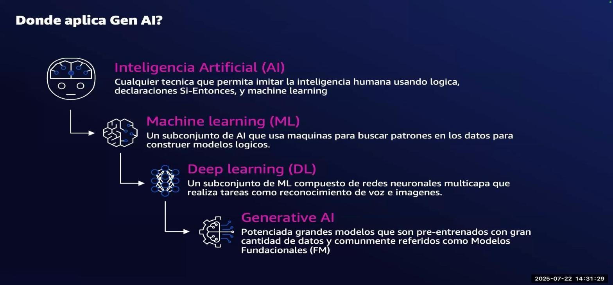
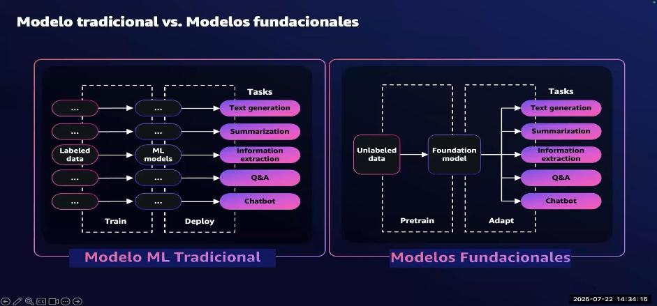
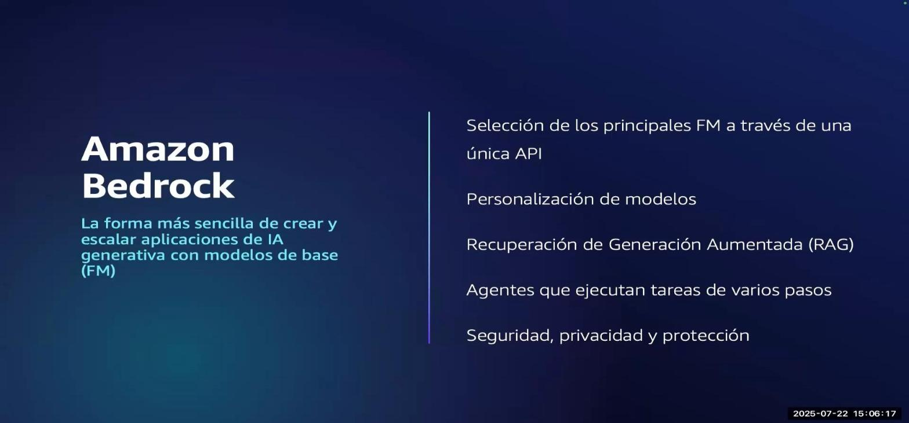
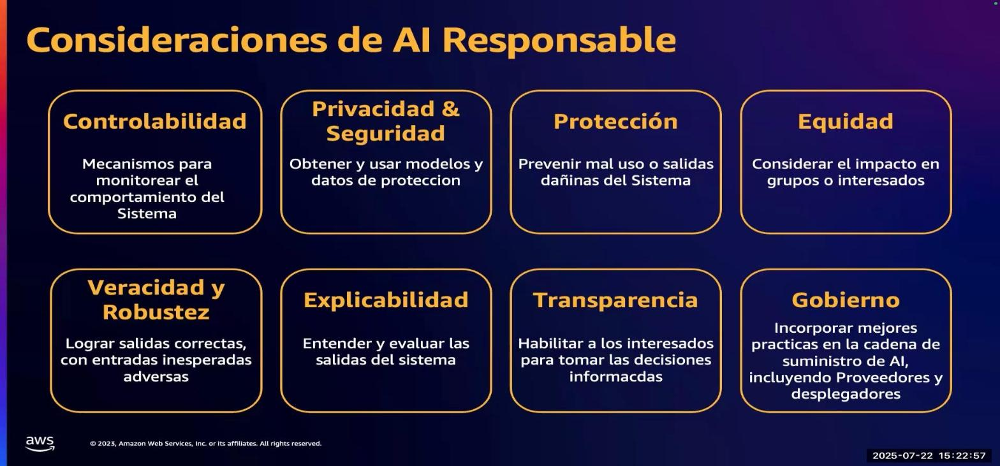
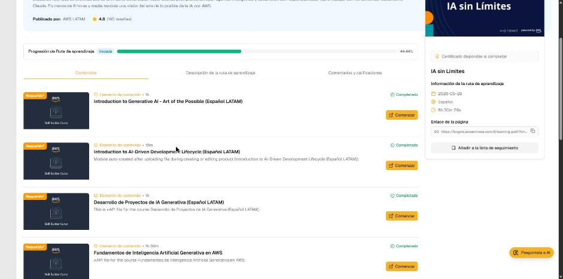

# 04 · Fundamentos de Inteligencia Artificial Generativa en AWS

Curso de AWS Skill Builder *Fundamentos de Inteligencia Artificial Generativa en AWS (Español LATAM)*, ruta «IA sin Límites». Es una sesión grabada de ~1 h 21 min con diapositivas. Recorre la evolución 2023 → 2024 (de pruebas de concepto a producción), los fundamentos de ML, los LLM y los embeddings, el stack de AWS y la IA responsable.

## Contexto: de la PoC a producción

- **2023, el año de las pruebas de concepto (PoC):** las preguntas eran del tipo *¿qué es la IA generativa?, ¿es segura?, ¿qué es un modelo fundacional?, ¿cómo escojo un modelo?*
- **2024, el año del paso a producción:** las preguntas cambian a *¿cómo bajo costos?, ¿cómo mido la calidad?, ¿cómo escalo?, ¿qué modelo uso?, ¿debo entrenar mi propio modelo?, ¿cómo manejo los riesgos?*
- **Buscar información vs. crear información:** índices invertidos, grafos de conocimiento y tablas sirven para **recuperar hechos almacenados**. Si la respuesta no está guardada («¿en qué país está California?» cuando solo existe el hecho de la capital), hace falta un modelo que **genere**.

!!! tip "Para recordar"
    - Los sistemas de búsqueda recuperan lo que existe; la IA generativa **crea contenido nuevo**.
    - El foco de la industria pasó de «probar» a **operar en producción**: costo, calidad, escala y riesgo.

## Fundamentos de machine learning

- **Definición de ML (Tom Mitchell, 1998):** un programa *aprende* de la experiencia **E** respecto a unas tareas **T** si su desempeño **P** en T mejora con E.
- **En esencia:** conjunto de datos → reconocer patrones → hacer predicciones sobre datos nuevos.
- **Crear un modelo:** por ejemplo, una regresión lineal `f(x) = w·x + b` (precio vs. tamaño de una casa). Se ajustan `w` y `b` para minimizar una **función de pérdida** (error cuadrático medio).
- **Redes neuronales:** el **perceptrón** es una neurona matemática (suma ponderada + sesgo + función de activación, `σ(⟨W,x⟩+b)`). Al apilar capas (entrada → ocultas → salida) se obtiene el *deep learning*.

*Figura: dónde se ubica la IA generativa (IA ⊃ ML ⊃ deep learning ⊃ IA generativa).*

!!! tip "Para recordar"
    - **IA** ⊃ **ML** (patrones en datos) ⊃ **DL** (redes neuronales multicapa) ⊃ **IA generativa** (modelos fundacionales preentrenados).
    - Entrenar = ajustar parámetros para **minimizar la pérdida**.
    - Pista para la prueba: el perceptrón es el bloque básico de las redes neuronales (pesos, sesgo y activación).

## Modelos fundacionales y LLM

*Figura: el ML tradicional entrena un modelo por tarea con datos etiquetados; un modelo fundacional se preentrena con datos sin etiquetar y luego se adapta a muchas tareas.*

- **Modelo fundacional (FM):** red de *deep learning* entrenada con **datos masivos sin etiquetar** sobre un espectro amplio de temas. Ciclo: obtener datos a escala (texto, imágenes, voz, datos estructurados, 3D) → **preentrenamiento** (puede tardar semanas o meses) → evaluación → **ajuste fino** para tareas específicas (puede tardar horas).
- **LM vs. LLM vs. FM:**
    - **LM:** modelo de lenguaje, normalmente con arquitectura *transformer* (ej. BERT).
    - **LLM:** un LM con muchos más parámetros, especializado en NLP.
    - **FM:** la generalización. No se limita a texto; también puede trabajar con audio, imágenes, etc. Los **LLM son un subconjunto de los FM**.
- **Cómo predicen los LLM:** estiman la probabilidad de la siguiente palabra según el contexto («Mi mamá me mima»). Durante el entrenamiento, si la predicción es incorrecta, se ajustan los parámetros y se vuelve a intentar.
- **Tokens:** unidades en que se parte el texto. Hay tres esquemas de tokenización: por **espacios**, por **diccionario** y **Byte-Pair Encoding (BPE)**, que divide por bytes y es común en idiomas como el chino. Cada token se convierte en un número.
- **Embeddings:** **vectores numéricos** que capturan la semántica y las relaciones entre palabras (o entre imágenes, documentos y audio). Palabras parecidas quedan cerca en el espacio vectorial, como coordenadas GPS cercanas. Los embeddings multilingües reconocen el mismo significado en varios idiomas. Pregunta abierta de la sesión: ¿dónde se almacenan esos vectores? (bases de datos vectoriales).
- **Limitaciones de los FM:** alucinaciones, **fecha de corte del conocimiento**, falta de referencia a la fuente, falta de certeza y que **no están hechos para tomar decisiones**.

!!! tip "Para recordar"
    - FM = preentrenado con datos **sin etiquetar** y adaptable a **muchas tareas**. LLM ⊂ FM.
    - Token → número → **embedding** (vector con significado). La similitud se mide por la **distancia** entre vectores.
    - Limitaciones: alucinación, corte de conocimiento, sin fuentes, sin certeza.
    - Pista para la prueba: «el modelo no conoce eventos recientes» = **recorte de conocimiento**. «Inventa datos plausibles» = **alucinación**.

## La IA generativa en AWS

**Stack de IA generativa (3 capas):**

1. **Infraestructura** para entrenar y hacer inferencia con FM: GPU, **AWS Trainium**, **AWS Inferentia**, **Amazon SageMaker**, UltraClusters, EFA, EC2 Capacity Blocks, Nitro, Neuron.
2. **Herramientas para construir con LLM y otros FM:** **Amazon Bedrock**.
3. **Aplicaciones que aprovechan los LLM:** **Amazon Q**.

- **Amazon SageMaker:** construir, entrenar y desplegar modelos de ML a escala, incluidos FM. Permite usar FM públicos recientes, desarrollar FM desde cero, personalizarlos, hacer inferencia y aplicar **FMOps** y gobernanza.

*Figura: Amazon Bedrock, la forma más sencilla de crear y escalar aplicaciones de IA generativa con modelos fundacionales.*

- **Amazon Bedrock:**
    - Acceso a varios FM con **una sola API**: AI21 Labs, Amazon, Anthropic, Cohere, Meta, Mistral y Stability AI.
    - Personalización de modelos, **RAG** (generación aumentada con recuperación) y **agentes** que ejecutan tareas de varios pasos.
    - **Agentes para Amazon Bedrock:** permiten que las apps generativas *actúen* en pocos clics. Descomponen y orquestan tareas, llaman API en nombre del usuario y consultan datos de la empresa de forma segura.
    - **Datos seguros y privados:** los datos del cliente **no se usan para entrenar** los modelos base, se cifran en tránsito y en reposo, permanecen en la Región y cumplen GDPR, SOC, ISO, CSA y HIPAA.
    - **Guardrails para Amazon Bedrock:** salvaguardas configurables según las políticas de IA responsable. Incluyen temas denegados descritos en lenguaje natural, filtros de contenido dañino y bloqueo o enmascaramiento de **PII** (también con regex).
- **Amazon Q:** reinventa el trabajo. **Q Business** (búsqueda en el conocimiento interno, resúmenes, creación de contenido), **Q in QuickSight** (entender datos, construir visuales, resúmenes ejecutivos, historias de datos), **Q Developer** (planificar, generar código, pruebas, escaneo de seguridad, migración y modernización), **Q in Connect** (asistencia al agente de contact center) y **Q in AWS Supply Chain**.

!!! tip "Para recordar"
    - Stack: **Infraestructura** (Trainium/Inferentia/SageMaker) → **Herramientas** (Bedrock) → **Aplicaciones** (Amazon Q).
    - **Bedrock** = FM de varios proveedores con una API + personalización + RAG + **Agentes** + **Guardrails**.
    - Pista para la prueba: en Bedrock, **tus datos no entrenan los modelos base** y no salen de la Región.
    - Pista para la prueba: bloquear temas, filtrar toxicidad y ocultar PII → **Guardrails para Amazon Bedrock**. Ejecutar tareas de varios pasos llamando API → **Agentes para Amazon Bedrock**.
    - Pista para la prueba: crear o personalizar FM desde cero con control total → **SageMaker**. Consumir FM listos por API → **Bedrock**.

## Riesgos de la IA generativa e IA responsable

- **Los FM son amplios y abiertos** (muchos casos de uso), a diferencia de los modelos tradicionales enfocados en un solo caso (ej. aprobar préstamos). Por eso es más difícil definir la *equidad*. Ejemplo: «El Dr. Hernández estudió los cuadros de pacientes…». ¿Qué pasa si cambio la profesión, el aspecto o el contexto en el prompt?
- **Riesgos emergentes:** **veracidad** (alucinaciones), **seguridad y toxicidad**, **propiedad intelectual** (ej. pedir «un gato al estilo Picasso») y **privacidad de los datos**. Mitigación: **guardrails** (ej. contra estereotipos).

*Figura: las ocho dimensiones de la IA responsable que usa AWS.*

- **Ocho dimensiones:** controlabilidad, privacidad y seguridad, protección (*safety*), equidad, veracidad y robustez, explicabilidad, transparencia y gobierno.
- **De la teoría a la práctica:** (1) definir claramente los casos de uso, (2) ajustar los procesos al riesgo, (3) tratar los conjuntos de datos como **especificaciones de producto** y (4) medir el desempeño **por cada conjunto de datos**.
- **Enfoque basado en riesgo:** no es lo mismo recomendar música que identificar un tumor en rayos X. El riesgo cambia los controles necesarios.
- **Responsabilidad compartida:**
    - **Proveedor del modelo (upstream):** anticipa la diversidad de casos de uso, evalúa el riesgo, construye datos como especificaciones y prueba con datos anticipados.
    - **Quien despliega la aplicación (downstream):** define con detalle su caso de uso, evalúa el riesgo, construye datos de evaluación de calidad y prueba la aplicación.
- **AI Service Cards de AWS:** documentan casos de uso, limitaciones y decisiones de diseño de cada servicio, por transparencia.
- **¿Dónde considerar la IA responsable?** En **todo el ciclo**: problema de negocio → formulación → adquisición de datos → elección del modelo → despliegue → ¿cumple el objetivo? → monitoreo continuo.

!!! tip "Para recordar"
    - Ocho dimensiones: **controlabilidad, privacidad y seguridad, protección, equidad, veracidad y robustez, explicabilidad, transparencia, gobierno**.
    - Los controles se ajustan **al riesgo del caso de uso**.
    - La responsabilidad es **compartida** entre el proveedor del modelo y quien despliega la app.
    - Pista para la prueba: «documentar casos de uso y limitaciones de un servicio» → **AI Service Cards** (transparencia).
    - Pista para la prueba: la IA responsable aplica en **cada etapa** del ciclo de vida, no solo al final.

---

## Evidencia

Curso marcado como **Completado** en la ruta el 2026-10-24 (progreso de la ruta: 44,44 %).

## Fuentes y aviso legal

- **Fuente:** ruta *IA sin Límites* de AWS Entrena Bogotá (cursos de AWS Skill Builder). Sitios oficiales: [bogota.awsentrena.com](https://bogota.awsentrena.com) · [skillbuilder.aws](https://skillbuilder.aws).
- **Uso:** apuntes personales de estudio, sin fines comerciales y con redacción propia. Las imágenes del curso son fragmentos breves citados con fines educativos; sus derechos son de sus titulares.
- **Sin afiliación:** sitio no oficial, no afiliado ni respaldado por AWS. Las marcas pertenecen a sus dueños.
- Más detalles y cómo pedir el retiro de contenido en el [aviso legal](../../aviso-legal.md).
