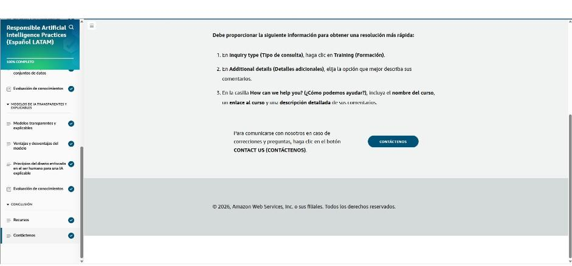

# 05 · Prácticas de inteligencia artificial responsable

Curso de AWS Skill Builder *Responsible Artificial Intelligence Practices (Español LATAM)*, ruta «IA sin Límites». Tiene tres secciones: qué es la IA responsable, cómo desarrollar sistemas responsables con AWS y modelos transparentes y centrados en las personas.

## Introducción

El curso define la IA responsable, los desafíos que busca resolver y sus dimensiones. Luego presenta los servicios de AWS que ayudan a aplicarla, cómo elegir modelos y preparar datos de forma responsable, la transparencia y explicabilidad de los modelos y el diseño centrado en las personas.

## IA responsable

- **Definición:** prácticas y principios para que los sistemas de IA sean **transparentes y confiables** y mitiguen riesgos y resultados negativos. Aplica en **todo el ciclo de vida**: diseño, desarrollo, implementación, supervisión y evaluación.
- **Una organización que opera IA de forma responsable** tiene un sistema transparente y auditable (con supervisión y vigilancia), un liderazgo que responde a la estrategia de IA responsable, equipos formados en sus principios y desarrollo según pautas de IA responsable.
- **Aplica a cualquier IA:**
    - **IA tradicional:** cada modelo hace **una tarea** (clasificación, sentimiento, imágenes) y se entrena con tus datos. Ej.: motores de recomendación, juegos, asistentes de voz.
    - **IA generativa:** se basa en **modelos fundacionales** preentrenados con datos masivos de dominio general. Hace **múltiples tareas** y genera contenido a partir de un *prompt*. Ej.: chatbots, generación de código, texto e imágenes.
- **Valor de negocio de la IA generativa:** **creatividad**, **productividad** y **conectividad** (nuevas formas de interactuar con clientes y entre organizaciones).

!!! tip "Para recordar"
    - La IA responsable no es exclusiva de la IA generativa; aplica también al **ML tradicional**.
    - Se considera **de principio a fin** del ciclo de vida, no solo al desplegar.
    - Pista para la prueba: IA tradicional = **una tarea por modelo**; IA generativa = **FM multitarea** guiado por prompts.

## Desafíos de la IA responsable en la IA tradicional

**Exactitud: sesgo y varianza**

| Concepto | Qué es | Síntoma |
|---|---|---|
| **Sesgo** (alto) | Diferencia grande entre lo predicho y el valor real; al modelo le faltan características importantes | **Subajuste** (*underfitting*): rinde mal incluso con los datos de entrenamiento |
| **Varianza** (alta) | Sensibilidad excesiva al ruido de los datos de entrenamiento | **Sobreajuste** (*overfitting*): muy bien en entrenamiento, mal con datos nuevos (memoriza) |
| **Equilibrio** | Sesgo bajo y varianza baja | Captura las características sin capturar el ruido |

**Cómo corregir sesgo y varianza:** validación cruzada (detecta el sobreajuste), más datos, **regularización** (penaliza pesos extremos), modelos más sencillos (contra el sobreajuste; si hay subajuste, el modelo puede ser demasiado simple), reducción de dimensiones (PCA) y **detener el entrenamiento antes** (*early stopping*).

**Desafíos propios de la IA generativa**

- **Toxicidad:** contenido ofensivo o inapropiado. Es difícil de definir y medir, y la frontera con la censura depende del contexto y la cultura.
- **Alucinaciones:** afirmaciones plausibles pero falsas. Ej.: inventar citas científicas o coautores que no existen, porque el modelo genera según la distribución de palabras y no busca fuentes.
- **Propiedad intelectual:** reproducción literal de datos de entrenamiento, o imitación de estilos (ej. «un gato en patineta al estilo de Andy Warhol»).
- **Plagio y trampa:** cuesta verificar si un contenido lo escribió una persona (educación, evaluaciones).
- **Alteración de la naturaleza del trabajo:** inquietud porque algunas profesiones cambien o sean reemplazadas.

!!! tip "Para recordar"
    - **Sesgo alto → subajuste**; **varianza alta → sobreajuste**. La meta es **sesgo bajo y varianza baja**.
    - Herramientas: validación cruzada, más datos, regularización, modelos más simples, PCA, *early stopping*.
    - Pista para la prueba: «funciona perfecto en entrenamiento y mal en producción» = **sobreajuste (alta varianza)**. Se detecta con **validación cruzada**.
    - Pista para la prueba: «el modelo inventa referencias bibliográficas» = **alucinación**.

## Dimensiones fundamentales de la IA responsable

Ninguna dimensión funciona sola; se superponen. Por ejemplo, la transparencia requiere explicabilidad, equidad y gobernanza.

| Dimensión | Idea clave |
|---|---|
| **Equidad** | Inclusión y no discriminación; sistemas beneficiosos para todas las personas |
| **Explicabilidad** | El modelo puede justificar sus decisiones de forma comprensible para humanos |
| **Privacidad y seguridad** | Privacidad: la persona controla si y cuándo se usan sus datos. Seguridad: nadie sin autorización accede a ellos |
| **Transparencia** | Comunicar procesos de desarrollo, capacidades y **limitaciones** para que se decida con información |
| **Veracidad y robustez** | Funcionar de forma confiable ante lo inesperado, la incertidumbre, los errores y los cambios en los datos |
| **Gobernanza** | Procesos para definir, implementar y **hacer cumplir** las prácticas (propiedad intelectual, leyes y regulación) |
| **Seguridad (*safety*)** | Evitar daños a personas y medio ambiente; prever sesgos, mal uso e impactos descontrolados |
| **Capacidad de control** | Supervisar y guiar el comportamiento del sistema para alinearlo con la intención y los valores humanos |

**Beneficios para el negocio:** más confianza y mejor reputación, conformidad normativa, mitigación de riesgos (legales y financieros), ventaja competitiva, mejores decisiones y mejores productos gracias a equipos diversos.

!!! tip "Para recordar"
    - Ocho dimensiones: **equidad, explicabilidad, privacidad y seguridad, transparencia, veracidad y robustez, gobernanza, safety, controlabilidad**.
    - Pista para la prueba: «entender **por qué** el modelo decidió algo» = **explicabilidad**; «informar capacidades y **limitaciones**» = **transparencia**.
    - Pista para la prueba: «resistir entradas inesperadas o cambios en la distribución de datos» = **robustez**; «políticas y cumplimiento normativo» = **gobernanza**.
    - Pista para la prueba: «el usuario decide si sus datos se usan» = **privacidad**; «nadie no autorizado accede» = **seguridad**.

## Evaluación de conocimientos 1

Resultado: **5/5 correctas**.

| Pregunta | Respuesta |
|---|---|
| ¿Qué describe mejor la IA responsable? | Estándares que mantienen prácticas responsables y **mitigan riesgos y resultados negativos** (no es exclusiva de la IA generativa) |
| ¿Cómo entrenar para no subajustar ni sobreajustar? | **Sesgo bajo y varianza baja** |
| Dos desafíos de la IA responsable | **Toxicidad** y **propiedad intelectual** |
| Procesos para definir, aplicar y hacer cumplir la normativa | **Gobernanza** |
| Saber cómo el modelo hizo su análisis (impacto en derechos humanos) | **Explicabilidad** |

!!! tip "Para recordar"
    - Pista para la prueba: «LLM», «aprendizaje no supervisado» o «riesgo empresarial» no son *desafíos* de la IA responsable. Toxicidad, alucinaciones, PI, plagio y sesgo sí lo son.

## Servicios y herramientas de Amazon para una IA responsable

**Amazon SageMaker AI** (servicio de ML totalmente administrado para crear, entrenar e implementar modelos) y **Amazon Bedrock** (FM vía API) traen herramientas integradas para la IA responsable:

| Necesidad | Herramienta |
|---|---|
| **Evaluar modelos fundacionales** | **Evaluación de modelos en Amazon Bedrock** y **SageMaker AI Clarify** (comparar FM según exactitud, robustez, toxicidad…) |
| **Salvaguardas para IA generativa** | **Barreras de protección (Guardrails) para Amazon Bedrock**: nivel de seguridad consistente, **bloquear temas no deseados**, **filtrar contenido dañino**, **redactar PII** |
| **Detectar sesgos** | **SageMaker AI Clarify**: se indican las características (ej. género, edad) y genera un informe visual con métricas de sesgo. **SageMaker Data Wrangler** permite **equilibrar** datos desbalanceados |
| **Explicar predicciones** | **SageMaker AI Clarify** (qué características pesaron en cada predicción) |
| **Supervisión y revisión humana** | **SageMaker Model Monitor** (calidad del modelo en producción) y **Amazon Augmented AI (A2I)** (revisión humana de predicciones) |
| **Gobernanza** | **SageMaker Role Manager** (permisos), **SageMaker Model Cards** (documentar el modelo), **SageMaker Model Dashboard** (vista central de los modelos) |
| **Transparencia** | **AWS AI Service Cards**: casos de uso previstos, limitaciones y buenas prácticas de cada servicio de IA de AWS |

!!! tip "Para recordar"
    - **Clarify** = sesgo + explicabilidad (y evaluación de FM). **Data Wrangler** = equilibrar datos.
    - **Guardrails** = temas denegados, filtros de contenido dañino y **redacción de PII** en Bedrock.
    - **Model Monitor** = vigilar el modelo en producción. **A2I** = revisión **humana**.
    - Gobernanza: **Role Manager, Model Cards, Model Dashboard**. Transparencia: **AI Service Cards**.
    - Pista para la prueba: «revisión humana de predicciones con baja confianza» → **Amazon A2I**. «Detectar sesgo por edad/género en el dataset» → **SageMaker Clarify**.

## Consideraciones responsables al seleccionar un modelo

- **Definir el caso de uso de forma restringida** (ej. una app que «persuade para comprar»): audiencia objetivo, posibles problemas, consecuencias y ajuste. Así el modelo se ajusta a un uso concreto.
- **Elegir por rendimiento.** Factores: nivel de personalización (de prompts a reentrenamiento completo), tamaño del modelo (parámetros), opciones de inferencia (autogestionada o API), **licencias** (algunas prohíben el uso comercial), **ventana de contexto** y **latencia**.
- **El rendimiento depende del modelo *y* del conjunto de datos de prueba.** Un modelo no es «bueno» o «malo» en abstracto, así que hay que evaluarlo con datos representativos del caso.
- **Sostenibilidad** (social, ambiental y económica a largo plazo):
    - **Agencia responsable:** alineación de valores, razonamiento responsable, **nivel adecuado de autonomía**, transparencia y rendición de cuentas.
    - **Medio ambiente:** consumo de energía, uso de recursos y evaluación del impacto ambiental. Conviene preferir modelos eficientes o reutilizar FM en vez de entrenar desde cero.
    - **Economía:** el costo frente al beneficio esperado.

!!! tip "Para recordar"
    - Caso de uso **acotado** → mejor ajuste y menos riesgo.
    - Criterios: personalización, tamaño, inferencia, **licencia**, **ventana de contexto**, **latencia**, costo y sostenibilidad.
    - Pista para la prueba: «el rendimiento es función del modelo **y** del dataset de prueba». Hay que evaluar con datos propios.
    - Pista para la prueba: en agentes, la «agencia responsable» incluye un **nivel de autonomía adecuado** y la rendición de cuentas.

## Preparación responsable de los conjuntos de datos

- **Datos equilibrados:** deben representar a todos los grupos con suficientes ejemplos de cada uno, para que el modelo no discrimine. Es crítico en **contratación, préstamos y justicia penal**. Herramientas: **SageMaker Clarify** (detectar el desbalance) y **SageMaker Data Wrangler** (equilibrar).
- **Prácticas:** recolección de datos **inclusiva y diversa**, selección cuidadosa de los datos, **preprocesamiento** (limpieza, normalización, quitar sesgos), **aumento de datos** para grupos subrepresentados y **auditorías periódicas**.
- Equilibrar **según el caso de uso previsto**: los datos deben parecerse a la población real sobre la que decidirá el modelo.

!!! tip "Para recordar"
    - Datos desbalanceados → modelo sesgado. **Detecta con Clarify, equilibra con Data Wrangler.**
    - Ciclo: recolección inclusiva → selección → preprocesamiento → aumento → **auditoría periódica**.
    - Pista para la prueba: generar más ejemplos sintéticos de un grupo subrepresentado = **aumento de datos**.

## Evaluación de conocimientos 2

Resultado: **6/6 correctas**.

| Pregunta | Respuesta |
|---|---|
| Mitigar sesgo en datos de préstamos y ver el comportamiento del modelo | **Amazon SageMaker AI Clarify** |
| Herramienta para saber cómo usar los servicios de IA de AWS de forma responsable | **Fichas de servicio de IA de AWS (AI Service Cards)** |
| Supervisión y revisión humana (dos) | **SageMaker Model Monitor** y **Amazon A2I** |
| Qué pedir al equipo para elegir el mejor modelo | **Definir el caso de uso de forma restringida** |
| Sesgo contra un grupo con pocas muestras | **Aumentar los datos** |
| Elegir entre muchos LLM y evitar contenido dañino en una app pública (dos) | **Evaluación de modelos en Amazon Bedrock** y **Guardrails (barreras de protección) para Amazon Bedrock** |

!!! tip "Para recordar"
    - Pista para la prueba: «pocas muestras de un grupo» → **aumento de datos**, no auditorías ni preprocesamiento.
    - Pista para la prueba: **elegir modelo** → *Model Evaluation* de Bedrock. **Bloquear contenido dañino** → *Guardrails*.

## Modelos transparentes y explicables

- **Transparencia = el CÓMO** decide el modelo. **Explicabilidad = el POR QUÉ** de cada resultado. Ambas generan confianza y rendición de cuentas (salud, seguridad, finanzas).
- **Frente a los modelos de caja negra:** más confianza, son más fáciles de depurar y mejorar, y se entienden mejor los datos y las decisiones.
- **Soluciones:** marcos de explicabilidad (ej. SHAP, LIME), documentación transparente, supervisión y auditoría, participación humana (*human-in-the-loop*), **explicaciones contrafácticas** («si X hubiera sido distinto, el resultado habría cambiado») y explicaciones en la interfaz de usuario.
- **Riesgos:** más complejidad y costo, vulnerabilidades que actores maliciosos pueden explotar y expectativas irreales de transparencia «perfecta».
- **Herramientas de AWS:**
    - Transparencia: **AI Service Cards** y **SageMaker Model Cards**.
    - Explicabilidad: **SageMaker Clarify** y **SageMaker Autopilot** (AutoML que también explica cómo llegó al modelo).

!!! tip "Para recordar"
    - **Transparencia → CÓMO; Explicabilidad → POR QUÉ.**
    - Transparencia en AWS: **AI Service Cards** y **Model Cards**. Explicabilidad: **Clarify** y **Autopilot**.
    - Pista para la prueba: «mostrar al usuario qué tendría que cambiar para obtener otro resultado» = **explicación contrafáctica**.

## Ventajas y desventajas del modelo

- **Interpretabilidad vs. explicabilidad:**
    - **Interpretabilidad:** un humano entiende la causa de una decisión mirando la **mecánica interna** del modelo (pesos, características). Es propia de modelos simples o transparentes, como la regresión lineal o los árboles de decisión.
    - **Explicabilidad:** se explica el comportamiento de un modelo complejo (caja negra) **en términos humanos** con métodos externos, sin entender del todo su interior.
- **Seguridad (*safety*) del modelo vs. transparencia:** la seguridad protege la información y evita daños; la transparencia la expone. Hay un equilibrio frágil en varios frentes:
    - **Exactitud:** los modelos complejos (grandes redes neuronales) suelen ser más precisos pero menos interpretables.
    - **Privacidad:** más transparencia puede exponer datos sensibles.
    - **Seguridad:** exponer el modelo abre vectores de ataque.
    - **Protección:** hay que evitar daños sin perder la capacidad de auditar.
- **Capacidad de control del modelo:** poder influir en el comportamiento del modelo cambiando entradas o datos. Un modelo más controlable suele ser más transparente.

!!! tip "Para recordar"
    - **Interpretabilidad** = ver *dentro* del modelo. **Explicabilidad** = explicar desde *fuera* un modelo complejo.
    - Más complejidad → más exactitud, pero **menos interpretabilidad**.
    - Pista para la prueba: si la regulación exige entender exactamente cómo se decide, conviene un **modelo interpretable** (más simple), aunque sea algo menos preciso.

## Principios del diseño centrado en el ser humano para una IA explicable

- **Diseño para una toma de decisiones amplificada:** apoya a las personas en entornos **de alta presión o estrés** para reducir errores. Aspectos: **claridad, simplicidad, usabilidad, reflexividad** (que la persona reflexione antes de decidir) y **rendición de cuentas**.
- **Diseño para decisiones imparciales:** reconocer y mitigar sesgos en el proceso de decisión. Aspectos: **transparencia, equidad y formación** de quienes deciden.
- **Diseño para el aprendizaje humano y de la IA:** que personas y sistema aprendan mutuamente. Aspectos: aprendizaje cognitivo, **personalización** y diseño centrado en el usuario.
- **RLHF (aprendizaje por refuerzo a partir de la retroalimentación humana):** usa la valoración humana de las respuestas como recompensa para alinear el modelo con lo que la gente prefiere.
- **Amazon SageMaker Ground Truth:** capacidades *human-in-the-loop* durante todo el ciclo de ML, incluida la **anotación de datos para RLHF**.

!!! tip "Para recordar"
    - Tres diseños: **amplificado** (presión y estrés), **imparcial** (sesgo) y **aprendizaje humano + IA**.
    - **RLHF** = alinear el modelo con preferencias humanas. **SageMaker Ground Truth** = retroalimentación y anotación humana (incluye RLHF).
    - Pista para la prueba: «reducir errores en entornos estresantes o de alta presión» → **diseño para la toma de decisiones amplificada**.

## Evaluación de conocimientos 3

Resultado: **5/5 correctas**.

| Pregunta | Respuesta |
|---|---|
| Ventajas de los modelos transparentes y explicables (dos) | **Más fáciles de depurar y optimizar** y **ayudan a generar confianza** |
| Servicio de AWS para que un modelo sea explicable (salud) | **Amazon SageMaker Autopilot** |
| Transparencia de un modelo propio (detalles del entrenamiento) | **Amazon SageMaker Model Cards** |
| ¿Qué es la interpretabilidad? | Transparencia que permite a un humano explicar el resultado **a partir de pesos y características** |
| Reducir errores en entornos estresantes | **Diseño para una toma de decisiones amplificada** |

!!! tip "Para recordar"
    - Pista para la prueba: los modelos transparentes **no** son más baratos ni menos complejos de desarrollar. Su ventaja es la confianza y la depuración.
    - Pista para la prueba: **Model Cards** documenta *tu* modelo; **AI Service Cards** documenta los *servicios de AWS*.

---

## Evidencia

Curso completado al **100 %** el 2026-10-24. Las tres evaluaciones de conocimientos se respondieron sin errores.

