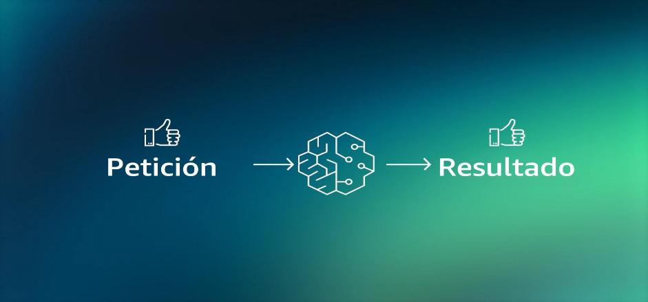
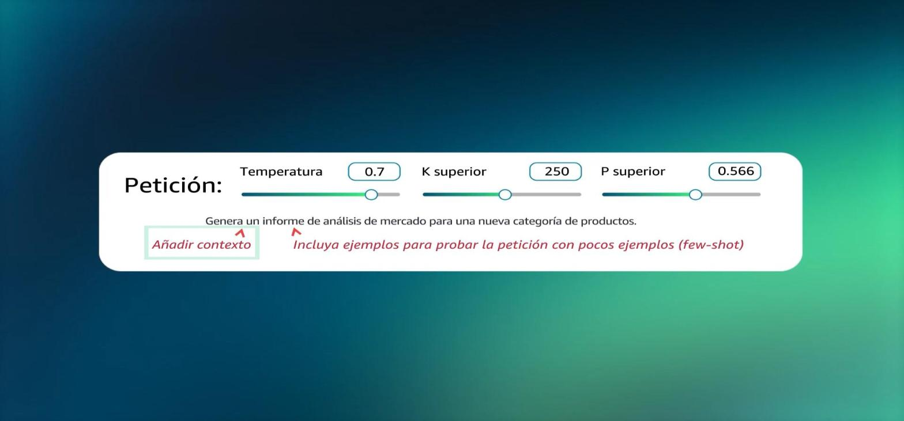
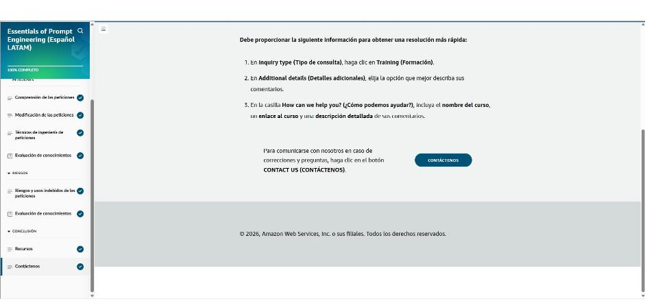

# 06 · Fundamentos de la ingeniería de peticiones (prompt engineering)

Curso de AWS Skill Builder *Essentials of Prompt Engineering (Español LATAM)*, ruta «IA sin Límites». Cubre cómo formular peticiones eficaces, ajustar los parámetros de inferencia, las técnicas *zero-shot*, *few-shot* y *chain-of-thought*, y los riesgos de uso indebido de las peticiones.

## Introducción

A medida que los modelos fundacionales son más capaces, **la calidad de la petición determina la calidad y exactitud del resultado**. El video del curso usa un ejemplo de negocio: pedir un informe de análisis de mercado para una nueva categoría de productos. Una petición vaga da un informe genérico. Al añadir contexto, ejemplos y parámetros, el resultado mejora.

*Figura: la petición es la entrada que guía al modelo fundacional hacia el resultado.*

!!! tip "Para recordar"
    - Mejor petición → mejor resultado, **sin reentrenar el modelo**.
    - La ingeniería de peticiones es la forma más rápida y barata de sacar provecho de un FM.

## Comprensión de las peticiones

Con buenas peticiones se pueden mejorar las capacidades del modelo y sus medidas de seguridad, darle conocimiento de dominio y herramientas externas **sin modificar sus parámetros**, y obtener salidas de mayor calidad.

**Elementos de una petición**

| Elemento | Qué es | Ejemplo (inventario) |
|---|---|---|
| **Instrucciones** | La tarea a realizar | «Dada la lista de pedidos y el inventario, determina qué pedidos se pueden atender y qué reabastecer» |
| **Contexto** | Información externa que orienta al modelo | «Es clave para la gestión de inventario en retail / e-commerce» |
| **Datos de entrada** | Aquello sobre lo que se responde | Lista de pedidos y existencias |
| **Indicador de salida** | Tipo o formato del resultado | «Estado de cumplimiento:» |

- **Petición negativa:** indicar lo que el modelo **no** debe generar (ej. evitar discurso de odio, contenido explícito o lenguaje sesgado).
- Una petición con solo instrucciones («Genera un informe de análisis de mercado…») y sin contexto, datos ni formato da un resultado genérico.

!!! tip "Para recordar"
    - Cuatro elementos: **instrucciones, contexto, datos de entrada, indicador de salida**.
    - Pista para la prueba: la **petición negativa** describe ejemplos o resultados **no deseados que el modelo debe evitar**.

## Modificación de las peticiones

**Parámetros de inferencia**

| Parámetro | Efecto |
|---|---|
| **Temperatura** (0–1) | Aleatoriedad. **Baja** (ej. 0,2) da respuestas conservadoras, repetitivas y probables. **Alta** (ej. 1,0) da respuestas diversas y creativas, pero menos coherentes |
| **Top-p** (0–1) | Limita las palabras candidatas a la **masa de probabilidad acumulada**. Con 0,25 solo entra el 25 % más probable (más enfocado); con 0,99 casi todo (más diverso) |
| **Top-k** | Limita las candidatas a las **k palabras más probables** |
| **Longitud máxima** | Tope de tokens generados; evita salidas excesivas o infinitas |
| **Secuencias de detención** | Tokens que hacen que el modelo deje de generar |

*Figura: ajuste de temperatura, top-k y top-p, más dos mejoras de la petición: añadir contexto e incluir ejemplos (few-shot).*

**Buenas prácticas:** peticiones claras y concisas; incluir contexto si hace falta; usar directivas para el tipo de respuesta («resume en 3 viñetas»); indicar el resultado esperado; empezar con una pregunta; dar un ejemplo de respuesta; **dividir tareas complejas**; experimentar; usar **plantillas de peticiones**.

*Ejemplo mejorado:* temperatura 0,9, top-p 0,999 y longitud máxima 5000, con un informe para pymes del sector financiero que tiene secciones definidas (resumen ejecutivo, sector, público objetivo, competencia, oportunidad y proyecciones) y un tono profesional.

!!! tip "Para recordar"
    - **Temperatura alta = más diversidad y creatividad**; baja = más determinista.
    - Top-p = probabilidad acumulada; top-k = número fijo de candidatas.
    - Pista para la prueba: «aumentar la temperatura» hace las respuestas **más diversas y menos deterministas**. **No** cambia su longitud.
    - Pista para la prueba: para limitar el tamaño de la respuesta se usa **longitud máxima** o **secuencias de detención**, no la temperatura.

## Técnicas de ingeniería de peticiones

| Técnica | Cómo funciona | Cuándo usarla |
|---|---|---|
| **Zero-shot** (sin ejemplos) | Se da la tarea sin ejemplos; el modelo usa su conocimiento general | Tareas simples o muy conocidas por el modelo |
| **Few-shot** (pocos ejemplos) | Se incluyen ejemplos de entrada y salida en la petición | Formato específico, clasificación con etiquetas propias |
| **Chain-of-thought (CoT)** | Se pide razonar en pasos intermedios («Piensa paso a paso») | Razonamiento, matemáticas, problemas de varios pasos |
| **CoT + zero-shot / CoT + few-shot** | Se combina el razonamiento paso a paso con o sin ejemplos | Problemas complejos donde los ejemplos de razonamiento ayudan |

!!! tip "Para recordar"
    - Zero-shot = sin ejemplos; **few-shot = con ejemplos**; **CoT = pasos intermedios**.
    - Pista para la prueba: problemas verbales matemáticos que hay que desglosar → **CoT combinado con few-shot**.
    - Pista para la prueba: un proceso largo (ej. declarar impuestos) se resuelve mejor **dividiéndolo en tareas más pequeñas** que con una sola petición gigante.

## Evaluación de conocimientos 1

Resultado: **4/4 correctas**. Las preguntas cubrieron: qué es una petición negativa, el efecto de subir la temperatura (más diversidad), dividir un proceso complejo en subtareas y CoT combinado con few-shot para problemas matemáticos.

## Riesgos y usos indebidos de las peticiones

| Riesgo | Qué es |
|---|---|
| **Envenenamiento** (*poisoning*) | Introducir datos maliciosos o sesgados en el **conjunto de entrenamiento** |
| **Secuestro e inyección de peticiones** (*prompt injection*) | Incrustar instrucciones dentro de la petición o del contenido para cambiar el comportamiento del modelo |
| **Exposición** | El modelo revela **datos sensibles de su entrenamiento** (ej. PII) durante la inferencia |
| **Filtración de peticiones** (*prompt leaking*) | Se divulgan las **peticiones o instrucciones** del sistema (aunque no contengan datos protegidos) |
| **Jailbreak** (desbloqueo) | Peticiones diseñadas para **eludir las restricciones** y salvaguardas del modelo |

!!! tip "Para recordar"
    - Envenenamiento = en el **entrenamiento**; inyección y secuestro = en la **petición**.
    - **Exposición** = salen datos del entrenamiento; **filtración** = salen las instrucciones del prompt.
    - Pista para la prueba: «el chatbot comparte PII de sus datos de entrenamiento» = **exposición**.
    - Pista para la prueba: «convencer al modelo de ignorar sus reglas» = **jailbreak**.

## Evaluación de conocimientos 2

Resultado: **1/1 correcta**. Un chatbot que comparte PII de sus datos de entrenamiento ilustra la **exposición**.

---

## Evidencia

Curso completado al **100 %** el 2026-10-25.

## Fuentes y aviso legal

- **Fuente:** ruta *IA sin Límites* de AWS Entrena Bogotá (cursos de AWS Skill Builder). Sitios oficiales: [bogota.awsentrena.com](https://bogota.awsentrena.com) · [skillbuilder.aws](https://skillbuilder.aws).
- **Uso:** apuntes personales de estudio, sin fines comerciales y con redacción propia. Las imágenes del curso son fragmentos breves citados con fines educativos; sus derechos son de sus titulares.
- **Sin afiliación:** sitio no oficial, no afiliado ni respaldado por AWS. Las marcas pertenecen a sus dueños.
- Más detalles y cómo pedir el retiro de contenido en el [aviso legal](../../aviso-legal.md).
