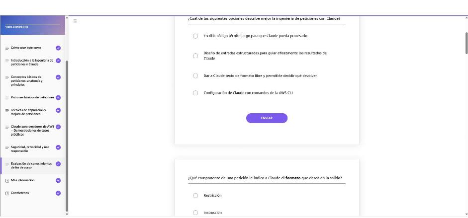
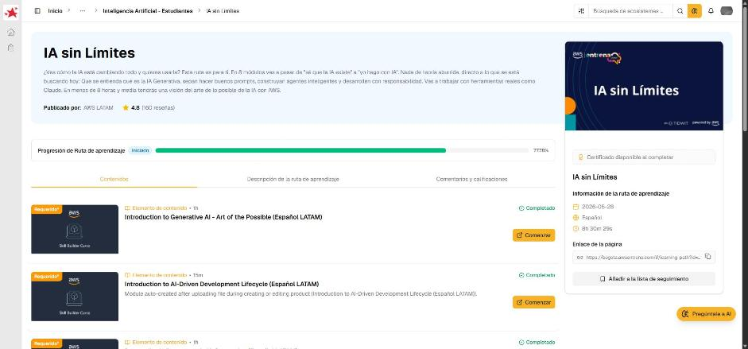

# 07 · Fundamentos de ingeniería de peticiones con Claude

Curso de AWS Skill Builder *Fundamentals of Prompt Engineering with Claude (Español LATAM)*, ruta «IA sin Límites». Es un curso autoguiado de unos 60 minutos para creadores de AWS. Enseña a guiar a **Claude** (el LLM de Anthropic, disponible en Amazon Bedrock) con peticiones estructuradas para tareas reales: políticas de IAM, comandos de CLI, resúmenes de documentación y plantillas de CloudFormation.

## Introducción a la ingeniería de peticiones y Claude

- **Ingeniería de peticiones:** escribir instrucciones efectivas para que un LLM dé resultados útiles, precisos y relevantes. No requiere código ni API, sino **palabras, estructura y contexto**. Esquema mental: petición = tu instrucción → Claude = tu asistente → resultado = depende de la claridad de la petición.
- La buena ingeniería de peticiones es **instructiva** (qué hacer), **orientada a objetivos** (qué tipo de salida), **estructurada** (contexto, restricciones y formato) e **iterativa** (se refina).
- **Claude:** familia de LLM de Anthropic para preguntas, resúmenes, código y análisis de imágenes. Se basa en **IA constitucional**, un conjunto de principios éticos y transparentes que guían su comportamiento.

| Fortalezas | Limitaciones |
|---|---|
| Sigue instrucciones de varios pasos («resume, formatea como YAML y comenta») | **No conoce tu entorno de AWS** ni tus recursos en tiempo real |
| Salidas estructuradas precisas (JSON, YAML, Markdown, tablas) | Necesita peticiones específicas; lo vago reduce la calidad |
| **Ventana de contexto larga** (logs, manuales, plantillas) | **No guarda memoria entre sesiones** |
| Explica bien servicios, comandos y arquitecturas | Puede generar contenido incorrecto o desactualizado |

!!! tip "Para recordar"
    - Prompt engineering = **diseñar entradas estructuradas** para guiar la salida.
    - Claude: contexto largo, salida estructurada e **IA constitucional**. No ve tu cuenta de AWS ni recuerda sesiones anteriores.
    - Pista para la prueba: si una opción dice que Claude «consulta tus recursos de AWS» o «recuerda la conversación de ayer», es falsa.

## Conceptos básicos de peticiones: anatomía y principios

**Anatomía de una petición**

| Componente | Ejemplo |
|---|---|
| **Instrucción** (verbo de acción directo) | «Genera una política de IAM que otorgue acceso de solo lectura a S3.» |
| **Contexto o entrada** | El bucket, el rol o el caso concreto |
| **Formato de salida** | «Responde en JSON válido con comentarios que expliquen cada declaración.» |
| **Restricciones / estilo** | «Usa privilegio mínimo y mantén la política en menos de 5 enunciados.» |

- **Claridad y especificidad:** las peticiones vagas («Háblame sobre EC2») dan respuestas genéricas. Hay que empezar con un **verbo de acción**, nombrar los servicios exactos, evitar referencias vagas y **acotar el alcance** («resume tipos de instancia, casos de uso y precios en viñetas, menos de 150 palabras»).
- **Conciencia de formato:** pedir JSON, YAML, Markdown, tablas, CSV, HTML, código o Bash da salidas **estructuradas, fáciles de leer y listas para usar** en el editor o el pipeline. Conviene limitar la verbosidad («solo el YAML, sin explicación») y refinar con preguntas de seguimiento.

!!! tip "Para recordar"
    - Anatomía: **instrucción + contexto + formato de salida + restricciones**.
    - El **formato** de salida se pide como parte de las **restricciones** de la petición.
    - Pista para la prueba: «Escribir una política de IAM para S3» es débil porque **carece de restricciones y alcance** (qué acceso, qué bucket, qué formato).
    - Pista para la prueba: el beneficio de pedir JSON/YAML es que la salida queda **estructurada y directamente utilizable**, no que sea más corta o libre de errores.

## Patrones básicos de peticiones

| Patrón | Idea | Ejemplo (AWS) |
|---|---|---|
| **Instrucción** | Directa y específica | «Escribe un manual para reiniciar una instancia EC2.» |
| **Zero-shot / few-shot** | Sin ejemplos / con ejemplos que fijan el estilo | «Ejemplo de política para EC2: {…}. Ahora crea una para solo lectura en S3.» |
| **Rol** (*role prompting*) | Asignar un personaje o perspectiva | «Actúa como arquitecto de soluciones de AWS y explica ALB vs. NLB.» |
| **Cadena de pensamiento** | Razonamiento paso a paso | «Sigue los pasos para diagnosticar una EC2 que no conecta por SSH.» |
| **Control de formato** | Fijar la estructura de salida | «Dame el manual como lista de verificación en Markdown.» |

!!! tip "Para recordar"
    - Cinco patrones: **instrucción, few-shot, rol, cadena de pensamiento, control de formato**.
    - Pista para la prueba: «Actúa como…» = **petición de rol**. «Explica paso a paso…» = **cadena de pensamiento**. Pegar un ejemplo previo = **few-shot**.
    - Pista para la prueba: CoT es más útil cuando necesitas que el modelo **explique su razonamiento paso a paso** (diagnóstico, troubleshooting).

## Técnicas de depuración y mejora de peticiones

- **Diagnóstico de peticiones débiles:** **entrada ambigua**, **objetivos poco claros** y **falta de restricciones**. Ej.: «Enumera servicios de AWS» frente a «Enumera los **cinco** servicios más usados, **una oración** cada uno, para un público **no técnico**».
- **Lista de verificación:** ¿la entrada es demasiado amplia? ¿el objetivo está claro? ¿hay restricciones? ¿hacen falta ejemplos? ¿otro creador de AWS entendería la petición al instante? Si alguna respuesta es «no», hay que refinar.
- **Bucle de iteración:** **Prueba** (ejecutar y revisar el resultado) → **Refinar** (añadir audiencia, formato, límites, ejemplo) → **Volver a solicitar**.
- **Antes / después:** «Escribe una política de IAM para S3» da acceso completo. La versión refinada especifica solo lectura, el bucket y JSON comentado. «Crear una VPC» pasa a ser una plantilla de CloudFormation en YAML con subredes y parámetros definidos.
- **Reproducibilidad:** ser explícito con el formato, usar lenguaje coherente, añadir restricciones, **guardar las peticiones que funcionan** (plantillas) y **verificar con la documentación de AWS**.

!!! tip "Para recordar"
    - Las tres causas de una petición débil: **ambigüedad, objetivo difuso, sin restricciones**.
    - Bucle: **Probar → Refinar → Volver a solicitar** (no «compilar» ni «implementar»).
    - Pista para la prueba: la petición que más probablemente da una plantilla de CloudFormation **utilizable** es la que pide YAML y nombra los recursos y parámetros, no «Crear una VPC».

## Claude para creadores de AWS – Demostraciones de casos prácticos

1. **Políticas de IAM con lenguaje natural:** describir el permiso y obtener JSON de privilegio mínimo.
2. **Explicar y convertir comandos de CLI:** ej. desglosar `aws ec2 run-instances --image-id … --count 1 --instance-type t2.micro` flag por flag, o convertirlo a otro formato.
3. **Resumir o redactar documentación de AWS** para distintos públicos.
4. **Generar plantillas de CloudFormation o fragmentos de Terraform.**

**Buenas prácticas:** anclar la petición en **contexto técnico** (servicio, recurso y región exactos), pedir formatos ejecutables, incluir **rol o audiencia**, añadir ejemplos si se necesita coherencia y **validar siempre la salida**.

!!! tip "Para recordar"
    - Usos típicos: **IAM, CLI, documentación, IaC (CloudFormation/Terraform)**.
    - Pista para la prueba: lo generado por Claude se **valida** antes de desplegarlo (documentación de AWS, pruebas, revisión de pares).

## Seguridad, privacidad y uso responsable

- **IA constitucional:** Claude busca ser **útil, honesto e inofensivo**. Evita salidas inseguras o maliciosas, razona con honestidad y ayuda dentro de límites seguros.
- **Modelo de seguridad en AWS:** las peticiones, respuestas y cargas de trabajo **permanecen en tu cuenta de AWS** salvo que las compartas. Claude **no accede** a tus recursos (EC2, S3, VPC, IAM); solo trabaja con el texto que le das. Se parece a un consultor que asesora con lo que le cuentas.
- **Nunca pegar** contraseñas, claves secretas ni PII de clientes en una petición.
- **Uso responsable:** revisar siempre el resultado, evitar depender en exceso de la automatización, mantener a un **humano en el proceso** y considerar la privacidad, la propiedad intelectual, la seguridad y el cumplimiento.

!!! tip "Para recordar"
    - IA constitucional = **útil, honesta, inofensiva**.
    - Tus datos se quedan en tu cuenta. Claude no ve tus recursos y **tú eres responsable** de validar.
    - Pista para la prueba: prácticas responsables = **revisar los resultados** y **validarlos con la documentación de AWS**. Pegar datos confidenciales o usar a Claude como autoridad final no lo son.

## Evaluación de conocimientos de fin de curso

Resultado: **10/10 correctas**. Las dos actividades de emparejamiento también quedaron completas: peticiones vagas con sus versiones mejoradas (4/4) y estilos de petición con su patrón (10/10).

| Tema de la pregunta | Respuesta |
|---|---|
| Qué es la ingeniería de peticiones con Claude | Diseñar **entradas estructuradas** para guiar sus resultados |
| Componente que indica el formato de salida | **Restricción** |
| Dos ejemplos de estímulo de rol | «Actúa como arquitecto de soluciones…» y «Actúa como instructor…» |
| Cuándo usar CoT | Cuando necesitas que **explique su razonamiento paso a paso** |
| Por qué «Escribir una política de IAM para S3» es débil | **Carece de restricciones y alcance** |
| Pasos del bucle de iteración (tres) | **Prueba, Refinar, Volver a solicitar** |
| Petición para una plantilla de CloudFormation utilizable | La que pide **CloudFormation en YAML** con detalles |
| Beneficio de pedir JSON/YAML | Salida **estructurada y directamente utilizable** |
| Prácticas responsables (dos) | **Revisar** los resultados y **validar** con la documentación de AWS |
| Propósito de la IA constitucional | Que Claude sea **útil, honesto e inofensivo** |

---

## Evidencia

Curso completado al **100 %** el 2026-10-25. La ruta «IA sin Límites» quedó en **77,78 %**.

## Fuentes y aviso legal

- **Fuente:** ruta *IA sin Límites* de AWS Entrena Bogotá (cursos de AWS Skill Builder). Sitios oficiales: [bogota.awsentrena.com](https://bogota.awsentrena.com) · [skillbuilder.aws](https://skillbuilder.aws).
- **Uso:** apuntes personales de estudio, sin fines comerciales y con redacción propia. Las imágenes del curso son fragmentos breves citados con fines educativos; sus derechos son de sus titulares.
- **Sin afiliación:** sitio no oficial, no afiliado ni respaldado por AWS. Las marcas pertenecen a sus dueños.
- Más detalles y cómo pedir el retiro de contenido en el [aviso legal](../../aviso-legal.md).
