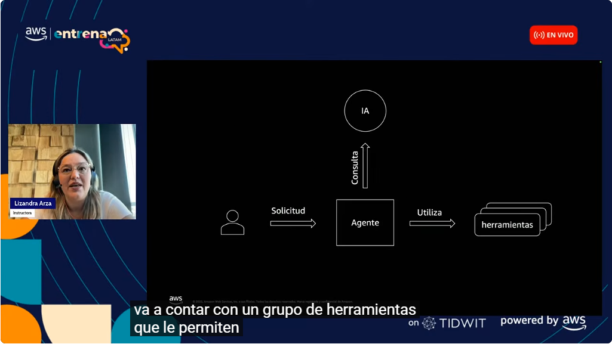
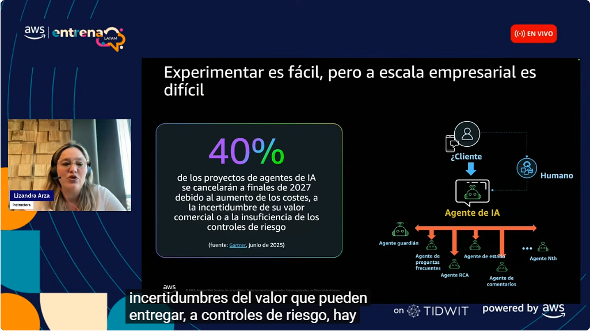
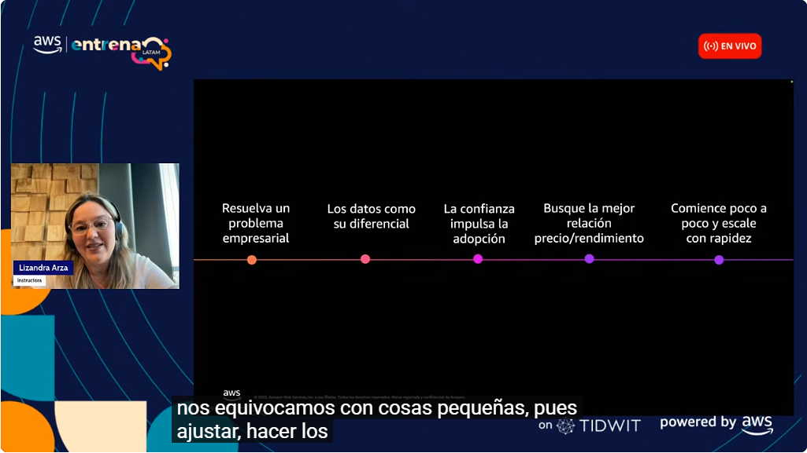

# 08 · Taller: La era de los agentes de IA

Grabación del webinar *«La Era de los Agentes de IA: qué son y por qué empezar a usarlos ahora»* (AWS Entrena LATAM, sesiones en vivo, 26-feb-2026, ~1 h). Lo dictó Lizandra Arza Pérez, Customer Solutions Manager de AWS para el sur de Latinoamérica. Forma parte de la ruta «IA sin Límites».

## ¿Qué es un agente de IA?

- Un modelo generativo **responde**; un agente **actúa**. Va más allá de contestar una necesidad puntual: interpreta la solicitud, decide los pasos y **ejecuta tareas** usando herramientas.
- **Flujo:** la persona hace una **solicitud** → el **agente** consulta al **modelo de IA** para interpretarla y planear → **utiliza herramientas** (API, sistemas, bases de datos) → devuelve el resultado. Ejemplo: un agente de pedidos con herramientas para *crear*, *obtener* y *cancelar* pedidos, que al final avisa «tu pedido 12345 se canceló correctamente».

*Figura: solicitud → agente → consulta a la IA → uso de herramientas.*

- **Demostraciones de la sesión:** Amazon Bedrock *playground* (chat con Claude), **Rufus** (asistente de compras de Amazon con más de 250 millones de clientes; quienes lo usan tienen un 60 % más de probabilidad de completar una compra), **Amazon Nova Act** (agente que navega la web y ejecuta pasos, como encontrar el precio de un producto), un agente que arma una presentación de PowerPoint, un flujo que redacta y envía un correo con noticias de AWS, y el IDE **Kiro** para desarrollar con agentes.

!!! tip "Para recordar"
    - Agente = **modelo + herramientas + capacidad de actuar** de forma autónoma sobre varios pasos.
    - El modelo «piensa» y el agente **orquesta y ejecuta** con herramientas.
    - Pista para la prueba: si la pregunta habla de **ejecutar acciones** (crear o cancelar pedidos, llamar API), la respuesta va por **agentes**, no por un chatbot que solo responde.

## Por qué ahora: adopción y casos

- Según la tendencia citada (Gartner), hacia 2028 cerca del **15 % de las decisiones laborales diarias** se tomarán de forma autónoma mediante agentes. Las empresas están **duplicando** su número de agentes.
- **Caso Toyota:** modernización de mainframe **50 veces más rápida** y **90 % menos** tiempo de extracción de conocimiento (de meses a horas) con apoyo de agentes.

## Experimentar es fácil, escalar es difícil

*Figura: la mayoría de proyectos se frena al escalar. En empresa se combinan varios agentes especializados (guardián, FAQ, estado, RCA, comentarios…) con supervisión humana.*

- Se estima que el **40 % de los proyectos de agentes** se cancelará hacia 2027 por **costos**, **valor de negocio incierto** o **controles de riesgo insuficientes**.
- La arquitectura empresarial típica es un **agente orquestador** con **agentes especializados** y un **humano en el ciclo**.

## Recomendaciones para empezar

*Figura: cinco principios para adoptar agentes con éxito.*

1. **Resuelva un problema empresarial** real; no se trata de construir agentes por moda.
2. **Los datos son su diferencial**: el valor sale de la información propia del negocio.
3. **La confianza impulsa la adopción**: seguridad, controles y transparencia.
4. **Busque la mejor relación precio/rendimiento** (elegir el modelo adecuado y no el más grande).
5. **Comience poco a poco y escale con rapidez**: equivocarse en pequeño es barato.

Cierre de la sesión: lo más importante de la IA no es solo automatizar, sino **deleitar a los clientes** de formas nuevas. También se mencionaron los cursos gratuitos de AWS Entrena LATAM y herramientas como Amazon Quick Suite para crear flujos.

!!! tip "Para recordar"
    - Riesgos al escalar: **costo, valor incierto, controles de riesgo**.
    - Cinco principios: **problema de negocio, datos propios, confianza, precio/rendimiento, empezar pequeño**.
    - Pista para la prueba: «¿por dónde empezar con agentes?» → por un **caso de negocio concreto y acotado**, midiendo valor, y luego escalar.
    - Pista para la prueba: la supervisión humana y los agentes «guardián» son parte del diseño en empresa, no un extra.

---

## Evidencia

Grabación revisada y actividad marcada como completada en la ruta el 2026-10-25.

## Fuentes y aviso legal

- **Fuente:** ruta *IA sin Límites* de AWS Entrena Bogotá (cursos de AWS Skill Builder). Sitios oficiales: [bogota.awsentrena.com](https://bogota.awsentrena.com) · [skillbuilder.aws](https://skillbuilder.aws).
- **Uso:** apuntes personales de estudio, sin fines comerciales y con redacción propia. Las imágenes del curso son fragmentos breves citados con fines educativos; sus derechos son de sus titulares.
- **Sin afiliación:** sitio no oficial, no afiliado ni respaldado por AWS. Las marcas pertenecen a sus dueños.
- Más detalles y cómo pedir el retiro de contenido en el [aviso legal](../../aviso-legal.md).
