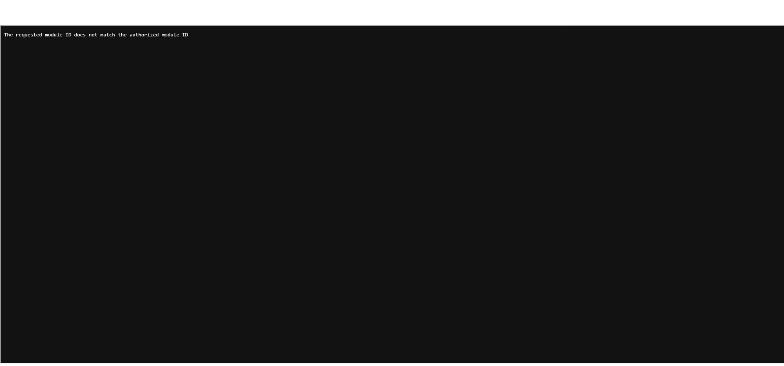

# AWS Entrena Bogotá · Ruta «IA sin Límites»

Apuntes de la formación gratuita de **AWS Entrena Bogotá** (plataforma bogota.awsentrena.com, cursos servidos desde AWS Skill Builder). Llegué por la invitación a la hackatón AWS («Agentes de IA para todos»), con plazo hasta el **miércoles 28 de octubre de 2026**.

!!! note "Ruta en la plataforma"
    En «Mis actividades» el curso inicial aparece dentro de la ruta **«IA sin Límites»** (AWS LATAM, 8 módulos, ~8 h 30 min). La búsqueda del catálogo no devolvió ninguna ruta llamada «Agentes de IA para todos». Estos apuntes siguen el orden de «IA sin Límites».

## Progreso

| # | Curso | Duración | Estado | Fecha | Apuntes |
|---|---|---|---|---|---|
| 1 | Introduction to Generative AI – Art of the Possible (Español LATAM) | 1 h | ✅ Completado (100 %) | 2026-10-24 | [Ver apuntes](01-intro-ia-generativa.md) |
| 2 | Introduction to AI-Driven Development Lifecycle (Español LATAM) | 15 min | ⛔ Bloqueado: el reproductor no carga | — | — |
| 3 | Desarrollo de Proyectos de IA Generativa (Español LATAM) | 1 h | ⛔ Bloqueado: el reproductor no carga | — | — |
| 4 | Fundamentos de Inteligencia Artificial Generativa en AWS | 1 h 30 min | ⛔ Bloqueado: el reproductor no carga | — | — |
| 5 | Responsible Artificial Intelligence Practices (Español LATAM) | 1 h | Pendiente | — | — |
| 6 | Essentials of Prompt Engineering (Español LATAM) | 1 h | Pendiente | — | — |
| 7 | Fundamentals of Prompt Engineering with Claude (Español LATAM) | 1 h | Pendiente | — | — |
| 8 | Taller en vivo: Agentes de IA – Lizandra Arza Pérez (evento) | 1 h | Pendiente | — | — |
| 9 | Prueba Conocimientos – IA Sin Límites (evaluación) | 45 min | Pendiente | — | — |

Progreso de la ruta en la plataforma: **11,11 %**.

!!! warning "Incidencia 2026-10-24"
    Desde la ruta, los cursos 2, 3 y 4 abren el reproductor de Skill Builder con el mensaje *"The requested module ID does not match the authorized module ID"*. Es probable que la sesión del reproductor siga atada al curso 1. Hay que reintentar con una sesión nueva o reportarlo a soporte. Además, la plataforma tiene mantenimiento programado del 24-10-2026 a las 23:00 al 25-10-2026 a la 01:00 (hora de Colombia).

    
