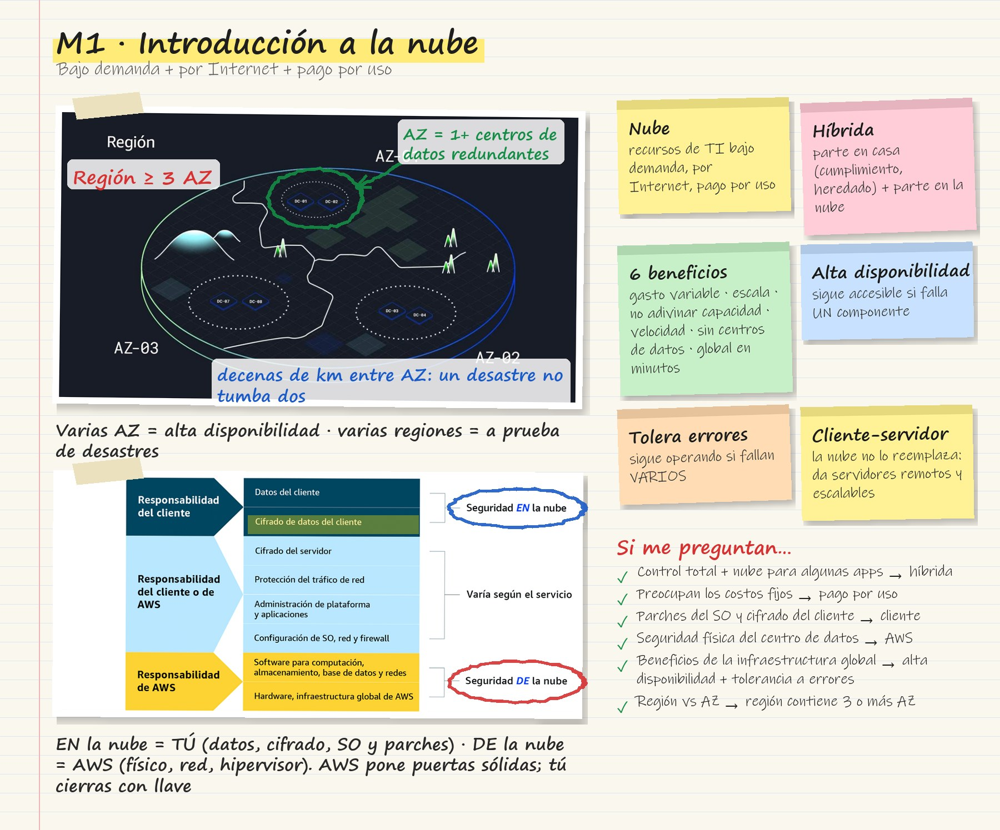
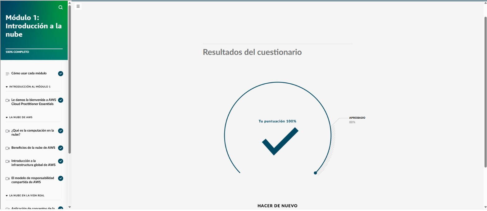

# Módulo 1 · Introducción a la nube

Curso *AWS Cloud Practitioner Essentials (Español LATAM)* de AWS Skill Builder. Lo dictan Anabel Montero, César Mendoza y Aldo Zúñiga, con la analogía de una **cafetería** que se repite en todo el curso. Ruta de AWS Entrena Bogotá.

## Tarjeta de estudio

*Repaso rápido: la imagen del curso rayada con lo esencial y las pistas para el examen.*

## Modelo cliente-servidor

- El **cliente** (el consumidor) hace una solicitud. El **servidor** (el barista) la valida y responde con lo pedido. En AWS, el barista sería un **servidor virtual**.
- La computación en la nube **no reemplaza** este modelo: funciona dentro de él, ofreciendo servidores remotos y escalables a los que se accede por Internet.
- **Pagar solo por lo que se usa:** a los baristas se les paga solo por las horas que trabajan. Contratar 10 baristas para todo el día por un lanzamiento deja gente ociosa en las horas flojas, que es justo lo que pasa en un centro de datos propio. En AWS se aprovisiona cuando se necesita y se desaprovisiona apenas sobra, y en ese momento se deja de pagar.

## ¿Qué es la computación en la nube?

- **Historia:** Amazon.com estandarizó herramientas para escalar su propio sitio. En 2003 vio que eso le servía a otras empresas.
  - **2004:** primer servicio público, **Amazon SQS**.
  - **2006:** **Amazon S3** y **Amazon EC2**.
  - Hoy AWS tiene más de 300 servicios y millones de clientes.
- **Definición:** la computación en la nube es la **entrega bajo demanda de recursos de TI a través de Internet con precios de pago por uso**.

| Parte de la definición | Significado |
|---|---|
| **Bajo demanda** | Recursos en segundos, cuando se necesitan; se escalan sin procesos largos de aprovisionamiento |
| **Recursos de TI** | Servidores, almacenamiento, bases de datos, redes, IA/ML… |
| **A través de Internet** | Acceso remoto desde cualquier lugar, sin mantener hardware propio |
| **Pago por uso** | Se paga lo consumido, sin contratos fijos a largo plazo |

### Tipos de implementación

| Tipo | Cuándo se usa |
|---|---|
| **Nube** | Todo en la nube: migrar lo existente, crear aplicaciones nuevas o ambas |
| **En las instalaciones** (*on-premises*) | Virtualización en centro de datos propio. Casi no da los beneficios de la nube, pero ofrece recursos dedicados y baja latencia |
| **Híbrida** | Nube e instalaciones propias conectadas. Útil cuando sistemas heredados o regulados deben quedarse en casa. Las implementaciones **multinube** también cuentan como híbridas |

*Ejemplo:* una organización con datos que por cumplimiento no pueden salir del país, pero que necesita escalar en temporada alta, usa una implementación **híbrida**.

## Los seis beneficios de la nube de AWS

1. **Gastos variables en lugar de gastos fijos** (inversión inicial). Las facturas cambian según el consumo y se puede empezar pequeño.
2. **Economías de escala masivas.** AWS compra hardware en volumen y traslada el menor costo a los clientes.
3. **Dejar de adivinar la capacidad.** Si se calcula hardware para 10 millones de usuarios y llegan 500 000, se desperdicia; si se subestima, se pierden clientes. En la nube se escala en minutos.
4. **Más velocidad y agilidad.** Se crean entornos de prueba, se experimenta y se borra lo que no funcionó.
5. **Dejar de gastar en operar y mantener centros de datos.** Menos tiempo en montar y alimentar servidores; más tiempo para los clientes.
6. **Global en minutos.** Expandirse, por ejemplo de EE. UU. a India, usando una región de AWS en lugar de construir un centro de datos.

## Infraestructura global

- **Alta disponibilidad:** la aplicación sigue accesible aunque falle un componente.
  - Analogía: si se derrama un latte sobre la caja y una tienda cierra, la cadena tiene otras sucursales a pocas cuadras.
- **Tolerancia a errores:** el sistema sigue operando aunque fallen **varios** componentes; hay resiliencia en cada capa.
- **Región:** ubicación física con grupos de centros de datos. Ejemplos: Querétaro, São Paulo, Virginia, Tokio, España. Cada región tiene **mínimo tres zonas de disponibilidad**.
- **Zona de disponibilidad (AZ):** uno o más centros de datos con energía, red y conectividad redundantes. Las AZ están separadas por decenas de kilómetros: suficiente para que un desastre no afecte a varias, pero con latencia despreciable entre ellas.
- **Buena práctica:** distribuir los recursos en **varias AZ**. Para estar a prueba de desastres, también en **varias regiones**.

## Modelo de responsabilidad compartida

- **AWS = seguridad *de* la nube:**
  - capa física (hardware, instalaciones);
  - red;
  - hipervisor (virtualización).
- **Cliente = seguridad *en* la nube:**
  - **sus datos** y quién accede a ellos;
  - **cifrado del lado del cliente**;
  - sistema operativo y parches;
  - aplicaciones.
- AWS **no tiene acceso** al sistema operativo del cliente. Si descubre una vulnerabilidad puede avisar, pero no aplicar el parche.
- **Analogía:** el constructor hace paredes y puertas sólidas; el dueño cierra la puerta con llave.
- **Responsabilidades que varían según el servicio:**
  - cifrado del lado del servidor;
  - protección del tráfico de red;
  - administración de la plataforma y las aplicaciones;
  - configuración del SO, la red y el *firewall*.

## La nube en la vida real

Una tienda en línea de Seattle quiere clientes en Europa y Asia:

- Despliega en **eu-west-1 (Irlanda)** y en Singapur, más cerca de los usuarios, lo que reduce la latencia.
- Usa **dos AZ** en cada región para tener alta disponibilidad y tolerancia a errores.
- No se ocupa de la seguridad física de esos centros de datos. Se concentra en proteger y cifrar sus datos y en cumplir normas como las de tarjetas de crédito.

!!! tip "Para recordar"
    - Definición exacta: **entrega bajo demanda de recursos de TI por Internet con pago por uso**.
    - Híbrida = parte en casa (cumplimiento, sistemas heredados) y parte en la nube (escalado).
    - Región ≥ **3 AZ**; AZ = **1 o más centros de datos** redundantes.
    - Beneficios de la infraestructura global: **alta disponibilidad** y **tolerancia a errores**.
    - Parches del SO y cifrado del cliente → **cliente**. Seguridad física y hardware → **AWS**.

## Evaluación del módulo

Resultado: **100 %** (se aprueba con 80 %).

??? note "Preguntas y respuestas correctas"

    **1.** Usted es un desarrollador de software que trabaja para una empresa que planea migrar su aplicación actual a la nube. Su líder le pidió que explique al resto del equipo el modelo cliente-servidor y cómo se integra la computación en nube en este modelo. ¿Qué enunciado describe MEJOR el modelo cliente-servidor y su relación con la computación en la nube?

    ✔ En el modelo cliente-servidor, el cliente envía solicitudes al servidor, que las procesa y envía respuestas. La computación en la nube proporciona recursos de servidor escalables a los que se puede acceder a través de internet.

    **2.** Una pequeña empresa está considerando migrar su infraestructura de TI a la nube. El equipo de finanzas tiene una reunión con el departamento de TI para analizar los costos asociados con esta transición. Durante la reunión, el gerente financiero dice que le gusta la idea de la fiabilidad que ofrece la nube, pero que le preocupan los costos fijos. ¿Qué enunciado define con precisión el modelo de computación en la nube y aborda la preocupación del gerente financiero?

    ✔ La computación en la nube es un modelo para entregar recursos de TI a través de internet. Las empresas pueden alquilar los servicios con un modelo de pago por uso, lo que puede ayudar a reducir los costos fijos y permitir presupuestos más flexibles.

    **3.** Una agencia gubernamental desea mantener un control total sobre su infraestructura de TI, pero planea usar los servicios de la nube de AWS para aplicaciones específicas. ¿Qué tipo de implementación es MEJOR para esta situación?

    ✔ Híbrida

    **4.** Una gran empresa busca reducir los costos operativos. Quiere reducir la sobrecarga operativa asociada con la administración de su propia infraestructura física. ¿Qué opción describe MEJOR las ventajas de la nube de las que puede beneficiarse esta empresa?

    ✔ Dejar de gastar dinero en la ejecución y el mantenimiento de centros de datos

    **5.** Usted trabaja para una empresa de ropa deportiva que está expandiendo sus operaciones a clientes de todo el mundo. La empresa quiere implementar recursos en varias ubicaciones de AWS para lograr una alta disponibilidad. Se le asignó la tarea de explicar los aspectos básicos de la infraestructura global de AWS a su director de operaciones (chief operating officer, COO). El COO necesita ayuda para comprender la diferencia entre las regiones y las zonas de disponibilidad de AWS. ¿Qué enunciado describe MEJOR la diferencia entre las regiones y las zonas de disponibilidad de AWS?

    ✔ Una región es una ubicación geográfica que contiene tres o más zonas de disponibilidad. Una zona de disponibilidad es una ubicación distinta dentro de una región que contiene uno o más centros de datos independientes.

    **6.** Su empresa tiene previsto lanzar una nueva aplicación web que ofrecerá servicios a usuarios de todo el mundo. Para garantizar que la aplicación funcione correctamente y siga siendo fiable, el equipo de TI tiene previsto utilizar AWS para su amplia infraestructura global. ¿Qué opciones describen MEJOR los beneficios de la infraestructura global de AWS en relación con esta situación? (Seleccione DOS opciones).

    ✔ Alta disponibilidad · Tolerancia a errores

    **7.** Una empresa financiera está interesada en migrar a la nube. Les interesa saber si contarán con suficiente personal para proteger tanto su espacio de oficina como la infraestructura física de sus recursos de computación en la nube. ¿Qué enunciado describe MEJOR la responsabilidad de la empresa en lo que respecta a la protección de la infraestructura física de la nube?

    ✔ AWS es responsable de proteger la infraestructura física, mientras que la empresa debe centrarse en proteger sus datos y aplicaciones en la nube.

    **8.** Usted es un arquitecto de nube en una empresa que migró recientemente su infraestructura a AWS. Su gerente le pidió que informe a su equipo sobre las responsabilidades que tiene el cliente en lo que respecta a la protección de los recursos en la nube. ¿Qué responsabilidad tiene el cliente según el modelo de responsabilidad compartida de AWS? (Seleccione DOS opciones).

    ✔ Administración de parches del sistema operativo (SO) · Cifrado de datos del cliente

## Fuentes y aviso legal

- **Fuente:** curso *AWS Cloud Practitioner Essentials* (AWS Skill Builder), ofrecido en AWS Entrena Bogotá. Sitios oficiales: [skillbuilder.aws](https://skillbuilder.aws) · [bogota.awsentrena.com](https://bogota.awsentrena.com) · [docs.aws.amazon.com](https://docs.aws.amazon.com).
- **Uso:** apuntes personales de estudio, sin fines comerciales y con redacción propia. Las imágenes del curso son fragmentos breves citados con fines educativos; sus derechos son de sus titulares.
- **Sin afiliación:** sitio no oficial, no afiliado ni respaldado por AWS. Las marcas pertenecen a sus dueños.
- Más detalles y cómo pedir el retiro de contenido en el [aviso legal](../../aviso-legal.md).
