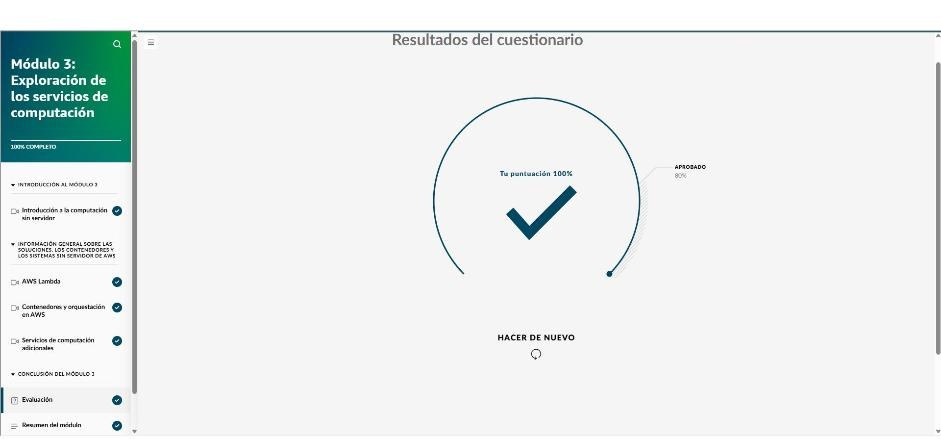

# Módulo 3 · Exploración de los servicios de computación

*AWS Cloud Practitioner Essentials*, módulo 3: servicios no administrados, administrados y sin servidor; Lambda, contenedores y servicios de computación especializados.

## No administrado, administrado y sin servidor

| Modelo | Ejemplo | Qué hace el cliente | En la cafetería |
|---|---|---|---|
| **No administrado** | Amazon EC2 | SO, parches, escalado, red y aplicaciones | Máquina de expreso de alta gama: control total y todo el mantenimiento |
| **Administrado** | ELB, SNS, SQS | Configura el servicio; AWS lo mantiene funcionando | Cafetera de cápsulas: comodidad |
| **Sin servidor (*serverless*)** | AWS Lambda, Fargate | Solo el **código** y sus permisos de acceso a datos | Comprar el café sin saber qué máquina se usó |

Sin servidor quiere decir que **no se ve ni se accede** a la infraestructura. AWS se encarga del aprovisionamiento, el escalado, la alta disponibilidad y el mantenimiento.

## AWS Lambda

- Ejecuta código **en respuesta a eventos**, sin aprovisionar servidores.
- **Escala solo**, sea un disparador o mil, y es altamente disponible. AWS aplica los parches.
- **Cobro por milisegundo** de ejecución. El precio depende de la **memoria** asignada.
- **Duración máxima: 15 minutos** por invocación. Es ideal para procesos rápidos basados en eventos.
- **Componentes:**
  - **función**: el código;
  - **desencadenador**: S3, SQS, HTTP, una app…;
  - **tiempo de ejecución**: Java, Python, Node.js o uno personalizado.
- **Flujo:** cargar el código → configurar el desencadenador → se ejecuta con cada evento → se paga el tiempo usado.
- **Casos:** cambiar el tamaño y filtrar las fotos que se suben, personalizar noticias, procesar eventos de un videojuego en tiempo real.
- **Demo:** una cola **SQS** de pedidos (los mensajes se guardan **hasta 14 días**) que dispara una función «barista». La función necesita un **rol** con permisos para leer SQS y escribir en **CloudWatch Logs**.

## Contenedores

- Un contenedor **empaqueta** el código, el tiempo de ejecución, las dependencias y la configuración en una unidad portátil. Así se acaba el «en mi computador sí funciona».
- **Contenedor frente a máquina virtual:** el contenedor comparte el SO del host, así que es más liviano y arranca más rápido. La máquina virtual lleva un SO completo sobre un hipervisor.
- **Orquestación:** con cientos o miles de contenedores hace falta automatizar el inicio y la parada, el escalado, la recuperación ante fallos, el monitoreo y las actualizaciones.

| Categoría | Servicio | Qué es |
|---|---|---|
| **Registro** | **Amazon ECR** | Guarda y versiona **imágenes** de contenedor (estándar OCI) |
| **Orquestación** | **Amazon ECS** | Orquestador propio de AWS, simple e integrado (por ejemplo, para Docker) |
| **Orquestación** | **Amazon EKS** | **Kubernetes** administrado, de código abierto; más control, ideal a gran escala o en entornos híbridos |
| **Computación** | **Amazon EC2** | El cliente administra las máquinas donde corren los contenedores |
| **Computación** | **AWS Fargate** | Motor **sin servidor** para contenedores; funciona con ECS y EKS |

**Flujo típico:** imagen en **ECR** → orquestador (**ECS** o **EKS**) → cómputo (**EC2** o **Fargate**).

## Servicios de computación adicionales

| Servicio | Para qué |
|---|---|
| **AWS Elastic Beanstalk** | Se sube el código y crea solo el entorno: EC2, escalado, balanceador y monitoreo de salud. Se sigue viendo y controlando lo que crea. Útil para apps web, API REST y microservicios |
| **AWS Batch** | Trabajos por lotes masivos y paralelos: simulaciones, genómica, riesgo financiero, transcodificación. Programa y escala los recursos solo |
| **Amazon Lightsail** | Servidores privados virtuales (VPS) con almacenamiento, base de datos y red a **precio mensual fijo**. Para blogs, sitios pequeños o entornos de prueba |
| **AWS Outposts** | Lleva hardware y servicios de AWS **al centro de datos propio** (nube híbrida): baja latencia, residencia de datos, cumplimiento |

!!! tip "Para recordar"
    - En Lambda el cliente solo responde por el **código** y los **permisos de acceso a datos**.
    - Lambda: **15 min máximo**, cobro por **ms**, escala solo y se activa con eventos (por ejemplo, una imagen subida a S3).
    - Kubernetes sin administrar servidores → **ECR + EKS + Fargate**.
    - Iniciar, detener y escalar contenedores → un **orquestador** (ECS o EKS).
    - Miles de simulaciones en paralelo sin interacción → **AWS Batch**. Blog sencillo con precio fijo → **Lightsail**. Subir código y olvidarse → **Elastic Beanstalk**. AWS en las instalaciones propias → **Outposts**.

## Evaluación del módulo

Resultado: **100 %** (se aprueba con 80 %).

??? note "Preguntas y respuestas correctas"

    **1.** ¿Qué debe administrar el cliente en un servicio sin servidor como AWS Lambda?

    ✔ El código de la aplicación

    **2.** Un desarrollador lanzará un nuevo microservicio y quiere centrarse únicamente en escribir e implementar código. No quiere administrar servidores, encargarse del escalado ni preocuparse por la disponibilidad de la infraestructura. ¿Qué modelo de servicio de AWS es MEJOR para este caso de uso?

    ✔ Sin servidor

    **3.** ¿Cuál es la MEJOR situación para usar AWS Lambda?

    ✔ Procesamiento automático de imágenes a medida que los usuarios las cargan a un bucket de Amazon S3

    **4.** Una empresa lanzará una aplicación de fotos en contenedores y creó la imagen del contenedor, que debe almacenarse de forma segura. Planean usar Kubernetes para la orquestación y prefieren no administrar ningún servidor. ¿Qué combinación de servicios de AWS se adapta MEJOR a sus necesidades?

    ✔ Amazon Elastic Container Registry (Amazon ECR), Amazon Elastic Kubernetes Service (Amazon EKS) y AWS Fargate

    **5.** Un equipo de desarrollo de una empresa de viajes almacenó la imagen del contenedor de su sistema de reservas de hoteles en Amazon Elastic Container Registry (Amazon ECR) y está listo para implementarla. Necesitan un servicio que pueda iniciar y detener contenedores de forma automática según el tráfico, escalar o reducir verticalmente según la demanda, y supervisar el estado del sistema. ¿Qué servicio debería utilizar el equipo?

    ✔ Un servicio de orquestación como Amazon Elastic Container Service (Amazon ECS) o Amazon Elastic Kubernetes Service (Amazon EKS)

    **6.** Un equipo de desarrollo de una empresa de comercio electrónico está trabajando en un nuevo sitio web. La aplicación funciona correctamente en sus máquinas locales, pero cuando intentan implementarla en un entorno de almacenamiento provisional, no funciona como debería. El equipo quiere asegurarse de que, en el futuro, la aplicación se ejecute de manera coherente en todos los entornos de desarrollo, pruebas y producción. ¿Qué solución debe usar el equipo para asegurarse de que la aplicación se ejecute de la misma manera en todos los entornos?

    ✔ Empaquetar la aplicación en un contenedor que incluya todas las dependencias.

    **7.** Una empresa de investigación farmacéutica necesita ejecutar miles de simulaciones para analizar el plegamiento de las proteínas. Estas tareas que consumen muchos recursos de computación se ejecutan en paralelo y no requieren interacción en tiempo real. La empresa quiere que los trabajos se programen y escalen de forma automática según la demanda de computación. ¿Qué servicio de AWS se adapta MEJOR a esta carga de trabajo?

    ✔ AWS Batch

    **8.** Un desarrollador independiente está creando un blog para un cliente con un tráfico mínimo. El desarrollador busca una solución básica y rentable que incluya almacenamiento y computación en un solo paquete, sin tener que lidiar con configuraciones complejas o problemas de escalamiento. ¿Qué servicio de AWS es el MÁS adecuado?

    ✔ Amazon Lightsail
