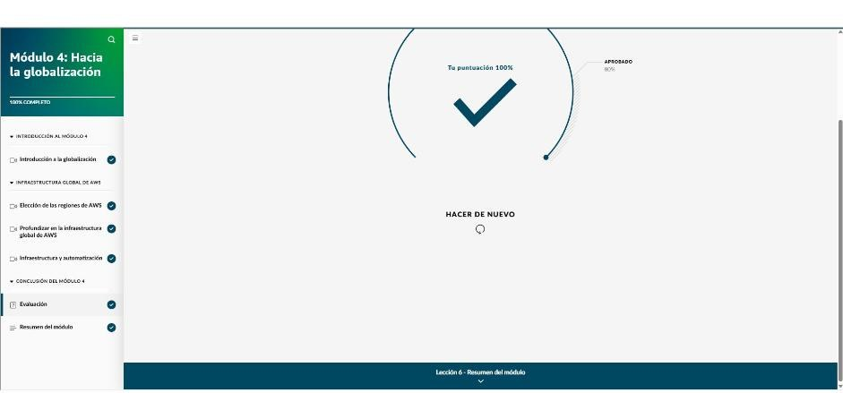

# Módulo 4 · Hacia la globalización

*AWS Cloud Practitioner Essentials*, módulo 4: cómo elegir una región, arquitecturas multi-AZ y multirregión, ubicaciones periféricas e infraestructura como código.

La cafetería se internacionaliza:

- **Nuevas tiendas** en otros países = elegir **regiones**.
- **Carritos de café** en aeropuertos y mercados, con solo lo más pedido = **ubicaciones periféricas**.
- **Recetas y máquinas programables iguales** en todas partes = **infraestructura como código**.

## Cómo elegir una región

Cada región está **aislada**: los datos no salen de ella sin permiso explícito, y quedan sujetos a las leyes del país donde está la región. Hay cuatro factores, en este orden:

| Factor | Ejemplo |
|---|---|
| **1. Cumplimiento** | Datos que no pueden salir del Reino Unido → región de Londres. Datos financieros en Fráncfort → Alemania. **RGPD** en la UE. Si hay un requisito legal, decide por sí solo |
| **2. Proximidad / latencia** | Clientes en Latinoamérica → Querétaro, São Paulo o EE. UU., no Australia |
| **3. Disponibilidad de servicios** | Las novedades suelen salir primero en Virginia u Oregón; las regiones **GovCloud** existen solo para el gobierno de EE. UU. |
| **4. Precio** | El mismo servicio cuesta distinto según la región (energía, infraestructura, impuestos) |

## Alta disponibilidad: multi-AZ y multirregión

- **Arquitectura redundante multi-AZ:** si una AZ cae, la aplicación pasa a otra sin que el usuario lo note. Además mejora la recuperación ante desastres, la continuidad y la latencia.
- **Multirregión:** si cae una región entera, se conmuta a otra. Es como el pinball con varias bolas: al principio cuesta, pero con práctica se vuelve fácil.
- **Beneficios de la infraestructura global:**
  - **Alta disponibilidad:** funciona aunque fallen componentes.
  - **Agilidad:** adaptarse rápido a cambios.
  - **Elasticidad:** escalar automáticamente con la demanda.

## Ubicaciones periféricas (*edge locations*)

- Sitios **fuera de las regiones**, por ejemplo Atlanta o Shanghái, que forman la red global de AWS. **Guardan en caché** imágenes, video, datos y API cerca del usuario: menos latencia y más velocidad de transferencia.
- Allí funcionan:
  - **Amazon CloudFront:** CDN o red de entrega de contenido.
  - **Amazon Route 53:** DNS; traduce nombres de dominio a direcciones IP.
  - **AWS Global Accelerator.**
- Si hace falta aún menos latencia que región + CloudFront, **AWS Outposts** lleva AWS a las instalaciones propias.

| Elemento | Qué es |
|---|---|
| **Región** | Área geográfica con **3 o más AZ** |
| **Zona de disponibilidad** | Uno o más centros de datos con energía, red y conectividad propias |
| **Ubicación periférica** | Caché fuera de las regiones, para entregar contenido rápido (CDN) |

## Infraestructura como código (IaC)

- Replicar a mano en la región B lo que hay en la región A es lento, propenso a errores y difícil de repetir. La IaC define la infraestructura en archivos **versionables** y la despliega igual cada vez.
- **AWS CloudFormation:** **plantillas** declarativas, en texto, que dicen **qué** recursos se quieren, no **cómo** crearlos. CloudFormation llama a las API por detrás. La misma plantilla en varias cuentas o regiones crea **entornos idénticos**.

| Forma de interactuar | Mejor para |
|---|---|
| **Consola** | Personas nuevas en la nube; paneles de facturación; servicios gráficos como QuickSight o Neptune |
| **CLI** | Automatizar tareas rutinarias con *scripts*, como copias de seguridad de EBS |
| **SDK** | Llamar a las API desde una aplicación, como guardar datos de usuario en S3 |
| **IaC (CloudFormation)** | CI/CD con DevOps; desplegar EC2, ELB y Auto Scaling de forma igual en varias regiones |

!!! tip "Para recordar"
    - Factores para elegir región: **cumplimiento, proximidad, disponibilidad de servicios y precio** (el cumplimiento primero).
    - Varias regiones y AZ dan **alta disponibilidad, tolerancia a errores y baja latencia**.
    - Las **ubicaciones periféricas** están fuera de las regiones y guardan contenido en caché (**CloudFront**, **Route 53**).
    - Despliegues uniformes y repetibles en varias regiones → **CloudFormation** (IaC).

## Evaluación del módulo

Resultado: **100 %** (se aprueba con 80 %).

??? note "Preguntas y respuestas correctas"

    **1.** Una organización sin fines de lucro está migrando todos sus recursos a la nube de AWS. Están intentando decidir en qué región de AWS van a implementar sus recursos. ¿Qué opción enumera los factores que la organización debe tener en cuenta al decidir dónde colocar sus recursos en la nube?

    ✔ Cumplimiento, proximidad a los clientes, disponibilidad de características y precios

    **2.** ¿Cuáles son las opciones que MEJOR describen los beneficios clave de usar varias regiones de AWS y varias zonas de disponibilidad? (Seleccione DOS opciones).

    ✔ Baja latencia para los usuarios finales · Alta disponibilidad y tolerancia a errores

    **3.** ¿Qué respuesta describe MEJOR el propósito y los beneficios de las ubicaciones periféricas de AWS?

    ✔ Las ubicaciones periféricas almacenan en caché el contenido para entregar datos con una latencia más baja y velocidades de transferencia más altas a los usuarios finales.

    **4.** ¿Qué respuesta describe MEJOR la relación entre las regiones, las zonas de disponibilidad y las ubicaciones periféricas de AWS?

    ✔ Las regiones de AWS son ubicaciones físicas en todo el mundo en las que AWS tiene varias zonas de disponibilidad. Las ubicaciones periféricas se encuentran fuera de las regiones de AWS y almacenan en caché el contenido de acceso frecuente.

    **5.** ¿Qué respuesta describe las principales características y beneficios de AWS CloudFormation?

    ✔ Con CloudFormation, los usuarios pueden modelar y configurar sus recursos de AWS mediante código para automatizar el aprovisionamiento y la administración de la infraestructura. Este método puede ayudar a reducir los errores y mantener la consistencia en todos los entornos.

    **6.** Se asignó a un equipo de una empresa de tecnología biomédica la tarea de implementar una nueva aplicación médica en varias regiones de AWS para ayudar a mantener la alta disponibilidad y la tolerancia a errores. La aplicación consta de varios componentes, incluidos un servidor web, una base de datos y una cola de mensajes. La implementación debe ser uniforme y repetible, y debe minimizar los errores manuales mediante la automatización. ¿Qué enfoque es el MÁS adecuado para implementar esta aplicación de acuerdo con las necesidades de automatización y consistencia?

    ✔ Usar un servicio de infraestructura como código (IaC), como AWS CloudFormation, para implementar la aplicación
