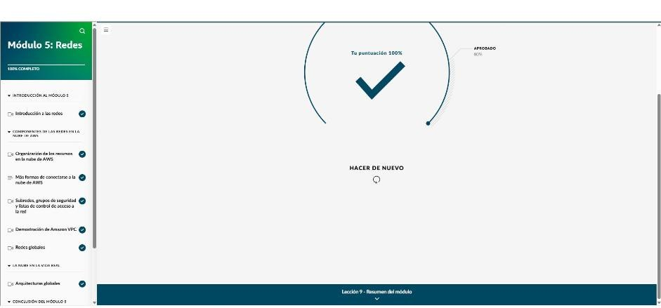

# Módulo 5 · Redes

*AWS Cloud Practitioner Essentials*, módulo 5: VPC y subredes, puertas de enlace, conexión con la red propia, grupos de seguridad y ACL de red, y redes globales (Route 53, CloudFront y Global Accelerator).

## Amazon VPC y subredes

- Los clientes deben hablar con la **cajera** (pública), no ir directo al **barista** (privado).
- **Amazon VPC (Virtual Private Cloud):** una sección de AWS **aislada lógicamente**, con su propio rango de IP privadas (bloque **CIDR**, de /16 a /28). Ofrece seguridad, control y comodidad.
- **Subred:** un rango de IP dentro de la VPC para agrupar recursos.
  - **Pública:** sitio web, balanceador.
  - **Privada:** base de datos con datos de clientes, aplicaciones internas.
- **En los diagramas:**
  - Nube de AWS → región → VPC (línea sólida) → AZ.
  - Las subredes privadas van con línea sólida y las públicas con línea punteada.

## Puertas de enlace y conectividad

| Componente | Para qué |
|---|---|
| **Puerta de enlace de internet** | La **puerta principal** de la cafetería: conecta la VPC con Internet. Sin ella, nadie llega a los recursos |
| **Puerta de enlace privada virtual** | Deja entrar solo tráfico **cifrado (VPN)** que venga de una **red aprobada**: el centro de datos o la red corporativa. Como una cafetería dentro de un edificio con registro de entrada |
| **VPN** | Túnel cifrado sobre Internet; es seguro, pero comparte ancho de banda |
| **AWS Client VPN** | VPN administrada y elástica para **trabajadores remotos** (basada en OpenVPN) |
| **AWS Site-to-Site VPN** | Conexión cifrada entre **centros de datos o sucursales** y la VPC; es la opción más económica |
| **AWS PrivateLink** | Conecta la VPC en privado con servicios o con otras VPC, **sin** Internet, NAT ni IP pública |
| **AWS Direct Connect** | **Fibra dedicada y privada** con AWS, montada con un socio: mucho ancho de banda, latencia constante y cumplimiento normativo |
| **AWS Transit Gateway** | Un **punto central** que interconecta muchas VPC y redes propias |
| **Puerta de enlace NAT** | Las instancias privadas salen a Internet, pero nadie de afuera puede iniciar conexión con ellas |
| **Amazon API Gateway** | Crear, publicar, proteger y monitorear API a cualquier escala |

**VPN o Direct Connect:**

- **VPN:** acceso remoto flexible y transferencias pequeñas.
- **Direct Connect:** grandes volúmenes de datos, ancho de banda dedicado y cumplimiento.
- Es común usar una **VPN como respaldo** de Direct Connect, o **varias líneas Direct Connect** para tolerancia a fallos y más ancho de banda.

## Grupos de seguridad y ACL de red

- **ACL de red = control de pasaportes** en la frontera de la **subred**. Revisa cada paquete al entrar **y** al salir.
- **Grupo de seguridad = portero** del edificio, que es la **instancia EC2**. Revisa la lista al entrar y deja salir sin revisar.

| | Grupo de seguridad | ACL de red |
|---|---|---|
| Alcance | **Instancia** | **Subred** |
| Estado | **Con estado** (recuerda) | **Sin estado** (no recuerda) |
| Reglas | Solo **permitir** | **Permitir y denegar** |
| Tráfico de retorno | Se permite automáticamente | Debe permitirse de forma explícita en ambos sentidos |
| Por defecto | **Niega todo lo que entra y permite todo lo que sale** | La predeterminada permite todo; una **personalizada niega todo** hasta que se agreguen reglas. Siempre termina con una denegación explícita |

- Configurar grupos de seguridad y ACL de red es **responsabilidad del cliente**: es seguridad *en* la nube.

## Demostración: construir una VPC

1. Crear la **VPC** con el bloque `10.0.0.0/16` (unas 65 000 IP).
2. Crear **subredes privadas y públicas en dos AZ**, por ejemplo `10.0.1.0/24`. Las públicas asignan IP pública automáticamente.
3. Crear la **puerta de enlace de internet** y **adjuntarla** a la VPC.
4. Crear una **tabla de enrutamiento** con la ruta `0.0.0.0/0` hacia la puerta de enlace y **asociarla** a las subredes públicas.

> Una subred no es pública por su nombre: lo es porque tiene **la puerta de enlace, la ruta y la asociación**.

## Redes globales

- **DNS:** la «guía telefónica» de Internet; traduce nombres de dominio en direcciones IP.
- **Amazon Route 53:**
  - DNS administrado y global.
  - **Registra y transfiere dominios.**
  - **Políticas de enrutamiento:** por latencia, geolocalización, geoproximidad o *round robin* ponderado.
  - Dirige el tráfico a recursos de AWS y de fuera.
- **Amazon CloudFront:**
  - CDN que guarda copias del contenido en ubicaciones periféricas.
  - Casos: *streaming* de video, imágenes de una tienda en línea, mapas de una app de viajes.
- **AWS Global Accelerator:**
  - Lleva el tráfico por la **red privada global de AWS** en lugar del Internet público.
  - Hace conmutación por error rápida según el estado de los puntos de conexión, la ubicación y las políticas.
  - Casos: videojuegos y banca.
- **Flujo típico:** usuario → **Route 53** resuelve el dominio → **CloudFront** en la ubicación periférica más cercana → **balanceador de carga** → EC2 en varias AZ.

!!! tip "Para recordar"
    - Segmento aislado de Internet → **subred privada**. Entrada pública → **puerta de enlace de internet**. VPN desde la red propia → **puerta de enlace privada virtual**.
    - Trabajadores remotos → **Client VPN**. Sucursales con poco presupuesto → **Site-to-Site VPN**. Ancho de banda dedicado → **Direct Connect**.
    - Reglas por instancia → **grupo de seguridad** (con estado, solo permitir). Reglas por subred con permitir y denegar → **ACL de red** (sin estado).
    - Dominios y DNS → **Route 53**. Contenido con baja latencia → **CloudFront**. Conmutación por error según el estado de los puntos de conexión → **Global Accelerator**.

## Evaluación del módulo

Resultado: **100 %** (se aprueba con 80 %).

??? note "Preguntas y respuestas correctas"

    **1.** ¿Qué son las redes en la nube de AWS?

    ✔ Dispositivos interconectados que pueden intercambiar datos y recursos

    **2.** ¿Cuál es la función principal de una zona de disponibilidad en la nube de AWS?

    ✔ Mejora la disponibilidad de las aplicaciones y la tolerancia a errores, ya que permite que los recursos se implementen en varias zonas.

    **3.** Una empresa desea establecer una conexión privada y segura entre su centro de datos en las instalaciones y su Amazon VPC para crear una arquitectura de nube híbrida. ¿Qué componente debe utilizar para garantizar una conexión segura?

    ✔ Puerta de enlace privada virtual

    **4.** Un cliente está creando una Amazon VPC para su aplicación. Desea crear un segmento privado en la Amazon VPC para que los recursos lanzados puedan aislarse de los usuarios en internet. ¿Qué componente de red se adaptaría MEJOR a sus necesidades?

    ✔ Una subred privada

    **5.** Un cliente minorista aloja su aplicación en una Amazon VPC y desea configurar las reglas de tráfico para las instancias de Amazon EC2 que se ejecutan en una subred pública. La aplicación requiere que se definan varias reglas en el nivel de la instancia. ¿Qué solución o característica cubriría sus necesidades?

    ✔ Configurar grupos de seguridad para las instancias de Amazon EC2 en función de los requisitos de la aplicación.

    **6.** Un cliente está trasladando su aplicación a una Amazon VPC y desea configurar un control de tráfico en el nivel de la subred. Requiere un control amplio sobre el tráfico entrante y saliente y le gustaría utilizar reglas de permiso y denegación. ¿Qué solución o característica cubriría sus necesidades?

    ✔ Utilizar listas de control de acceso de red (ACL de red).

    **7.** Un cliente está explorando soluciones para establecer conexiones seguras y cifradas entre sus redes en las instalaciones en sus centros de datos y sucursales. Está buscando la forma MÁS rentable de conectar sus oficinas con otros sitios y sus servicios de AWS. No desea aumentar la cantidad de ancho de banda. ¿Qué solución se adaptaría MEJOR a sus necesidades?

    ✔ AWS Site-to-Site VPN

    **8.** Un cliente empresarial acaba de fusionarse con otra empresa y necesita una forma de escalar de manera rápida y ofrecer al nuevo equipo de ventas mundial una manera de acceder a sus recursos de AWS. Busca un servicio completamente administrado con autenticación avanzada para sus trabajadores remotos nuevos. ¿Qué solución se adaptaría MEJOR a sus necesidades?

    ✔ AWS Client VPN

    **9.** Un cliente busca una forma de establecer una conexión dedicada desde su red en las instalaciones a una Amazon VPC. Necesita una solución que brinde una experiencia de red más uniforme con un ancho de banda mayor. ¿Qué tipo de conexión a la nube de AWS se adaptaría MEJOR a sus necesidades?

    ✔ AWS Direct Connect

    **10.** ¿Cuál es la función principal de un servicio de nombres de dominio (DNS)?

    ✔ Traduce nombres de dominio legibles para el ser humano a direcciones IP legibles por máquinas.

    **11.** Un cliente está creando recursos de aplicaciones en sus subredes de nube virtual privada (VPC). Desea proteger sus recursos en la nube, sobre todo, las tareas de protección del tráfico de redes. ¿De qué componente es responsable el cliente según el modelo de responsabilidad compartida?

    ✔ Proteger el tráfico de red con las subredes y los recursos con listas de control de acceso de red (ACL de red) y grupos de seguridad

    **12.** Un cliente financiero necesita una solución de entrega de contenido para ofrecer los videos de formación y el contenido estático necesarios a sus consultores financieros de todo el mundo. Quiere asegurarse de que la solución ofrezca una latencia baja. ¿Qué solución de AWS se adaptaría MEJOR a sus necesidades?

    ✔ Amazon CloudFront

    **13.** Una empresa de medios necesita un servicio para administrar sus registros de dominio con diferentes proveedores. Además, utilizarán el servicio para dirigir el tráfico de internet a sus recursos alojados en la nube de AWS y en otros lugares. ¿Qué solución de AWS se adaptaría MEJOR a sus necesidades?

    ✔ Amazon Route 53

    **14.** Un cliente está explorando los servicios de redes periféricas para mejorar la disponibilidad, el rendimiento y la seguridad de las aplicaciones. Necesita una solución para enrutar el tráfico cuando haya problemas en una de las ubicaciones de su aplicación. En concreto, debe tener en cuenta el estado de los puntos de conexión, la ubicación del usuario y las políticas. ¿Qué solución de AWS se adaptaría MEJOR a sus necesidades?

    ✔ AWS Global Accelerator

## Fuentes y aviso legal

- **Fuente:** curso *AWS Cloud Practitioner Essentials* (AWS Skill Builder), ofrecido en AWS Entrena Bogotá. Sitios oficiales: [skillbuilder.aws](https://skillbuilder.aws) · [bogota.awsentrena.com](https://bogota.awsentrena.com) · [docs.aws.amazon.com](https://docs.aws.amazon.com).
- **Uso:** apuntes personales de estudio, sin fines comerciales y con redacción propia. Las imágenes del curso son fragmentos breves citados con fines educativos; sus derechos son de sus titulares.
- **Sin afiliación:** sitio no oficial, no afiliado ni respaldado por AWS. Las marcas pertenecen a sus dueños.
- Más detalles y cómo pedir el retiro de contenido en el [aviso legal](../../aviso-legal.md).
