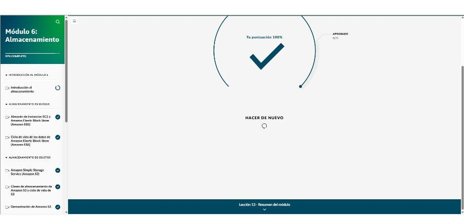

# Módulo 6 · Almacenamiento

*AWS Cloud Practitioner Essentials*, módulo 6: almacenamiento en bloque, de objetos y de archivos, almacenamiento híbrido y recuperación ante desastres.

## Tres tipos de almacenamiento

| Tipo | Servicios | Idea |
|---|---|---|
| **En bloque** | Almacén de instancias EC2, **Amazon EBS** | Volúmenes que se conectan a EC2 como discos duros |
| **De objetos** | **Amazon S3** | Objetos (datos + metadatos + clave) en un espacio plano, escala ilimitada |
| **De archivos** | **Amazon EFS**, **Amazon FSx** | Sistemas de archivos compartidos en red |
| **Otros** | **AWS Storage Gateway**, **AWS Elastic Disaster Recovery** | Almacenamiento híbrido y recuperación ante desastres |

**Responsabilidad compartida en almacenamiento:**

- **Completamente administrado**, como S3: el cliente solo maneja sus datos, el control de acceso y la configuración.
- **Administrado**, como EBS: además, el cliente se ocupa de las copias de seguridad, el cifrado, el rendimiento y la capacidad.
- **No administrado**: el cliente se encarga de todo, salvo el hardware y la red física.

## Almacenamiento en bloque

| | Almacén de instancias EC2 | Amazon EBS |
|---|---|---|
| Persistencia | **Temporal**: los datos se pierden al detener o terminar la instancia | **Persistente**: los datos siguen aunque la instancia se detenga o termine |
| Ubicación | Disco físico del host | Volumen independiente, replicado dentro de su AZ |
| Costo | Incluido en el precio de la instancia | Se paga aparte |
| Uso | Búferes, cachés, datos temporales con E/S muy alta | Bases de datos, sistemas de archivos, copias de seguridad |

- **EBS:** se puede desconectar y reconectar a otra instancia, cambiar de tamaño y tipo **sin detener nada**, y ajustar las IOPS.
- **Instantáneas de EBS:**
  - Copias en un momento dado, **progresivas**: la primera es completa y las siguientes guardan solo los bloques que cambiaron.
  - Se guardan en **S3** en varias AZ.
  - Sirven para recuperación ante desastres, migrar entre AZ o regiones y clonar entornos de prueba.
  - Programarlas, cifrarlas y borrar las que sobran es **responsabilidad del cliente**.
- **Amazon Data Lifecycle Manager:** automatiza crear, retener y borrar instantáneas de EBS y AMI con políticas y horarios.

## Amazon S3

- Almacenamiento de objetos **ilimitado** con **durabilidad de 99,999999999 % (11 nueves)**.
- Los objetos van en **buckets** con nombre **único a nivel global** y se identifican por su **clave**. Admite control de versiones.
- **Todo es privado por defecto.** El acceso se controla con:
  - **políticas de bucket** (basadas en el recurso);
  - **políticas de identidad** (IAM);
  - **cifrado** en reposo y en tránsito.
- Si las imágenes públicas no cargan aunque la política lo permita, suele ser porque está activado el **bloqueo de acceso público**.
- **Casos:** contenido de apps y archivos multimedia, sitios web estáticos, copias de seguridad, archivado, **lagos de datos**.

### Clases de almacenamiento

| Clase | Para qué |
|---|---|
| **S3 Standard** | Uso general y acceso frecuente; es la predeterminada |
| **S3 Intelligent-Tiering** | Patrón de acceso **desconocido**: mueve los objetos de nivel automáticamente |
| **S3 Standard-IA** | Acceso poco frecuente pero rápido cuando se necesita; 3 AZ |
| **S3 One Zone-IA** | Igual, en **una sola AZ** y más barato: copias secundarias o datos que se pueden recrear |
| **S3 Express One Zone** | Una AZ, milisegundos de un dígito: hasta 10 veces más rápido que Standard |
| **S3 Glacier Instant Retrieval** | Archivo que se recupera en milisegundos (hasta 68 % menos que Standard-IA) |
| **S3 Glacier Flexible Retrieval** | Archivo consultado 1–2 veces al año: de 1–5 min (acelerada) a 5–12 h |
| **S3 Glacier Deep Archive** | **La más barata**: retención de 7–10 años o más, recuperación en **12 h** |
| **S3 on Outposts** | Objetos S3 en las instalaciones propias, por residencia de datos |

- **Ciclo de vida de S3:**
  - **Acciones de transición:** pasar de clase después de N días.
  - **Acciones de vencimiento:** borrar.
  - Ejemplo: a los 30 días pasa a Standard-IA, a los 60 a Glacier Instant Retrieval y a los 365 se elimina.
- El precio de cada clase combina el **costo por GB, las tarifas de recuperación y la duración mínima** de almacenamiento.

## Almacenamiento de archivos

- **Amazon EFS:**
  - Sistema de archivos **NFS para Linux**, totalmente administrado y **elástico**: crece y se reduce solo.
  - **Miles de instancias EC2** lo usan a la vez.
  - Replicado en **varias AZ**.
  - **Clases:** Standard y Standard-IA (multi-AZ); One Zone y One Zone-IA (más baratas); **Archive** (hasta 50 % menos que IA).
  - **Ciclo de vida:** pasa a IA a los 30 días sin acceso y a Archive a los 90.
- **Amazon FSx:** sistemas de archivos populares, totalmente administrados.
  - **Windows File Server:** SMB y Active Directory.
  - **NetApp ONTAP.**
  - **OpenZFS:** NFS.
  - **Lustre:** HPC y ML.

## Almacenamiento híbrido y recuperación

- **AWS Storage Gateway:** conecta el centro de datos propio con almacenamiento casi ilimitado en AWS y deja en **caché local** los datos más usados.
  - **S3 File Gateway:** aparece como un servidor de archivos normal y los archivos se guardan en S3.
  - **Volume Gateway:** volúmenes iSCSI.
    - Modo **en caché:** los datos viven en la nube y lo frecuente queda en local.
    - Modo **almacenado:** todo en local, con copia asíncrona en instantáneas de EBS.
  - **Tape Gateway:** cintas virtuales para el software de respaldo de siempre, guardadas en S3.
- **AWS Elastic Disaster Recovery:**
  - **Replicación continua a nivel de bloque** de servidores físicos, virtuales o en la nube.
  - Recuperación en minutos y pruebas que no interrumpen la operación.
  - Elimina el centro de datos secundario. Casos: hospitales, bancos, fábricas.

!!! tip "Para recordar"
    - Temporal con E/S altísima → **almacén de instancias**. Persistente para EC2 → **EBS**. Respaldos progresivos → **instantáneas de EBS**, automatizadas con **Data Lifecycle Manager**.
    - Objetos ilimitados con 11 nueves → **S3**. Patrón de acceso desconocido → **Intelligent-Tiering**. Archivo de años al menor costo → **Glacier Deep Archive**.
    - Archivos compartidos en Linux (NFS) → **EFS**. Windows con SMB y Active Directory → **FSx para Windows File Server**. HPC → **FSx para Lustre**.
    - Archivos locales respaldados en la nube con caché → **Storage Gateway (File Gateway)**. Réplica continua de servidores → **Elastic Disaster Recovery**.

## Evaluación del módulo

Resultado: **100 %** (se aprueba con 80 %).

??? note "Preguntas y respuestas correctas"

    **1.** ¿Qué enunciado define MEJOR a Amazon Elastic Block Store (Amazon EBS)?

    ✔ Un servicio de almacenamiento a nivel de bloques que proporciona volúmenes de almacenamiento persistentes para las instancias de Amazon EC2

    **2.** En los últimos tiempos, EmpresaX Comercio migró su aplicación principal a una instancia de Amazon EC2 en AWS. A medida que su base de clientes crece, la empresa explora soluciones de almacenamiento que puedan crecer de forma dinámica según las necesidades de datos de la aplicación. La solución debe cumplir los siguientes criterios: Disponer de un almacenamiento en bloque persistente que proporcione un rendimiento constante de baja latencia. Poder conectarse y desconectarse de la instancia de EC2 según sea necesario. Redimensionar la capacidad de almacenamiento de forma independiente sin interrumpir la instancia. Crear copias de seguridad en un momento dado para proteger los datos importantes de los clientes y del inventario. ¿Qué servicio de almacenamiento de AWS cumpliría MEJOR los requisitos de la situación?

    ✔ Amazon Elastic Block Store (Amazon EBS)

    **3.** EmpresaX IA está desarrollando una aplicación de machine learning que requiere un procesamiento de datos muy rápido para conjuntos de datos de entrenamiento de modelos temporales. Los datos se generan durante las sesiones de entrenamiento y se almacenan por separado en un almacenamiento persistente. El equipo intenta determinar la mejor solución de almacenamiento para usar junto con su aplicación. La solución debe cumplir los siguientes criterios: Rendimiento de E/S más alto posibleConexión directa a sus instancias de Amazon EC2Almacenamiento temporal (los datos no persisten cuando las instancias se detienen o terminan)¿Qué servicio de AWS cubre MEJOR las necesidades de almacenamiento temporal descritas en esta situación?

    ✔ Almacén de instancias Amazon EC2

    **4.** EmpresaX Software implementa una aplicación de producción importante en instancias de Amazon EC2 con varios volúmenes de Amazon Elastic Block Store (Amazon EBS) que contienen código de aplicación y datos de clientes. El equipo busca un servicio de AWS con el que puedan hacer copias de seguridad de los datos de su aplicación. La solución debe cumplir los siguientes criterios:Crear copias de seguridad periódicas de los datos. Crear entornos duplicados para realizar pruebas. Crear una estrategia de recuperación de desastres. Crear copias de seguridad completas o progresivas sin afectar el rendimiento de la aplicación. Proporcionar un almacenamiento rentable a largo plazo. ¿Qué servicio o característica de AWS cumpliría MEJOR los requisitos de la situación?

    ✔ Instantáneas de EBS

    **5.** ¿Qué enunciado describe MEJOR a Amazon S3?

    ✔ Un servicio escalable de almacenamiento de objetos que se utiliza para almacenar y recuperar cualquier cantidad de datos desde cualquier lugar de la web.

    **6.** EmpresaX Marketing necesita una solución de almacenamiento con la que pueda distribuir grandes colecciones de imágenes, videos y archivos de diseño de alta resolución para las campañas de sus clientes. Algunos activos son de acceso frecuente, mientras que otros se archivan para consultarlos en ocasiones. La solución debe cumplir los siguientes criterios:Capacidad de almacenamiento ilimitadaAlta durabilidadUso compartido de archivos sencillo mediante URLCapacidad para organizar los activos por cliente y proyectoOpciones de almacenamiento rentablesControles de seguridad para evitar el acceso no autorizado a activos específicos¿Qué servicio de AWS es el MÁS adecuado para las necesidades de almacenamiento descritas en esta situación?

    ✔ Amazon S3

    **7.** ¿Cuál es la función principal de las clases de almacenamiento de Amazon S3?

    ✔ Proporcionar diferentes opciones de almacenamiento que estén optimizadas para diferentes casos de uso y patrones de acceso

    **8.** ¿Cuál es una característica clave de los precios de las clases de almacenamiento de Amazon S3?

    ✔ Los precios varían según los costos de almacenamiento, las tarifas de recuperación y la duración mínima de almacenamiento.

    **9.** ¿Qué enunciado describe MEJOR a Amazon Elastic File System (Amazon EFS)?

    ✔ Un sistema de archivos elástico y completamente administrado que se escala de forma automática a medida que se agregan y eliminan archivos

    **10.** EmpresaX Tecnología necesita implementar una solución de almacenamiento centralizada para su equipo de desarrollo, la cual permita que varias instancias de Amazon EC2 accedan al mismo sistema de archivos de forma simultánea. La solución debe cumplir los siguientes criterios:Brindar un servicio completamente administrado. Escalar de forma automática. Eliminar la necesidad de planificar la capacidad. Admitir aplicaciones basadas en Linux con interfaces de sistema de archivos estándar. Mantener un acceso constante de baja latencia en todos los entornos de desarrollo. Proporcionar una alta durabilidad sin necesidad de configuraciones de replicación complejas. ¿Qué servicio de almacenamiento de AWS es el MÁS adecuado para esta situación?

    ✔ Amazon Elastic File System (Amazon EFS)

    **11.** ¿Qué enunciado describe MEJOR a Amazon FSx?

    ✔ Un servicio completamente administrado que proporciona un almacenamiento de archivos escalable y rentable basado en sistemas de archivos muy utilizados

    **12.** EmpresaX Marketing necesita migrar sus archivos compartidos existentes a AWS para brindar apoyar a los equipos de diseño que trabajan con archivos creativos de gran tamaño. La empresa necesita ayuda para elegir una solución de almacenamiento que pueda facilitar esta migración. La solución debe cumplir los siguientes requisitos:Brindar un servicio completamente administrado. Integrarse de manera fluida con las aplicaciones de Windows. Admitir el protocolo SMB. Ofrecer la integración de Active Directory para autenticar usuarios. Admitir la deduplicación de datos para optimizar los costos de almacenamiento. Proporcionar latencias consistentes inferiores a milisegundos. Proporcionar una alta disponibilidad. ¿Qué servicio de almacenamiento de AWS cumple MEJOR los requisitos descritos en la situación?

    ✔ Amazon FSx para Windows File Server

    **13.** ¿Qué enunciado describe MEJOR a AWS Storage Gateway?

    ✔ Una solución de almacenamiento en la nube híbrida que proporciona a las aplicaciones en las instalaciones acceso a un almacenamiento en la nube casi ilimitado

    **14.** ¿Qué enunciado describe MEJOR a la Recuperación elástica ante desastres de AWS?

    ✔ Un servicio que minimiza el tiempo de inactividad y la pérdida de datos, ya que brinda una recuperación rápida y fiable de aplicaciones en las instalaciones y basadas en la nube mediante el almacenamiento de bajo costo, la computación mínima y la recuperación a un momento dado

    **15.** EmpresaX Manufactura conserva una gran cantidad de dibujos técnicos y archivos de diseño a los que sus equipos necesitan acceder a diario desde sus aplicaciones en las instalaciones. La empresa desea migrar estos archivos a AWS de manera gradual para reducir sus costos de almacenamiento local y, al mismo tiempo, mantener un acceso de baja latencia para los archivos de uso frecuente. La solución debe cumplir los siguientes criterios:Integrarse con los flujos de trabajo existentes basados en archivos. Proporcionar una ruta fluida hacia el almacenamiento en la nube sin interrumpir las operaciones actuales. Mantener el acceso local y de baja latencia a los archivos de uso frecuente. ¿Qué servicio de almacenamiento de AWS debe usar en función de estos requisitos?

    ✔ AWS Storage Gateway: File Gateway
