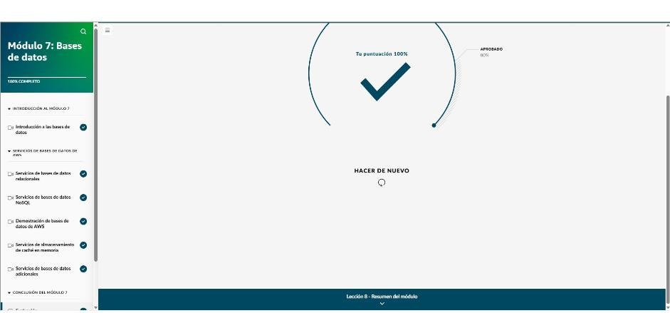

# Módulo 7 · Bases de datos

*AWS Cloud Practitioner Essentials*, módulo 7: bases de datos relacionales y NoSQL, caché en memoria, bases especializadas, copias de seguridad y migración.

## Responsabilidad compartida en bases de datos

| Modelo | Ejemplo | Qué hace el cliente |
|---|---|---|
| **No administrado** | MySQL instalado en una instancia **EC2** | Todo: instalar, parchear, respaldar, alta disponibilidad, rendimiento. Sirve cuando se necesita **control total** del SO y del motor |
| **Administrado** | Amazon RDS | Configurar la base, optimizar consultas y ajustar el rendimiento. AWS hace las copias de seguridad, los parches y el hardware |
| **Completamente administrado** | DynamoDB, Aurora | Solo **diseñar las estructuras de datos y los controles de acceso** |

## Bases de datos relacionales

- Tablas con filas y columnas, esquema rígido y **SQL**.
- **Migración por *lift and shift*:** mover la base tal como está a EC2. **AWS Database Migration Service (DMS)** facilita la migración y **minimiza el tiempo de inactividad**, porque la base de origen sigue operando.
- **Amazon RDS:**
  - Motores: **Aurora, MySQL, PostgreSQL, SQL Server, MariaDB y Oracle**.
  - Automatiza copias de seguridad, parches y hardware.
  - **Multi-AZ:** réplica en espera en otra AZ con **conmutación por error automática**.
  - **Réplicas de lectura** e **instantáneas** manuales.
  - Seguridad: aislamiento en la **VPC** y cifrado en reposo y en tránsito.
  - **Performance Insights** para detectar cuellos de botella.
- **Amazon Aurora:**
  - Compatible con **MySQL y PostgreSQL**: **hasta 5 veces** más rápida que MySQL y 3 veces más que PostgreSQL.
  - **6 copias en 3 AZ**, disponibilidad del 99,99 %.
  - El almacenamiento crece solo de 10 GB a 128 TB, con respaldo continuo en S3.
  - Alternativa económica a motores comerciales costosos.

## Bases de datos NoSQL

- Esquema **flexible**: pares **clave-valor** o documentos. No todos los elementos necesitan los mismos atributos.
- **Amazon DynamoDB:**
  - NoSQL totalmente administrado y **sin servidor**.
  - Respuesta en **milisegundos de un dígito** a cualquier escala; disponibilidad del 99,999 % (3 instalaciones por región).
  - **Escalado automático** con capacidad aprovisionada y cifrado automático.
  - Casos: videojuegos, finanzas, apps móviles globales.

## Caché en memoria

- Una caché en RAM es **cientos o miles de veces** más rápida que el disco. La aplicación consulta primero la caché y así quita carga a la base de datos.
- **Amazon ElastiCache:**
  - **Redis, Valkey o Memcached** administrados.
  - Reemplaza solos los nodos que fallan; réplicas en varias AZ; cifrado con TLS.
  - Casos: sesiones, resultados de consultas, tablas de clasificación de juegos. Resuelve los **cuellos de botella de latencia**.

## Bases de datos especializadas y copias de seguridad

| Servicio | Qué es | Casos |
|---|---|---|
| **Amazon DocumentDB** | Documentos JSON **compatible con MongoDB**: hasta 64 TB y 15 réplicas de lectura | Catálogos de productos, gestión de contenido, perfiles de usuario |
| **Amazon Neptune** | Base de **grafos** para datos muy conectados (grafos de propiedades y RDF) | Redes sociales, detección de fraude, recomendaciones |
| **AWS Backup** | **Panel único** de copias de seguridad para EBS, EFS, bases de datos y recursos en las instalaciones, con políticas, programación, copias **entre regiones** y auditoría | Recuperación ante desastres centralizada y cumplimiento |

!!! tip "Para recordar"
    - Relacional administrada → **RDS**. Más rendimiento compatible con MySQL o PostgreSQL → **Aurora**. Alta disponibilidad → **multi-AZ**.
    - Clave-valor sin servidor en milisegundos → **DynamoDB**. Documentos de MongoDB → **DocumentDB**. Grafos y relaciones → **Neptune**.
    - Acelerar lecturas con RAM → **ElastiCache**. Migrar bases con poco tiempo de inactividad → **DMS**. Copias de seguridad centralizadas → **AWS Backup**.
    - En servicios completamente administrados, el cliente solo diseña los datos y controla el acceso.

## Evaluación del módulo

Resultado: **100 %** (se aprueba con 80 %).

??? note "Preguntas y respuestas correctas"

    **1.** ¿Cuál es la explicación que MEJOR describe Amazon RDS?

    ✔ Un servicio completamente administrado que ayuda a configurar, operar y escalar bases de datos relacionales en la nube

    **2.** ¿Cuál es un posible caso de uso de Amazon Aurora?

    ✔ Sustituir los motores de bases de datos comerciales de alto costo por una solución más rentable que siga proporcionando un rendimiento y una fiabilidad de nivel empresarial

    **3.** ¿Qué problema resuelve AWS Database Migration Service (AWS DMS)?

    ✔ Minimizar el tiempo de inactividad de las aplicaciones durante las migraciones de bases de datos

    **4.** ¿Qué enunciado describe MEJOR Amazon DynamoDB?

    ✔ DynamoDB es una base de datos de documentos y clave-valor NoSQL completamente administrada que proporciona un rendimiento rápido y predecible con una escalabilidad perfecta.

    **5.** ¿Cuál es el principal beneficio de usar Amazon ElastiCache?

    ✔ Rendimiento mejorado de las aplicaciones mediante el almacenamiento de caché en memoria

    **6.** ¿Cuál de estas opciones es una característica de AWS Backup?

    ✔ AWS Backup proporciona políticas centralizadas de copia de seguridad y supervisión en varias cuentas y regiones de AWS.

    **7.** ¿Cuál es un caso de uso práctico de Amazon DocumentDB (compatible con MongoDB)?

    ✔ Almacenamiento y administración de un gran catálogo de productos para una aplicación de comercio electrónico

    **8.** ¿Cuál es un uso práctico de Amazon Neptune?

    ✔ Administrar y consultar conjuntos de datos altamente conectados de manera eficiente

    **9.** ¿Qué definición describe MEJOR el almacenamiento de caché en memoria?

    ✔ Un servicio basado en la nube que almacena los datos en la memoria para un acceso rápido, lo que mejora el rendimiento y la escalabilidad de las aplicaciones y reduce la carga de la base de datos

    **10.** ¿Cuál es la principal diferencia entre las bases de datos NoSQL, como Amazon DynamoDB, y las bases de datos relacionales?

    ✔ Las bases de datos NoSQL utilizan diseños de esquemas flexibles en lugar de las estructuras rígidas de tablas de las bases de datos relacionales.

    **11.** ¿Qué opción describe una situación hipotética en la que una solución no administrada, como una base de datos instalada directamente en una instancia de Amazon EC2, sería preferible a utilizar un servicio de base de datos de AWS completamente administrado?

    ✔ Un desarrollador necesita tener el control total sobre la base de datos y acceder a su sistema operativo subyacente, la instalación de la base de datos y la configuración.

    **12.** ¿Qué enunciado describe las responsabilidades de los clientes que utilizan los servicios de bases de datos de AWS completamente administrados?

    ✔ Los clientes son responsables de diseñar las estructuras de datos y administrar los controles de acceso.

## Fuentes y aviso legal

- **Fuente:** curso *AWS Cloud Practitioner Essentials* (AWS Skill Builder), ofrecido en AWS Entrena Bogotá. Sitios oficiales: [skillbuilder.aws](https://skillbuilder.aws) · [bogota.awsentrena.com](https://bogota.awsentrena.com) · [docs.aws.amazon.com](https://docs.aws.amazon.com).
- **Uso:** apuntes personales de estudio, sin fines comerciales y con redacción propia. Las imágenes del curso son fragmentos breves citados con fines educativos; sus derechos son de sus titulares.
- **Sin afiliación:** sitio no oficial, no afiliado ni respaldado por AWS. Las marcas pertenecen a sus dueños.
- Más detalles y cómo pedir el retiro de contenido en el [aviso legal](../../aviso-legal.md).
