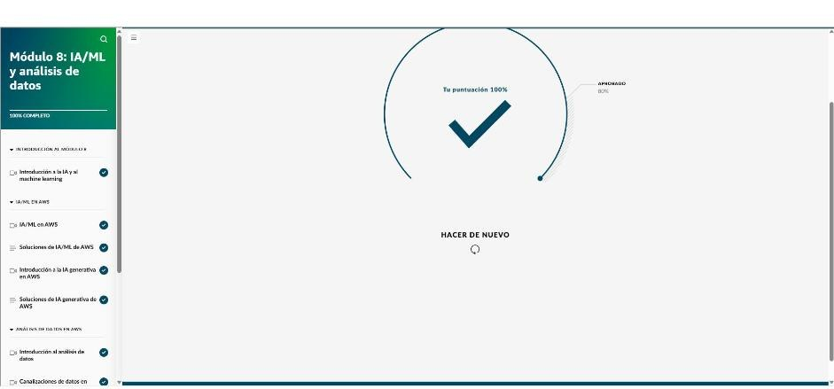

# Módulo 8 · IA/ML y análisis de datos

*AWS Cloud Practitioner Essentials*, módulo 8: la pila de IA y ML de AWS, IA generativa (Bedrock, JumpStart, Amazon Q) y canalizaciones de datos para análisis.

## Conceptos

- **IA:** sistemas que hacen tareas parecidas a las humanas.
- **Machine learning:** entrena con datos históricos y produce un **modelo** que predice o decide.
  - La **programación clásica** sigue reglas explícitas; el ML **aprende patrones**.
  - Casos: predecir tendencias, decidir (enrutar llamadas), detectar anomalías (fraude).
- **Aprendizaje profundo:** redes neuronales con muchas capas.
- **IA generativa:** aprendizaje profundo con **modelos fundacionales (FM)**.
  - Están preentrenados con enormes volúmenes de datos y se adaptan a **muchas tareas**.
  - Los **LLM** son FM entrenados en lenguaje humano.

## Pila de IA/ML de AWS (tres niveles)

| Nivel | Qué es | Servicios |
|---|---|---|
| **1. Servicios de IA** | Modelos **ya entrenados**, listos para usar | Ver tabla siguiente |
| **2. Servicios de ML** | Crear, entrenar e implementar modelos propios **sin administrar infraestructura** | **Amazon SageMaker AI**: IDE para científicos de datos, interfaz sin código para analistas, MLOps |
| **3. Infraestructura y marcos de trabajo** | Control total del entrenamiento | PyTorch, TensorFlow, Apache MXNet sobre instancias EC2 para ML, **Amazon EMR** y ECS |

| Servicio de IA | Hace | Ejemplo |
|---|---|---|
| **Amazon Comprehend** | Procesamiento de lenguaje natural: frases clave, idioma, **sentimiento** | Analizar comentarios de clientes |
| **Amazon Polly** | **Texto a voz** | Convertir guiones en audio para un curso |
| **Amazon Transcribe** | **Voz a texto** | Transcribir llamadas, subtítulos |
| **Amazon Translate** | Traducción | Apps en varios idiomas |
| **Amazon Kendra** | **Búsqueda inteligente** en contenido empresarial | Buscador interno, chatbots |
| **Amazon Rekognition** | Análisis de **imágenes y video** | Moderación de contenido, verificación de identidad |
| **Amazon Textract** | Extrae texto, formularios y tablas de documentos | Formularios de salud y de gobierno |
| **Amazon Lex** | **Chatbots** de voz y texto (NLU + ASR) | Interfaz conversacional en una app de salud |
| **Amazon Personalize** | **Recomendaciones** personalizadas | Motor de recomendaciones de una tienda |

## IA generativa en AWS

- **Amazon SageMaker JumpStart:** centro de modelos preentrenados (visión, NLP, datos tabulares) que se ajustan e implementan con pocos clics. Sirve para prototipos y comparar modelos.
- **Amazon Bedrock:** servicio totalmente administrado para usar FM de Amazon y de terceros (**Claude**, Stable Diffusion…) mediante **una sola API**. Permite ajustarlos con datos propios. Casos: texto e imágenes, agentes conversacionales.
- **Amazon Q:**
  - **Q Business:** responde preguntas y ejecuta acciones con los datos de la empresa.
  - **Q Developer:** sugerencias y generación de código, revisiones y seguridad.

## Análisis de datos

- **ETL (extraer, transformar, cargar):** deja los datos limpios y en un formato utilizable. Las **canalizaciones de datos** lo vuelven automático y repetible.
- El **análisis** convierte datos históricos en información y tendencias útiles.

| Fase | Servicios |
|---|---|
| **Ingesta** | **Kinesis Data Streams**: tiempo real, terabytes, sin servidor. **Amazon Data Firehose**: casi tiempo real; entrega a lagos y almacenes de datos |
| **Almacenamiento** | **Amazon S3** como **lago de datos** (datos sin procesar). **Amazon Redshift** como **almacén de datos** para BI (petabytes, columnar, procesamiento masivo en paralelo) |
| **Catálogo** | **Catálogo de datos de AWS Glue**: metadatos centralizados |
| **Procesamiento** | **AWS Glue**: ETL sin servidor. **Amazon EMR**: Spark, Hadoop y Hive a gran escala |
| **Análisis y visualización** | **Amazon Athena**: SQL sobre S3, sin servidor, pago por consulta. **Redshift**. **Amazon QuickSight**: paneles, con Amazon Q en lenguaje natural. **Amazon OpenSearch Service**: búsqueda y paneles en tiempo real |

**Caso real (tienda en línea):**

1. DynamoDB guarda los datos de la app.
2. Kinesis Data Streams los ingiere y Firehose los agrega.
3. Una función Lambda pasa el JSON a CSV.
4. Los datos llegan al lago en S3 y Glue los cataloga.
5. Los científicos de datos consultan con **Athena** y **SageMaker** entrena el nuevo modelo de recomendaciones con los mismos datos.

!!! tip "Para recordar"
    - Texto a voz → **Polly**. Voz a texto → **Transcribe**. Sentimiento → **Comprehend**. Chatbot → **Lex**. Recomendaciones → **Personalize**. Imágenes → **Rekognition**. Documentos → **Textract**.
    - Modelo propio sin infraestructura → **SageMaker AI**. FM de varias empresas con una sola API → **Bedrock**. Asistente con datos de la empresa → **Q Business**. Código → **Q Developer**.
    - Ingesta en tiempo real → **Kinesis Data Streams**. Lago de datos → **S3**. Almacén de datos → **Redshift**. ETL → **Glue**. SQL sobre S3 → **Athena**. Paneles → **QuickSight**.

## Evaluación del módulo

Resultado: **100 %** (se aprueba con 80 %).

??? note "Preguntas y respuestas correctas"

    **1.** Tanto la programación clásica como el machine learning se pueden utilizar para entrenar a los equipos a fin de que realicen tareas. ¿Cuál es la principal diferencia entre estos dos enfoques?

    ✔ La programación clásica establece reglas explícitas que el equipo debe seguir. En el machine learning, los equipos hacen predicciones mediante patrones aprendidos de datos históricos.

    **2.** Un pequeño equipo de desarrollo busca agregar una característica a su aplicación que pueda convertir el texto a voz. ¿Qué servicio prediseñado de la IA de AWS se puede utilizar para esta tarea?

    ✔ Amazon Polly

    **3.** Una empresa de comercio electrónico desea agregar un motor de recomendación de productos a su aplicación en línea para aumentar las ventas. El equipo de desarrollo quiere que estas recomendaciones sean relevantes para cada cliente. ¿Qué servicio prediseñado de la IA de AWS sería útil en este caso de uso?

    ✔ Amazon Personalize

    **4.** ¿Qué servicio de AWS se puede utilizar para crear, entrenar e implementar un modelo de machine learning (ML) personalizado sin tener que preocuparse por la infraestructura subyacente?

    ✔ IA de Amazon SageMaker

    **5.** La IA generativa es un tipo de aprendizaje profundo impulsado por modelos de machine learning (ML) extremadamente grandes, conocidos como modelos fundacionales (FM). ¿Qué características tienen los FM? (Seleccione DOS opciones).

    ✔ Los FM reciben entrenamiento previo con vastas colecciones de datos. · Los FM se pueden adaptar para realizar varias tareas.

    **6.** Amazon Bedrock es un servicio completamente administrado que se diseñó específicamente para trabajar con modelos fundacionales (FM) de gran tamaño y crear aplicaciones de IA generativa. ¿Qué ofrece el servicio para poder acceder a los FM de Amazon y de las principales startups de IA?

    ✔ Una única API

    **7.** Una amplia organización de sanidad desea mejorar la productividad de sus empleados. La empresa busca un asistente de IA generativa prediseñado que pueda responder preguntas, ayudar a resolver problemas y realizar acciones con los datos y la experiencia que se encuentran en sus repositorios de información. ¿Qué servicio de AWS podría ser de ayuda en este caso de uso?

    ✔ Amazon Q Business

    **8.** El proceso de extraer, transformar y cargar (ETL) se utiliza con frecuencia para proporcionar datos limpios y accesibles en un formato que puedan utilizar las herramientas de análisis y los algoritmos de IA. ¿Cómo puede una canalización de datos mejorar este proceso?

    ✔ Las canalizaciones de datos hacen que el proceso de ETL sea más eficiente y repetible.

    **9.** Una empresa de servicios financieros está desarrollando una aplicación que analice los datos bursátiles en tiempo real para que su equipo de analistas pueda tomar decisiones comerciales inmediatas. La empresa necesita hacer una ingesta de datos bursátiles en tiempo real sin preocuparse por los servidores ni la capacidad de escalado. ¿Qué servicio de AWS sería acorde a sus necesidades?

    ✔ Amazon Kinesis Data Streams

    **10.** Los datos pueden provenir de muchas fuentes diferentes. Para proporcionar información, los datos deben estar consolidados en una sola ubicación. Para esto, existen dos opciones de almacenamiento. Los lagos de datos almacenan grandes cantidades de datos sin procesar, mientras que los almacenes de datos están optimizados para la inteligencia empresarial. ¿Qué servicios de AWS se suelen utilizar como lagos y almacenes de datos?

    ✔ Amazon S3 es una opción popular para los lagos de datos, mientras que Amazon Redshift es un servicio de almacén de datos.
