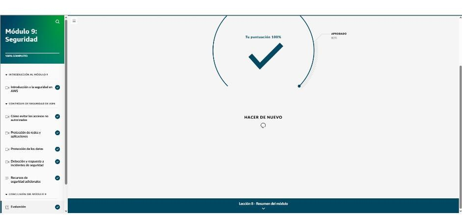

# Módulo 9 · Seguridad

*AWS Cloud Practitioner Essentials*, módulo 9: autenticación y autorización, IAM y mínimo privilegio, protección frente a DDoS, cifrado, y detección y respuesta a incidentes.

## Conceptos base

- **Autenticación:** verifica **quién eres**, por ejemplo con usuario y contraseña.
- **Autorización:** define **qué puedes hacer**. Ejemplo: comprobar si se puede transferir 10 000 USD.
- **Responsabilidad compartida:**
  - El **cliente** protege sus datos, sistemas y aplicaciones, elige qué servicios usar y controla quién accede.
  - **AWS** protege el software base, la virtualización, el hardware y la infraestructura global, **incluida la seguridad física de los centros de datos**.
- Los controles de AWS sirven para **prevenir**, **proteger** y **detectar y responder**.

## Prevenir accesos no autorizados: IAM

- En **AWS IAM** todo está **denegado por defecto**. Se concede el **principio de mínimo privilegio**: solo lo necesario.

| Elemento | Qué es |
|---|---|
| **Usuario raíz** | Dueño de la cuenta, puede hacer todo. Se protege con **contraseña fuerte y MFA** y **no** se usa para el día a día |
| **Usuario de IAM** | Una persona o aplicación con credenciales propias (una por persona) |
| **Grupo de IAM** | Conjunto de usuarios que **heredan** los permisos del grupo, por ejemplo «empleados» o «diseñadores» |
| **Rol de IAM** | Permisos **temporales** que se asumen; se dejan los permisos anteriores (barista en la mañana, cajero en la tarde) |
| **Política de IAM** | Documento **JSON** que permite o niega acciones sobre recursos, por ejemplo acceso a un solo bucket de S3 |

- **MFA:** exige **dos o más** métodos de verificación.
- **AWS IAM Identity Center:** **inicio de sesión único** para varias cuentas y aplicaciones usando el directorio de identidades que ya existe (**identidad federada**).
- **AWS Secrets Manager:** guarda y **rota** contraseñas de bases de datos, claves de API y otros secretos.
- **AWS Systems Manager:** vista central de los nodos en AWS, en las instalaciones y en otras nubes; automatiza parches y administración.

## Proteger redes y aplicaciones

- **DoS:** un atacante satura la aplicación. **DDoS:** usa **muchos equipos comprometidos** (*bots* zombi).
- **La propia infraestructura de AWS defiende:**
  - Los **grupos de seguridad** dejan pasar solo el tráfico válido.
  - El **ELB** absorbe y reparte el tráfico.
  - La **enorme capacidad de las regiones** hace muy caro saturarlas.
- **AWS Shield:**
  - **Standard:** **gratis y automático** contra los DDoS más comunes.
  - **Advanced:** de pago, con diagnóstico detallado y protección ante ataques sofisticados; se integra con CloudFront, Route 53 y ELB.
- **AWS WAF:** *firewall* de aplicaciones web que bloquea IP según una **ACL web**; se combina con Shield.

## Proteger los datos

- **Cifrado:** funciona como cerradura y llave.
  - **En reposo:** datos almacenados.
  - **En tránsito:** datos en movimiento, cifrados con **certificados SSL/TLS**.
- **Cifrado integrado:**
  - **S3** cifra por defecto todos los objetos nuevos.
  - **EBS** cifra volúmenes e instantáneas.
  - **DynamoDB** cifra en reposo con claves de **KMS**.
- **Servicios de protección de datos:**
  - **AWS KMS:** crea y administra **claves criptográficas**. Las claves nunca salen de KMS y se puede decidir quién las usa.
  - **Amazon Macie:** usa ML para **descubrir datos confidenciales en S3**.
  - **AWS Certificate Manager (ACM):** gestiona los **certificados SSL/TLS** para el tráfico en tránsito.

## Detectar y responder

| Servicio | Para qué |
|---|---|
| **Amazon Inspector** | Evaluaciones automáticas de **vulnerabilidades** en EC2, contenedores y Lambda, con hallazgos por severidad y cómo corregirlos |
| **Amazon GuardDuty** | **Detección inteligente de amenazas**: monitoreo continuo de la actividad de cuenta y red, IP maliciosas y ML. Puede disparar Lambda para corregir solo |
| **Amazon Detective** | **Investigar la causa raíz** con visualizaciones interactivas y una línea de tiempo |
| **AWS Security Hub** | **Reúne los hallazgos** de varios servicios en **una sola vista** de seguridad y cumplimiento, con corrección automatizada |

**Más recursos:** la documentación de seguridad de AWS, el Knowledge Center, el blog de seguridad y **AWS Marketplace**, donde hay herramientas de terceros de detección, identidad, protección de datos y cumplimiento.

!!! tip "Para recordar"
    - Iniciar sesión → **autenticación**. Qué puede hacer cada quien → **autorización**.
    - Usuario raíz → **contraseña fuerte + MFA**. Permisos heredados → **grupo**. Acceso temporal → **rol**. Permisos en JSON → **política**.
    - Inicio de sesión único con el directorio de la empresa → **IAM Identity Center**. Credenciales y claves de API → **Secrets Manager**.
    - DDoS gratis y automático → **Shield Standard**. Filtrar IP y reglas web → **WAF**.
    - Claves de cifrado → **KMS**. Tráfico en tránsito → **ACM (SSL/TLS)**. Datos sensibles en S3 → **Macie**.
    - Vulnerabilidades → **Inspector**. Amenazas → **GuardDuty**. Causa raíz → **Detective**. Vista única de hallazgos → **Security Hub**.

## Evaluación del módulo

Resultado: **100 %** (se aprueba con 80 %).

??? note "Preguntas y respuestas correctas"

    **1.** Un empleado desea consultar el portal de empleados en línea de su empresa para ver cuántas horas de vacaciones acumuló. Antes de acceder a sus registros personales, ingresa su nombre de usuario y contraseña para iniciar sesión en el sitio. ¿Qué sucede durante este proceso de inicio de sesión?

    ✔ Autenticación

    **2.** ¿Cuál es la responsabilidad que tiene AWS según el modelo de responsabilidad compartida?

    ✔ Administrar la seguridad física de los centros de datos

    **3.** Con AWS Identity and Access Management (AWS IAM), todas las acciones se deniegan de forma predeterminada. Al conceder permisos, el acceso debe proporcionarse únicamente cuando sea necesario. ¿Cómo se denomina este concepto?

    ✔ Principio de mínimo privilegio

    **4.** Todas las cuentas de AWS reciben un usuario raíz. El usuario raíz es el propietario de la cuenta y tiene permiso para realizar cualquier acción. ¿Cuáles son algunas maneras de proteger esta cuenta privilegiada? (Seleccione DOS opciones).

    ✔ Asociar una contraseña segura a la cuenta. · Activar la autenticación multifactor (MFA).

    **5.** Una gran empresa de marketing tiene un conjunto estándar de permisos que se usan para conceder a los diseñadores acceso a determinados buckets de Amazon S3. La empresa agregó un nuevo bucket de S3 al que todos los diseñadores deben acceder. ¿Qué control de AWS Identity and Access Management (AWS IAM) puede utilizar la empresa para asignar permisos que heredarán todos los diseñadores?

    ✔ Grupo de IAM

    **6.** Una empresa de tecnología está trasladando algunos de sus recursos a AWS. La empresa quiere ofrecer acceso de inicio de sesión único a sus empleados en AWS mediante su fuente de identidad existente. ¿Qué servicio ayudaría a la empresa a lograr esto?

    ✔ AWS IAM Identity Center

    **7.** Recientemente, una pequeña empresa de servicios financieros trasladó sus recursos en línea a AWS. El equipo de seguridad estaba preocupado por la protección frente a los tipos más comunes y frecuentes de ataques de denegación de servicio distribuida (DDoS). ¿Qué servicio de AWS protege a los clientes de los ataques DDoS de forma automática y sin costo alguno?

    ✔ AWS Shield

    **8.** La protección de los datos confidenciales de los clientes es un componente vital para mantener su confianza. Esto implica cifrar los datos tanto en reposo como en tránsito. ¿Qué se utiliza para cifrar los datos en tránsito?

    ✔ Los certificados SSL/TLS

    **9.** El equipo de seguridad de una gran empresa de comercio electrónico necesita una forma centralizada de crear y administrar claves de cifrado que protejan sus datos en AWS. ¿Cuál de estos servicios representa la MEJOR opción para esto?

    ✔ AWS Key Management Service (AWS KMS)

    **10.** El equipo de seguridad de una gran empresa de desarrollo de software necesita comprobar si hay vulnerabilidades de seguridad y desviaciones de las prácticas recomendadas de seguridad en varias aplicaciones. Las aplicaciones se ejecutan en Amazon EC2, AWS Lambda y en contenedores. ¿Qué servicio de AWS deberían utilizar para estas evaluaciones de seguridad?

    ✔ Amazon Inspector
