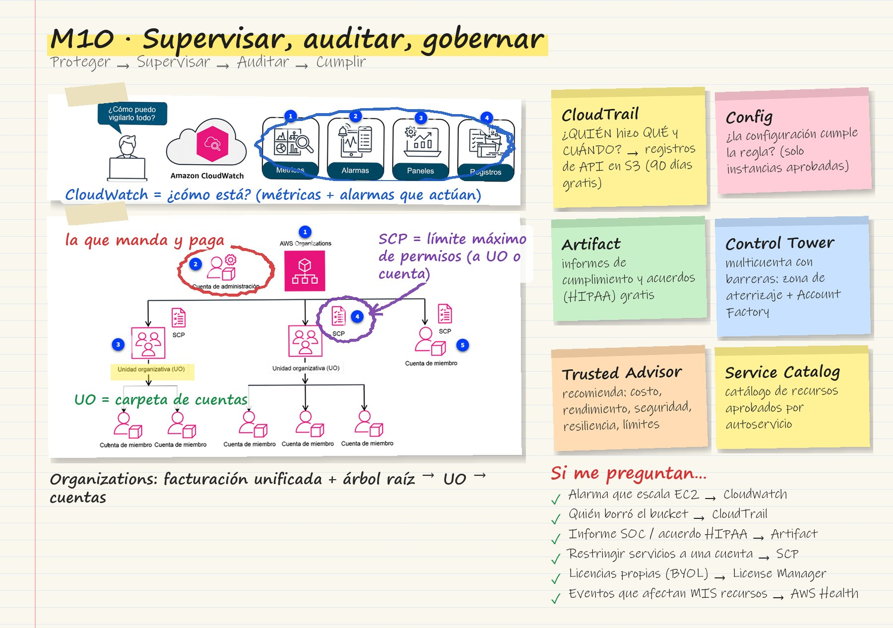
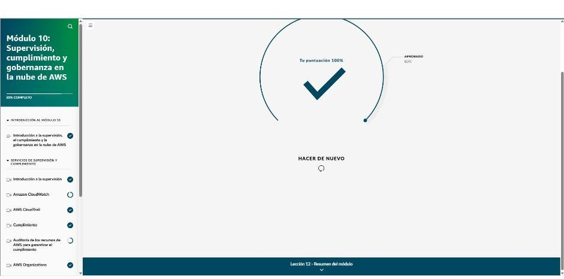

# Módulo 10 · Supervisión, cumplimiento y gobernanza

*AWS Cloud Practitioner Essentials*, módulo 10: monitoreo con CloudWatch, auditoría con CloudTrail, cumplimiento, administración de varias cuentas y gobernanza.

**Progresión recomendada:**

1. **Proteger:** datos, sistemas e infraestructura.
2. **Supervisar:** observar la actividad y detectar anomalías.
3. **Auditar:** comprobar que los controles funcionan.
4. **Cumplir:** respetar normas, estándares y contratos.

## Tarjeta de estudio

*Repaso rápido: la imagen del curso rayada con lo esencial y las pistas para el examen.*

## Supervisión: Amazon CloudWatch

- La **supervisión** recopila y sigue de forma continua el estado y el rendimiento de los recursos para detectar problemas a tiempo.
- **Amazon CloudWatch** observa en tiempo real recursos de AWS y de las instalaciones propias. Tiene cuatro piezas:

| Pieza | Para qué |
|---|---|
| **Métricas** | Datos de uso y rendimiento de recursos, servicios y aplicaciones |
| **Alarmas** | Umbrales que **notifican** o **actúan solos**, por ejemplo escalar EC2 si la CPU sigue alta |
| **Paneles** | Una sola vista personalizada |
| **Registros (*Logs*)** | Centralizan los registros de sistemas y aplicaciones para analizar errores |

## Auditoría: AWS CloudTrail

- Registra **quién hizo qué, cuándo y desde dónde**: llamadas a la API y acciones en la consola, en AWS, en las instalaciones y en otras nubes.
- **Historial de eventos:**
  - **90 días** de eventos de administración.
  - Inmutable y gratis de consultar.
- **Registros:**
  - Se envían a un **bucket de S3** para auditoría y cumplimiento (PCI, HIPAA).
- **CloudTrail Insights:**
  - Detecta volúmenes de llamadas o tasas de error fuera de lo normal.

## Cumplimiento

- AWS ayuda a cumplir porque:
  - los clientes **heredan** sus controles;
  - tiene validaciones de terceros para miles de requisitos;
  - entrega **informes bajo demanda**.
- **AWS Artifact:** acceso **gratuito y bajo demanda**.
  - **Informes:** auditorías de terceros que sirven como prueba ante auditores y reguladores.
  - **Acuerdos:** revisar, aceptar y administrar acuerdos con AWS, como el de **HIPAA**, para una cuenta o toda la organización.
- **Centro de conformidad (Customer Compliance Center):**
  - historias de clientes de sectores regulados;
  - respuestas a preguntas clave;
  - lista de comprobación de seguridad para auditorías.
- **AWS Config:** evalúa y audita la **configuración** de los recursos frente al estado deseado. Ejemplo: comprobar que solo se usan los tipos de instancia aprobados.
- **AWS Audit Manager:** auditoría continua y **recopilación automática de evidencias** para evaluaciones de riesgo y cumplimiento.

## Varias cuentas: AWS Organizations

- Reúne muchas cuentas en una estructura de **árbol**:
  - **Raíz.**
  - **Cuenta de administración:** la que gobierna.
  - **Unidades organizativas (UO)**, que pueden anidarse.
  - **Cuentas miembro:** pueden ir en una UO o directamente bajo la raíz.
- Ofrece **facturación unificada**, creación de cuentas por programa y recursos compartidos.
- **Políticas de control de servicios (SCP):** limitan los servicios, recursos y acciones de API disponibles. Se aplican a **UO** o a **cuentas miembro**.

## Gobernanza

| Servicio | Para qué |
|---|---|
| **AWS Control Tower** | Montar y gobernar un entorno **multicuenta** seguro con buenas prácticas: **zona de aterrizaje** (el contenedor de todas las UO, cuentas y recursos regulados), **Account Factory** (plantilla de cuentas), **controles** o barreras de protección y un panel |
| **AWS Service Catalog** | Catálogo de recursos **aprobados** que los empleados despliegan por autoservicio |
| **AWS License Manager** | Gestionar licencias, incluidas las propias (**BYOL**, como Microsoft en hosts dedicados), con límites de uso para no incumplirlas |

## Salud y optimización

- **AWS Health:**
  - Fuente oficial de eventos de servicio, cambios planificados y avisos que afectan a la cuenta.
  - Se consulta en el **panel de AWS Health**, o por API con soporte Premium.
- **AWS Trusted Advisor:**
  - Revisa el entorno de forma continua con comprobaciones de buenas prácticas: **costo, rendimiento, seguridad, resiliencia y límites de servicio**.
  - Todos los planes de soporte incluyen algunas comprobaciones; desde **Business** hay cientos.
- **Analizador de acceso de IAM:**
  - Revisa el acceso externo, valida políticas y quita permisos que no se usan, para llegar al **mínimo privilegio**.

!!! tip "Para recordar"
    - Métricas, alarmas y escalado automático → **CloudWatch**. Quién hizo qué y cuándo → **CloudTrail** (registros en S3).
    - Informes de cumplimiento y acuerdos como HIPAA → **AWS Artifact**. Configuraciones aprobadas → **AWS Config**. Evidencias de auditoría → **Audit Manager**.
    - Facturación unificada y UO → **Organizations**; restringir servicios → **SCP**. Entorno multicuenta con barreras de protección → **Control Tower** (zona de aterrizaje).
    - Catálogo de autoservicio → **Service Catalog**. Licencias BYOL → **License Manager**. Recomendaciones de costo y seguridad → **Trusted Advisor**.

## Evaluación del módulo

Resultado: **100 %** (se aprueba con 80 %).

??? note "Preguntas y respuestas correctas"

    **1.** Una empresa de ropa deportiva aloja su aplicación en instancias de Amazon EC2. Quiere recopilar métricas de sus instancias de EC2 y desea recibir notificaciones cuando la utilización supere los umbrales. También desea configurar una acción para automatizar el aumento vertical del número de instancias de EC2 cuando la utilización supere su umbral. ¿Qué servicio de AWS se adaptaría mejor a sus necesidades?

    ✔ Amazon CloudWatch

    **2.** ¿Qué servicio de AWS proporciona acceso gratuito y bajo demanda a los informes de seguridad y cumplimiento de AWS y a determinados acuerdos en línea?

    ✔ AWS Artifact

    **3.** Una empresa financiera con una solución de nube híbrida desea realizar un seguimiento de los cambios realizados en sus recursos de AWS tanto en la nube como en las instalaciones. En concreto, quieren saber quién hizo qué y cuándo. ¿Qué servicio de AWS se adaptaría mejor a sus necesidades?

    ✔ AWS CloudTrail

    **4.** Un cliente empresarial creció rápidamente y tiene dificultades para administrar la facturación de sus cuentas y recursos de AWS. Todos los empleados crearon cuentas independientes sin una administración centralizada ni agrupaciones jerárquicas de cuentas. El cliente desea unificar la facturación y centralizar la administración en unidades organizativas. ¿Qué servicio de AWS se adaptaría mejor a las necesidades de este cliente?

    ✔ AWS Organizations

    **5.** ¿Qué servicio de AWS proporciona evaluaciones y comprobaciones continuas de sus recursos de AWS y ofrece sugerencias para optimizar los costos, el rendimiento, la seguridad y la resiliencia?

    ✔ AWS Trusted Advisor

    **6.** Una empresa financiera busca una solución con el fin de controlar un conjunto seleccionado de recursos de AWS para sus empleados. Cuando los empleados necesitan seleccionar e iniciar un nuevo recurso de AWS, la empresa quiere ofrecer una forma de autoservicio para crear, compartir e implementar los recursos de AWS. ¿Qué servicio de AWS se adaptaría mejor a sus necesidades?

    ✔ AWS Service Catalog

    **7.** ¿Dónde pueden los clientes encontrar recursos sobre el cumplimiento de AWS, por ejemplo, información sobre historias de cumplimiento de los clientes, respuestas a preguntas clave sobre cumplimiento y una lista de comprobación de seguridad para auditorías?

    ✔ Centro de conformidad para clientes

    **8.** ¿Cuál es el propósito de una zona de aterrizaje de AWS Control Tower?

    ✔ Es el contenedor de toda la empresa que alberga todas las unidades organizativas (UO), cuentas, usuarios y recursos que desea regular para garantizar el cumplimiento.

    **9.** Un cliente de investigación con un gran equipo de desarrolladores necesita una forma de garantizarles pautas de configuración específicas a la hora de crear recursos de AWS. Quiere una forma de evaluar y auditar los recursos de AWS para asegurarse de que el equipo utilice la lista aprobada de recursos de computación más rentable. ¿Qué solución o característica cubriría sus necesidades?

    ✔ AWS Config

    **10.** Un cliente utiliza AWS Organizations para administrar de forma centralizada las cuentas de su empresa en cuanto a la facturación para optimizar y organizar los costos. Quiere establecer reglas o restricciones en los servicios, los recursos y las acciones individuales de la API de AWS a los que los usuarios pueden acceder. ¿Qué característica cubriría sus necesidades?

    ✔ Una política de control de servicios (SCP)

    **11.** Un cliente se está trasladando de un entorno en las instalaciones a la nube y decidió utilizar el enfoque del modelo Bring Your Own License (BYOL) para ahorrar costos. Le preocupa la administración de las licencias, quiere una forma de reducir el riesgo de incumplimiento y desea aplicar límites de uso para las licencias. ¿Qué solución se adaptaría mejor a sus necesidades?

    ✔ AWS License Manager
