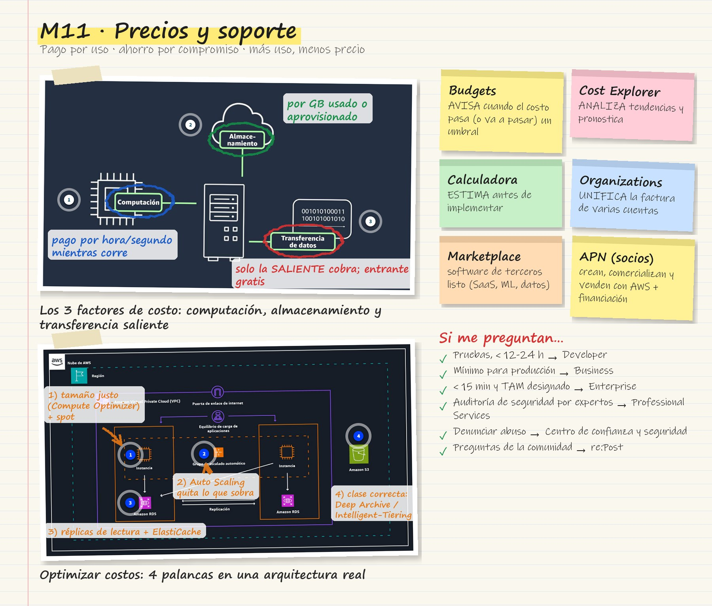
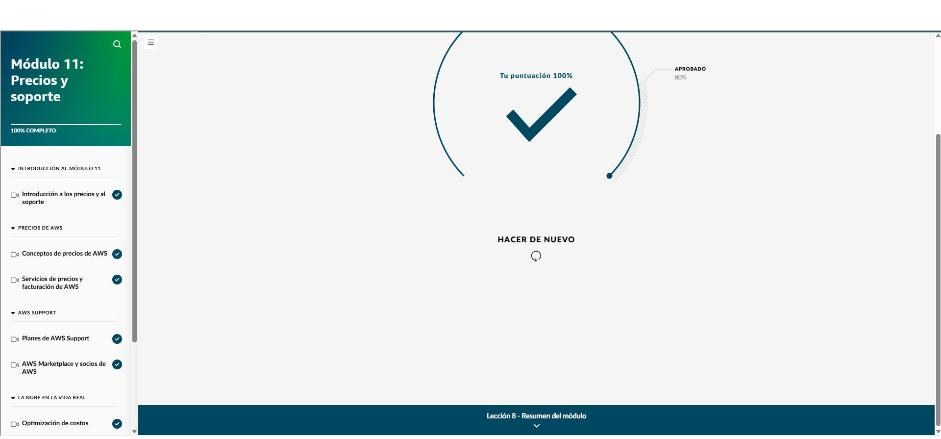

# Módulo 11 · Precios y soporte

*AWS Cloud Practitioner Essentials*, módulo 11: cómo cobra AWS, qué herramientas sirven para ver y controlar el gasto, qué planes de soporte existen y cómo optimizar costos en una arquitectura real.

## Tarjeta de estudio

*Repaso rápido: la imagen del curso rayada con lo esencial y las pistas para el examen.*

## Cómo cobra AWS

| Concepto | Idea |
|---|---|
| **Pago por uso** | Se paga solo lo que se usa, sin contratos largos. Evita aprovisionar de más o quedarse corto |
| **Ahorro cuando se compromete** | **Savings Plans**: descuento frente al precio bajo demanda a cambio de un compromiso de **1 o 3 años** |
| **Más uso, menos dinero** | Precios **escalonados**: cuanto más se usa, menos se paga por unidad (por ejemplo, en S3) |

### Factores que determinan el costo

El precio depende del servicio, la configuración, la región y el modelo de precios. Los **tres factores fundamentales** son:

- **Computación:**
  - Se paga por tiempo, por hora o por segundo, desde que se lanza el recurso hasta que se detiene, salvo que haya una reserva.
  - Ejemplo: entre más de 500 tipos de instancia EC2, una ONG elige `t4g.nano` porque es la más barata que cubre su necesidad.
- **Almacenamiento:**
  - Se paga por la cantidad aprovisionada o usada, casi siempre por GB.
  - Ejemplo: el volumen EBS de esa instancia cobra según la capacidad configurada.
  - **S3 tiene seis componentes de costo:** almacenamiento, solicitudes y recuperación, transferencia y aceleración, administración y análisis, replicación, y procesamiento con S3 Object Lambda.
- **Transferencia de datos *saliente*:**
  - La transferencia **entrante**, o entre servicios de la misma región, suele ser **gratis**.
  - La **saliente** se suma entre servicios y se cobra por GB; a más volumen, menor precio por GB.

## Herramientas de facturación y precios

| Herramienta | Para qué | Pista de examen |
|---|---|---|
| **AWS Organizations** | Agrupar cuentas, aplicar políticas y **facturación unificada** con un solo método de pago | «Consolidar la factura de varias cuentas» |
| **Panel de facturación y costos** | Cargos actuales, uso, previsiones, facturas y métodos de pago | «Ver la factura y pagar» |
| **AWS Budgets** | Presupuestos personalizados con **alertas** cuando el costo o el uso pasa un umbral, incluso uno **proyectado** | «Avisarme si paso de X» |
| **Explorador de costos** | **Analizar** gráficos de tendencias históricas, pronósticos y recomendaciones de instancias reservadas | «Ver en qué se fue el dinero» |
| **Calculadora de precios** | **Estimar** costos *antes* de implementar y comparar configuraciones | «Cuánto costará» |

## Planes de AWS Support

Cada plan incluye lo del anterior y suma herramientas, atención personalizada y respuestas más rápidas.

| Plan | Para quién | Respuesta más rápida | Trusted Advisor | TAM |
|---|---|---|---|---|
| **Basic** | Todos los clientes, gratis | — (documentación, documentos técnicos, re:Post) | Comprobaciones principales | No |
| **Developer** | Experimentar y hacer pruebas | < 24 h orientación general · < 12 h sistema dañado | Comprobaciones principales | No |
| **Business** | Mínimo para **producción** | < 4 h producción dañada · < 1 h producción caída | Conjunto completo | No |
| **Enterprise On-Ramp** | Cargas críticas para el negocio | < 30 min sistema crítico caído | Conjunto completo | Un **grupo** de TAM |
| **Enterprise** | Cargas de **misión crítica** | **< 15 min** sistema crítico caído | Completo + recomendaciones priorizadas por el equipo de cuentas | Un **TAM designado** |

- **TAM (Technical Account Manager):** es el contacto principal en AWS. Orienta sobre arquitectura, operación, costos y programas de AWS.

### Otros recursos de ayuda

- **AWS re:Post:** preguntas y respuestas de la comunidad. Incluye el **AWS Knowledge Center**, con artículos y videos sobre las dudas más comunes.
- **Centro de confianza y seguridad:** para **denunciar abuso**, es decir, actividad o contenido sospechoso en AWS.
- **Arquitectos de soluciones (SA):** para clientes Business y Enterprise. Dan orientación de arquitectura y buenas prácticas.
- **AWS Professional Services:** consultoría por proyecto para migraciones complejas, **auditorías de seguridad** y ajuste de rendimiento.
- **Autoayuda:** documentación de AWS, guías del usuario, guías de SDK, blog y documentos técnicos.

## AWS Marketplace y Red de socios

- **AWS Marketplace:**
  - Catálogo digital con miles de productos de **proveedores independientes** para buscar, probar y comprar software que corre en AWS, con precios y reseñas.
  - Incluye SaaS, modelos y algoritmos de ML/IA, y datos y análisis (BI, integración).
  - Se puede filtrar por sector, por ejemplo soluciones de **cumplimiento** para salud.
- **Red de socios de AWS (APN):**
  - Comunidad global que **crea, comercializa y vende** soluciones basadas en AWS.
  - **Beneficios de ser socio:** financiación (créditos y descuentos), eventos para socios, y formación y certificación exclusivas.

## Optimización de costos en la vida real

| Servicio | Técnica |
|---|---|
| **Amazon EC2** | **Dimensionar bien** con **AWS Compute Optimizer**; usar **instancias spot** (capacidad sobrante con gran descuento) para cargas que toleran interrupciones |
| **Escalado automático** | **AWS Auto Scaling** retira capacidad cuando baja la demanda; el balanceador reparte el tráfico |
| **Amazon RDS** | Escalado automático del almacenamiento; **réplicas de lectura** (escala horizontal) y **ElastiCache** para quitar carga a la instancia principal |
| **Amazon S3** | Elegir la **clase correcta**: **Glacier Deep Archive** para datos que se leen 1–2 veces al año, **Intelligent-Tiering** si el acceso es desconocido o cambiante. Usar **puntos de conexión de VPC** para bajar costos de transferencia |

!!! tip "Para recordar"
    - Tres formas de pagar: **pago por uso**, **ahorro por compromiso** (Savings Plans, 1–3 años) y **más uso, menos precio**.
    - Tres factores de costo: **computación, almacenamiento y transferencia saliente**. La entrante suele ser gratis.
    - **Budgets** avisa, el **Explorador de costos** analiza, la **Calculadora** estima antes y **Organizations** unifica la factura.
    - Soporte: Developer para pruebas, Business como mínimo para producción, y **Enterprise** con TAM designado y 15 min.
    - Auditoría de seguridad hecha por expertos: **Professional Services**. Software listo de terceros: **Marketplace**.

## Evaluación del módulo

Resultado: **100 %** (se aprueba con 80 %).

??? note "Preguntas y respuestas correctas"

    **1.** Una empresa financiera global actualmente tiene sus recursos de tecnología de la información (TI) en las instalaciones y está evaluando utilizar la nube de AWS. La empresa está acostumbrada a las inversiones de capital fijas y quiere saber cómo pagarían si se trasladaran a la nube de AWS. ¿Cuáles son las opciones que MEJOR describen la forma en que los clientes pagan por AWS? (Seleccione TRES opciones).

    ✔ Pago por uso · Más uso, menos dinero · Ahorro cuando se compromete

    **2.** Una empresa de tecnología educativa está considerando trasladar su aplicación educativa a la nube. El director financiero (CFO) de la empresa quiere comprender cómo se fijan los precios de los servicios de AWS y qué factores determinarán su costo. Si bien los precios varían en función de varios factores, ¿qué opciones son los principales determinantes de los costos en AWS? (Seleccione TRES opciones).

    ✔ Computación · Almacenamiento · Transferencia saliente de datos

    **3.** Imagine que forma parte de un equipo que desea supervisar y administrar los costos de varias cuentas de AWS en diferentes departamentos de su organización. ¿Qué servicio de AWS puede utilizar para administrar y consolidar de forma eficaz la información de facturación de estas cuentas?

    ✔ AWS Organizations

    **4.** Una empresa minorista en línea está interesada en seguir adelante con la migración de una aplicación, pero le gustaría estimar los costos antes de comenzar. ¿Qué herramienta o servicio puede usar para estimar el costo de los servicios y las configuraciones de AWS específicos que necesitan?

    ✔ La calculadora de precios de AWS es una herramienta basada en la web que la empresa puede utilizar para configurar las estimaciones de costos según sus necesidades empresariales únicas.

    **5.** Es el director de tecnología de una gran empresa con aplicaciones esenciales que se ejecutan en AWS. Su organización requiere el más alto nivel de soporte, incluidos tiempos de respuesta de 15 minutos o menos cuando los sistemas de importancia crítica no funcionan. ¿Qué plan de AWS Support debe elegir?

    ✔ Enterprise Support

    **6.** Imagine que es el líder técnico de una empresa de comercio electrónico de tamaño mediano y está evaluando varias opciones de soporte para su infraestructura de AWS. Sus desafíos actuales incluyen la optimización del rendimiento de la base de datos y la planificación de la respuesta a los incidentes. También busca asesoramiento técnico sobre las prácticas recomendadas de seguridad. Además de los planes de AWS Support, ¿qué opción de soporte es la MEJOR para obtener asesoramiento sobre las prácticas recomendadas de seguridad y realizar una auditoría de seguridad de su entorno de AWS?

    ✔ AWS Professional Services

    **7.** Además de los planes de AWS Support y otras opciones de asistencia técnica, AWS también proporciona acceso a recursos de autoayuda. ¿Qué opciones tienen disponibles los clientes de AWS como recursos de autoayuda? (Seleccione TRES opciones).

    ✔ Documentación de AWS, como guías del usuario para los servicios de AWS · Guías de SDK · Blog de AWS

    **8.** Una gran empresa desea encontrar soluciones de software preparadas para el cumplimiento a fin de asegurarse de satisfacer las normativas del sector. La empresa está analizando qué servicios de AWS pueden resultar útiles en este sentido y quiere implementar la solución lo antes posible. ¿Cuál es la MEJOR opción para esta empresa y sus requisitos?

    ✔ Encontrar soluciones preparadas para el cumplimiento en AWS Marketplace.

    **9.** ¿Qué opción describe MEJOR el rol de la Red de socios de AWS (APN)?

    ✔ Ayudar a las empresas a crear, comercializar y vender soluciones basadas en AWS

    **10.** ¿Cuál es la opción que MEJOR describe un beneficio clave de ser socio de AWS?

    ✔ Beneficios de financiación para los socios de AWS

## Fuentes y aviso legal

- **Fuente:** curso *AWS Cloud Practitioner Essentials* (AWS Skill Builder), ofrecido en AWS Entrena Bogotá. Sitios oficiales: [skillbuilder.aws](https://skillbuilder.aws) · [bogota.awsentrena.com](https://bogota.awsentrena.com) · [docs.aws.amazon.com](https://docs.aws.amazon.com).
- **Uso:** apuntes personales de estudio, sin fines comerciales y con redacción propia. Las imágenes del curso son fragmentos breves citados con fines educativos; sus derechos son de sus titulares.
- **Sin afiliación:** sitio no oficial, no afiliado ni respaldado por AWS. Las marcas pertenecen a sus dueños.
- Más detalles y cómo pedir el retiro de contenido en el [aviso legal](../../aviso-legal.md).
