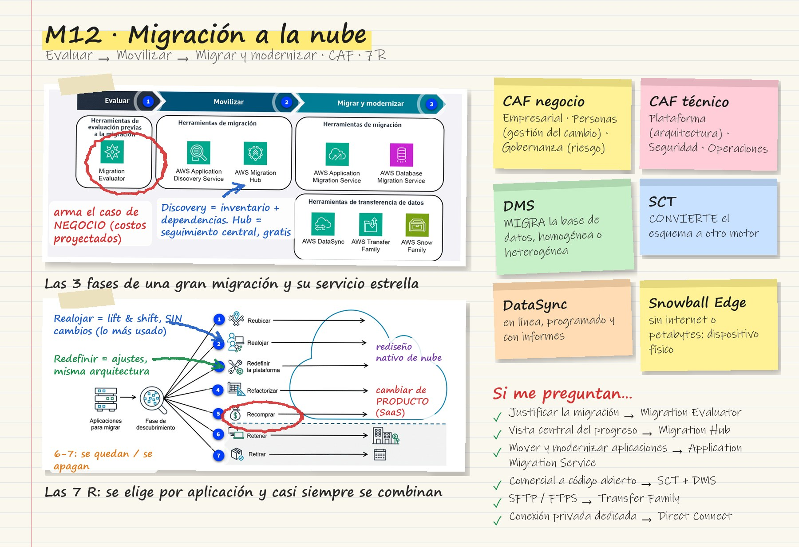
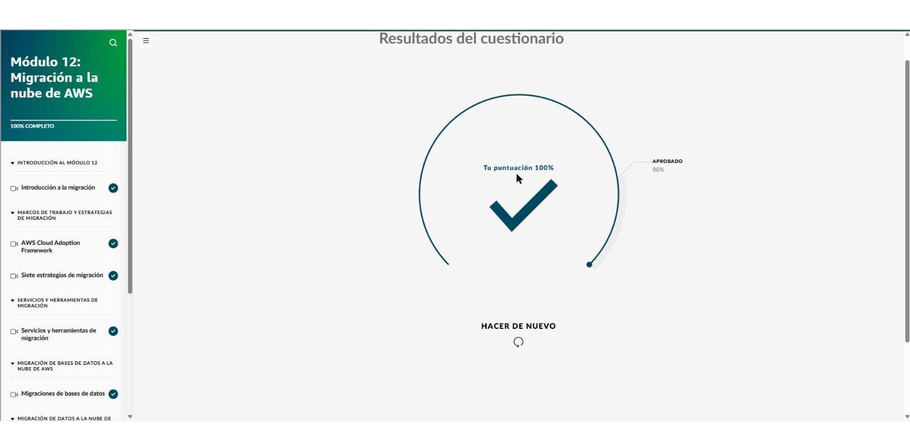

# Módulo 12 · Migración a la nube de AWS

*AWS Cloud Practitioner Essentials*, módulo 12: qué es migrar a la nube, las tres fases de una gran migración, el marco AWS CAF, las siete estrategias (las «7 R») y los servicios para mover aplicaciones, bases de datos y datos.

## Tarjeta de estudio

*Repaso rápido: la imagen del curso rayada con lo esencial y las pistas para el examen.*

## Las tres fases de una gran migración

Migrar es trasladar activos digitales, aplicaciones y bases de datos de las instalaciones propias a AWS. Rara vez se hace de una sola vez: las migraciones grandes van por fases.

| Fase | Qué se hace | Servicios clave |
|---|---|---|
| **1. Evaluar** | Armar el **caso de negocio** y medir qué tan preparada está la empresa | **Migration Evaluator** |
| **2. Movilizar** | Preparar la organización, descubrir el inventario y planear | **Application Discovery Service**, **Migration Hub** |
| **3. Migrar y modernizar** | Ejecutar el plan con buenas prácticas | **Application Migration Service**, **DMS**; para datos: **DataSync**, **Transfer Family**, **Snow Family** |

**Migration Hub** sirve en la fase de movilizar y también como **lugar único** para seguir toda la migración.

## AWS Cloud Adoption Framework (CAF)

Marco con la experiencia y las buenas prácticas de AWS para preparar la migración. Ayuda a **acelerar la migración, organizar los recursos y alinear la administración** durante la transición. Reduce riesgos y puede bajar costos operativos y abrir nuevos productos o modelos de negocio.

Organiza a las partes interesadas en **seis perspectivas**:

| Perspectiva | Enfoque | Roles típicos |
|---|---|---|
| **Empresarial** | Que la TI sirva a los resultados del negocio; caso de negocio y prioridades | Gerentes de negocio y de finanzas, dueños del presupuesto |
| **Personas** | **Gestión del cambio** en toda la organización: roles, habilidades, brechas, formación | Recursos Humanos, reclutadores, gerentes de personal |
| **Gobernanza** | Alinear estrategia de TI y de negocio, maximizar valor y **minimizar riesgo**; medir las inversiones en nube | CIO, gerentes de programas y de cartera, arquitectos empresariales |
| **Plataforma** | **Principios y patrones de arquitectura** para soluciones nuevas y para migrar cargas | CTO, gerentes de TI, arquitectos de soluciones |
| **Seguridad** | Visibilidad, auditabilidad, control y agilidad; elegir los controles de seguridad | CISO, gerentes y analistas de seguridad |
| **Operaciones** | Habilitar, operar y **recuperar** las cargas al nivel acordado con el negocio | Gerentes de operaciones y de soporte de TI |

Truco: las tres primeras son del **negocio** (empresarial, personas, gobernanza) y las tres últimas son **técnicas** (plataforma, seguridad, operaciones).

## Las siete estrategias de migración (7 R)

Se elige según la complejidad de cada aplicación, los objetivos, el tiempo y los recursos. Lo normal es **combinarlas** dentro del portafolio.

| Estrategia | En inglés | Qué significa |
|---|---|---|
| **Reubicar** | Relocate | Llevar VM o contenedores tal cual a la nube, cambiando solo dónde se alojan |
| **Realojar** | Rehost, *lift and shift* | Mover la aplicación **sin cambios**. Lo más común en migraciones grandes y rápidas |
| **Redefinir la plataforma** | Replatform, *lift, tinker and shift* | Algunas optimizaciones de nube **sin cambiar la arquitectura central** (por ejemplo, pasar la base de datos a RDS) |
| **Refactorizar** | Refactor / re-architect | **Rediseñar** con características nativas de nube para escalar, ganar rendimiento o agregar funciones |
| **Recomprar** | Repurchase | **Cambiar de producto**: de licencia tradicional a SaaS (por ejemplo, un CRM nuevo) |
| **Retener** | Retain | Dejar la aplicación donde está, por ahora |
| **Retirar** | Retire | Eliminar lo que ya no se necesita |

## Servicios de migración

| Servicio | Para qué | Pista de examen |
|---|---|---|
| **Migration Evaluator** | Crear el **caso de negocio** con datos: estado actual, estado objetivo y costos proyectados; detecta licencias reutilizables | «No sabe cómo justificar la migración» |
| **Application Discovery Service** | Descubrir el **inventario** de servidores en las instalaciones, su configuración, rendimiento y **dependencias** | «Qué tengo y cómo se conecta» |
| **Migration Hub** | **Centro único** para planear y **seguir el progreso** de toda la migración. Gratis | «Vista centralizada de las tareas de migración» |
| **Application Migration Service** | Mover (y modernizar) aplicaciones desde servidores físicos, otras nubes u otras regiones, sin parar la operación | «Migrar aplicaciones y reducir costos» |
| **Socios con competencia en migración** | Expertos externos del programa de socios de AWS | «Necesito ayuda especializada» |

## Migración de bases de datos

- **Homogénea:** mismo motor en origen y destino. Es sencilla.
- **Heterogénea:** cambia el motor, por ejemplo de una base comercial a una de código abierto. Es más compleja y puede requerir cambios en la aplicación.

| Servicio | Para qué |
|---|---|
| **AWS DMS** (Database Migration Service) | Planear, evaluar, convertir y **migrar bases de datos** con alta disponibilidad y poco tiempo de inactividad. Sirve para migraciones homogéneas y heterogéneas, y para **replicación continua** |
| **AWS SCT** (Schema Conversion Tool) | **Convertir el esquema** y los objetos de código (procedimientos, vistas, funciones) de un motor a otro. Estima el esfuerzo de la conversión |

## Migración de datos

**En línea** (hay conexión de red):

| Servicio | Para qué |
|---|---|
| **AWS DataSync** | **Automatizar y acelerar** grandes transferencias entre almacenamiento local y AWS (S3, EFS…). Permite **programar** horarios, limitar el ancho de banda, filtrar y ver **informes de tareas** |
| **AWS Transfer Family** | Transferencias de archivos administradas por **SFTP, FTPS, FTP** y otros protocolos, hacia S3 y EFS |
| **AWS Direct Connect** | **Conexión privada dedicada** entre la red propia y la VPC: rápida, fiable, más ancho de banda y menor costo de red |

**Sin conexión** (poco ancho de banda, sitios remotos sin internet o petabytes de datos):

- **Snowball Edge Storage Optimized** (Snow Family): **dispositivo físico** con almacenamiento NVMe que se llena y se envía a AWS. Sirve para migrar varios petabytes. También se usa para computación en el borde, en lugares difíciles.

!!! tip "Para recordar"
    - Fases: **Evaluar** (Migration Evaluator), **Movilizar** (Discovery Service y Migration Hub), **Migrar y modernizar** (Application Migration Service, DMS, DataSync…).
    - CAF tiene 6 perspectivas. Gestión del cambio: **Personas**. Patrones de arquitectura: **Plataforma**.
    - 7 R: reubicar, realojar, redefinir la plataforma, refactorizar, **recomprar (cambiar de producto)**, retener y retirar.
    - Cambiar a una base de datos de código abierto: **SCT** convierte el esquema y **DMS** mueve los datos.
    - Datos programados con informes: **DataSync**. SFTP/FTPS: **Transfer Family**. Sin internet o con petabytes: **Snowball Edge**.

## Preguntas de práctica de las lecciones

- **Perspectiva del CAF con principios y patrones para implementar soluciones nuevas y migrar cargas:** perspectiva de la **plataforma**.
- **Estrategia de migración que implica cambiar a un producto diferente:** **recomprar**.
- **Cliente que no sabe cómo crear el caso de negocio:** **Migration Evaluator**.
- **Vista central de todas las tareas de migración y su seguimiento:** **AWS Migration Hub**.
- **Pasar de una base comercial a una de código abierto convirtiendo todos los objetos:** **AWS SCT**.
- **Migrar grandes cantidades de datos a S3, automatizado, en horas de baja actividad y con informes:** **AWS DataSync**.

## Evaluación del módulo

Resultado: **100 %** (se aprueba con 80 %).

??? note "Preguntas y respuestas correctas"

    **1.** El equipo de migración quiere asegurarse de que la organización considere una estrategia de administración de cambios para toda la empresa con el fin de adoptar la nube con éxito. ¿Qué perspectiva del Cloud Adoption Framework (CAF) utilizarían?

    ✔ Perspectiva de las personas

    **2.** ¿Cuál es la función principal del AWS Cloud Adoption Framework (AWS CAF)?

    ✔ Proporciona herramientas para ayudar a acelerar el proceso de migración, organizar los recursos y alinear la administración durante la transición.

    **3.** ¿Cuáles son las siete estrategias de migración que se utilizan habitualmente cuando los clientes migran a la nube de AWS?

    ✔ Reubicar, realojar, redefinir la plataforma, refactorizar, recomprar, retener y retirar

    **4.** Una empresa minorista acaba de empezar su migración a la nube de AWS. Necesita ayuda para crear un caso empresarial con el fin de garantizar la financiación de su director financiero (CFO) y las partes interesadas. ¿Qué servicio de migración se adaptaría MEJOR a sus necesidades?

    ✔ Migration Evaluator

    **5.** Una empresa de medios se encuentra en la fase de migración y modernización y quiere una ubicación centralizada para ver sus tareas y el progreso de la migración. ¿Qué servicio de migración se adaptaría MEJOR a sus necesidades?

    ✔ AWS Migration Hub

    **6.** Una agencia medioambiental está migrando sus aplicaciones a la nube de AWS. Durante la migración, también quieren buscar formas de modernizar y reducir los costos de sus aplicaciones. ¿Qué servicio de migración se adaptaría MEJOR a sus necesidades?

    ✔ AWS Application Migration Service

    **7.** Durante su próxima migración, el administrador de la base de datos desea pasar de su base de datos actual a una base de datos administrada por AWS para descargar parte de la administración de la base de datos. También le gustaría usar una herramienta para planificar, evaluar, convertir y migrar la base de datos. ¿Qué solución de migración se adaptaría MEJOR a sus necesidades?

    ✔ AWS Database Migration Service (AWS DMS)

    **8.** Una empresa de tarjetas de crédito está migrando grandes cantidades de información confidencial de su almacenamiento en las instalaciones a la nube de AWS. Quiere automatizar el proceso y programar la migración fuera de las horas de mayor actividad. También quiere poder comprobar el progreso y los informes de tareas. No tiene una conexión privada dedicada entre su centro de datos y la nube de AWS. ¿Qué solución de migración en línea se ajustaría a sus necesidades?

    ✔ AWS DataSync

    **9.** Una empresa de ingeniería está migrando grandes cantidades de archivos de diseño de propiedad intelectual patentados desde su centro de datos en las instalaciones a la nube de AWS. Quiere un servicio que tenga soporte completamente administrado para transferencias seguras de archivos con varios protocolos diferentes, como el Protocolo de transferencia segura de archivos (SFTP) y el Protocolo seguro de transferencia de archivos (FTPS)¿Qué solución de migración en línea se ajustaría a sus necesidades?

    ✔ AWS Transfer Family

## Fuentes y aviso legal

- **Fuente:** curso *AWS Cloud Practitioner Essentials* (AWS Skill Builder), ofrecido en AWS Entrena Bogotá. Sitios oficiales: [skillbuilder.aws](https://skillbuilder.aws) · [bogota.awsentrena.com](https://bogota.awsentrena.com) · [docs.aws.amazon.com](https://docs.aws.amazon.com).
- **Uso:** apuntes personales de estudio, sin fines comerciales y con redacción propia. Las imágenes del curso son fragmentos breves citados con fines educativos; sus derechos son de sus titulares.
- **Sin afiliación:** sitio no oficial, no afiliado ni respaldado por AWS. Las marcas pertenecen a sus dueños.
- Más detalles y cómo pedir el retiro de contenido en el [aviso legal](../../aviso-legal.md).
