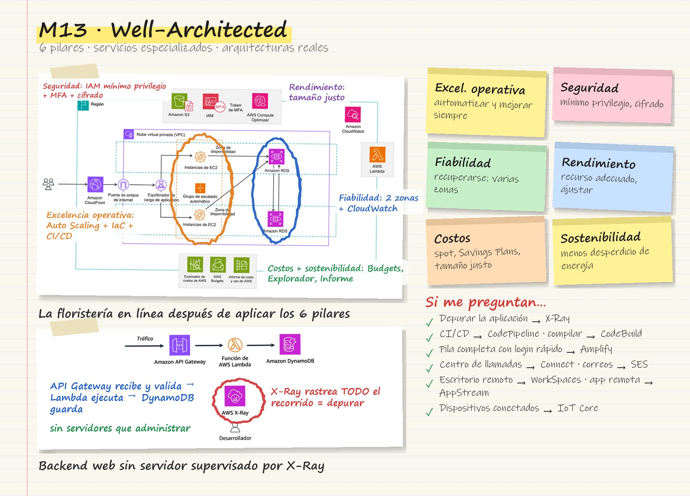
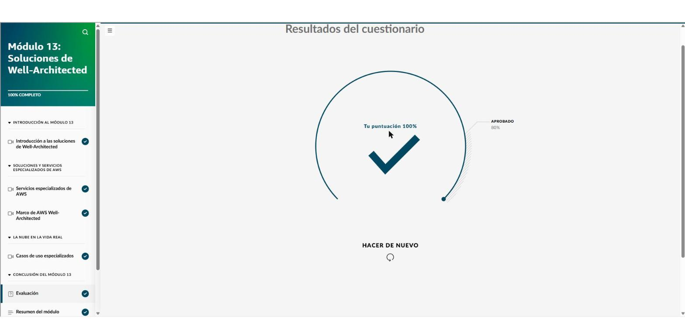

# Módulo 13 · Soluciones Well-Architected

*AWS Cloud Practitioner Essentials*, módulo 13 y cierre del curso. Cubre:

- servicios especializados para desarrollo, aplicaciones empresariales, escritorios remotos e IoT;
- el **Marco de AWS Well-Architected** con sus seis pilares;
- arquitecturas reales que combinan varios servicios.

## Tarjeta de estudio

*Repaso rápido: la imagen del curso rayada con lo esencial y las pistas para el examen.*

## Servicios especializados

### Desarrollo

| Servicio | Para qué | Pista de examen |
|---|---|---|
| **CodeBuild** | Integración continua: **compila**, ejecuta pruebas y empaqueta. Se paga por tiempo de compilación | «Compilar y probar el código» |
| **CodePipeline** | **CI/CD** completo: automatiza crear → probar → implementar en cada cambio | «Automatizar las implementaciones» |
| **X-Ray** | **Rastreo y depuración**: ve el recorrido de cada solicitud y encuentra cuellos de botella | «Visualizar el comportamiento de la aplicación» |
| **AppSync** | API de **GraphQL** administrada: una sola API que combina datos de varios orígenes | «Una API GraphQL» |
| **Amplify** | Crear y alojar apps web y móviles de **pila completa**; agrega autenticación, API y almacenamiento con poca infraestructura | «Agregar login y almacenamiento rápido» |

### Aplicaciones empresariales

- **Amazon Connect:** **centro de contacto** con IA. Ofrece enrutamiento, grabación y análisis de llamadas.
- **Amazon SES** (Simple Email Service): envío de **correos** transaccionales y de marketing en volumen.

### Computación de usuario final

- **AppStream 2.0:** **transmite aplicaciones** desde la nube a cualquier dispositivo, sin hardware potente local.
- **WorkSpaces:** **escritorio virtual** completo. Es como estar en el equipo de la oficina, desde cualquier lugar.
- **WorkSpaces Secure Browser:** **navegador remoto** protegido para sitios internos y SaaS, sin VPN ni software cliente.

### Internet de las cosas

- **AWS IoT Core:** conecta **dispositivos físicos** con la nube de forma segura, con autenticación mutua y cifrado de extremo a extremo.
- Ejemplos: cámaras inteligentes, comederos para mascotas controlados a distancia, riego según el clima y sensores de una línea de ensamblaje.

## Marco de AWS Well-Architected

Es un enfoque estructurado para diseñar arquitecturas **seguras, de alto rendimiento, resilientes y eficientes**. La mejora es **continua**, no de una sola vez.

| Pilar | Idea central | Ejemplo de mejora (caso de la floristería en línea) |
|---|---|---|
| **Excelencia operativa** | Operar, supervisar, **automatizar** y mejorar continuamente | EC2 Auto Scaling, infraestructura como código, autorreparación, **CI/CD** |
| **Seguridad** | Proteger sistemas y datos: **mínimo privilegio**, integridad y cifrado | Cifrado en reposo y en tránsito; políticas de IAM más estrictas; parches |
| **Fiabilidad** | **Recuperarse** de fallas y adaptarse a la demanda | Varias **zonas de disponibilidad**; CloudWatch con recuperación automática |
| **Eficiencia del rendimiento** | El recurso **adecuado** para cada trabajo, ajustado cuando cambia la necesidad | **Compute Optimizer** para dimensionar; Lambda; CloudFront |
| **Optimización de costos** | Aprovisionar con inteligencia y no pagar de más | **Spot** para tráfico variable, **Savings Plans** para lo estable, Budgets y Explorador de costos |
| **Sostenibilidad** | Usar energía y recursos con responsabilidad | Recursos elásticos y sin servidor, menos desperdicio, Informe de costo y uso |

**Herramienta de AWS Well-Architected (AWS WA):**

- Es un servicio **gratuito** que **evalúa las cargas de trabajo** contra los seis pilares.
- Hace seguimiento de hitos y propone planes de mejora.

## Arquitecturas reales

- **Backend web sin servidor:** API Gateway recibe la solicitud → Lambda → DynamoDB. **X-Ray** rastrea todo el recorrido.
- **Sitio estático con formulario de contacto:** sitio en **S3** → API Gateway → Lambda → correo al dueño con **SES**.
- **Atención al cliente con devolución de llamada:** llamada o texto → **Amazon Connect** (IVR) → agente en vivo. Si la espera es larga, el cliente puede pedir que lo llamen o pasar a mensajes de texto con Lambda.

!!! tip "Para recordar"
    - Los 6 pilares: **excelencia operativa, seguridad, fiabilidad, eficiencia del rendimiento, optimización de costos y sostenibilidad**.
    - Despliegues manuales que fallan: **CI/CD** (excelencia operativa). Una sola instancia en una sola zona: **varias zonas de disponibilidad** (fiabilidad). CPU al 10 %: **reducir el tamaño de la instancia** (costos y rendimiento).
    - Depurar: **X-Ray**. CI/CD: **CodePipeline**. Compilar: **CodeBuild**. GraphQL: **AppSync**. Pila completa rápida: **Amplify**.
    - Centro de llamadas: **Connect**. Correos masivos: **SES**. Escritorio remoto: **WorkSpaces**. Transmitir una aplicación: **AppStream 2.0**. Dispositivos: **IoT Core**.

## Preguntas de práctica de las lecciones

- **Depurar y visualizar el comportamiento de una aplicación en AWS:** **X-Ray**.
- **Centro de servicio al cliente con IA, con enrutamiento, grabación y análisis de llamadas:** **Amazon Connect**.
- **Dar a los empleados acceso a varias aplicaciones SaaS:** **AppStream 2.0**.
- **Soluciones de IoT:** una pulsera que cuenta pasos en el teléfono y un enchufe wifi que apaga las luces a distancia.
- **Despliegues manuales con caídas y entornos inconsistentes:** automatizar con **CI/CD** (excelencia operativa).
- **Propósito de la Herramienta AWS WA:** evaluar y mejorar las cargas de trabajo según los **seis pilares**.

## Evaluación del módulo

Resultado: **100 %** (se aprueba con 80 %).

??? note "Preguntas y respuestas correctas"

    **1.** Un desarrollador está trabajando en una aplicación de pila completa alojada en AWS. Le interesa agilizar el proceso de desarrollo al agregar rápidamente características como la autenticación y el almacenamiento con una administración mínima de la infraestructura. ¿Qué servicio de AWS proporcionaría la mejor solución para las necesidades del desarrollador?

    ✔ AWS Amplify

    **2.** El propietario de una gran empresa de hardware quiere automatizar y optimizar los correos electrónicos de marketing de la empresa para mejorar la participación de los clientes. ¿Qué servicio de AWS ayudaría en este caso de uso?

    ✔ Amazon Simple Email Service (Amazon SES)

    **3.** Una pequeña startup tecnológica debe proporcionar a su fuerza laboral remota un acceso seguro a su entorno de trabajo. Los empleados deben poder realizar las mismas tareas que si estuvieran en un equipo físico de la oficina. ¿Qué servicio de AWS se puede usar para proporcionar este acceso remoto?

    ✔ Amazon WorkSpaces

    **4.** Una empresa de fabricación necesita una forma de supervisar el equipo de su línea de ensamblaje para detectar cualquier problema de rendimiento. ¿Qué servicio de AWS puede ser útil para crear una solución de supervisión para el equipo?

    ✔ AWS IoT Core

    **5.** Una startup aloja una aplicación web crítica en una única instancia de EC2 en una zona de disponibilidad. Tras una breve interrupción, deciden revisar su arquitectura. ¿Qué práctica del Marco de AWS Well-Architected podría mejorar esta situación?

    ✔ Implementar instancias en varias zonas de disponibilidad para lograr tolerancia a errores (Fiabilidad).

    **6.** Una empresa utiliza un tipo de instancia de Amazon EC2 de gran tamaño para un sitio web con poco tráfico, pero la supervisión muestra que el uso de CPU rara vez supera el 10 por ciento. ¿Qué debería hacer a continuación la empresa?

    ✔ Ajustar el tamaño de la instancia de EC2 a un tipo de instancia más pequeña para que coincida con la carga de trabajo real.

## Fuentes y aviso legal

- **Fuente:** curso *AWS Cloud Practitioner Essentials* (AWS Skill Builder), ofrecido en AWS Entrena Bogotá. Sitios oficiales: [skillbuilder.aws](https://skillbuilder.aws) · [bogota.awsentrena.com](https://bogota.awsentrena.com) · [docs.aws.amazon.com](https://docs.aws.amazon.com) · [Marco Well-Architected](https://aws.amazon.com/architecture/well-architected/).
- **Uso:** apuntes personales de estudio, sin fines comerciales y con redacción propia. Las imágenes del curso son fragmentos breves citados con fines educativos; sus derechos son de sus titulares.
- **Sin afiliación:** sitio no oficial, no afiliado ni respaldado por AWS. Las marcas pertenecen a sus dueños.
- Más detalles y cómo pedir el retiro de contenido en el [aviso legal](../../aviso-legal.md).
