# Simulacro · Examen tipo AWS Cloud Practitioner

Preguntas del **examen tipo** de la ruta *AWS Cloud Practitioner Essentials* en AWS Entrena Bogotá (30 preguntas, 40 minutos, un solo intento), presentado el 2 nov 2026. Sirven para practicar antes del examen oficial **AWS Certified Cloud Practitioner (CLF-C02)**.

**Cómo usarlo:** cronometra 40 minutos, responde las 30 en papel y luego abre cada respuesta. Apunta las que fallaste y vuelve a la tarjeta de estudio del módulo indicado.

!!! success "Resultado: 100 / 100"
    La plataforma no muestra la nota al enviar, pero AWS Entrena la mandó por correo: **puntaje 100.00**. Las 30 respuestas de abajo son correctas.

    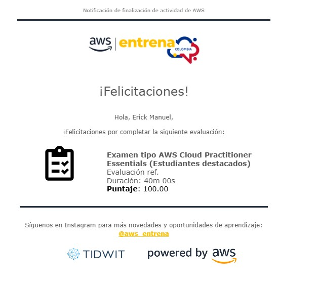{ width="420" }

## Preguntas

**1.** ¿Cuál de las siguientes es una ventaja de migrar a la nube de AWS?

A) Tercerizar las operaciones de TI · B) Pague por lo que utilice · C) Compras de capital · D) Compromisos a largo plazo

??? success "Respuesta"
    **B) Pague por lo que utilice.** Gasto variable en lugar de inversión inicial ([M1](01-introduccion-nube.md)).

**2.** Un proceso de producción usa varias instancias de EC2, corre de forma constante y continua, y no se puede interrumpir. ¿Qué modelo de precios es el mejor?

A) Instancias reservadas · B) Instancias spot · C) Instancias bajo demanda · D) Instancias flexibles

??? success "Respuesta"
    **A) Instancias reservadas.** Carga estable y predecible por 1 o 3 años; spot se descarta porque puede interrumpirse ([M2](02-computacion-nube.md)).

**3.** ¿Cuáles son pilares del marco de buena arquitectura de AWS? (Seleccione DOS.)

A) Resiliencia · B) Excelencia operativa · C) Confidencialidad · D) Economía · E) Eficiencia en el rendimiento

??? success "Respuesta"
    **B y E.** Los pilares son excelencia operativa, seguridad, fiabilidad, eficiencia del rendimiento, optimización de costos y sostenibilidad ([M13](13-well-architected.md)).

**4.** ¿Qué servicios de AWS ofrecen capacidades de computación? (Seleccione DOS.)

A) Amazon DynamoDB · B) Amazon ECS · C) Amazon EFS · D) AWS CloudHSM · E) AWS Lambda

??? success "Respuesta"
    **B y E.** ECS ejecuta contenedores y Lambda ejecuta código. DynamoDB es base de datos, EFS almacenamiento y CloudHSM claves ([M3](03-servicios-computacion.md)).

**5.** ¿Qué servicio ejecuta el código de su aplicación solo cuando es necesario, sin ejecutar servidores?

A) Amazon EC2 · B) Amazon ECS · C) AWS Lambda · D) Amazon Lightsail

??? success "Respuesta"
    **C) AWS Lambda.** Se activa con eventos y cobra por milisegundo ([M3](03-servicios-computacion.md)).

**6.** ¿Qué función de EC2 permite crear una imagen estandarizada para lanzar instancias nuevas?

A) Amazon Golden Image · B) Amazon Block Template · C) Amazon Machine Image · D) Amazon EBS Mount Point

??? success "Respuesta"
    **C) Amazon Machine Image (AMI).** Plantilla con SO, configuración y software ([M2](02-computacion-nube.md)).

**7.** ¿Qué tareas optimizan los costos de Amazon EC2? (Seleccione DOS.)

A) Grupos de Auto Scaling que agregan y quitan instancias según la demanda · B) Una política que restringe el acceso de los usuarios de IAM a la consola de EC2 · C) Un presupuesto en AWS Budgets para limitar el gasto en EC2 · D) Adquirir instancias reservadas · E) Crear usuarios en una sola región

??? success "Respuesta"
    **A y D.** Auto Scaling evita pagar capacidad ociosa y las reservadas dan hasta 75 % de descuento. Budgets alerta, pero no baja el costo de las instancias ([M2](02-computacion-nube.md), [M11](11-precios-soporte.md)).

**8.** ¿Qué servicio de AWS está diseñado para el análisis operativo?

A) Amazon EMR · B) Amazon Athena · C) Amazon QuickSight · D) Amazon Elasticsearch Service

??? success "Respuesta"
    **D) Amazon Elasticsearch Service** (hoy Amazon OpenSearch Service): búsqueda y paneles sobre registros en tiempo real ([M8](08-ia-ml-analisis-datos.md)).

**9.** Tres instancias EC2 detrás de un único Elastic Load Balancer deben estar altamente disponibles. ¿Cómo se despliegan?

A) En varias zonas de disponibilidad de una sola región · B) Como spot en la misma región y la misma AZ · C) En varias regiones con IP elásticas · D) Como reservadas en la misma región y en AZ distintas

??? success "Respuesta"
    **A) Varias AZ en una sola región.** El ELB es regional y reparte entre AZ. La opción D habla del modelo de precio, que no aporta disponibilidad ([M4](04-globalizacion.md)).

**10.** ¿Cuál es un ejemplo de escalado vertical?

A) Auto Scaling añade más instancias de EC2 · B) Lambda añade ejecuciones simultáneas · C) Aumentar el tamaño de la instancia de Amazon RDS · D) Añadir réplicas de lectura a RDS

??? success "Respuesta"
    **C.** Vertical = una máquina más grande; las demás opciones agregan unidades, es decir, escalan en horizontal ([M2](02-computacion-nube.md)).

**11.** ¿Qué prácticas recomendadas aplican a IAM? (Seleccione DOS.)

A) Insertar claves de acceso en el código · B) Crear usuarios individuales de IAM · C) Usar políticas insertadas en vez de administradas · D) Usar grupos para asignar permisos · E) Otorgar privilegios a los usuarios

??? success "Respuesta"
    **B y D.** Una identidad por persona y permisos heredados por grupo; nunca claves en el código ([M9](09-seguridad.md)).

**12.** ¿Qué conexión une un centro de datos local con AWS con alta velocidad, baja latencia y sin usar Internet?

A) Direct Connect · B) VPC Endpoints · C) VPN administrada por AWS · D) Client VPN

??? success "Respuesta"
    **A) Direct Connect.** Fibra dedicada y privada; las VPN viajan por Internet ([M5](05-redes.md)).

**13.** ¿Cuáles son servicios de computación? (Seleccione DOS.)

A) AWS Batch · B) AWS CloudTrail · C) AWS Elastic Beanstalk · D) Amazon EFS · E) Amazon Inspector

??? success "Respuesta"
    **A y C.** Batch procesa trabajos por lotes y Beanstalk despliega aplicaciones sobre EC2 ([M3](03-servicios-computacion.md)).

**14.** ¿Qué servicio se usa para almacenar datos en caché?

A) Amazon SQS · B) Amazon DynamoDB DAX · C) AWS KMS · D) Amazon EFS

??? success "Respuesta"
    **B) DynamoDB Accelerator (DAX):** caché en memoria para DynamoDB. Es el mismo concepto de ElastiCache ([M7](07-bases-de-datos.md)).

**15.** ¿Qué servicio introduce tolerancia a errores en la arquitectura de una aplicación?

A) Amazon CloudFront · B) Amazon ElastiCache · C) Elastic Load Balancing · D) Amazon DynamoDB

??? success "Respuesta"
    **C) Elastic Load Balancing.** Deja de enviar tráfico a las instancias con fallas ([M2](02-computacion-nube.md)).

**16.** ¿Qué servicio de control de código fuente totalmente administrado aloja repositorios Git?

A) AWS CodeBuild · B) AWS CodeDeploy · C) AWS CodeCommit · D) AWS CodePipeline

??? success "Respuesta"
    **C) AWS CodeCommit.** CodeBuild compila, CodeDeploy despliega y CodePipeline orquesta el CI/CD.

**17.** ¿Entre qué límites se puede reasignar una dirección IP elástica de una instancia EC2 a otra?

A) Regiones · B) Ubicaciones periféricas · C) Zonas de disponibilidad · D) Subredes de bases de datos

??? success "Respuesta"
    **C) Zonas de disponibilidad.** La IP elástica pertenece a una región y se mueve entre instancias de cualquier AZ de esa región, pero no a otra región.

**18.** ¿Qué permite usar licencias propias sobre hardware físicamente aislado de otras cuentas?

A) Instancias dedicadas · B) Instancias spot · C) Hosts dedicados · D) Instancias reservadas

??? success "Respuesta"
    **C) Hosts dedicados.** Dan visibilidad del servidor físico, que es lo que piden las licencias por socket o núcleo ([M2](02-computacion-nube.md)).

**19.** ¿Qué herramienta orienta en tiempo real con buenas prácticas de costos, rendimiento, seguridad y tolerancia a fallos?

A) Amazon Inspector · B) AWS Trusted Advisor · C) AWS Personal Health Dashboard · D) AWS IAM

??? success "Respuesta"
    **B) Trusted Advisor** ([M10](10-supervision-cumplimiento-gobernanza.md)).

**20.** ¿Qué beneficio permite sustituir gastos fijos iniciales por gastos variables?

A) Precios de pago por uso · B) Economías de escala · C) Alcance global · D) Alta disponibilidad

??? success "Respuesta"
    **A) Pago por uso** ([M1](01-introduccion-nube.md)).

**21.** ¿Qué herramienta muestra el uso y los límites de servicio actuales?

A) Amazon CloudWatch · B) AWS Personal Health Dashboard · C) AWS Trusted Advisor · D) AWS Systems Manager

??? success "Respuesta"
    **C) Trusted Advisor.** Una de sus categorías es «límites de servicio» ([M10](10-supervision-cumplimiento-gobernanza.md)).

**22.** ¿Qué describe mejor Amazon Route 53?

A) Enrutamiento dentro de una VPC · B) Servicio DNS altamente disponible y escalable · C) Extiende la red local a AWS · D) Distribuye conexiones entre instancias EC2

??? success "Respuesta"
    **B) DNS.** C describe una VPN o Direct Connect y D describe ELB ([M5](05-redes.md)).

**23.** ¿Qué ventajas tiene Amazon RDS frente a una base de datos local? (Seleccione DOS.)

A) Control total del SO · B) Mejor escalabilidad por despliegue rápido y capacidad abundante · C) Usar cualquier software de base de datos · D) Alta disponibilidad más fácil con réplicas de lectura y multi-AZ · E) Replicar entre regiones sin costo

??? success "Respuesta"
    **B y D.** Con RDS no hay acceso al SO, los motores son seis y la replicación entre regiones se cobra ([M7](07-bases-de-datos.md)).

**24.** ¿Qué permite agrupar recursos que comparten una o más etiquetas?

A) Tag groups · B) Organization groups · C) Resource groups · D) Consolidation groups

??? success "Respuesta"
    **C) AWS Resource Groups.**

**25.** ¿Qué servicio mejora el rendimiento para usuarios de todo el mundo?

A) Amazon Lightsail · B) Amazon CloudFront · C) Amazon Connect · D) Amazon ElastiCache

??? success "Respuesta"
    **B) CloudFront.** CDN con caché en las ubicaciones periféricas ([M4](04-globalizacion.md)).

**26.** ¿Cómo se configura la copia automática y asíncrona de objetos de S3 entre regiones?

A) AWS lo hace de forma predeterminada · B) Replicación multimaestro · C) Replicación entre regiones · D) Acciones del ciclo de vida

??? success "Respuesta"
    **C) Replicación entre regiones (CRR).** El ciclo de vida cambia la clase de almacenamiento o borra objetos, pero no copia ([M6](06-almacenamiento.md)).

**27.** ¿Qué dato se introduce en la calculadora del costo total de propiedad (TCO)?

A) Número de usuarios finales · B) Número de aplicaciones · C) Cantidad de sistemas de almacenamiento · D) Número de servidores

??? success "Respuesta"
    **D) Número de servidores.** El TCO compara los servidores propios con su equivalente en AWS ([M11](11-precios-soporte.md)).

**28.** ¿Cuál es la forma más sencilla de respaldar un volumen EBS en S3?

A) Un script propio · B) Ciclo de vida de S3 · C) Crear una instantánea (snapshot) del volumen · D) Amazon Kinesis

??? success "Respuesta"
    **C) Instantánea de EBS.** Se guarda en S3 de forma progresiva ([M6](06-almacenamiento.md)).

**29.** ¿Qué se necesita para iniciar sesión en la consola de AWS?

A) Nombre de usuario y contraseña · B) Par de claves · C) Clave de acceso y clave secreta · D) Certificado

??? success "Respuesta"
    **A) Usuario y contraseña** (más MFA si está activada). Las claves de acceso son para la CLI y los SDK; el par de claves, para entrar por SSH a EC2 ([M9](09-seguridad.md)).

**30.** ¿Qué afirmación NO caracteriza a la computación en la nube?

A) Entrega bajo demanda de potencia de cómputo · B) Enormes economías de escala · C) Cambiar gastos variables por gastos de capital · D) Más velocidad y agilidad

??? success "Respuesta"
    **C.** Es al revés: la nube cambia gastos de capital por gastos **variables** ([M1](01-introduccion-nube.md)).

## Evidencia

Capturas del examen con las respuestas marcadas antes de enviarlo, y la revisión final.

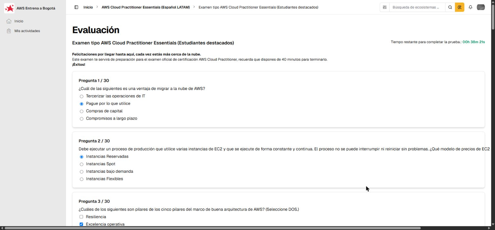
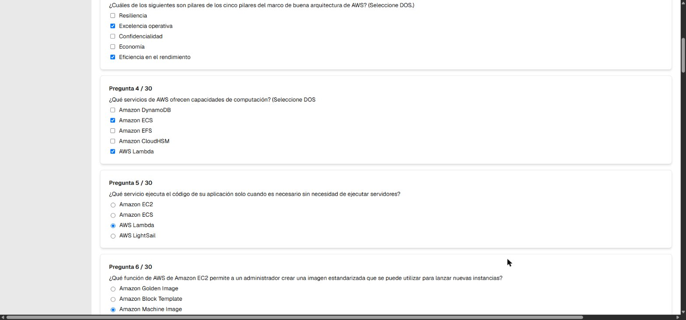
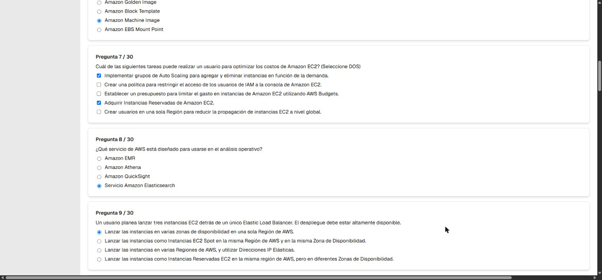
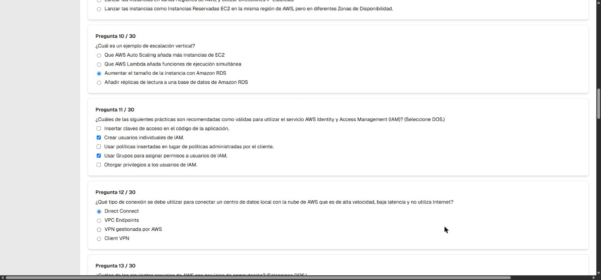
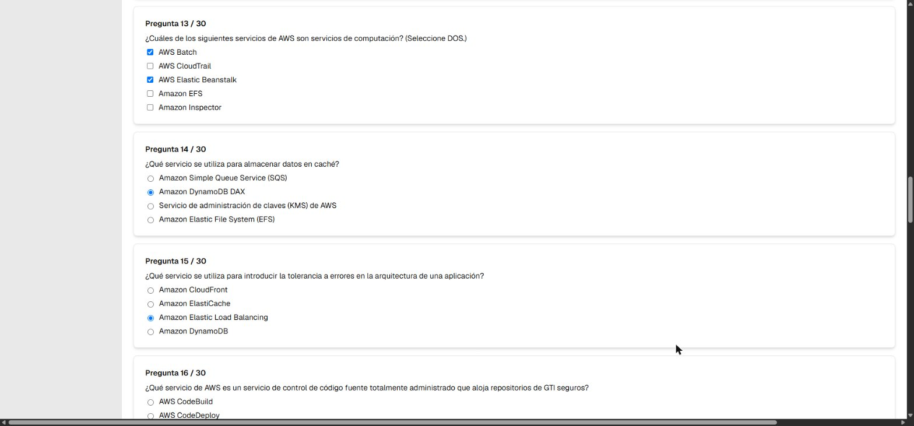
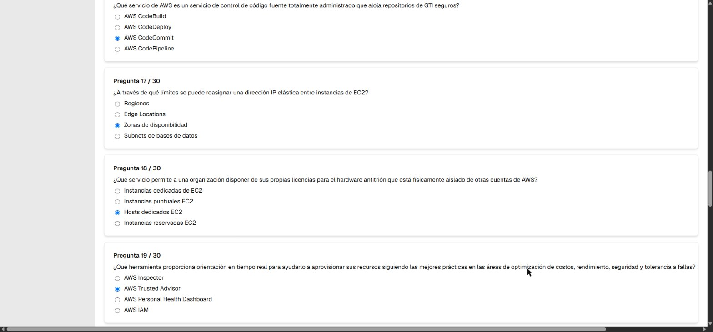
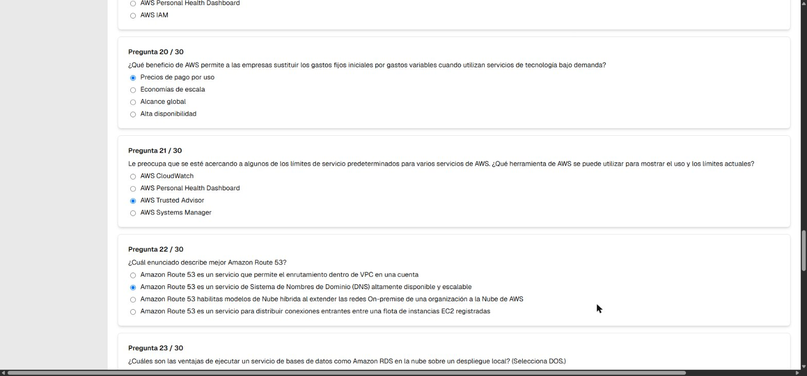
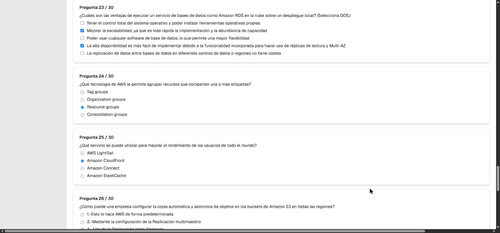
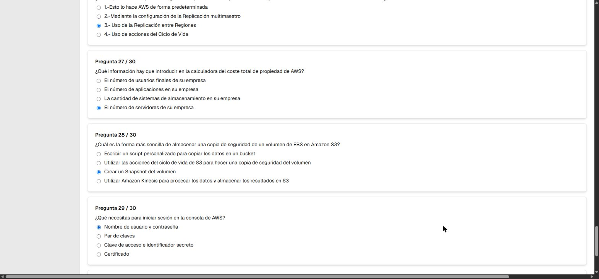
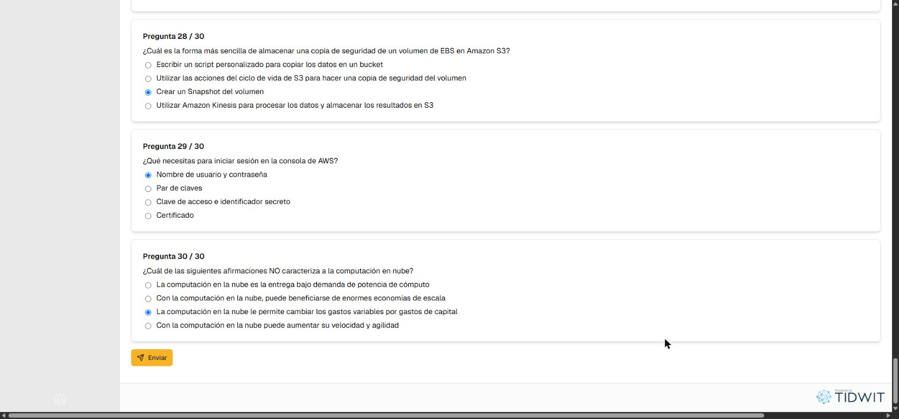
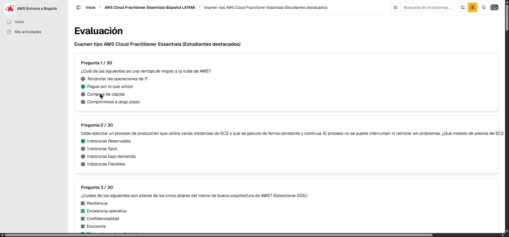

## Fuentes y aviso legal

- **Fuente:** examen tipo de la ruta *AWS Cloud Practitioner Essentials* en [AWS Entrena Bogotá](https://bogota.awsentrena.com) y el curso de [AWS Skill Builder](https://skillbuilder.aws). Las explicaciones son mías, a partir de los apuntes del curso y de [docs.aws.amazon.com](https://docs.aws.amazon.com).
- **Uso:** material personal de estudio, sin fines comerciales.
- **Sin afiliación:** sitio no oficial, no afiliado ni respaldado por AWS. Las marcas pertenecen a sus dueños.
- Más detalles y cómo pedir el retiro de contenido en el [aviso legal](../../aviso-legal.md).
