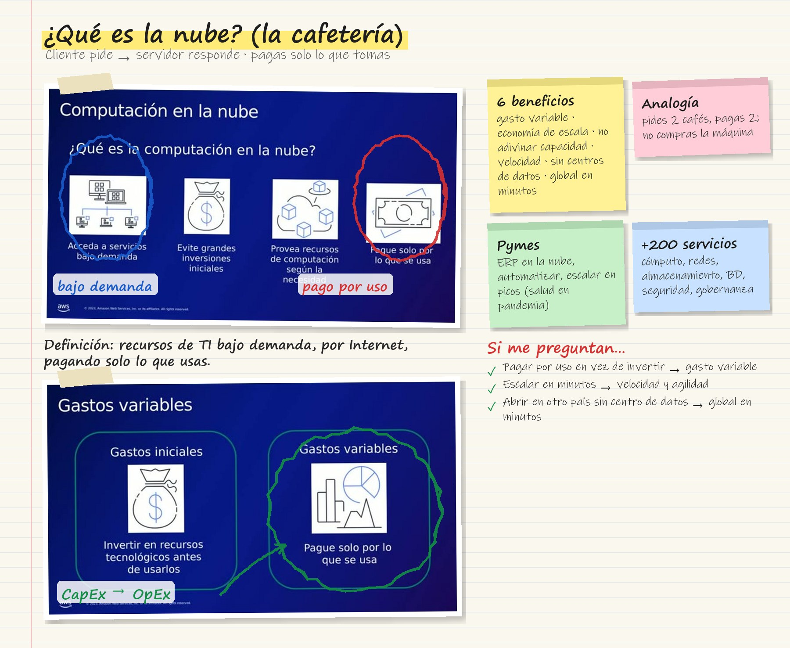
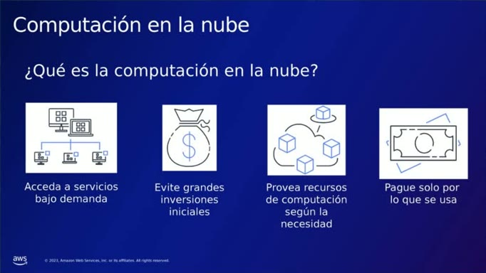

# 01 · ¿Qué es la computación en la nube de AWS?

Video corto de Juan Esteban Gómez, instructor técnico de AWS (Talento Cloud), unos 9 min. Explica la nube con una analogía: **una cafetería**. Ruta «Fundamentos de Nube AWS para Empresas».

## Tarjeta de estudio

*Repaso rápido: la imagen del curso rayada con lo esencial y las pistas para el examen.*

## Modelo cliente-servidor

- En la cafetería, el **cliente** pide un café con ciertas características y quien está en la caja recibe el pedido y le entrega el producto preparado.
- En tecnología es el **modelo cliente-servidor**: un cliente (celular, computador, tableta) hace una **solicitud** a un **servidor**, que es donde viven las aplicaciones y los sitios web. El servidor procesa la solicitud y devuelve el contenido.
- En la nube nosotros somos el cliente y **la nube es el servidor**: un catálogo de servicios y capacidades al que se accede por Internet.

## ¿Qué es la computación en la nube?

*Figura: los cuatro rasgos de la computación en la nube.*

1. **Acceso a servicios bajo demanda.** Se pide solo lo que se necesita del catálogo (cómputo, almacenamiento, *machine learning*…), igual que en la cafetería no se piden todos los productos.
2. **Sin grandes inversiones iniciales.** No hay que comprar un servidor que, se use o no, ya quedó pagado.
3. **Recursos según la necesidad.** Si hoy necesito dos cafés, pido dos; si mañana necesito más capacidad, la pido.
4. **Pago solo por lo que se usa.** Si mañana ya no necesito una máquina virtual, dejo de pagarla.

## Beneficios

| Beneficio | Idea | En la cafetería |
|---|---|---|
| **Gastos variables** en vez de gastos iniciales | Se paga por consumo, no se invierte antes de tener usuarios | No compro la cafetería entera |
| **Optimización de costos** | Sin mantenimiento de centros de datos; el foco queda en aplicaciones y clientes | Al cliente final solo le importa que la app funcione y le dé valor |
| **Capacidad** | No hay que adivinar cuánta infraestructura se necesitará; se escala según la necesidad | Si quiero otro café pido otro, no compro la máquina |
| **Economía de escala** | Entre más clientes tiene AWS, más bajo el precio para todos | Un café en la cafetería sale más barato que montar mi propia máquina |
| **Velocidad y agilidad** | Recursos en **minutos**, no en semanas o meses | No tengo que ir a comprar e instalar la máquina |
| **Global en minutos** | Infraestructura en América, Europa, Asia… lista para usar | Una cadena con muchas sucursales: voy a la más cercana |

- AWS ofrece **más de 200 servicios** en categorías como cómputo, redes y entrega de contenido, almacenamiento, bases de datos, seguridad, y gestión y gobernanza. No hay que usarlos todos: se toman los que sirven para construir la solución.

!!! tip "Para recordar"
    - Nube = **servicios de TI bajo demanda por Internet, pagando por uso**.
    - Pasar de **gasto inicial (CapEx)** a **gasto variable (OpEx)** es el primer beneficio que se suele preguntar.
    - Las seis ventajas: gasto variable, optimización de costos, no adivinar capacidad, economía de escala, velocidad y agilidad, global en minutos.

## Casos de pymes en la nube

Video de testimonios de clientes de AWS en Latinoamérica (unos 4 min):

- Un proveedor de software para empresas en zonas apartadas, con mala conectividad, subió su **ERP a la nube** para que sus clientes pudieran usarlo con más facilidad.
- Una empresa de comunicación pasó de **procesos manuales** en varias plataformas a flujos automatizados para llegar más rápido a sus audiencias.
- Una empresa resumió su experiencia como «**estamos subidos en los hombros de un gigante**»: AWS resuelve la infraestructura y ellos se dedican a mostrar su producto. Además, aprenden de los servicios nuevos que van apareciendo.
- Otra organización decidió **centralizar toda su infraestructura** en un solo lugar con un *partner* certificado porque estaba asumiendo demasiado riesgo.
- Un servicio de salud tuvo un pico de demanda en la pandemia y, gracias a la **elasticidad** de AWS, atendió a todos sus pacientes y generó más ingresos.
