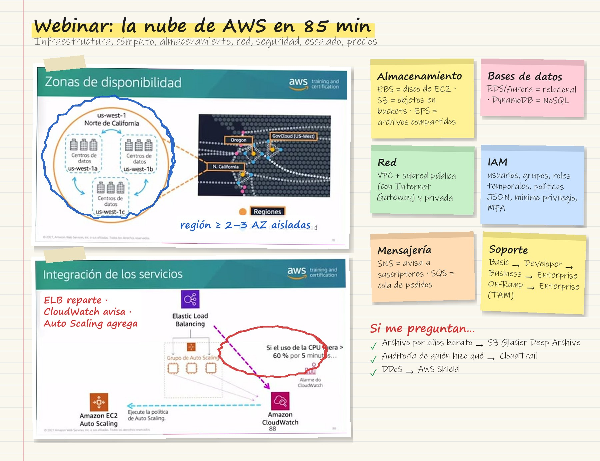
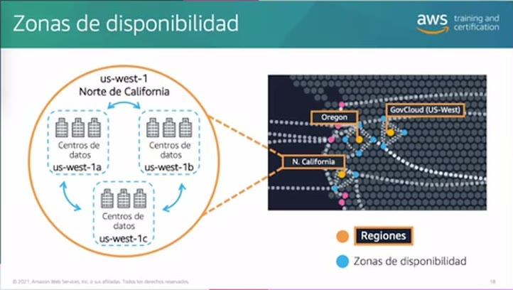
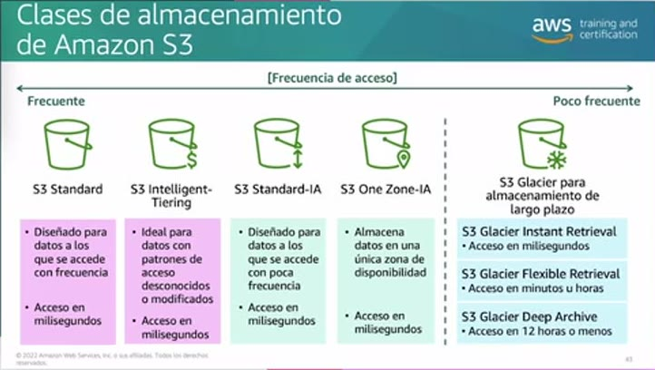
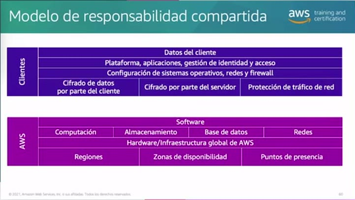
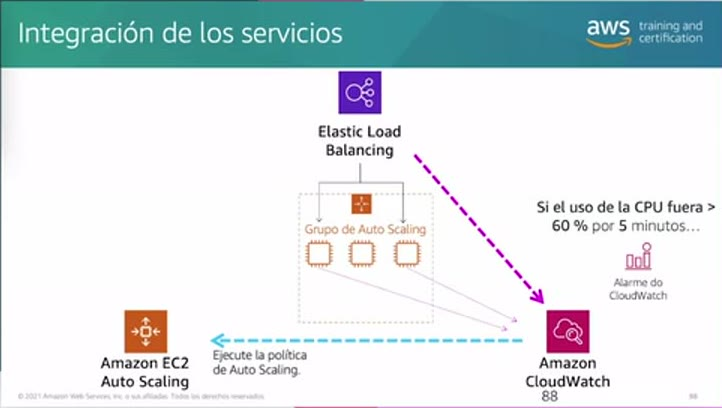
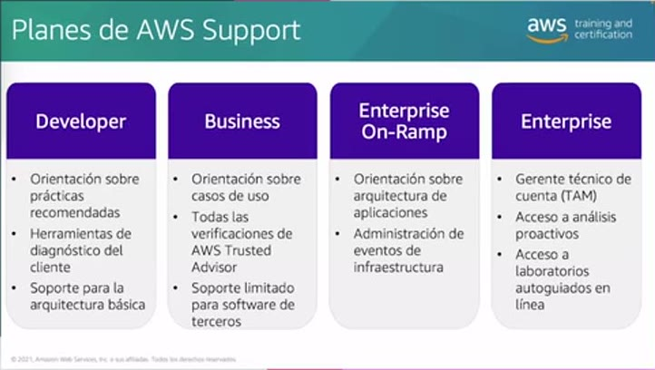

# 02 · Webinar «¿Qué es la Nube de AWS?»

Webinar de Diego Casas, Technical Trainer de AWS, de 1 h 25 min. Recorre en ocho módulos los fundamentos de AWS, siempre con la analogía de la cafetería. Es un buen resumen de los temas de **AWS Cloud Practitioner**. Ruta «Fundamentos de Nube AWS para Empresas».

## Tarjeta de estudio

*Repaso rápido: la imagen del curso rayada con lo esencial y las pistas para el examen.*

## 1. Introducción a AWS

- **Modelo cliente-servidor:** el cliente pide un café a su gusto y el barista lo prepara. En la nube, el cliente envía una solicitud, por ejemplo guardar un archivo, y el servidor la cumple.
- **Computación en la nube:** servicios **bajo demanda**, **sin grandes inversiones**, **recursos según la necesidad** y **pago por consumo**. Funciona como el gas o el agua: si se usan 2 m³, se pagan 2 m³.
- **Seis beneficios:**
  - **Gasto variable** en vez de inversión previa.
  - **Optimización de costos**, sin mantener un centro de datos.
  - **No adivinar capacidad**: se crece o se reduce según el negocio.
  - **Economía de escala**: los descuentos se trasladan a los clientes.
  - **Velocidad y agilidad**: minutos en lugar de semanas de compras y envíos.
  - **Global en minutos**: clave para las *startups* que crecen a varios países.
- **Grupos de servicios:** cómputo, redes y entrega de contenido, almacenamiento, bases de datos, seguridad, y gestión y gobernanza.

## 2. Infraestructura global

*Figura: la región Norte de California (us-west-1) con sus zonas de disponibilidad, cada una con centros de datos aislados y conectados por red de alta velocidad.*

- **Región:** zona geográfica con centros de datos conectados a la red global de AWS. Tiene **al menos dos zonas de disponibilidad**.
- **Zona de disponibilidad (AZ):** uno o más centros de datos con energía, red y configuración **aislados** de las otras AZ y unidos por enlaces de baja latencia. Repartir recursos entre AZ da **alta disponibilidad**.
- **Ejemplo en Sudamérica:** la región de **São Paulo** tiene 3 AZ. Un usuario en Colombia, Chile o Argentina llega más rápido a través de los **puntos de presencia** (ubicaciones de borde) de **Amazon CloudFront**.
- **Cómo se interactúa con AWS** (el «cajero» y el «barista»):
  - **Consola de administración:** interfaz gráfica en el navegador.
  - **CLI:** línea de comandos, para automatizar con *scripts*.
  - **SDK:** kits para integrar AWS en el código, en los lenguajes más usados.

## 3. Cómputo

- **Amazon EC2:**
  - Capacidad de cómputo **segura y redimensionable**.
  - Instancias listas en **minutos**.
  - **Pago por uso**.
  - Tres pasos: **lanzar** (configurar parámetros), **conectarse** y **usar**.
- **Familias de instancias EC2:** como en una cafetería que crece y **especializa** a sus empleados.

| Familia | Para qué |
|---|---|
| **Uso general** | Equilibrio entre CPU, memoria y red: entornos de desarrollo y pruebas, cargas variadas |
| **Optimizadas para cómputo** | Alto desempeño de procesador: procesamiento por lotes, cargas intensivas |
| **Optimizadas para memoria** | Grandes volúmenes en RAM: **bases de datos relacionales** de alto rendimiento |
| **Computación acelerada** | **GPU**: *machine learning*, analítica, renderizado de video, *streaming* |
| **Optimizadas para almacenamiento** | Muchas **IOPS** y baja latencia: sistemas de archivos distribuidos, bodegas de datos |

- **Serverless (sin servidor):**
  - Sí hay servidores, pero **AWS administra** el sistema operativo y el software de base. Uno solo entrega el código.
  - **AWS Lambda** ejecuta código sin aprovisionar servidores, cobra **por milisegundo** de ejecución y se activa con **eventos** de otros servicios.
  - Flujo: subir el código → configurar el evento disparador → se ejecuta con el evento → se paga solo el tiempo de cómputo.

## 4. Almacenamiento y bases de datos

| Tipo | Servicio | Idea clave |
|---|---|---|
| **Bloque** | **Amazon EBS** | Volúmenes para EC2 divididos en bloques; al cambiar un archivo solo se reescriben los bloques afectados. Da **persistencia** (el *instance store* muere con la instancia). Una instancia puede tener varios volúmenes, pero un volumen se asocia a una sola instancia |
| **Objetos** | **Amazon S3** | Archivos con **clave y metadatos** guardados en **buckets** de capacidad prácticamente ilimitada, con permisos por bucket y objeto |
| **Archivos** | **Amazon EFS** | Sistema de archivos **compartido** que varias instancias montan a la vez, escalable y en varias AZ |

*Figura: clases de S3 ordenadas de acceso frecuente a poco frecuente.*

**Clases de almacenamiento de S3**

- **S3 Standard:** acceso frecuente, en milisegundos.
- **S3 Intelligent-Tiering:** para patrones de acceso desconocidos. Mueve los objetos de clase de forma automática.
- **S3 Standard-IA:** datos que se guardan mucho tiempo pero se consultan poco.
- **S3 One Zone-IA:** igual que Standard-IA pero en **una sola AZ**, más barato.
- **S3 Glacier y Glacier Deep Archive:** archivo de **largo plazo** a bajo costo, por ejemplo historias clínicas que se deben guardar 10 o 20 años. Recuperar de Glacier tarda de minutos a horas, y de Deep Archive unas **12 horas**.

**Bases de datos**

- **Relacionales (tablas):** **Amazon RDS** administra respaldos, escalado y seguridad.
  - Motores: **Amazon Aurora** (compatible con MySQL y PostgreSQL), PostgreSQL, MySQL, MariaDB, Oracle y SQL Server.
- **No relacionales:** **Amazon DynamoDB** es totalmente administrado y escala solo.
  - Guarda atributos y documentos JSON sin preocuparse por infraestructura ni almacenamiento.

## 5. Redes

- **Analogía:** la caja de la cafetería es pública; la zona del barista es privada. Así nadie interrumpe al barista saltándose la fila.
- **Amazon VPC:** red **aislada** para la cuenta, dentro de la que se definen los recursos.
- **Subred:** división de la VPC.
  - **Pública:** expuesta a Internet.
  - **Privada:** la mayoría de recursos, con acceso controlado.
- **Internet Gateway:** recurso administrado por AWS que da salida a Internet a la subred pública. Solo hay que asignarlo y configurarlo.

## 6. Seguridad

*Figura: el cliente responde por la seguridad EN la nube; AWS, por la seguridad DE la nube.*

- Para AWS la seguridad es la **prioridad cero**.
- **Modelo de responsabilidad compartida:**
  - **Cliente, seguridad *en* la nube:**
    - sus datos y su cifrado (del lado del cliente o del servidor, en tránsito y en reposo);
    - plataforma, aplicaciones, gestión de identidad y acceso;
    - **sistema operativo y parches de EC2**, **grupos de seguridad**, *firewalls* de host;
    - cuentas y facturación.
  - **AWS, seguridad *de* la nube:**
    - seguridad física de los centros de datos;
    - hardware e infraestructura global (regiones, AZ, puntos de presencia);
    - red y virtualización;
    - servicios base de cómputo, almacenamiento, bases de datos y redes.
- **IAM (Identity and Access Management):** se habilita un nuevo cajero dándole un usuario con permisos; nadie llega «mágicamente» a la caja.
  - **Usuario:** identidad de una persona o aplicación. Uno por persona; **nunca compartir credenciales**.
  - **Política:** documento **JSON** que permite o niega acciones sobre recursos. Se aplica el **principio de privilegio mínimo**.
  - **Grupo:** colección de usuarios (**no admite subgrupos**). Sus miembros heredan las políticas del grupo, mejor que asignar políticas individuales.
  - **Rol:** identidad que se **asume temporalmente**. Ejemplo: el cajero toma el rol de inventario al cierre, sin compartir credenciales.
  - **MFA:** autenticación de múltiples factores.
- **AWS WAF:** *firewall* de aplicaciones web que filtra solicitudes y bloquea, por ejemplo, IP o direcciones de atacantes conocidos.
- **DoS y DDoS:**
  - **DoS:** un atacante satura un objetivo.
  - **DDoS:** lo hace a través de muchos *bots*, y es difícil separar ese tráfico del real.
- **AWS Shield:** protege contra DDoS.
  - **Shield Standard:** básico, incluido para todas las cuentas.
  - **Shield Advanced:** con soporte especializado.
  - Se integra con WAF.

## 7. Monitoreo, escalabilidad y alta disponibilidad

- **Métrica:** medición de un valor que cambia en el tiempo. Ejemplos: el tiempo promedio de espera en la caja y los postres que quedan en el mostrador.
  - **Límite y acción:** si la espera supera 5 min, abrir otra caja; si quedan menos de 10 postres, hornear más.
- **Amazon CloudWatch:**
  - Monitoreo en tiempo real de recursos de AWS y también locales.
  - Métricas por defecto y **personalizadas**, enviadas por un agente; por ejemplo, la memoria RAM.
  - **Alarmas** con umbral y **acciones** automáticas, como avisar por **Amazon SNS** o escalar.
- **AWS CloudTrail:** el «circuito cerrado de TV».
  - Registra **qué** se hizo, **quién**, **cuándo**, **cómo** (consola, CLI…) y con qué **resultado**.
  - Ejemplo: el usuario John creó al usuario Mary el 1 de enero a las 9:00 desde la consola. Es sospechoso por ser festivo.
  - Los eventos se guardan en S3.
- **Amazon EC2 Auto Scaling** (sin costo adicional):
  - Ajusta las instancias según la demanda, en vez de una capacidad fija que se desperdicia fuera del pico.
  - Se configuran **mínimo**, **máximo** y **capacidad deseada**.
- **Elastic Load Balancing (ELB):** reparte el tráfico entre las instancias del grupo de Auto Scaling y es su **punto único de contacto**. Es como equilibrar la fila entre baristas.

*Figura: el ELB recibe más solicitudes, la alarma de CloudWatch detecta CPU > 60 % durante 5 min y Auto Scaling agrega una instancia; el balanceador le envía tráfico cuando está lista.*

## 8. Mensajería, precios y soporte

- **Amazon SNS (Simple Notification Service):** **publicar/suscribir**. Los mensajes se publican en **temas** y todos los suscriptores los reciben al instante. Ejemplo: clientes suscritos solo a cupones, a curiosidades del café o a productos nuevos.
- **Amazon SQS (Simple Queue Service):** **colas** para enviar, guardar y recibir mensajes entre componentes. Los pedidos esperan en orden hasta que el barista los toma, y la cola puede ser ordenada o no.
- **Capa gratuita:**
  - **siempre gratis**, por ejemplo Lambda con cierto volumen;
  - **12 meses gratis**;
  - **pruebas**, por ejemplo QuickSight.
- **Herramientas de costos:**
  - **AWS Pricing Calculator** (calculator.aws) para estimar.
  - **AWS Cost Explorer** para ver el consumo histórico, las tendencias y el pronóstico.

*Figura: planes de soporte de pago sobre el plan Basic.*

| Plan | Qué añade |
|---|---|
| **Basic** (gratis) | Documentación, foros, *AWS Health Dashboard*, verificaciones limitadas de **Trusted Advisor** |
| **Developer** | Buenas prácticas, diagnóstico, soporte para arquitectura básica |
| **Business** | Orientación por caso de uso, **todas** las verificaciones de Trusted Advisor, soporte limitado a software de terceros |
| **Enterprise On-Ramp** | Orientación de arquitectura, gestión de eventos e infraestructura |
| **Enterprise** | **Gerente técnico de cuenta (TAM)**, análisis proactivo, laboratorios autoguiados |

!!! tip "Para recordar"
    - **Región ≥ 2 AZ**, **AZ ≥ 1 centro de datos**; **CloudFront** usa los puntos de presencia.
    - **EBS** = bloque para una instancia; **S3** = objetos en *buckets*; **EFS** = archivos compartidos por varias instancias.
    - **RDS** = relacional administrado (Aurora es el motor propio); **DynamoDB** = NoSQL sin servidor.
    - Responsabilidad compartida: el **SO de EC2, los grupos de seguridad y los datos** son del cliente; lo **físico** es de AWS.
    - **CloudWatch** = métricas y alarmas; **CloudTrail** = auditoría de quién hizo qué.
    - **SNS** = publicar/suscribir (*push*); **SQS** = cola (*pull*).
    - Un **TAM designado** solo viene con **Enterprise** (On-Ramp da acceso a un grupo de TAM); todas las verificaciones de Trusted Advisor llegan desde **Business**.
