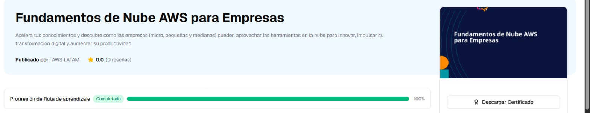

# AWS Entrena Bogotá · Ruta «Fundamentos de Nube AWS para Empresas»

Ruta corta de **AWS Entrena Bogotá** (AWS LATAM, unas 2 h 10 min) sobre qué es la computación en la nube y cómo la pueden aprovechar las micro, pequeñas y medianas empresas. Al completarla se emite un certificado.

## Progreso

| # | Contenido | Duración | Estado | Fecha | Apuntes |
|---|---|---|---|---|---|
| 1 | ¿Qué es computación en la nube de AWS? (Juan Esteban Gómez) | 9 min | ✅ Completado | 2026-10-30 | [Ver apuntes](01-que-es-la-nube.md) |
| 2 | Webinar «¿Qué es la Nube de AWS?» (Diego Casas) | 1 h 25 min | ✅ Completado | 2026-10-30 | [Ver apuntes](02-webinar-nube-aws.md) |
| 3 | Descubra la nube para pequeñas y medianas empresas (casos) | 4 min | ✅ Completado | 2026-10-30 | [Ver apuntes](01-que-es-la-nube.md#casos-de-pymes-en-la-nube) |
| 4 | ¿Cómo sacar el mejor provecho de la nube para hacer crecer mi pyme? (Edmundo Arzate) | 34 min | ✅ Completado | 2026-10-30 | — |
| 5 | ¿Está lista tu pyme para migrar a la nube? (*Súbete a la Nube*, ep. 2) | 26 min | ✅ Completado | 2026-10-30 | [Ver apuntes](03-subete-a-la-nube.md) |
| 6 | 4 tips antes de subirme a la nube (*Súbete a la Nube*, ep. 3) | 16 min | ✅ Completado | 2026-10-30 | [Ver apuntes](03-subete-a-la-nube.md#episodio-3-recomendaciones-antes-de-migrar) |

