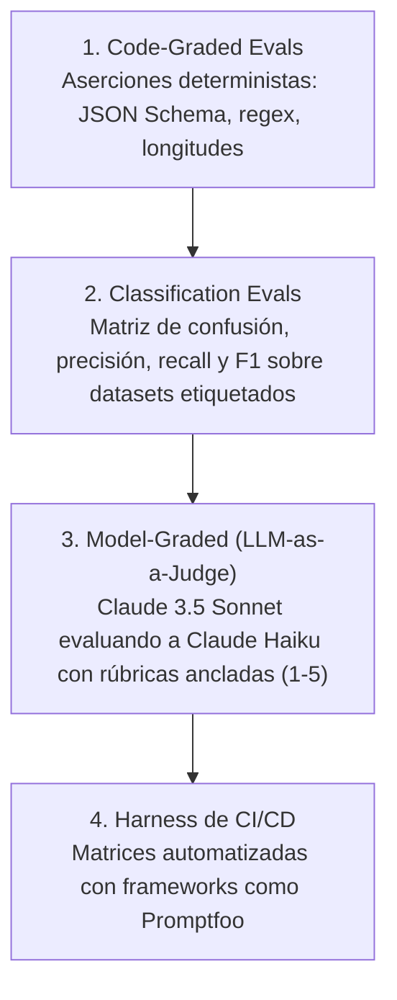

# Claude Academy · Building with the Claude API

Curso oficial avanzado de Anthropic (67 lecciones, 8 quizzes y ejercicios interactivos) sobre la construcción de aplicaciones y agentes de producción utilizando el SDK y la API de Anthropic: Messages API, selección de modelos, ingeniería de prompts de alto impacto, XML tags, CoT (`<thinking>`), prefill, mitigación de alucinaciones, evaluaciones sistemáticas, Tool Use y Prompt Caching.

**Estado:** Completado · **Quizzes:** 8/8 aprobados (100 %) · **Ruta:** Oficial Anthropic 1P

---

## 1. Arquitectura de la Messages API

- **Alternancia estricta de roles:** La API rechaza llamadas con dos turnos consecutivos del mismo rol. El flujo debe alternar rigurosamente entre `user` y `assistant`, comenzando siempre por un mensaje del usuario.
- **`system` como parámetro independiente:** Las directivas de sistema van fuera del array de mensajes. Define la personalidad, restricciones operativas y reglas de negocio del asistente.
- **`max_tokens` es obligatorio:** A diferencia de otros proveedores, Anthropic exige un valor explícito para prevenir generaciones descontroladas y proteger el presupuesto de tokens.
- **Bloques de contenido polimórficos:** `content` puede ser un texto simple o una lista de bloques tipados: `{"type": "text"}`, `{"type": "image"}`, `{"type": "tool_use"}` y `{"type": "tool_result"}`.

```python
from anthropic import Anthropic

client = Anthropic()

response = client.messages.create(
    model="claude-3-5-sonnet-20241022",
    max_tokens=1024,
    temperature=0.2,
    system="Eres un ingeniero de datos senior enfocado en pipelines analíticos.",
    messages=[
        {"role": "user", "content": "¿Cómo modelar un esquema estrella en DuckDB?"}
    ]
)
print(response.content[0].text)
```

---

## 2. Selección de Modelos y Estrategia de Enrutamiento

| Nivel | Modelo | Ventana | Latencia / Coste | Casos de Producción |
|:---|:---|:---:|:---:|:---|
| **Haiku** | `claude-3-haiku-20240307` / `claude-3-5-haiku-latest` | 200k | Ultra rápida / Bajo costo | Clasificación, extracción ligera, moderación, prefiltrado de consultas. |
| **Sonnet** | `claude-3-5-sonnet-20241022` | 200k | Balance óptimo / Nivel SOTA | Codificación compleja, razonamiento de agentes, visión y flujos multi-herramienta. |
| **Opus** | `claude-3-opus-20240229` | 200k | Máxima profundidad | Razonamiento filosófico, síntesis bibliográfica masiva y auditoría legal crítica. |

- **Enrutamiento dinámico:** La mejor práctica en producción es evaluar la intención con Haiku; si la tarea supera cierto umbral de complejidad o requiere herramientas complejas, se despacha a Sonnet.

---

## 3. Las 8 Reglas de Oro de Prompting para Claude

1. **Claridad y franqueza:** Instrucciones directas sin suposiciones tácitas; establecer límites numéricos explícitos.
2. **Asignación de roles:** Asignar un rol de evaluador estricto o perito técnico en el `system prompt` mejora radicalmente la detección de fallos lógicos o aritméticos.
3. **Estructura semántica con XML:** Separar datos de instrucciones mediante etiquetas como `<instructions>`, `<context>`, `<documents>`, `<thinking>` y `<output>`.
4. **Prefill de la respuesta (*Speaking for Claude*):** Pasar un mensaje final con `role: "assistant"` y contenido inicial (ej. `{"role": "assistant", "content": "{"}`) para obligar al modelo a emitir JSON puro sin bloques markdown ni texto introductorio.
5. **Precognición / Chain-of-Thought (`<thinking>`):** Permitir que Claude escriba su proceso deductivo paso a paso antes de emitir el veredicto final. Esto genera tokens intermedios de razonamiento y reduce errores drásticamente.
6. **Few-Shot Prompting estructurado:** Proveer de 2 a 5 ejemplos en bloques `<example>` para calibrar formato y tono en casos límite.
7. **Mitigación activa de alucinaciones:** Ofrecer siempre una salida explícita (*"Si la respuesta no está en el documento, responde 'Información no disponible'"*) y exigir citas textuales obligatorias en `<quotes>`.
8. **Long-Context Prompting:** Colocar los documentos masivos arriba y la pregunta específica del usuario abajo para maximizar la atención del modelo.

---

## 4. Evaluaciones Sistemáticas de Prompts (Evals)

El curso establece tres niveles de validación para evitar regresiones silenciosas al ajustar prompts:



---

## 5. Tool Use y el Bucle de Agente

El uso de herramientas transforma a Claude en un agente autónomo:

1. **Definición de herramienta:** Esquema JSON Schema riguroso con `name`, `description` (fundamental para la decisión semántica) e `input_schema`.
2. **Detección y parada:** Si Claude decide usar una herramienta, devuelve `stop_reason: "tool_use"` y un bloque con `id`, `name` e `input`.
3. **Ejecución local:** El código de la aplicación ejecuta la función correspondiente en la base de datos o API.
4. **Retorno de resultado:** Se envía un bloque `tool_result` asociado al `tool_use_id` dentro de un turno `user`.
5. **Respuesta final:** Claude asimila el resultado y redacta la respuesta al usuario con `stop_reason: "end_turn"`.
6. **Salidas estructuradas con `tool_choice`:** Forzar `tool_choice={"type": "tool", "name": "mi_esquema"}` para garantizar matemáticamente que la respuesta de Claude sea un objeto con la estructura deseada.

---

## 6. Prompt Caching (Optimización de Producción)

- **Ahorro masivo:** **90 % de descuento** en tokens de entrada cacheados y hasta **80 % de reducción en latencia** (TTFT).
- **Activación:** Añadir `cache_control: {"type": "ephemeral"}` en el bloque de sistema, herramientas o documentos de contexto (mínimo 1,024 tokens en Sonnet, 2,048 en Haiku).
- **TTL:** Mantiene la caché caliente durante 5 minutos y se renueva con cada petición.

```python
response = client.messages.create(
    model="claude-3-5-sonnet-20241022",
    max_tokens=1000,
    system=[
        {
            "type": "text",
            "text": "Aquí se incluye la base documental completa de 50.000 tokens...",
            "cache_control": {"type": "ephemeral"}
        }
    ],
    messages=[{"role": "user", "content": "¿Cuál es la política de garantías?"}]
)
# Revisa tokens leídos de caché:
print(response.usage.cache_read_input_tokens)
```
