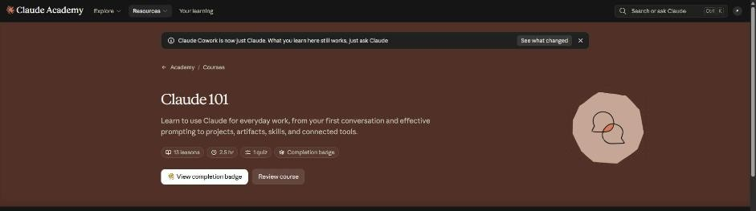
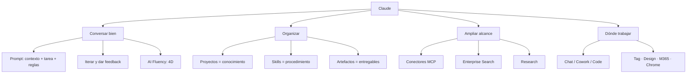
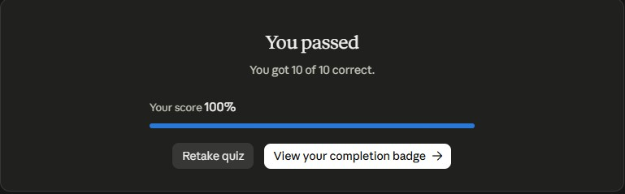

# Claude Academy · Claude 101

Curso de Anthropic (13 lecciones, ~2,5 h y un quiz) para usar Claude en el trabajo diario: desde la primera conversación y el prompting hasta proyectos, artefactos, skills, conectores, Research y las otras superficies (Claude Code, Claude Tag, Claude Design, Microsoft 365 y Chrome).

**Estado:** Completado · **Quiz final:** 10/10 (100 %) · **Insignia:** emitida el 27 oct 2026

[Ver insignia verificable](https://academy.claude.com/badges/b174b902-e8bf-4f1a-93e3-de9199cbe2de){ .md-button }

## Módulos

| # | Módulo | Lecciones | Estado | Notas |
|---|--------|-----------|--------|-------|
| 1 | Conocer a Claude | Qué es Claude · Primera conversación · Mejores resultados · Claude en el escritorio | Completado | [01 · Conocer a Claude](01-conocer-a-claude.md) |
| 2 | Organizar el trabajo y el conocimiento | Proyectos · Artefactos · Skills | Completado | [02 · Proyectos, artefactos y skills](02-proyectos-artefactos-skills.md) |
| 3 | Ampliar el alcance | Conectores · Enterprise Search · Research | Completado | [03 · Conectores y Research](03-conectores-research.md) |
| 4 | Ponerlo todo junto | Casos por rol · Otras formas de trabajar con Claude | Completado | [04 · Casos de uso y superficies](04-casos-de-uso-y-superficies.md) |
| 5 | Cierre e insignia | Qué sigue · Quiz del curso | Completado | Quiz 10/10 |

## Mi resumen de uso (una página)

| Necesito… | Uso | Por qué |
|-----------|-----|---------|
| Pensar, redactar o resolver algo ida y vuelta | **Chat** | El valor está en el intercambio; cada respuesta cambia la siguiente pregunta |
| Entregar un resultado de varios pasos, con archivos o programado | **Cowork** (o cualquier conversación en la experiencia nueva) | Claude planea, ejecuta y devuelve el entregable; yo reviso plan y resultado |
| Escribir, probar y versionar código | **Claude Code** (pestaña Code, terminal o IDE) | Lee el repo, edita, corre comandos y hace commits |
| Contexto fijo para un frente de trabajo | **Proyecto** | Conocimiento + instrucciones que aplican a todos los chats del proyecto |
| Un procedimiento que se repite igual | **Skill** | Encapsula el *cómo* (pasos, formato, método) y Claude lo invoca solo |
| Un entregable para editar y compartir | **Artefacto** (Design, Slides, Docs) | Vive en la pestaña Artifacts, se edita directo, se comenta y se exporta |
| Datos de mis herramientas reales | **Conectores (MCP)** | Busca, lee y actúa en Drive, Gmail, Slack, Jira… con mis permisos |
| Investigación con muchas fuentes y citas | **Research** | Búsquedas encadenadas, síntesis y citas verificables (minutos, no segundos) |
| Un dato puntual | **Búsqueda web** | Rápido; Research sería exceso |
| Razonamiento profundo sin fuentes externas | **Thinking** | Matemáticas, depuración, lógica |

!!! tip "Para recordar"
    - **Proyectos guardan conocimiento, skills ejecutan tareas.** El proyecto da el *qué*; la skill da el *cómo*.
    - Un buen prompt = **preparar el escenario** (rol, objetivo, contexto) + **definir la tarea** + **especificar reglas** (formato, tono, ejemplos).
    - Primero identificar la **forma del trabajo** (ida y vuelta, delegar, construir software); la herramienta sale sola.
    - Los conectores solo ven **lo que yo ya puedo ver**, y se revocan cuando quiera.

## Fuentes y aviso legal

- **Fuente:** cursos de Anthropic Academy (Claude Academy). Sitios oficiales: [anthropic.com/learn](https://www.anthropic.com/learn) · [docs.anthropic.com](https://docs.anthropic.com).
- **Uso:** apuntes personales de estudio, sin fines comerciales y con redacción propia. Las imágenes del curso son fragmentos breves citados con fines educativos; sus derechos son de sus titulares.
- **Sin afiliación:** sitio no oficial, no afiliado ni respaldado por Anthropic. Las marcas pertenecen a sus dueños.
- Más detalles y cómo pedir el retiro de contenido en el [aviso legal](../../aviso-legal.md).
