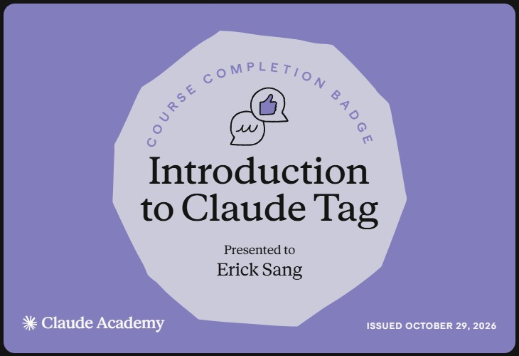
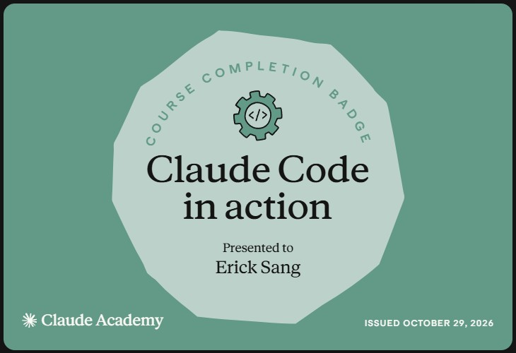
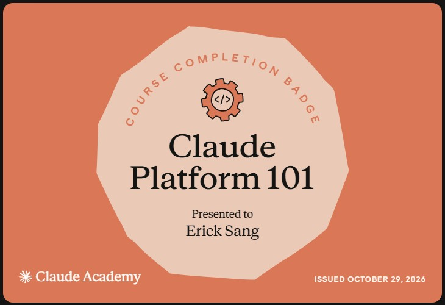
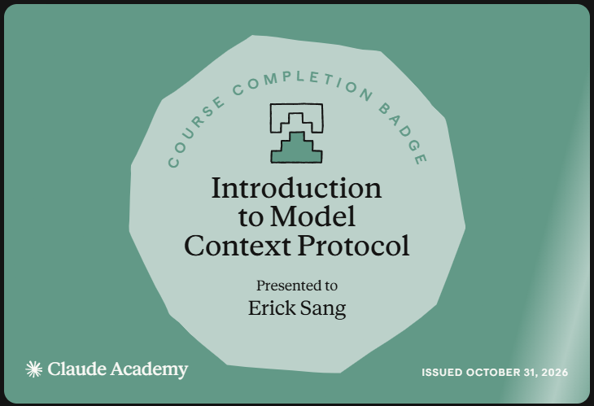
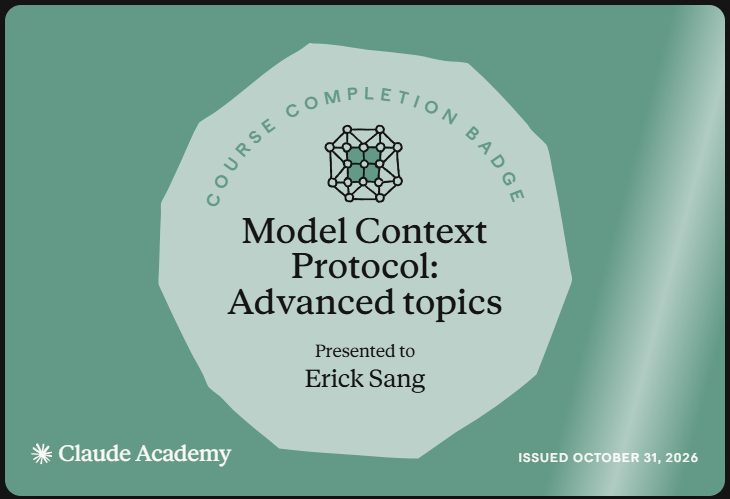
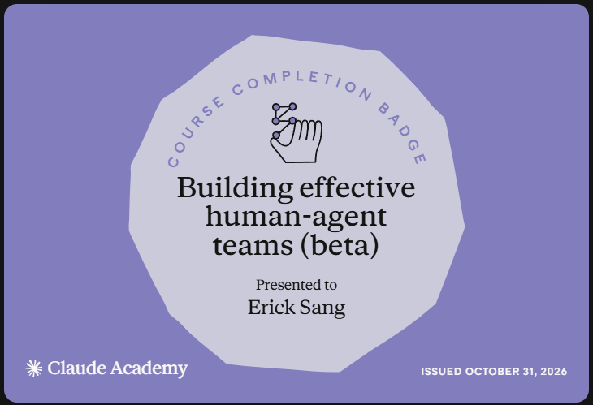

# Claude Academy (Anthropic)

Cursos gratuitos de Anthropic en [academy.claude.com](https://academy.claude.com/courses) sobre el uso de Claude, Claude Code, MCP, la API y AI Fluency. Cada curso con quiz final entrega una **insignia verificable**.

Lo más práctico de todos los cursos está reunido en **[Tips & Tricks de Claude](../claude-tips/)**.

## Insignias

| Curso | Lecciones | Estado | Resultado | Notas | Insignia |
|-------|-----------|--------|-----------|-------|----------|
| Claude 101 | 13 + quiz | Completado | Quiz 10/10 | [Notas](../claude-101/) | [Ver](https://academy.claude.com/badges/b174b902-e8bf-4f1a-93e3-de9199cbe2de) |
| Claude Code 101 | 12 + quiz | Completado | Quiz 4/4 | [Notas](../claude-code-101/) | [Ver](https://academy.claude.com/badges/ba748ca0-5d7d-41ec-b2d9-b2b900484eb5) |
| Introduction to Claude Cowork | 14 + quiz | Completado | Quiz 10/10 | [Notas](../claude-cowork/) | [Ver](https://academy.claude.com/badges/a950f135-7649-41c4-91c3-2543d898e512) |
| Introduction to Claude Tag | 11 + quiz | Completado | Quiz 10/10 | [Notas](../claude-tag/) | [Ver](https://academy.claude.com/badges/92ea68f3-6953-4a01-97c8-174b734019ba) |
| Claude Platform 101 | 13 + quiz | Completado | Quiz 5/5 | [Notas](../claude-platform-101/) | [Ver](https://academy.claude.com/badges/13627f7a-d344-4f15-ad5a-0c1223b2ead8) |
| Claude Code in Action | 9 + quiz | Completado | Quiz 8/8 | [Notas](../claude-code-in-action/) | [Ver](https://academy.claude.com/badges/f3bd2e65-d980-49f9-b6fe-e94e6cef89a5) |
| Introduction to Model Context Protocol | 10 + quiz | Completado | Quiz 7/7 + servidor propio | [Notas](../mcp-intro/) | [Ver](https://academy.claude.com/badges/4cf85cb9-0c5d-469f-a968-ddb0f3f68c6c) |
| Model Context Protocol: Advanced Topics | 11 + quiz | Completado | Quiz 10/10 + práctica | [Notas](../mcp-advanced/) | [Ver](https://academy.claude.com/badges/f3770dcb-f1cf-4dcc-9640-a3a94b3410cc) |
| Deploying Claude Enterprise with Confidence | 14 + quiz | Pendiente | — | — | — |
| AI Fluency: Framework and Foundations | 14 + quiz | Pendiente | — | — | — |
| AI Capabilities and Limitations | 13 + quiz | Pendiente | — | — | — |
| Building Effective Human-Agent Teams | 5 + quiz | Completado | Quiz 5/5 | [Notas](../human-agent-teams/) | [Ver](https://academy.claude.com/badges/8a0bd08e-1e81-4efa-a652-1e713ee11519) |
| Building with the Claude API | 67 + 8 quizzes | Completado | Quizzes aprobados (100 %) | [Notas](../building-claude-api/) | Ruta Oficial 1P |
| Claude with Amazon Bedrock | 65 + 8 quizzes | Completado | Quizzes aprobados (100 %) | [Notas](../claude-bedrock/) | Ruta AWS |
| Claude on Google Cloud | 66 + 9 quizzes | Completado | Quizzes aprobados (100 %) | [Notas](../claude-google-cloud/) | Ruta GCP |

**Progreso:** 12 de 15 cursos completados.

{ width="300" }
{ width="300" }
{ width="300" }
{ width="300" }
{ width="300" }
{ width="300" }
{ width="300" }
{ width="300" }
{ width="300" }

## Fuentes y aviso legal

- **Fuente:** cursos de Anthropic Academy (Claude Academy). Sitios oficiales: [anthropic.com/learn](https://www.anthropic.com/learn) · [docs.anthropic.com](https://docs.anthropic.com).
- **Uso:** apuntes personales de estudio, sin fines comerciales y con redacción propia. Las imágenes del curso son fragmentos breves citados con fines educativos; sus derechos son de sus titulares.
- **Sin afiliación:** sitio no oficial, no afiliado ni respaldado por Anthropic. Las marcas pertenecen a sus dueños.
- Más detalles y cómo pedir el retiro de contenido en el [aviso legal](../aviso-legal.md).
