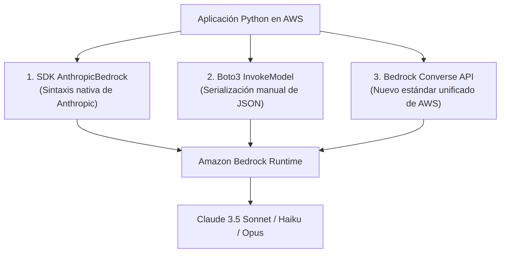

# Claude Academy · Claude with Amazon Bedrock

Curso oficial de Anthropic y AWS (65 lecciones, 8 quizzes y laboratorios prácticos) sobre el despliegue empresarial de Claude en Amazon Bedrock: arquitectura de nube, modelos fundacionales, métodos de invocación (`AnthropicBedrock`, `invoke_model` y la moderna `boto3 converse API`), cross-region inference profiles, tool use empresarial y seguridad con IAM y KMS.

**Estado:** Completado · **Quizzes:** 8/8 aprobados (100 %) · **Ruta:** AWS Enterprise Path

---

## 1. Por qué Claude en Amazon Bedrock

- **Aislamiento y cumplimiento:** Los datos del cliente no se usan para reentrenar modelos fundacionales. Cumple con normativas SOC, HIPAA, FedRAMP e ISO.
- **Seguridad perimetral:** Acceso a través de VPC Endpoints (AWS PrivateLink) sin exponer el tráfico a la internet pública.
- **Cifrado en reposo y en tránsito:** Integración con AWS KMS mediante claves gestionadas por el cliente (CMK).
- **Gobernanza centralizada:** Control granular mediante políticas de identidad IAM, Service Control Policies (SCPs) en AWS Organizations y auditoría continua en AWS CloudTrail.

---

## 2. Los 3 Métodos de Consumo en AWS



### Tabla Comparativa de Integraciones

| Método | Librería | Formato de Petición | Ventaja Clave |
|:---|:---|:---|:---|
| **AnthropicBedrock** | `anthropic` | `messages=[{"role": "user", "content": "..."}]` | Portabilidad directa de código escrito para Anthropic 1P con mínimos cambios. |
| **InvokeModel** | `boto3` | JSON en el parámetro `body` | Compatible con entornos legados que no pueden actualizar boto3. |
| **Converse API** | `boto3` | `converse(modelId=..., messages=..., inferenceConfig=...)` | Interfaz agnóstica a modelos: el mismo código funciona para Claude, Llama 3 o Mistral. |

---

## 3. Identificadores de Modelos (Model IDs) y Perfiles Multi-Región

En Amazon Bedrock se utilizan identificadores calificados por proveedor:

- **Claude 3.5 Sonnet v2:** `anthropic.claude-3-5-sonnet-20241022-v2:0`
- **Claude 3.5 Sonnet v1:** `anthropic.claude-3-5-sonnet-20240620-v1:0`
- **Claude 3.5 Haiku:** `anthropic.claude-3-5-haiku-20241022-v1:0`
- **Claude 3 Haiku:** `anthropic.claude-3-haiku-20240307-v1:0`
- **Claude 3 Opus:** `anthropic.claude-3-opus-20240229-v1:0`

### Perfiles de Inferencia Multi-Región (*Cross-Region Inference*)
Para mitigar picos de demanda y límites de cuota (TPM/RPM), AWS permite usar prefijos geográficos como `us.anthropic.claude-3-5-sonnet-20241022-v2:0`. Bedrock balancea automáticamente la petición entre múltiples regiones de EE. UU. (ej. `us-east-1`, `us-west-2`, `us-east-2`) sin intervención del usuario.

---

## 4. Implementación con la Bedrock Converse API

La API `converse` es el estándar moderno recomendado por AWS:

```python
import boto3

bedrock = boto3.client("bedrock-runtime", region_name="us-east-1")

response = bedrock.converse(
    modelId="anthropic.claude-3-5-sonnet-20241022-v2:0",
    messages=[
        {
            "role": "user",
            "content": [{"text": "¿Cómo diseñar una arquitectura resiliente multi-AZ en AWS?"}]
        }
    ],
    system=[{"text": "Eres un Lead Cloud Solutions Architect en AWS."}],
    inferenceConfig={
        "maxTokens": 1024,
        "temperature": 0.2,
        "topP": 0.9
    }
)

texto = response["output"]["message"]["content"][0]["text"]
motivo_fin = response["stopReason"]  # "end_turn", "tool_use", "max_tokens"
print(texto)
print(f"Uso de tokens: {response['usage']}")
```

---

## 5. Tool Use en Bedrock: `toolConfig`

En la Converse API, las herramientas se configuran mediante el parámetro estructurado `toolConfig`:

```python
herramienta_s3 = {
    "tools": [
        {
            "toolSpec": {
                "name": "listar_objetos_s3",
                "description": "Lista los objetos y prefijos dentro de un bucket S3 específico.",
                "inputSchema": {
                    "json": {
                        "type": "object",
                        "properties": {
                            "bucket_name": {"type": "string"},
                            "prefijo": {"type": "string"}
                        },
                        "required": ["bucket_name"]
                    }
                }
            }
        }
    ],
    "toolChoice": {"auto": {}}
}
```

---

## 6. Política Mínima de Permisos IAM

Para invocar modelos Claude en Bedrock, el rol de la aplicación o función Lambda requiere la siguiente política de IAM:

```json
{
  "Version": "2012-10-17",
  "Statement": [
    {
      "Sid": "InvokeClaudeBedrock",
      "Effect": "Allow",
      "Action": [
        "bedrock:InvokeModel",
        "bedrock:InvokeModelWithResponseStream"
      ],
      "Resource": "arn:aws:bedrock:*::foundation-model/anthropic.*"
    }
  ]
}
```
