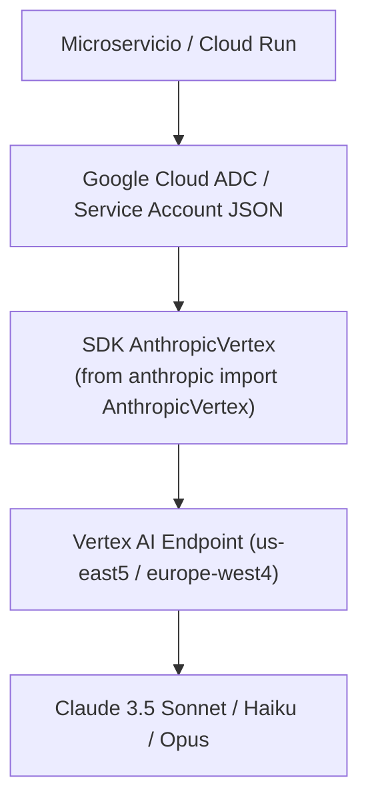

# Claude Academy · Claude on Google Cloud

Curso oficial de Anthropic y Google Cloud (66 lecciones, 9 quizzes y laboratorios en consola) sobre la integración y despliegue de Claude en Google Cloud Vertex AI (Model Garden): arquitectura de nube, SDK `AnthropicVertex`, Application Default Credentials (ADC), nomenclatura versionada con `@`, regiones de servicio, Tool Use y conexión con BigQuery y Cloud Storage.

**Estado:** Completado · **Quizzes:** 9/9 aprobados (100 %) · **Ruta:** Google Cloud Enterprise Path

---

## 1. Arquitectura de Claude en Vertex AI

- **Model Garden:** Anthropic aloja sus modelos Claude dentro de la infraestructura gestionada de Vertex AI, permitiendo consumirlos bajo la misma consola y proyecto de Google Cloud.
- **Autenticación nativa IAM:** Sin necesidad de API keys estáticas; se emplean cuentas de servicio (Service Accounts) con rotación automática o Application Default Credentials (ADC).
- **Aislamiento perimetral:** Soporte de VPC Service Controls para evitar exfiltración de datos y puntos finales privados de Google Cloud.
- **Facturación unificada:** Todo el consumo de tokens se integra de forma transparente en la factura mensual de Google Cloud Billing.



---

## 2. Nomenclatura de Modelos en Vertex AI

> [!IMPORTANT]
> En Vertex AI, la versión y fecha del modelo se separan obligatoriamente con el carácter `@` en lugar de guiones:

| Modelo | Identificador en Vertex AI | Regiones Principales |
|:---|:---|:---|
| **Claude 3.5 Sonnet v2** | `claude-3-5-sonnet-v2@20241022` | `us-east5`, `europe-west4` |
| **Claude 3.5 Sonnet v1** | `claude-3-5-sonnet@20240620` | `us-east5`, `europe-west4` |
| **Claude 3.5 Haiku** | `claude-3-5-haiku@20241022` | `us-east5` |
| **Claude 3 Haiku** | `claude-3-haiku@20240307` | `us-central1`, `us-east5`, `europe-west4` |
| **Claude 3 Opus** | `claude-3-opus@20240229` | `us-east5` |

---

## 3. Configuración del Entorno y Autenticación

### En Entorno Local de Desarrollo:
```bash
gcloud auth application-default login
gcloud config set project TU_PROJECT_ID
```

### En Servidores o Pipelines de CI/CD:
```bash
export GOOGLE_APPLICATION_CREDENTIALS="/ruta/a/service_account.json"
```

### Rol de IAM Requerido:
La identidad invocadora debe tener asignado en el proyecto de GCP:
- `roles/aiplatform.user` (*Vertex AI User*)

---

## 4. Implementación en Python con `AnthropicVertex`

El SDK oficial de Anthropic incluye la clase especializada `AnthropicVertex`, manteniendo total paridad con la interfaz estándar de mensajes:

```python
import os
from anthropic import AnthropicVertex

project_id = os.environ.get("GOOGLE_CLOUD_PROJECT", "mi-proyecto-gcp")
region = os.environ.get("GOOGLE_CLOUD_REGION", "us-east5")

client = AnthropicVertex(
    project_id=project_id,
    region=region
)

response = client.messages.create(
    model="claude-3-5-sonnet-v2@20241022",
    max_tokens=1000,
    temperature=0.2,
    system="Eres un especialista en BigQuery y arquitecturas de datos en GCP.",
    messages=[
        {"role": "user", "content": "¿Cómo estructurar una consulta analítica sobre tablas particionadas por fecha?"}
    ]
)

print(response.content[0].text)
print(f"Tokens de entrada: {response.usage.input_tokens}")
print(f"Tokens de salida: {response.usage.output_tokens}")
```

---

## 5. Streaming y Tool Use en Vertex AI

El comportamiento de Streaming y Tool Use es 100 % idéntico a la API directa:

```python
# Streaming de respuestas
with client.messages.stream(
    model="claude-3-haiku@20240307",
    max_tokens=500,
    messages=[{"role": "user", "content": "Explica Cloud Run en 3 párrafos claros."}]
) as stream:
    for chunk in stream.text_stream:
        print(chunk, end="", flush=True)
```

---

## 6. Integración con el Ecosistema GCP

- **BigQuery:** Procesamiento analítico masivo de columnas de texto mediante UDFs de Python o funciones remotas conectadas a Claude en Vertex.
- **Cloud Storage:** Análisis multimodal de documentos PDF, imágenes satelitales o contratos almacenados en buckets `gs://`.
- **Cloud Run / GKE:** Despliegue de microservicios con escalado automático y asignación de identidad mediante Workload Identity.
