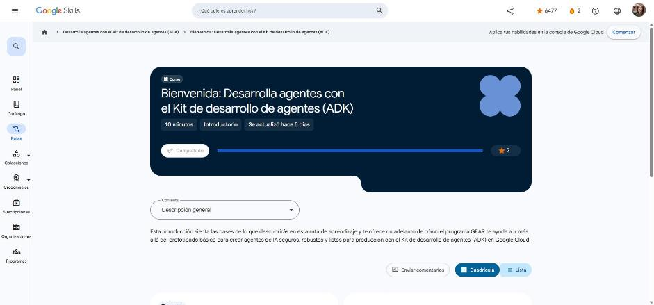

# 1. Bienvenida: Desarrolla agentes con el Kit de desarrollo de agentes (ADK)

Curso de bienvenida (10 min) de la ruta. Enlace: <https://www.skills.google/paths/3545/course_templates/1778>

## Te damos la bienvenida

Segunda ruta de la serie **GEAR (Gemini Enterprise Agent Ready)**. Si la primera explicaba *qué* es un agente, esta se enfoca en **construir agentes listos para producción** con el **ADK (Agent Development Kit)**, el framework de código abierto de Google.

Recorrido de la ruta:

1. **Crea tu primer agente con el ADK**: entorno, estructura del proyecto, parámetros del agente y formas de ejecutarlo.
2. **Ingeniería de agentes de IA con el ADK** (insignia de habilidad intermedia): configurar, reparar e implementar agentes.
3. **Optimiza el comportamiento de los agentes**: de un agente básico a un asistente preciso.
4. **Controla la memoria y el estado**: estado de sesión para recordar contexto y preferencias.
5. **Agrega capacidades con herramientas**: búsqueda web, ejecución de código, bases de datos, acciones propias y **MCP**.
6. **Conclusión**.

Temas transversales: flujos de trabajo basados en grafos, memoria persistente, estado de sesión, herramientas especializadas y el **Model Context Protocol (MCP)**.

!!! tip "Para recordar"
    - ADK = framework open source de Google para crear agentes (Python y Java).
    - La ruta va de lo básico (un agente) a capacidades reales: comportamiento, memoria/estado y herramientas.
    - Pista: cada curso añade una pieza de la fórmula *agente = modelo + herramientas + organización*.

*Figura: el curso aparece como completado en Google Skills.*
