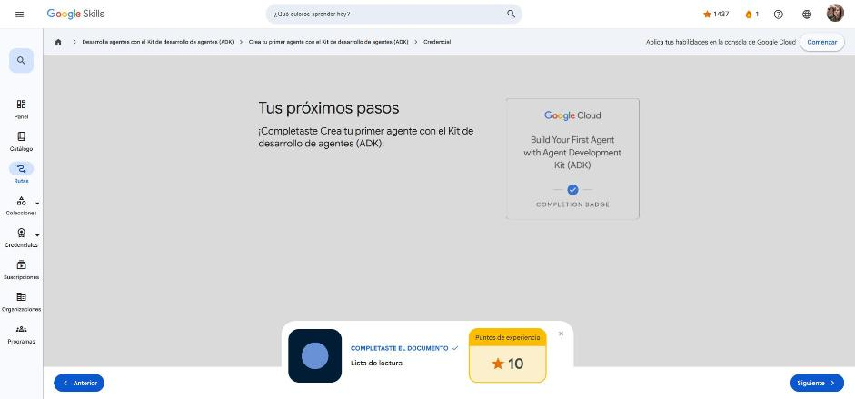

# 2. Crea tu primer agente con el Kit de desarrollo de agentes (ADK)

Curso de la ruta **GEAR: Desarrolla agentes con el ADK** · 1 h · Introductorio.
Enlace: <https://www.skills.google/paths/3545/course_templates/1563>

**Módulos:** Configuración del entorno · Conoce a tu primer agente · Otras formas de ejecutar tu agente · Configuración del agente con YAML · Lista de lectura.

---

## Comprende tu configuración

**Requisitos:** Python **3.11+** (o Java 17+), `pip`, una terminal. Funciona en macOS, Windows y Linux.

**Pasos para el entorno**

| Paso | Comando / acción |
|---|---|
| 1. Verificar Python | `python --version` |
| 2. Espacio de trabajo | `mkdir adk-workspace && cd adk-workspace` |
| 3. Entorno virtual | `python -m venv .venv` y activarlo (`source .venv/bin/activate` o `.venv\Scripts\Activate.ps1`) |
| 4. Instalar ADK | `pip install google-adk` → verificar con `adk --version` |
| 5. Clave de API | **Opción A:** Google AI Studio (rápida, nivel gratuito, ideal para aprender). **Opción B:** Vertex AI (producción: proyecto, facturación, `gcloud auth application-default login`) |
| 6. Crear proyecto | `adk create my_first_agent` |
| 7. Configurar `.env` | AI Studio: `GOOGLE_GENAI_USE_VERTEXAI=0` + `GOOGLE_API_KEY=...` · Vertex: `GOOGLE_GENAI_USE_VERTEXAI=1` + `GOOGLE_CLOUD_PROJECT` + `GOOGLE_CLOUD_LOCATION` |
| 8. Probar | `adk web` → interfaz en `http://localhost:8000` |

**Estructura que genera `adk create`:**

```text
my_first_agent/
├── agent.py      # define root_agent (modelo, herramientas, organización)
├── __init__.py   # convierte la carpeta en paquete; el ADK lo usa para descubrir el agente
└── .env          # claves y configuración (nunca a Git)
```

**Relación con la arquitectura:** el **modelo** se configura en `.env` (Gemini), las **herramientas** se agregan después y la **organización** (bucle percibir → pensar → actuar → comprobar) la aporta la clase `Agent` del ADK.

Errores típicos: `ModuleNotFoundError: google.adk` (venv sin activar), "Invalid API key" (usar `GOOGLE_API_KEY`, no `GEMINI_API_KEY`), `adk` no encontrado (instalar en el venv).

!!! tip "Para recordar"
    - Orden: venv → instalar ADK → clave de API → `adk create` → `.env` → `adk web`.
    - El ADK solo busca una variable llamada `root_agent` en `agent.py`.
    - Pista: en AI Studio la variable es **`GOOGLE_API_KEY`**; `.env` siempre en `.gitignore`.

## Define la identidad de tu agente

Cada `LlmAgent` (alias `Agent`) se define con cuatro parámetros:

| Parámetro | Obligatorio | Para qué sirve |
|---|---|---|
| `model` | Sí | El LLM que razona (`gemini-2.5-flash` rápido y eficiente; `gemini-2.5-pro` para razonamiento complejo). Afecta costo y latencia. |
| `name` | Sí | Identificador único; clave en multiagente (delegación, logs). Usar `snake_case` descriptivo, evitar `user`. |
| `description` | No (recomendado en multiagente) | Lo leen **otros agentes** para decidir si le enrutan una tarea. Debe ser específica. |
| `instruction` | No, pero es el más importante | Lo lee **el propio agente**: rol, personalidad, tarea, límites, cuándo usar herramientas y formato de salida. |

Buenas prácticas para instrucciones: ser claro y específico, usar Markdown, dar ejemplos (few-shot) y explicar *cuándo y por qué* usar cada herramienta.

El nombre interno (`name`) puede diferir de la variable: `root_agent = mi_agente_especializado`.

!!! tip "Para recordar"
    - Solo `model` y `name` son obligatorios.
    - `description` → para otros agentes (enrutamiento); `instruction` → para este agente (comportamiento).
    - Pista: "Eres un asistente útil" es demasiado genérico; define rol + personalidad + tarea.

## Manos a la obra: transforma a tu agente

Ejercicio: convertir el agente genérico en un **tutor de álgebra**.

```python
from google.adk.agents.llm_agent import Agent

root_agent = Agent(
    model='gemini-2.5-flash',
    name='math_tutor_agent',
    description='Ayuda a los estudiantes a aprender álgebra guiándolos paso a paso.',
    instruction='Eres un tutor de matemáticas paciente. Ayuda a los estudiantes con los problemas de álgebra.'
)
```

Se prueba con `adk web` (ejecutado desde la carpeta padre o con `adk web my_first_agent`). Hay que **reiniciar el servidor** para que tome los cambios.

!!! tip "Para recordar"
    - Una instrucción corta pero específica cambia mucho el comportamiento.
    - Errores comunes: instrucciones vagas, confundir `description` con `instruction`, olvidar `root_agent`.

## Tres métodos de implementación

| Método | Comando | Ideal para |
|---|---|---|
| Interfaz web | `adk web` | Desarrollo, depuración, demos (mantiene sesión en el navegador) |
| Terminal | `adk run [carpeta]` | Pruebas rápidas, servidores sin GUI, scripts y CI/CD |
| Servidor API REST | `adk api_server` | Integrar el agente en apps web/móviles, microservicios, antes de desplegar en Cloud Run |
| Programático | `Runner` + `InMemorySessionService` en Python | Notebooks (Jupyter/Colab), pipelines de datos, apps a medida |

En la ejecución programática se crea una **sesión** (`app_name`, `user_id`, `session_id`), un `Runner` con el agente y se recorre `runner.run_async(...)` buscando el evento `is_final_response()`. En notebooks se usa `await`; en scripts, `asyncio.run()`.

!!! tip "Para recordar"
    - El mismo `agent.py` funciona con los cuatro métodos; solo cambia la forma de interactuar.
    - Pista: probar rápido desde terminal → **`adk run`**; integrar en una app → **`adk api_server`**.

## Dos formas de definir a los agentes

Además de Python, el ADK soporta **Agent Config en YAML** (solo con ADK para Python, función experimental).

```bash
adk create --type=config my_config_agent   # genera root_agent.yaml + .env
```

```yaml
name: math_tutor_agent
model: gemini-2.5-flash
description: Ayuda a los estudiantes a aprender álgebra.
instruction: |
  Eres un tutor de álgebra paciente y motivador...
```

El `|` permite texto multilínea. Se ejecuta igual: `adk web my_config_agent`.

| | YAML | Python |
|---|---|---|
| Edición | Fácil, también para no programadores | Requiere programar |
| Ideal para | Agentes simples, prototipos, separar configuración del código | Multiagente complejo, herramientas personalizadas, callbacks, control programático |

!!! tip "Para recordar"
    - Ambos enfoques producen agentes idénticos y usan los mismos comandos.
    - Pista: YAML cuando personas no técnicas deben ajustar el agente; Python cuando hay herramientas propias, callbacks o multiagente.

## Cuestionarios

Los cuatro cuestionarios de módulo: **100 %** (mínimo 50 %).

| Módulo | Preguntas clave | Respuesta |
|---|---|---|
| Entorno | Variable para AI Studio / orden de configuración | `GOOGLE_API_KEY` / venv → ADK → clave → `adk create` → `.env` |
| Primer agente | Parámetros obligatorios / description vs instruction | `model` y `name` / description = enrutamiento de otros agentes, instruction = comportamiento propio |
| Formas de ejecutar | ¿Cuándo `api_server`? / prueba rápida en terminal | Integrar en apps web o móviles / `adk run` |
| YAML | ¿Cuándo YAML? / comando | Que no programadores editen el agente / `adk create --type=config` |

**Insignia:** *Build Your First Agent with Agent Development Kit (ADK)* (completion badge).



## Fuentes y aviso legal

- **Fuente:** cursos de la ruta GEAR de Google Cloud Skills Boost. Sitios oficiales: [cloudskillsboost.google](https://www.cloudskillsboost.google) · [cloud.google.com/docs](https://cloud.google.com/docs).
- **Uso:** apuntes personales de estudio, sin fines comerciales y con redacción propia. Las imágenes del curso son fragmentos breves citados con fines educativos; sus derechos son de sus titulares.
- **Sin afiliación:** sitio no oficial, no afiliado ni respaldado por Google. Las marcas pertenecen a sus dueños.
- Más detalles y cómo pedir el retiro de contenido en el [aviso legal](../../aviso-legal.md).
