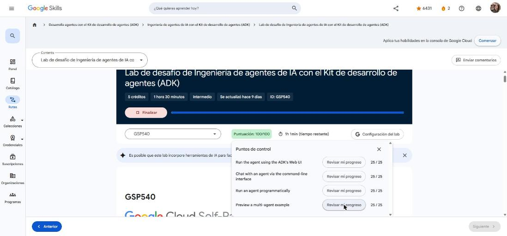
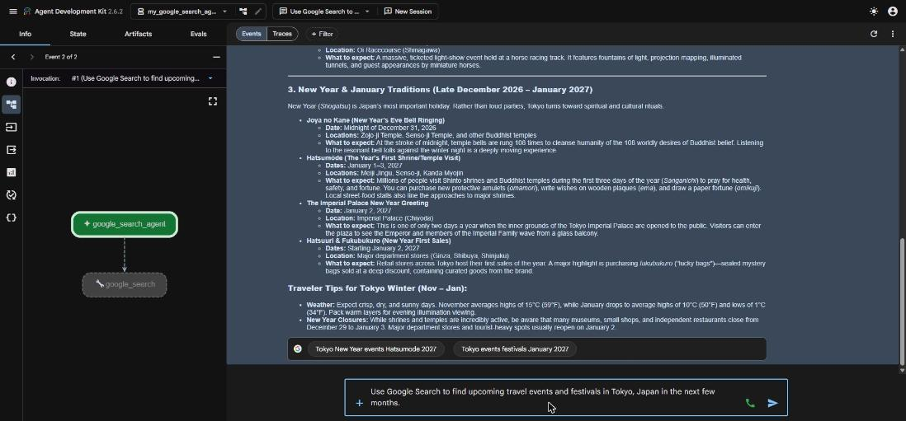
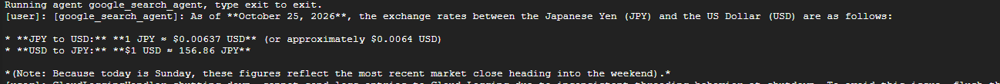
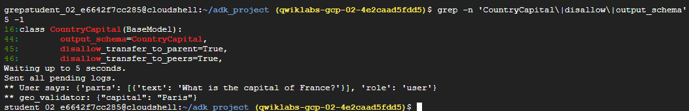
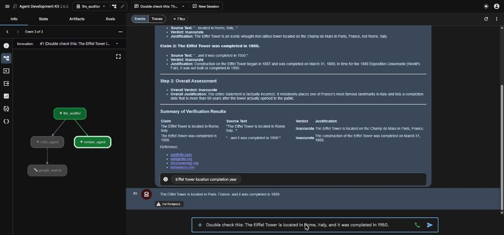
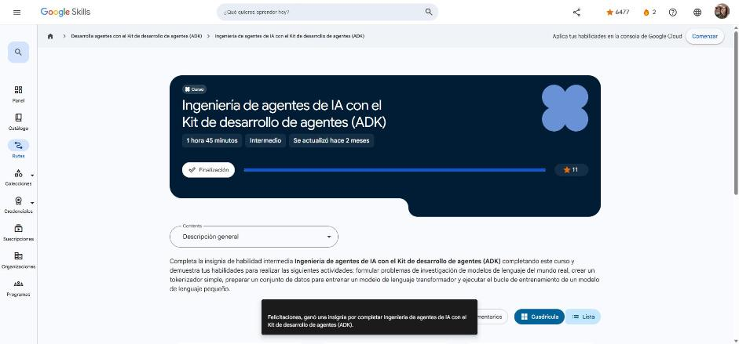

# 3. Ingeniería de agentes de IA con el ADK (insignia de habilidad)

Curso con **insignia de habilidad** de la ruta **GEAR: Desarrolla agentes con el ADK** · 1 h 45 min · Intermedio.
Enlace: <https://www.skills.google/paths/3545/course_templates/1596>

Contiene una lectura con recursos (documentación del ADK, la herramienta de Búsqueda de Google, datos estructurados y agentes secuenciales) y el **lab de desafío GSP540**. El lab se hace en un proyecto real de Google Cloud desde Cloud Shell.

**Resultado del lab: 100/100** (4 de 4 puntos de control).


*Figura: los cuatro puntos de control del lab de desafío aprobados.*

---

## Situación: Cymbal Travel

Cymbal Travel usa agentes ADK para explorar la web, validar destinos y auditar folletos. Los prototipos estaban incompletos y había que repararlos:

| Agente | Problema | Solución |
|---|---|---|
| `my_google_search_agent` (explorador de viajes) | Sin herramientas | Agregar `google_search` |
| `geo_validator` (verificador de destinos) | Devuelve texto libre | Esquema JSON estricto con Pydantic |
| `llm_auditor` (auditor de folletos) | Solo tenía el crítico | Reactivar `reviser_agent` en la canalización secuencial |

## Tarea 1: Entorno y proyecto

```bash
export PATH=$PATH:"/home/${USER}/.local/bin"
python3 -m pip install google-adk
gcloud storage cp gs://<PROJECT_ID>-bucket/adk_project.zip .
unzip adk_project.zip && cd adk_project
pip install -r requirements.txt
```

Cada agente usa **Agent Platform (Vertex AI)** en lugar de claves de API, configurado con un archivo `.env`:

```bash
GOOGLE_GENAI_USE_ENTERPRISE=true
GOOGLE_CLOUD_PROJECT=<PROJECT_ID>
GOOGLE_CLOUD_LOCATION=global
MODEL=gemini-3.5-flash
```

!!! tip "Para recordar"
    - Sin claves de API: el ADK usa las credenciales del proyecto con `GOOGLE_GENAI_USE_ENTERPRISE=true`.
    - Pista: `GOOGLE_CLOUD_LOCATION=global` y el modelo se lee de `MODEL` con `os.getenv`.

## Tarea 2: Explorador de viajes con Búsqueda de Google (IU web)

```python
from google.adk import Agent
from google.adk.tools import google_search

root_agent = Agent(
    name="google_search_agent",
    model=os.getenv("MODEL"),
    instruction="You are an expert researcher. You stick to the facts.",
    before_model_callback=log_query_to_model,
    after_model_callback=log_model_response,
    tools=[google_search],
)
```

Se prueba con `adk web --allow_origins "regex:https://.*\.cloudshell\.dev"` y la **vista previa web** de Cloud Shell en el puerto 8000. El gráfico del agente muestra la llamada a `google_search`, y la respuesta trae las sugerencias de búsqueda (fundamentación).


*Figura: el agente consulta Google Search y responde con eventos fundamentados en resultados reales.*

Los *callbacks* `before_model_callback` y `after_model_callback` escriben en **Cloud Logging** cada consulta al modelo y cada respuesta. Así se puede auditar el agente.

!!! tip "Para recordar"
    - Una herramienta se habilita pasándola en `tools=[...]`.
    - Pista: `google_search` es una herramienta integrada; para fundamentar, el agente debe llamarla de verdad.

## Tarea 3: Probar el agente por CLI

```bash
adk run my_google_search_agent
[user]: What is the currency exchange rate in Japan today?
```


*Figura: el mismo agente respondiendo en la terminal con el tipo de cambio JPY/USD.*

!!! tip "Para recordar"
    - `adk web` = interfaz de desarrollo con eventos y trazas; `adk run` = chat rápido en la terminal.
    - Pista: en `adk run` se sale con `exit`.

## Tarea 4: Salida estructurada en el verificador de destinos

```python
from pydantic import BaseModel, Field

class CountryCapital(BaseModel):
    capital: str = Field(description="The capital city of the country")

root_agent = Agent(
    model=model_name,
    name="geo_validator",
    instruction="Answer questions.",
    output_schema=CountryCapital,
    disallow_transfer_to_parent=True,
    disallow_transfer_to_peers=True,
)
```

Se ejecuta de forma programática con `InMemoryRunner` y una sesión: `python3 geo_validator/agent.py`. El resultado es un JSON y no una oración.


*Figura: "What is the capital of France?" devuelve `{"capital": "Paris"}`.*

!!! tip "Para recordar"
    - `output_schema` (modelo Pydantic) obliga a una respuesta JSON validada.
    - Pista: un agente con `output_schema` no debe transferir el control, por eso se desactivan las transferencias al padre y a los pares.

## Tarea 5: Auditor de folletos multiagente

```python
from google.adk.agents import SequentialAgent
from .sub_agents.critic import critic_agent
from .sub_agents.reviser import reviser_agent

llm_auditor = SequentialAgent(
    name="llm_auditor",
    sub_agents=[critic_agent, reviser_agent],
)
root_agent = llm_auditor
```

El **crítico** verifica cada afirmación en la web (con veredicto y fuentes) y el **revisor** reescribe el texto con los datos correctos. Ejemplo: "La Torre Eiffel está en Roma y se terminó en 1950" se corrige a "está en París y se terminó en 1889".


*Figura: el `SequentialAgent` ejecuta `critic_agent` (con `google_search`) y después `reviser_agent`.*

!!! tip "Para recordar"
    - `SequentialAgent` ejecuta sus `sub_agents` en orden; si falta uno, la canalización queda incompleta.
    - Pista: crítico = verifica y cita fuentes; revisor = corrige el texto.

**Insignia de habilidad:** *Engineer AI Agents with Agent Development Kit (ADK)*.


*Figura: curso finalizado con la insignia de habilidad.*

## Fuentes y aviso legal

- **Fuente:** cursos de la ruta GEAR de Google Cloud Skills Boost. Sitios oficiales: [cloudskillsboost.google](https://www.cloudskillsboost.google) · [cloud.google.com/docs](https://cloud.google.com/docs).
- **Uso:** apuntes personales de estudio, sin fines comerciales y con redacción propia. Las imágenes del curso son fragmentos breves citados con fines educativos; sus derechos son de sus titulares.
- **Sin afiliación:** sitio no oficial, no afiliado ni respaldado por Google. Las marcas pertenecen a sus dueños.
- Más detalles y cómo pedir el retiro de contenido en el [aviso legal](../../aviso-legal.md).
