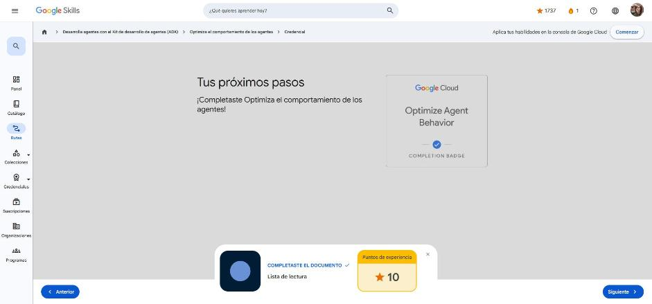

# 4. Optimiza el comportamiento de los agentes

Curso de la ruta **GEAR: Desarrolla agentes con el ADK** · 1 h · Introductorio.
Enlace: <https://www.skills.google/paths/3545/course_templates/1564>

**Módulos:** Escribe instrucciones avanzadas · Resultados estructurados · Elige y configura modelos · Planifica tareas complejas.

Cada módulo sigue el esquema *el problema → la solución*.

---

## Escribe instrucciones avanzadas

**Problema.** Con instrucciones vagas ("Sé útil") el agente no sabe qué está dentro de su alcance, qué tono usar, cómo manejar casos raros ni cuándo negarse: puede escribir poemas, opinar de política o ceder ante pedidos peligrosos.

**Solución: instrucciones estructuradas.** Según la documentación del ADK, `instruction` es el parámetro más importante y debe definir **tarea principal, personalidad, restricciones y formato de salida**. Puede ser una cadena, una plantilla con `{var}` (inyecta valores del estado) o una función.

Cinco patrones reutilizables (en Markdown):

| Patrón | Plantilla | Para qué |
|---|---|---|
| 1. Identidad | `# Tu identidad` — "Eres [nombre], [rol], con [experiencia]" | Personalidad y tono coherentes |
| 2. Misión | `# Tu misión` — "[objetivo] a la vez que [criterio de calidad]" | Enfoca y evita desviarse del alcance |
| 3. Metodología | `# Cómo trabajas` — 3 a 5 pasos (p. ej. reconocer → aclarar → resolver → verificar) | Flujo predecible y depurable |
| 4. Límites | `# Tus límites` — alcance, calidad de respuesta, privacidad/seguridad | Evita alucinaciones y respuestas fuera de rol |
| 5. Ejemplos (few-shot) | `# Interacciones de ejemplo` — casos comunes y casos límite | El modelo imita tono y formato |

Ejemplo del curso: un agente de soporte "Alex Chen" que reconoce, aclara, resuelve y verifica; nunca da contraseñas ni datos de otros clientes; deriva facturación, funciones, errores y seguridad al equipo correcto.

!!! tip "Para recordar"
    - Fórmula: identidad + misión + metodología + límites + ejemplos.
    - Los límites de la instrucción **se suman** a la configuración de seguridad del LLM (no la reemplazan).
    - Pista: basar las respuestas en herramientas/datos reduce alucinaciones; Markdown mejora la comprensión del LLM.

## Resultados estructurados

**Problema.** El texto libre varía en cada respuesta ("Producto: iPhone…", "El iPhone cuesta…"), es difícil de parsear, no valida campos faltantes y rompe integraciones con bases de datos y APIs.

**Solución: `output_schema` con Pydantic.**

```python
from pydantic import BaseModel, Field

class ProductInfo(BaseModel):
    product_name: str = Field(description="Nombre del producto")
    price: float = Field(description="Precio en USD")
    storage: str = Field(description="Capacidad, p. ej. '256GB'")
    color: str = Field(default="No se especifica")

root_agent = LlmAgent(
    model="gemini-2.5-flash",
    name="product_extractor",
    instruction="Extrae los datos y responde SOLO con JSON: {...}",
    output_schema=ProductInfo,         # se pasa la CLASE, no una instancia
    output_key="extracted_product",    # guarda la respuesta en session.state
)
```

- El esquema debe heredar de **`BaseModel`** (no sirven dicts ni clases normales). Tipos: `str`, `int`, `float`, `bool`, `List[T]`, `Dict`, `Optional[T]` y modelos anidados.
- El esquema es un **contrato**: solo aparecen los campos definidos.
- `output_key` deja el resultado en el estado de la sesión, útil para pasar datos entre agentes de un flujo.
- La instrucción debe igualmente **describir el formato JSON** esperado.

!!! tip "Para recordar"
    - `output_schema` = JSON garantizado y validado; `output_key` = guardar el resultado en `session.state`.
    - Pista: usa `Field(description=...)` para que el LLM entienda cada campo.

## Elige y configura modelos

**Problema.** Usar Pro para saludar es caro (≈10× Flash); usar la temperatura por defecto (1.0) para extraer datos genera variabilidad; no fijar seguridad ni límites de tokens.

**Solución: configuración estratégica.**

- **Selección:** prototipar con **Gemini 2.5 Pro** (mejor razonamiento, contexto de 2 M tokens) y optimizar con **2.5 Flash** (≈2× más rápido, ≈10× más barato, 1 M tokens) verificando que la calidad se mantenga.
- **`generate_content_config`** con `google.genai.types.GenerateContentConfig`:

| Parámetro | Uso |
|---|---|
| `temperature` | 0.0–0.3 fáctico (extracción, Q&A) · 0.4–0.7 equilibrado (soporte, tutoría) · 0.8–1.0 creativo (ideas, marketing) |
| `max_output_tokens` | Largo máximo de la respuesta |
| `top_p` / `top_k` | Muestreo de núcleo / top-K (más bajos = más enfocado) |
| `safety_settings` | `SafetySetting(category=HarmCategory..., threshold=HarmBlockThreshold...)` |

Umbrales de seguridad, de más flexible a más estricto: `BLOCK_NONE` → `BLOCK_ONLY_HIGH` → `BLOCK_MEDIUM_AND_ABOVE` → **`BLOCK_LOW_AND_ABOVE`**.

```python
from google.genai import types
factual = LlmAgent(model="gemini-2.5-flash", name="data_extractor",
    generate_content_config=types.GenerateContentConfig(
        temperature=0.1, max_output_tokens=500, top_p=0.8, top_k=10))
```

!!! tip "Para recordar"
    - Importar con `from google.genai import types` y usar `types.GenerateContentConfig`.
    - Pista: extracción de datos → temperatura ≈ 0.1; el umbral más estricto es `BLOCK_LOW_AND_ABOVE`.

## Planifica tareas complejas

**Problema.** Ante problemas de varios pasos (reducir costos de nube 30 %, monolito vs. microservicios, viaje familiar con presupuesto) el agente responde de inmediato, superficialmente y sin analizar compensaciones.

**Solución: `planner=BuiltInPlanner(...)`** (parámetro en singular, solo Python), que aprovecha el "pensamiento" nativo de Gemini:

```python
from google.adk.planners import BuiltInPlanner
from google.genai import types

agent = LlmAgent(
    model="gemini-2.5-flash",
    planner=BuiltInPlanner(
        thinking_config=types.ThinkingConfig(
            include_thoughts=True,   # muestra el razonamiento (ideal para depurar)
            thinking_budget=1024)),  # tokens de pensamiento (512 rápido – 2048 profundo)
    instruction="Ayuda a los usuarios a tomar decisiones")
```

En el ejemplo comprar vs. alquilar un auto, el agente con planificación calcula el kilometraje anual, compara costos totales y riesgos y da una recomendación con excepción, sin necesidad de una instrucción complicada.

| Planificador | Cuándo |
|---|---|
| `BuiltInPlanner` | Modelos Gemini con pensamiento integrado |
| `PlanReActPlanner` | Modelos sin pensamiento nativo; fuerza la estructura PLANIFICACIÓN → ACCIÓN → RAZONAMIENTO → RESPUESTA_FINAL |

Planificación vs. multiagente: planificar cuando **un** agente debe razonar varios pasos en su dominio; multiagente cuando se necesitan habilidades especializadas distintas.

!!! tip "Para recordar"
    - Usar planificación para problemas complejos de varios pasos y análisis de compensaciones; omitirla en preguntas simples o urgentes.
    - Pista: `include_thoughts` decide si el razonamiento interno aparece en la respuesta; `thinking_budget` fija cuánto puede pensar.

## Cuestionarios

Cuatro cuestionarios de módulo: **100 %** en todos.

| Módulo | Respuesta clave |
|---|---|
| Instrucciones | Elementos: tarea, personalidad, restricciones y formato · los límites trabajan *sobre* la seguridad del LLM |
| Resultados estructurados | `output_key` guarda la respuesta en el estado · esquema = clase Pydantic `BaseModel` · la instrucción debe guiar el formato JSON |
| Modelos | Temperatura 0.1 para datos fácticos · `from google.genai import types` · `BLOCK_LOW_AND_ABOVE` es el más estricto |
| Planificación | Para problemas complejos de varios pasos · `include_thoughts` incluye el razonamiento en la respuesta |

**Insignia:** *Optimize Agent Behavior* (completion badge).



## Fuentes y aviso legal

- **Fuente:** cursos de la ruta GEAR de Google Cloud Skills Boost. Sitios oficiales: [cloudskillsboost.google](https://www.cloudskillsboost.google) · [cloud.google.com/docs](https://cloud.google.com/docs).
- **Uso:** apuntes personales de estudio, sin fines comerciales y con redacción propia. Las imágenes del curso son fragmentos breves citados con fines educativos; sus derechos son de sus titulares.
- **Sin afiliación:** sitio no oficial, no afiliado ni respaldado por Google. Las marcas pertenecen a sus dueños.
- Más detalles y cómo pedir el retiro de contenido en el [aviso legal](../../aviso-legal.md).
