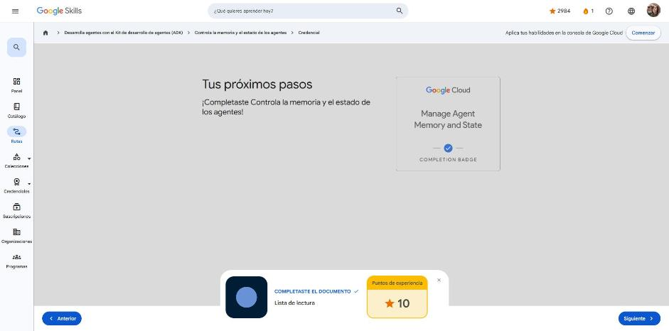

# 5. Controla la memoria y el estado de los agentes

Curso de la ruta **GEAR: Desarrolla agentes con el ADK** · 1 h · Intermedio.
Enlace: <https://www.skills.google/paths/3545/course_templates/1584>

**Módulos (Administra el estado y la memoria, partes 1 a 3):** Estado de la sesión · Plantillas de estado con `{var}` · Espacios de nombres de estado.

---

## El estado de la sesión

**Problema.** El historial de conversación llega al LLM, así que el agente "recuerda" ("Te llamas Álex"), pero **tu código no puede consultarlo**: no puedes hacer `if historial.contiene("Álex")`. Para validar valores, enrutar o usar datos en la lógica de la aplicación se necesitan datos estructurados.

**Solución: `session.state`**, un diccionario clave-valor por sesión. Sirve para personalizar (preferencias), seguir el progreso de tareas (`booking_step`), acumular datos (carrito) y guardar banderas (`user_is_authenticated`).

```python
agent = LlmAgent(model='gemini-2.5-flash',
                 instruction="Extrae el nombre del usuario y devuelve SOLO el nombre.",
                 output_key="user_name")          # guarda la respuesta en state["user_name"]

session_service = InMemorySessionService()
session = session_service.create_session(app_name="app", user_id="u1")
runner = Runner(agent=agent, app_name="app", session_service=session_service)
runner.run(user_id="u1", session_id=session.id, new_message=...)

if session.state.get("user_name"):                # lectura segura con .get(clave, defecto)
    ...
```

| | Historial de conversación | Estado de la sesión |
|---|---|---|
| Qué es | Mensajes de texto | Diccionario clave-valor |
| ¿Lo lee el LLM? | Sí, automáticamente | Sí, mediante plantillas `{var}` |
| ¿Lo consulta tu código? | No | Sí, `session.state.get("clave")` |

!!! tip "Para recordar"
    - Historial = contexto para el LLM; estado = valores exactos para el código. Se complementan.
    - `output_key="x"` guarda automáticamente la respuesta final en `state["x"]`; el estado persiste entre turnos de la misma sesión.
    - Pista: la ventaja clave del estado es que **tu código puede verificar valores exactos**.

## Plantillas de estado con {var}

**Problema.** Tienes `user_name` y `user_language` en el estado, pero ¿cómo hacer que la instrucción los use sin escribirlos a mano?

**Solución.** Escribir la clave entre llaves dentro de `instruction`. **Antes de enviar la instrucción al LLM**, el ADK reemplaza `{clave}` por `session.state["clave"]` (distingue mayúsculas).

```python
agent = LlmAgent(instruction="Hola, {user_name}. Responde en {user_language}.")
# El LLM recibe: "Hola, Álex. Responde en Spanish."
```

| Sintaxis | Si la clave no existe |
|---|---|
| `{var}` | **Error** (modo estricto) |
| `{var?}` | Cadena vacía |
| `{var?valor por defecto}` | Usa el texto por defecto |
| `{var?Texto condicional}` | El texto solo aparece si `var` existe |

Ejemplo: un agente de bienvenida con `{user_name?usuario}`, `{user_language?English}` y `{membership_tier?free}` que adapta el saludo según el estado disponible.

!!! tip "Para recordar"
    - Las plantillas hacen las instrucciones dinámicas sin tocar el código del agente.
    - Pista: `{missing_key}` sin `?` provoca error; la resolución ocurre **antes** de llamar al LLM.

## Espacios de nombres de estado

**Problema.** No todos los datos deben vivir lo mismo: un paso intermedio, el tema de la conversación, el tema visual del usuario o la URL global de una API tienen vidas útiles distintas (fugas de memoria, preferencias perdidas, duplicación o filtración entre sesiones).

**Solución: prefijos en las claves.**

| Prefijo | Duración | Ejemplo |
|---|---|---|
| `temp:` | Solo la invocación actual (un turno: entrada → respuesta); luego se descarta | `temp:current_step` |
| *(sin prefijo)* | Sesión actual (conversación) | `conversation_topic`, carrito |
| `user:` | Todas las sesiones de ese `user_id` (misma app) | `user:language`, `user:theme` |
| `app:` | Global para todos los usuarios de la app | `app:api_url`, `app:version`, feature flags |

La persistencia real entre reinicios requiere un `SessionService` persistente (Database o Vertex AI); `InMemorySessionService` se pierde al reiniciar. Todos los prefijos funcionan en plantillas: `{user:language?English}`.

Árbol de decisión: ¿solo ahora? → `temp:` · ¿esta conversación? → sin prefijo · ¿todas las conversaciones del usuario? → `user:` · ¿todos los usuarios? → `app:`.

!!! tip "Para recordar"
    - Usa siempre el alcance **más limitado** necesario.
    - Pista: preferencias de idioma → `user:`; configuración global → `app:`; `temp:` se descarta al terminar el turno.

## Cuestionarios

Tres cuestionarios de módulo: **100 %** en todos (mínimo 66 %).

| Módulo | Respuesta clave |
|---|---|
| Estado de la sesión | `output_key="topic"` guarda la respuesta en `state["topic"]` · se lee con `session.state.get("key")` · ventaja: el código accede a valores exactos |
| Plantillas | Clave inexistente → error · `{topic}` se reemplaza antes de que el LLM lo vea · la resolución ocurre antes de enviar la instrucción |
| Espacios de nombres | `app:` para configuración global · `user:` para idioma del usuario · `temp:` se descarta al terminar el turno |

**Insignia:** *Manage Agent Memory and State* (completion badge).



## Fuentes y aviso legal

- **Fuente:** cursos de la ruta GEAR de Google Cloud Skills Boost. Sitios oficiales: [cloudskillsboost.google](https://www.cloudskillsboost.google) · [cloud.google.com/docs](https://cloud.google.com/docs).
- **Uso:** apuntes personales de estudio, sin fines comerciales y con redacción propia. Las imágenes del curso son fragmentos breves citados con fines educativos; sus derechos son de sus titulares.
- **Sin afiliación:** sitio no oficial, no afiliado ni respaldado por Google. Las marcas pertenecen a sus dueños.
- Más detalles y cómo pedir el retiro de contenido en el [aviso legal](../../aviso-legal.md).
