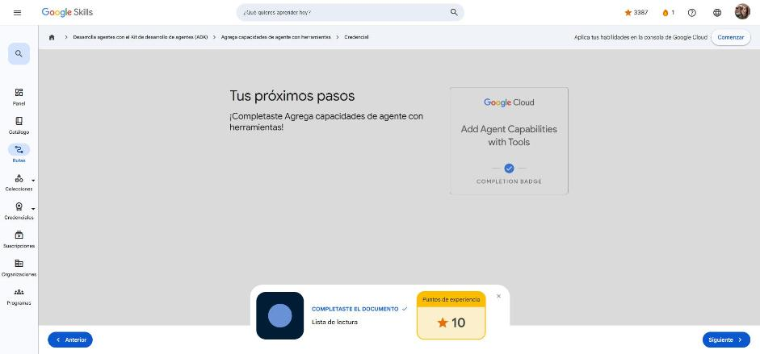

# 6. Agrega capacidades de agente con herramientas

Curso de la ruta **GEAR: Desarrolla agentes con el ADK** · 1 h · Intermedio.
Enlace: <https://www.skills.google/paths/3545/course_templates/1593>

**Módulos:** Comprende las herramientas · Herramientas integradas · MCP · Herramientas de funciones personalizadas · Combina herramientas de forma eficaz.

Este curso completa la ecuación **agente = modelo + herramientas + organización**.

---

## Comprende las herramientas

**Problema.** Sin herramientas, el agente solo sabe lo que aprendió en el entrenamiento: no tiene datos en tiempo real, calcula de forma poco fiable, no accede a sistemas externos y no puede actuar (solo genera texto).

**Solución.** Una herramienta es un componente de código modular (función, método u otro agente) que ejecuta una tarea **con lógica predefinida**; no razona por sí misma. El LLM decide *cuál*, *cuándo* y *con qué argumentos*.

Ciclo de uso de herramientas (5 pasos): **Razonamiento → Selección → Invocación → Observación → Finalización**.

| Tipo | Ejemplo | Cuándo |
|---|---|---|
| Integradas | `google_search`, ejecución de código, Vertex AI Search, RAG Engine, BigQuery, Spanner, Bigtable | Capacidades comunes |
| Funciones personalizadas | `get_capital_city`, `calculate_shipping_cost` | Lógica de tu negocio |
| Agente como herramienta (`AgentTool`) | Especialista de soporte técnico | Subtareas que requieren razonamiento propio |

```python
def get_capital_city(country: str) -> str:
    """Recupera la capital de un país."""
    ...
agent = LlmAgent(model="gemini-2.5-flash", name="capital_agent",
                 instruction="...", tools=[get_capital_city])   # se envuelve como FunctionTool
```

El LLM "ve" la herramienta por su **nombre, docstring y esquema de parámetros**.

!!! tip "Para recordar"
    - El LLM razona y decide; la herramienta ejecuta.
    - `tools=[...]` acepta funciones, instancias de `BaseTool` o `AgentTool`.
    - Pista: las herramientas solo se llaman cuando el razonamiento lo requiere; una pregunta general no las activa.

## Herramientas integradas

**Problema.** Implementar búsqueda web o ejecución de código desde cero exige integrar APIs, autenticación, límites de uso, caché y mantenimiento.

**Solución: herramientas listas para producción** mantenidas por el equipo del ADK y optimizadas para LLM.

```python
from google.adk.tools import google_search
search_agent = LlmAgent(model="gemini-2.5-flash", tools=[google_search])

from google.adk.code_executors import BuiltInCodeExecutor
code_agent = LlmAgent(model="gemini-2.5-flash", code_executor=BuiltInCodeExecutor())
```

- **Búsqueda de Google** (modelos Gemini 2+): datos web en tiempo real y **fundamentación** (grounding) con fuentes citadas. Por política es **obligatorio mostrar las sugerencias de búsqueda (`renderedContent`)** en la interfaz.
- **Ejecución de código**: cálculos exactos en Python en entorno seguro; se configura con el parámetro **`code_executor`**, no en `tools`.
- **Limitación:** por ahora **solo una herramienta integrada por agente** y no se puede mezclar con otras herramientas en el mismo agente (se resuelve con agentes secundarios / `AgentTool`).

!!! tip "Para recordar"
    - Integradas = importar y usar; personalizadas = escribir la función.
    - Pista: grounding con Google Search → mostrar `renderedContent`; ejecución de código va en `code_executor`.

## Protocolo de contexto del modelo (MCP)

**Problema.** Muchas capacidades (sistema de archivos, bases de datos, Slack, GitHub, Notion…) no vienen integradas en el ADK, pero ya existen como servidores mantenidos por la comunidad.

**Solución: MCP**, estándar abierto (creado por Anthropic, hoy alojado por la Linux Foundation, adoptado por OpenAI y Google) que funciona como un "USB" para herramientas de IA: cualquier servidor MCP sirve a cualquier cliente MCP.

En el ADK se usa **`McpToolset`** dentro de `tools`; descubre automáticamente las herramientas del servidor y actúa como proxy.

```python
McpToolset(
    connection_params=StdioConnectionParams(
        server_params=StdioServerParameters(
            command="npx",
            args=["-y", "@modelcontextprotocol/server-filesystem", ALLOWED_PATH])),
    tool_filter=["list_directory", "read_file"])   # solo lectura
```

| Conexión | Dónde corre el servidor | Uso |
|---|---|---|
| `StdioConnectionParams` | Local, como subproceso | Desarrollo y pruebas |
| `SseConnectionParams` | Remoto por HTTP (URL + headers) | Producción / nube, varios usuarios |

Dos patrones: (1) el agente ADK **consume** servidores MCP existentes; (2) **exponer** herramientas del ADK como servidor MCP.

Árbol de decisión: ¿búsqueda o código? → integrada · ¿existe servidor MCP? (registry.modelcontextprotocol.io) → MCP · ¿lógica propia? → función personalizada.

!!! tip "Para recordar"
    - Usa siempre `tool_filter` en producción para exponer solo lo necesario.
    - Pista: Stdio = servidor local como subproceso; SSE = servidor HTTP remoto. Elige MCP cuando ya existe un servidor con la capacidad.

## Herramientas de funciones personalizadas

**Problema.** Las herramientas genéricas no conocen tus productos, precios, políticas ni sistemas internos.

**Solución.** Escribir funciones de Python; el ADK las convierte en `FunctionTool` y genera el esquema para el LLM a partir de **nombre, type hints, docstring y tipo de retorno**.

Buenas prácticas:

- **Nombre verbo-sustantivo** descriptivo (`calculate_shipping_cost`, no `process`).
- **Type hints obligatorios** y tipos serializables en JSON (`str`, `int`, `float`, `bool`, `list`, `dict`).
- **Sin valores por defecto** en parámetros (el modelo no los respeta de forma fiable).
- **Docstring completo**: qué hace, cuándo usarla, argumentos y retornos — es lo más importante para que el LLM la use bien.
- **Retornar `dict` con clave `status`** (`success` / `error` + `error_message`) para que el LLM sepa si funcionó y qué hacer después.
- Varias herramientas en `tools=[...]` se encadenan (p. ej. inventario → precio → envío → total).

Ejemplo del curso: un agente de viajes con `search_flights`, `search_hotels` y `calculate_trip_budget`.

!!! tip "Para recordar"
    - Docstring = descripción que ve el LLM; type hints = esquema de parámetros.
    - Pista: `{"status": "error", "error_message": ...}` evita que el agente invente datos ante fallos.

## Combina herramientas de forma eficaz

**Problema.** Con instrucciones vagas el agente elige mal la herramienta (reembolsa antes de verificar el pedido), ignora errores, llama en orden ilógico y no sabe cuándo escalar.

**Solución: instrucciones estratégicas** que nombran las herramientas y definen:

1. **Selección**: qué herramienta usar en cada situación.
2. **Manejo de resultados/errores** por tipo: `temporary_failure` → reintentar una vez; `not_found` → pedir verificación y ofrecer búsqueda alternativa; `invalid_format` → explicar el formato; `permission_denied` → escalar de inmediato.
3. **Secuencia explícita** ("primero `check_order_status`, luego `process_refund`").
4. **Degradación elegante** (por ID → por email → por teléfono → supervisor).
5. **Rutas de escalamiento** (`escalate_to_supervisor`).

**Agente como herramienta** (`AgentTool(agent=tech_agent)`): para subtareas que requieren razonamiento especializado o instrucciones distintas del agente principal.

Lista de verificación: nombres descriptivos, type hints, docstrings completos, retorno con `status`, mensajes de error claros, instrucciones con selección + flujos + errores + escalamiento. Las herramientas también pueden coordinarse vía `session.state` (p. ej. guardar `current_order_id` para la siguiente herramienta).

!!! tip "Para recordar"
    - Docstring dice *qué* hace la herramienta; la instrucción dice *cuándo, cómo y en qué orden*.
    - Pista: la secuencia se especifica explícitamente en la instrucción; el manejo de errores en la instrucción guía al LLM cuando una herramienta falla.

## Cuestionarios

Cinco cuestionarios de módulo: **100 %** en todos (mínimo 66 %).

| Módulo | Respuesta clave |
|---|---|
| Herramientas / integradas | Mostrar `renderedContent` con grounding · integradas: listas para producción y mantenidas por el ADK · limitación: una sola integrada por agente |
| MCP | `tool_filter` selecciona un subconjunto · usar MCP cuando ya existe un servidor · Stdio local vs. SSE remoto |
| Funciones personalizadas | Lo más importante: el docstring · type hints generan el esquema · `status` ayuda al LLM a decidir el siguiente paso |
| Combinar herramientas | `AgentTool` para razonamiento especializado · secuencia explícita en la instrucción · manejo de errores guía al LLM |

**Insignia:** *Add Agent Capabilities with Tools* (completion badge).



## Fuentes y aviso legal

- **Fuente:** cursos de la ruta GEAR de Google Cloud Skills Boost. Sitios oficiales: [cloudskillsboost.google](https://www.cloudskillsboost.google) · [cloud.google.com/docs](https://cloud.google.com/docs).
- **Uso:** apuntes personales de estudio, sin fines comerciales y con redacción propia. Las imágenes del curso son fragmentos breves citados con fines educativos; sus derechos son de sus titulares.
- **Sin afiliación:** sitio no oficial, no afiliado ni respaldado por Google. Las marcas pertenecen a sus dueños.
- Más detalles y cómo pedir el retiro de contenido en el [aviso legal](../../aviso-legal.md).
