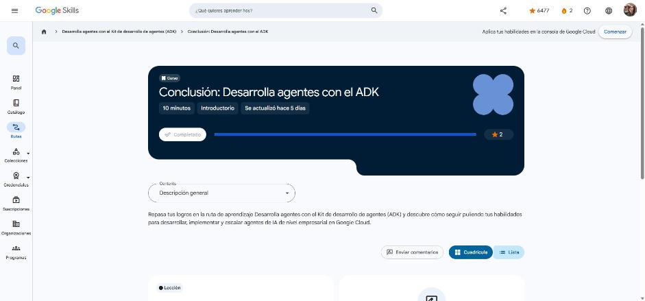

# 7. Conclusión: Desarrolla agentes con el ADK

Curso de cierre (10 min). Enlace: <https://www.skills.google/paths/3545/course_templates/1771>

## Conclusión

Repaso de lo construido en la ruta:

1. **Primer agente con el ADK**: entorno (venv, `google-adk`, clave de API), estructura `agent.py` / `__init__.py` / `.env`, parámetros `model`, `name`, `description`, `instruction`, formas de ejecución (`adk web`, `adk run`, `adk api_server`, `Runner`) y Agent Config en YAML.
2. **Ingeniería de agentes con el ADK**: configurar, reparar e implementar agentes (insignia de habilidad intermedia).
3. **Optimizar el comportamiento**: instrucciones estructuradas (identidad, misión, metodología, límites, ejemplos), `output_schema` con Pydantic, `generate_content_config` y `BuiltInPlanner`.
4. **Memoria y estado**: `session.state`, `output_key`, plantillas `{var}` y prefijos `temp:` / sesión / `user:` / `app:`.
5. **Herramientas**: integradas, MCP con `McpToolset`, funciones personalizadas y coordinación estratégica (incluido `AgentTool`).
6. **Herramientas de moneda con MCP**: modificar un agente ADK para usar un servidor MCP y abrir una sesión interactiva desde la CLI.

**Siguiente ruta GEAR:** *Deploy Production-Ready Agents* (implementar agentes listos para producción).

!!! tip "Para recordar"
    - Del prototipo a producción: instrucciones claras + salidas estructuradas + estado bien acotado + herramientas con buen docstring y manejo de errores.
    - Pista: ante cualquier capacidad nueva, el orden de decisión es integrada → servidor MCP → función personalizada.

*Figura: el curso aparece como completado en Google Skills.*
