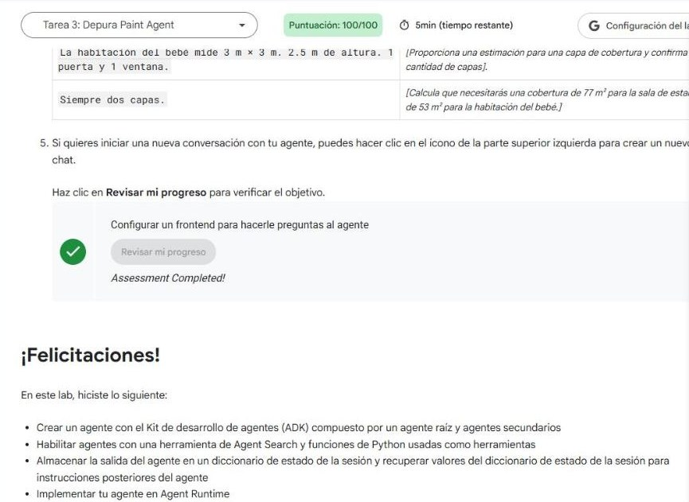
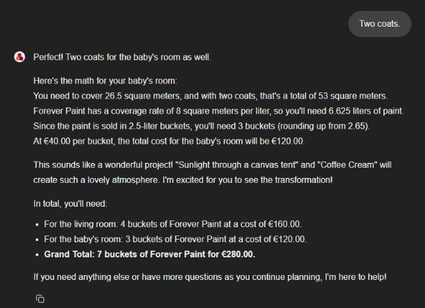

# 8. Implementa un agente con el ADK (lab de desafío GENAI129)

Lab de desafío adicional de la serie **GEAR** en Google Skills · 2 h 30 min · aprobación con 80 %.

**Estado:** ✅ **100/100** (2026-10-31).


*Las seis verificaciones aprobadas.*

## Situación: el departamento de pinturas de Cymbal Shops

Un asistente que recomienda pintura y calcula cuánta comprar. El código viene **roto a propósito** y hay que repararlo, desplegarlo y darle una interfaz.

```
paint_agent (raíz)
├─ herramienta set_session_value      → guarda pintura, rendimiento y precio en el estado
├─ herramienta AgentTool(search_agent) → busca en el catálogo (Agent Search)
└─ subagente room_planner_agent        → habitaciones y colores
     └─ subagente coverage_calculator_agent → m², litros, cubetas y costo
Chainlit (app.py) ──► Agent Runtime (Agent Engine) ──► paint_agent
```

## Resultado

| Tarea | Puntos | Qué se verificó |
|---|---|---|
| 1. App de búsqueda y almacén de datos | 15 | App «Paint Search» + almacén «Cymbal Paint» desde Cloud Storage, con analizador de diseño, anotación de tablas y encabezados en los fragmentos |
| 3. Depurar el agente | 25 | Responde con los precios del catálogo: EcoGreens €35, Forever Paint €40 |
| 4. Estado de sesión | 25 | Oficina 3×4×3 m → 37 m² por capa, 74 m² con dos capas, 3 cubetas, €105 |
| 5. Desplegar en Agent Runtime | 25 | Motor «Paint Agent» creado y con permisos sobre Vertex AI y Discovery Engine |
| 6. Frontend con Chainlit | 10 | Conversación completa contra el agente desplegado |


*Sala 5×4×2,5 m = 38,5 m² (77 m² con dos capas); habitación del bebé 3×3×2,5 m = 26,5 m² (53 m²). Total: 7 cubetas de Forever Paint, €280.*

## Cómo lo resolvimos

### 1. Agent Search: el catálogo como fuente de verdad

El catálogo de pinturas es un PDF con tablas en un bucket. Para que la búsqueda devuelva precios exactos:

- **Analizador de diseño** (*Layout parser*) en vez del analizador digital: entiende la estructura del documento.
- **Anotación de tablas**: precio y rendimiento viven en tablas.
- **Encabezados ancestros en los fragmentos**: cada fragmento lleva el título del producto al que pertenece, así una fila de tabla no queda «huérfana».

### 2. Depurar: una herramienta de búsqueda no se mezcla con otras

El agente raíz tenía `search_agent` como subagente y fallaba con:

```
400 INVALID_ARGUMENT: Multiple tools are supported only when they are all search tools.
```

`VertexAiSearchTool` es una herramienta *integrada* de Gemini; en una misma llamada al modelo no puede convivir con funciones propias como `set_session_value`. La solución es **envolver** el agente de búsqueda en `AgentTool`: queda como una herramienta más, que corre en su propio contexto.

```python
root_agent = Agent(
    name="paint_agent",
    ...
    sub_agents=[room_planner_agent],                     # antes: [search_agent, room_planner_agent]
    tools=[
        set_session_value,
        AgentTool(agent=search_agent, skip_summarization=False),
    ],
)
```

| | Subagente (`sub_agents`) | `AgentTool` (`tools`) |
|---|---|---|
| Control | Se **transfiere**: el subagente sigue la conversación | El padre **llama**, recibe el resultado y sigue al mando |
| Uso típico | Fases de la conversación (planificar habitaciones) | Consultas puntuales (buscar precios) |
| Herramientas integradas | Aisladas en el subagente | Aisladas también: por eso resuelve el error |

### 3. Estado: escribir con la herramienta, leer con `{CLAVE?}`

```python
async def set_session_value(tool_context: ToolContext, key: str, value: str):
    """Sets a value in the tool_context's state dictionary."""
    tool_context.state[key] = value
    return {"status": f"stored '{value}' in '{key}'"}
```

La instrucción del calculador pasó de texto fijo a plantillas que se rellenan con el estado:

```text
The coverage rate of the paint they have chosen ({SELECTED_PAINT?}) is {COVERAGE_RATE?} ...
The price is {PRICE?} per bucket ...
```

Así el subagente nieto conoce la elección hecha dos niveles arriba sin que nadie se la repita.

### 4. Desplegar y dar permisos

```bash
adk deploy agent_engine --project <PROYECTO> --region us-central1 \
  --display_name "Paint Agent" paint_agent
```

El agente desplegado corre con la **cuenta de servicio de Agent Runtime** (`service-<NÚMERO>@gcp-sa-aiplatform-re.iam.gserviceaccount.com`). Sin permisos no puede llamar al modelo ni a la búsqueda, por eso se le otorgan los roles **Usuario de Agent Platform** (`roles/aiplatform.user`) y **Usuario de Discovery Engine** (`roles/discoveryengine.user`).

### 5. Frontend con Chainlit

```python
client = vertexai.Client(project=project_id, location=location)
agent = client.agent_engines.get(name="projects/<NÚMERO>/locations/us-central1/reasoningEngines/<ID>")
session = agent.create_session(user_id="user")
async for event in agent.async_stream_query(user_id=..., session_id=..., message=...):
    ...  # se emiten los fragmentos de texto en la interfaz
```

La interfaz es un cliente delgado: la sesión y el estado viven en el motor desplegado.

## Análisis de la sesión

### Cómo leímos el problema

- El lab mezcla tres capas: **datos** (Agent Search), **lógica** (ADK con estado) y **operación** (despliegue, IAM, frontend). Cada tarea rompe una capa distinta, así que conviene verificar capa por capa antes de seguir.
- El error de la tarea 3 no es de código Python sino del **contrato de la API de Gemini**. Leer el texto exacto del 400 llevó directo a la solución.

### Decisiones y por qué

| Decisión | Razón |
|---|---|
| `AgentTool` y no quitar `set_session_value` | El raíz necesita ambas cosas: buscar precios **y** guardarlos en el estado |
| Probar en la terminal con `(printf ...; sleep 120; echo exit) \| adk run` | Pruebas repetibles y con tiempo para que los logs lleguen a Cloud Logging, que es lo que mira el verificador |
| Consultar la API de `reasoningEngines` antes de redesplegar | Un despliegue largo puede fallar en el último paso y aun así haber creado el motor |
| `venv` aparte para Chainlit | Su árbol de dependencias choca con el del ADK ya instalado |

### Fallos reales convertidos en lecciones

| Síntoma | Causa | Arreglo | Lección |
|---|---|---|---|
| `400 Multiple tools are supported only when they are all search tools` | `VertexAiSearchTool` (integrada) junto a una función propia en el mismo agente | Envolver `search_agent` en `AgentTool` | Herramientas integradas (búsqueda, código) van **solas** o detrás de un `AgentTool` |
| El despliegue terminó con `401 UNAUTHENTICATED ... ACCESS_TOKEN_TYPE_UNSUPPORTED` | La sesión de Google expiró mientras el comando consultaba el estado de la operación | Volver a autenticar y listar los motores: «Paint Agent» ya existía | Un error en el **sondeo** no implica que la operación falló; comprobar el recurso antes de repetir 10 minutos de despliegue |
| `chainlit: command not found` tras reconectar | La VM de Cloud Shell se recicla; solo `~` persiste | Reinstalar | En Cloud Shell, todo lo que no esté en `~` es temporal |
| `pip install chainlit` sin avanzar durante minutos | *Backtracking* del resolvedor entre versiones de `opentelemetry` ya fijadas por el ADK | `python3 -m venv ~/cl` e instalar ahí solo lo que usa el frontend | Un cliente con dependencias propias va en su propio entorno |

### Qué haríamos distinto

- Verificar los recursos con la API antes de relanzar cualquier operación larga.
- Crear el `venv` del frontend desde el principio, en paralelo con el despliegue.

### Lo que nos llevamos

- El código original y el resuelto quedaron guardados como proyecto de referencia, con un README de cambios.
- Refinamos las skills de **agente ADK base** (estado entre niveles, `AgentTool` con herramientas integradas, despliegue en Agent Engine) y de **labs de Google Skills** (permisos de la cuenta de servicio, entorno aparte para el frontend, descarga por vista previa web).

!!! tip "Para recordar"
    - Herramienta integrada + función propia en el mismo agente = error 400. Solución: `AgentTool(agent=...)`.
    - **Subagente** = le pasas la conversación. **AgentTool** = le haces una consulta y sigues tú.
    - `tool_context.state[k] = v` para escribir; `{k?}` en la instrucción para leer, incluso varios niveles abajo.
    - Agente desplegado = otra identidad: dale roles a su cuenta de servicio.
    - Si un comando largo falla al final, revisa si el recurso ya existe.

## Fuentes y aviso legal

- **Fuente:** lab GENAI129 «Implementa un agente con el Kit de desarrollo de agentes (ADK): lab de desafío» de Google Skills (programa GEAR). Sitios oficiales: [skills.google](https://www.skills.google) · [google.github.io/adk-docs](https://google.github.io/adk-docs/) · [cloud.google.com/docs](https://cloud.google.com/docs).
- **Uso:** apuntes personales de estudio, sin fines comerciales y con redacción propia. Los fragmentos de código son breves y se citan con fines educativos.
- **Sin afiliación:** sitio no oficial, no afiliado ni respaldado por Google. Las marcas pertenecen a sus dueños.
- Más detalles y cómo pedir el retiro de contenido en el [aviso legal](../../aviso-legal.md).
