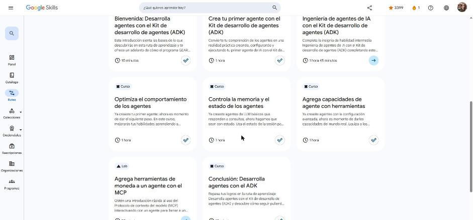

# Google Skills · GEAR: Desarrolla agentes con el Kit de desarrollo de agentes (ADK)

Programa **Google Cloud Career Launchpad – LatAm** (MinTIC) · Plataforma: Google Skills
Ruta: <https://www.skills.google/paths/3545> · Serie **Gemini Enterprise Agent Ready (GEAR)**, ruta 2 de 6.

Ruta técnica para construir agentes que planifican, razonan y ejecutan tareas con el **ADK** (framework open source de Google): configuración del entorno, lógica y comportamiento del agente, salidas estructuradas, selección y configuración de modelos, planificación, memoria y estado de sesión, y herramientas (integradas, MCP y funciones propias).

## Actividades

| # | Actividad | Duración | Estado | Fecha | Resultado | Notas |
|---|---|---|---|---|---|---|
| 1 | [Bienvenida: Desarrolla agentes con el ADK](https://www.skills.google/paths/3545/course_templates/1778) | 10 min | ✅ Completado | 2026-10-24 | — | [Notas](01-bienvenida.md) |
| 2 | [Crea tu primer agente con el ADK](https://www.skills.google/paths/3545/course_templates/1563) | 1 h | ✅ Completado | 2026-10-24 | 4 cuestionarios al 100 % · insignia *Build Your First Agent with ADK* | [Notas](02-primer-agente-adk.md) |
| 3 | [Ingeniería de agentes de IA con el ADK](https://www.skills.google/paths/3545/course_templates/1596) (insignia de habilidad) | 1 h 45 min | ✅ Completado | 2026-10-25 | Lab de desafío GSP540: **100/100** · insignia de habilidad *Engineer AI Agents with ADK* | [Notas](03-ingenieria-agentes-adk-lab-desafio.md) |
| 4 | [Optimiza el comportamiento de los agentes](https://www.skills.google/paths/3545/course_templates/1564) | 1 h | ✅ Completado | 2026-10-24 | 4 cuestionarios al 100 % · insignia *Optimize Agent Behavior* | [Notas](04-optimiza-comportamiento.md) |
| 5 | [Controla la memoria y el estado de los agentes](https://www.skills.google/paths/3545/course_templates/1584) | 1 h | ✅ Completado | 2026-10-25 | 3 cuestionarios al 100 % · insignia *Manage Agent Memory and State* | [Notas](05-memoria-y-estado.md) |
| 6 | [Agrega capacidades de agente con herramientas](https://www.skills.google/paths/3545/course_templates/1593) | 1 h | ✅ Completado | 2026-10-25 | 5 cuestionarios al 100 % · insignia *Add Agent Capabilities with Tools* | [Notas](06-herramientas.md) |
| 7 | Agrega herramientas de moneda a un agente con el MCP (lab) | — | Pendiente | — | — | — |
| 8 | [Conclusión: Desarrolla agentes con el ADK](https://www.skills.google/paths/3545/course_templates/1771) | 10 min | ✅ Completado | 2026-10-25 | — | [Notas](07-conclusion.md) |

**Progreso de la ruta:** 7 de 8 actividades (88 %).

## Lab adicional

| Lab | Duración | Estado | Fecha | Resultado | Notas |
|---|---|---|---|---|---|
| Implementa un agente con el ADK: lab de desafío (GENAI129) | 2 h 30 min | ✅ Completado | 2026-10-31 | **100/100** · Agent Search + estado + Agent Runtime + Chainlit | [Notas](08-lab-desafio-genai129.md) |

## Insignias obtenidas

- **Build Your First Agent with Agent Development Kit (ADK)**
- **Optimize Agent Behavior**
- **Manage Agent Memory and State**
- **Add Agent Capabilities with Tools**
- **Engineer AI Agents with Agent Development Kit (ADK)** (insignia de habilidad)

## Evidencias

## Fuentes y aviso legal

- **Fuente:** cursos de la ruta GEAR de Google Cloud Skills Boost. Sitios oficiales: [cloudskillsboost.google](https://www.cloudskillsboost.google) · [cloud.google.com/docs](https://cloud.google.com/docs).
- **Uso:** apuntes personales de estudio, sin fines comerciales y con redacción propia. Las imágenes del curso son fragmentos breves citados con fines educativos; sus derechos son de sus titulares.
- **Sin afiliación:** sitio no oficial, no afiliado ni respaldado por Google. Las marcas pertenecen a sus dueños.
- Más detalles y cómo pedir el retiro de contenido en el [aviso legal](../../aviso-legal.md).
