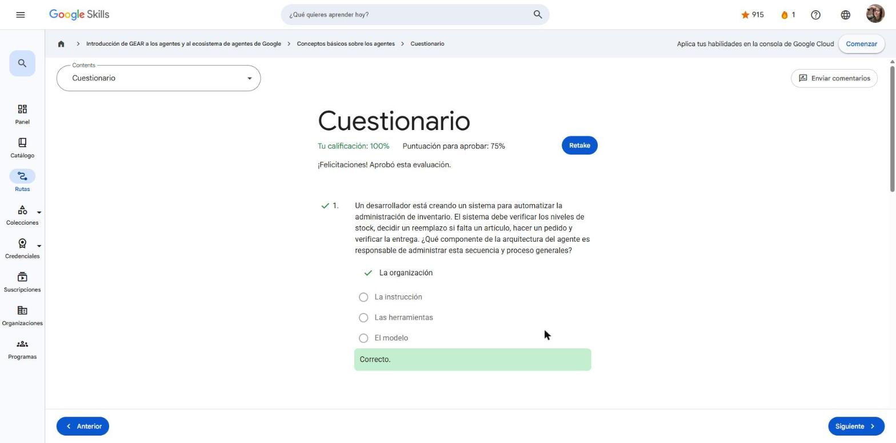
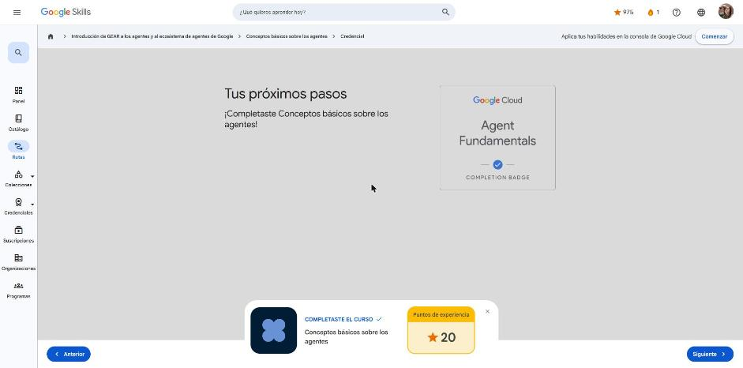

# 2. Conceptos básicos sobre los agentes

Curso de la ruta **GEAR: Introducción a los agentes y al ecosistema de agentes de Google** (Google Skills).
Enlace: <https://www.skills.google/paths/3546/course_templates/1562>

**Lecciones:** Te damos la bienvenida · Introducción a los agentes de IA · Abstracción de agentes · Cómo funcionan los agentes · Los agentes en acción · Conclusión del curso · Cuestionario.

---

## Te damos la bienvenida

El curso plantea el salto de una IA que **responde** a una IA que **actúa**: un asistente al que le das una meta y que busca, analiza, decide y ejecuta la tarea usando el software de la empresa sin que tengas que guiar cada paso.

Objetivos del curso:

- Definir qué es un agente de IA y cómo alcanza metas sin intervención humana constante.
- Identificar sus capacidades clave: acción autónoma, razonamiento, planificación y aprendizaje continuo.
- Reconocer casos de uso en atención al cliente, marketing e investigación.
- Diferenciar agentes de chatbots tradicionales.

!!! tip "Para recordar"
    - Los agentes son la siguiente etapa: de "aconsejar" a "ejecutar".

## Introducción a los agentes de IA

**Definición.** Un agente de IA es un sistema de software que usa IA (normalmente un modelo de lenguaje) para cumplir un objetivo en nombre de un usuario: percibe su entorno mediante entradas y herramientas y actúa sobre él. A diferencia de un chatbot basado en reglas, se orienta a la **acción autónoma** y puede ser proactivo.

**Lo que lo distingue de un modelo solo:**

1. **Bucle de razonamiento** – ciclo iterativo *observar → interpretar → planificar → actuar* que se repite hasta cumplir la meta o llegar a un punto de parada.
2. **Herramientas** – funciones para interactuar con el mundo: datos, APIs, aplicaciones, incluso robots (p. ej. actualizar inventario, agendar reuniones, pedir suministros).

**Cinco capacidades esenciales**

| Capacidad | En pocas palabras |
|---|---|
| Autonomía | Recibe una meta y decide/ejecuta los pasos sin instrucciones por acción |
| Razonamiento y planificación | Usa el modelo para decidir y adaptarse a cambios |
| Aprendizaje continuo | Mejora con la experiencia |
| Conciencia del entorno | Percibe entradas (peticiones, respuestas de API, estado de BD, errores) y mantiene un "modelo del mundo" |
| Uso de herramientas | APIs, bases de datos, servicios externos para actuar de verdad |

**Multiagente.** Los agentes rinden más cuando colaboran: un **agente organizador** (orquestador) reparte el trabajo a agentes especializados. Ejemplos del curso:

- *Reembolsos:* organizador → agente de verificación (reglas y pedido) → agente de entrega (procesa el pago y envía confirmación).
- *Campaña de marketing:* organizador → redacción publicitaria + creación de imágenes → programación de publicaciones → análisis de rendimiento que retroalimenta al organizador.
- *Informe de mercado:* organizador → investigación web → limpieza/normalización de datos → síntesis del borrador → entrega.

**Arquitectura de un agente (video).** Tres elementos básicos:

- **Modelo** (cerebro): cada vez más se usan *modelos de razonamiento*, que evalúan opciones antes de responder.
- **Herramientas**: muchas se exponen vía **MCP (Model Context Protocol)**, que es como una API pero con descripción semántica de entradas/salidas, para que el agente sepa cuándo y cómo usarla.
- **Memoria**: en lo básico es la ventana de contexto; también puede haber memoria de corto y largo plazo. El contexto debe **gestionarse activamente** (resumir, comprimir, descartar lo irrelevante, inyectar memorias útiles).

**Patrones de agentes**

- **Agente único**: instrucciones + algunas herramientas + un modelo; ideal para empezar o para metas muy claras.
- **Agente secundario (sub-agente)**: el principal delega subtareas especializadas, pasando solo el contexto necesario (p. ej. extracción de datos de facturas).
- **Organizador / router**: un agente inicial detecta la intención y enruta al agente más apto; el reto es identificar bien la intención y hacerlo rápido.

!!! tip "Para recordar"
    - Agente = modelo + herramientas + memoria/organización, funcionando en bucle.
    - De reglas reactivas a objetivos autónomos; de generar texto a integrar sistemas.
    - MCP estandariza cómo los agentes descubren y usan herramientas.
    - Patrones: único, sub-agente, organizador/router.

## Abstracción de agentes

Problema: los LLM nos dan buenos consejos, pero **la ejecución sigue siendo nuestra** (brecha entre saber y hacer). Un agente no es "un LLM con herramientas pegadas"; es otra abstracción: mantiene contexto, planifica y toma la iniciativa.

**Ejemplo de la chaqueta**

| Nivel | Comportamiento | Qué le falta |
|---|---|---|
| LLM | Da una regla general ("si hace menos de 16 °C…") | Sin datos del entorno, sin herramientas |
| LLM + llamadas a funciones | Consulta la API del clima cuando tú lo pides | Tú diriges el flujo; no es autónomo ni proactivo |
| Agente | Revisa ubicación, clima, tu calendario y pronóstico por hora y responde con contexto | — (aplica todas las características) |

**Problemas "de agente":** procesos de varios pasos (informes de gastos), entornos cambiantes (reservas de viaje con precios y cupos variables), monitoreo continuo ("reserva cuando el vuelo baje de X"), coordinación entre múltiples sistemas (organizar un evento).

**Verificación de conocimientos:** lo que separa a un agente de un LLM con llamadas a funciones es la **operación autónoma y proactiva orientada a objetivos** (no solo usar herramientas).

!!! tip "Para recordar"
    - De reactivo a proactivo; de aislado a integrado (mantiene estado); de asesor a ejecutor; de estático a adaptativo.

## Cómo funcionan los agentes

Todas las capacidades salen de **tres pilares**: (analogía del auto: motor, ruedas y dirección).

1. **Modelo – el cerebro.** Tomador de decisiones central. Hace tres cosas:
    - *Entender la intención*: extrae la meta real y detecta ambigüedad ("¿París, Francia o París, Texas?").
    - *Decidir el siguiente paso*: prioridades, dependencias (¿vuelo u hotel primero?).
    - *Interpretar la retroalimentación*: si la herramienta falla o el precio es alto, cambia de estrategia.
2. **Herramientas – las manos.** Sin ellas el modelo solo describe lo que haría. Tipos frecuentes:
    - *Integraciones prediseñadas* (extensiones) a servicios externos (vuelos, clima): el agente pide y la integración resuelve la llamada a la API.
    - *Funciones personalizadas*: el agente prepara la llamada pero **tu aplicación la ejecuta** → útil para control (aprobación humana antes de comprar) y para reutilizar lógica de negocio.
    - *Recuperación de datos* (bases de datos / RAG): conocimiento fuera del entrenamiento (documentos, historiales, catálogos).
3. **Organización (orquestación) – el proceso.** Ciclo **percibir → pensar → actuar → verificar** que se repite hasta lograr el objetivo. Se apoya en marcos de razonamiento como **ReAct**, **cadena de pensamiento (CoT)** y **árbol de pensamiento (ToT)**.

Sin esta arquitectura terminas con miles de líneas de `if-then-else` frágiles para cada caso ("¿y si Sara está ocupada?").

!!! tip "Para recordar"
    - Modelo = inteligencia, herramientas = capacidad, organización = proceso que los une.
    - El poder está en **encadenar** varias llamadas a herramientas y adaptarse con la retroalimentación.

## Los agentes en acción

**Cuándo SÍ usar un agente:** comportamiento orientado a objetivos, razonamiento de varios pasos con acciones externas, resolución adaptativa ante variaciones, integración entre varios sistemas.

Ejemplos fuertes: respuesta automática a incidentes de producción (analizar logs, revisar despliegues, crear tickets, revertir, avisar), análisis competitivo (buscar, extraer, sintetizar y citar), informes ejecutivos diarios programados.

**Cuándo NO (antipatrones):** preguntas frecuentes simples (basta búsqueda/FAQ), consultas de una sola función (clima, precio de acción), tareas masivas repetitivas (10 000 operaciones idénticas → automatización tradicional), procesos totalmente determinísticos por reglas, y casos de latencia crítica (trading en microsegundos, control de seguridad).

**Prueba rápida:** ¿varios pasos dependientes? ¿adaptación? ¿razonamiento? ¿acciones en sistemas externos? Si la mayoría es "sí" → agente.

**Ecosistema de Google Cloud – Gemini Enterprise Agent Platform** (4 pilares):

| Pilar | Componentes |
|---|---|
| **Crear** | Agent Development Kit (**ADK**, framework modular e independiente del modelo), Agent Studio (lienzo low-code), Agent Garden (plantillas/agentes prearmados), Model Garden (Gemini, terceros y open source), RAG Engine, Vector Search, Managed Agents API (Agents API + Interactions API) |
| **Escalar** | Agent Runtime (arranques en frío < 1 s, agentes de larga duración), Sessions (estado de una interacción), Memory Bank (memoria persistente entre sesiones), Code Execution (Python en sandbox) |
| **Administrar (gobernar)** | Agent Registry (catálogo de agentes, herramientas y servidores MCP), Agent Identity, Agent Gateway (políticas sobre llamadas a herramientas), políticas de contenido, análisis de amenazas de IA, AI Content Detection API |
| **Optimizar** | Evaluación de agentes (AutoRaters multi-turno, evaluación en línea), simulación con personajes sintéticos, observabilidad/trazas, optimización de instrucciones |

!!! tip "Para recordar"
    - Agentes para razonamiento + adaptación + varios pasos; automatización clásica para lo simple y determinístico.
    - Considerar latencia, costo y complejidad; empezar simple.

## Conclusión del curso

Modelos mentales:

- **LLM = consultor** (aconseja), **LLM + funciones = asistente con herramientas** (actúa si se lo pides), **agente = empleado de confianza** (actúa solo una vez tiene la meta).
- **Agente = modelo + herramientas + organización** (cocinero, utensilios y proceso de pedir-planificar-cocinar-servir).
- Usa un agente si hay varios pasos, adaptación, razonamiento y acciones externas.

!!! tip "Para recordar"
    - Los agentes no son chatbots: perciben, razonan y actúan.
    - Las herramientas son los "superpoderes"; la autonomía orientada a objetivos es la característica definitoria.
    - No todo necesita un agente.

## Cuestionario

Resultado: **100 %** (mínimo 75 %) · insignia de finalización **Agent Fundamentals**.

- Componente que gestiona la secuencia completa (stock → reemplazo → pedido → entrega) → **la organización**.
- Pasos del bucle → **percibir, pensar, actuar, verificar**.
- ¿Por qué un agente para soporte con entradas impredecibles y reembolsos multi-sistema? → varios pasos + razonamiento + adaptación + acciones externas.
- Sistema que vigila alertas, decide criticidad, crea y asigna tickets sin que se lo pidan → **agente de IA** (autónomo y orientado a objetivos).

