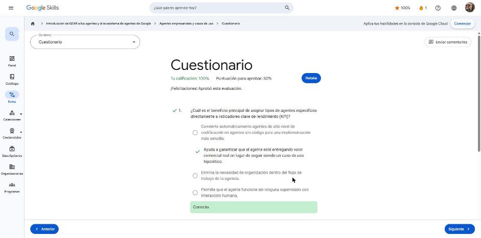
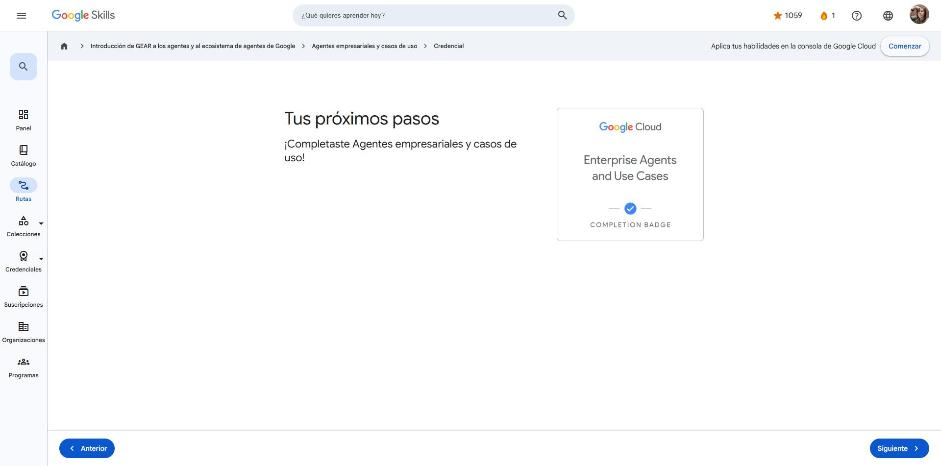

# 3. Agentes empresariales y casos de uso

Curso de la ruta **GEAR: Introducción a los agentes y al ecosistema de agentes de Google** · 1 h 30 min · Introductorio.
Enlace: <https://www.skills.google/paths/3546/course_templates/1587>

**Lecciones:** Casos de uso empresariales para agentes de IA · Desarrollo de agentes con Google Cloud · Acerca de Gemini Enterprise · Cuestionario.

---

## Casos de uso empresariales para agentes de IA

La IA pasa de "responder preguntas" a ser una red de **socios activos** que hacen trabajo. El valor de un agente se mide por su **impacto en el negocio** (cerrar ventas, mejor código, proteger datos).

**Tipos funcionales de agentes**

- **Recuperación y resumen**: encuentran información en grandes volúmenes y la resumen.
- **Acción / automatización**: ejecutan tareas por petición o por reglas (actualizar registros, notificar) y flujos de varios pasos.
- **Análisis**: detectan tendencias y patrones, generan informes y visualizaciones.
- **Conversacionales**: chat en lenguaje natural (soporte, preguntas frecuentes).

**Seis categorías por impacto empresarial** (cada una ligada a KPI concretos):

| Categoría | KPI típico |
|---|---|
| Atención al cliente | tiempo de resolución, satisfacción |
| Productividad de empleados | tiempo ahorrado en búsqueda/tareas |
| Creatividad (contenido) | velocidad de producción de campañas |
| Código | velocidad de desarrollo |
| Datos | tiempo hasta el insight |
| Seguridad | tiempo de respuesta ante amenazas |

**Flujo de agentes (agentic workflow).** Modelos + herramientas + organización + **entorno de ejecución** forman un flujo de agentes, que se vuelve central en la operación de las empresas.

**Caso Zebra Technologies (video).** Ante la escasez proyectada de trabajadores de primera línea, Zebra lanzó *Zebra Companion* (con Gemini) para retail, con cuatro agentes: **conocimiento** (procedimientos/SOP de la tienda), **merchandising** (estanterías listas), **ventas asistidas** y **dispositivos** (interoperabilidad y soporte). Combina voz, visión y contexto con tecnología *wearable*.

**Para recordar**

- Mapear cada agente a un KPI evita que se quede en "caso hipotético".
- Seis categorías: cliente, empleado, creatividad, código, datos, seguridad.

## Desarrollo de agentes con Google Cloud

Google ofrece una **pila de IA unificada** con rutas según el perfil:

| Perfil | Herramientas |
|---|---|
| **Usuarios de negocio (sin código)** | AppSheet + Gemini para crear apps desde una hoja de cálculo; **Agent Designer** (en la app de Gemini Enterprise); **ADK Visual Agent Builder**; **Agentes conversacionales** (Customer Engagement Suite / Contact Center as a Service) |
| **Desarrolladores ocasionales (low-code, asistido)** | **Agent Search**, app de **Gemini Enterprise**, **Application Integration** (cientos de conectores gobernados), **Opal** |
| **Desarrolladores profesionales (pro-code)** | **ADK** (Agent Development Kit, open source, sistemas multiagente), **Genkit** (apps de IA en general), **Gemini Enterprise Agent Platform** (crear, escalar, administrar, optimizar), Gemini Code Assist, Jules, Firebase Studio |

**Productos clave**

- **App de Gemini Enterprise**: SaaS con agentes listos, conectores empresariales, gráfico de conocimiento, agentes prediseñados y personalizados, políticas y visibilidad.
- **Agentes conversacionales**: plataforma sin código, runtime administrado, analítica y CI/CD; mezcla flujos determinísticos con LLM.
- **Gobernanza**: todos los agentes (sin código o pro-code) quedan bajo los mismos controles empresariales.
- **Gemini Enterprise Agent Platform**: ADK, Agent Garden, Agent Engine/**Agent Runtime** (monitoreo, trazas, memoria de largo plazo, sesiones, *Example Store* para few-shot, *Agentic Autorater*), y la **API de Gemini** (modelo multimodal + herramientas de "bucle interno" como intérprete de código y búsqueda).

**¿Qué plataforma elegir?**

- Agentes listos / productividad interna con chat y búsqueda → **Gemini Enterprise**.
- Bots de voz o chat para clientes, conversaciones estructuradas multi-turno (máquina de estados) → **Agentes conversacionales**.
- Recorridos no lineales y multicanal que cambian de tema sin perder contexto → **CX Agent Studio**.
- Lógica personalizada en código y despliegue en Google Cloud → **Agent Platform + ADK + Agent Runtime**.

**Para recordar**

- ADK = framework open source, code-first (SDK de Python) para multiagente.
- Agent Platform = ciclo de vida completo + runtime administrado.
- La elección depende de **quién construye** y **cuánto control** se necesita.

## Acerca de Gemini Enterprise

Gemini Enterprise es el **asistente inteligente y centro de comando** del trabajo: combina el razonamiento de Gemini, búsqueda con calidad de Google y los datos de la empresa (donde estén) para dar respuestas fundamentadas y ejecutar tareas (planificar, investigar, generar contenido, actuar) con una sola instrucción.

**Tipos de agentes en Gemini Enterprise**

1. **Creados por Google**: Asistente (LLM Gemini), **Gemini Notebook** (investigación sobre tus fuentes), **Deep Research** (informes exhaustivos con web + datos internos).
2. **Sin código**: (1) definir el propósito, (2) conectar datos, (3) dar instrucciones en lenguaje natural, (4) probar e iterar.
3. **Alto nivel de código (pro-code)**: para desarrolladores y científicos de datos; lógica compleja, integraciones a medida, ajuste de modelos.
4. **De terceros/socios**: Salesforce, Jira, SharePoint, Microsoft Copilot… con **conectores precompilados que respetan las ACL** del sistema de origen.

**Flujo:** Instrucción → Gemini Enterprise (Asistente, Búsqueda, Acciones + Agentes) ⇄ almacenes de datos y sistemas externos → Respuesta.

**Para recordar**

- Propósito principal: conectar el conocimiento de toda la organización y ponerlo al servicio del empleado, con acciones sobre sus herramientas.
- Cuatro familias de agentes: Google, sin código, pro-code, terceros.

## Cuestionario

Resultado: **100 %** (mínimo para aprobar 50 %) · insignia de finalización **Enterprise Agents and Use Cases**.

- Beneficio de mapear agentes a KPI → asegurar valor de negocio real, no un caso hipotético.
- Jefe no técnico que quiere su propio agente → **agentes sin código**.

