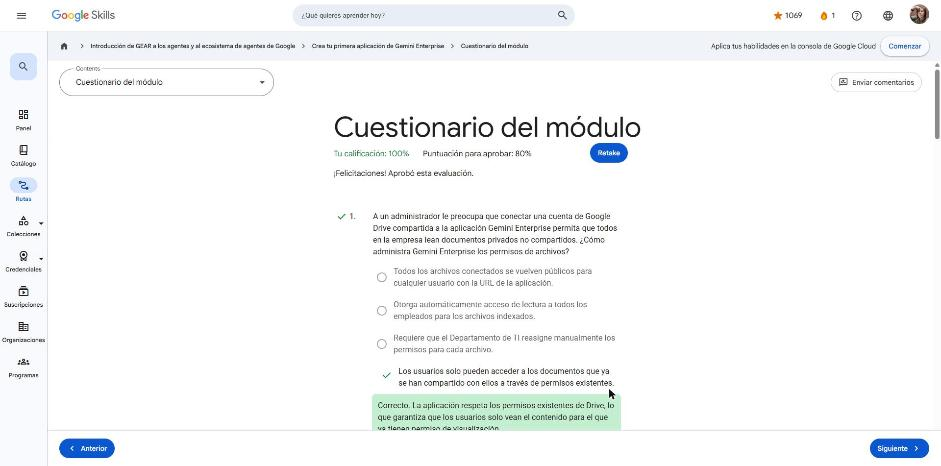
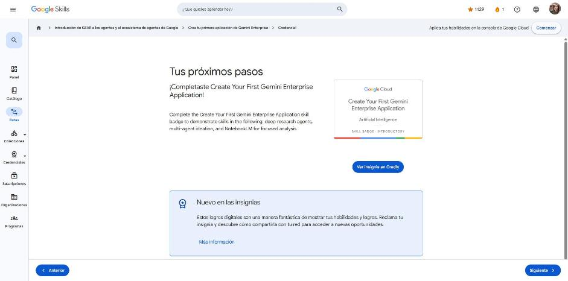

# 4. Crea tu primera aplicación de Gemini Enterprise

Curso con **insignia de habilidad** (1 h, introductorio). Enlace: <https://www.skills.google/paths/3546/course_templates/1586>

**Contenido:** Lección "Crea tu primera aplicación de Gemini Enterprise" (simulación práctica + video demostrativo) · Cuestionario del módulo · Insignia de habilidad.

---

## Crea tu primera aplicación de Gemini Enterprise

Objetivo: crear una app de Gemini Enterprise, conectarle varios almacenes de datos y probar sus funciones (asistente, agentes prediseñados y NotebookLM). Caso de ejemplo: *Cymbal Foods – Equipo de marketing*.

**1. Crear la app**

1. En la consola de Google Cloud buscar **Gemini Enterprise** → *Crear tu primera app* → ponerle nombre → *Crear*.
2. **Configurar la identidad** antes de compartirla: elegir **Google Identity** como proveedor y confirmar la identidad del personal. (Es lo primero, para que los empleados se autentiquen.)

**2. Conectar almacenes de datos** (*Almacenes de datos conectados → Nuevo almacén de datos*)

| Fuente | Configuración clave |
|---|---|
| Google Drive | Sincronizar todas las unidades compartidas de la organización |
| Calendario de Google | Conector con nombre y crear |
| Cloud Storage | Tipo **Documentos** (PDF, HTML, TXT no estructurados); frecuencia **Una vez** para una carga única (o **Periódica** si los datos se actualizan, p. ej. informes semanales); elegir el bucket |

- Los conectores **respetan los permisos existentes** (ACL): cada usuario solo ve los documentos que ya tenía compartidos.
- Si hay PDF + datos estructurados por documento (precio, stock) y se quiere filtrar → importar como **documentos con metadatos**.

**3. Usar la app** (se comparte con el personal mediante una URL única)

- **Asistente**: "Ponme al día con nuestros datos de marketing más recientes" → busca en fuentes internas y externas y responde con contexto.
- **Mejorar tu conversación**: limitar a fuentes internas, generar video con **Veo** o imágenes con **Nano Banana**. Admite instrucciones **multimodales** (p. ej. resumir un gráfico circular de sentimiento guardado como PNG).
- **Generación de ideas (Idea Generation)**: un **equipo de agentes** planifica, genera y evalúa ideas (p. ej. campaña para la generación Z); primero propone un plan que el usuario revisa.
- **Deep Research**: investigación exhaustiva (incluye cientos de sitios externos); genera un plan editable y luego un informe completo + resumen en audio.
- **NotebookLM**: cuaderno con fuentes propias (Docs, URLs, YouTube, texto, archivos). Responde **solo con base en las fuentes cargadas**; permite guardar respuestas como notas y, en **Studio**, generar audio, video, mapas mentales e informes (ej. resumen en video "Marketing en cifras").

!!! tip "Para recordar"
    - Orden de configuración: crear app → **identidad** → almacenes de datos → compartir URL.
    - Gemini Enterprise hereda permisos de la fuente; no expone documentos privados.
    - Herramienta según la tarea: pregunta rápida → asistente; ideas → Idea Generation; investigación amplia → Deep Research; análisis de un conjunto cerrado de fuentes → NotebookLM.

## Cuestionario del módulo

Resultado: **100 %** (mínimo 80 %, 8 preguntas).

| Pregunta (resumen) | Respuesta |
|---|---|
| ¿Cómo maneja permisos de Drive? | Solo se accede a lo ya compartido con el usuario |
| PDF + datos estructurados para filtrar por precio/stock | Documentos con metadatos |
| Resumen en video de unos pocos archivos | NotebookLM |
| Primer paso del administrador para autenticar al personal | Elegir un proveedor de identidad |
| Informe de tendencias analizando cientos de sitios externos | Agente Deep Research |
| Pregunta a NotebookLM sobre algo que no está en las fuentes | Responde solo con el contenido subido |
| Bucket con informes semanales, datos siempre al día | Sincronización periódica |
| Entender un gráfico PNG de sentimiento | Pedirle al asistente que lo resuma |

## Insignia de habilidad

Obtenida: **Create Your First Gemini Enterprise Application** (Skill Badge · Introductory · Artificial Intelligence).

## Fuentes y aviso legal

- **Fuente:** cursos de la ruta GEAR de Google Cloud Skills Boost. Sitios oficiales: [cloudskillsboost.google](https://www.cloudskillsboost.google) · [cloud.google.com/docs](https://cloud.google.com/docs).
- **Uso:** apuntes personales de estudio, sin fines comerciales y con redacción propia. Las imágenes del curso son fragmentos breves citados con fines educativos; sus derechos son de sus titulares.
- **Sin afiliación:** sitio no oficial, no afiliado ni respaldado por Google. Las marcas pertenecen a sus dueños.
- Más detalles y cómo pedir el retiro de contenido en el [aviso legal](../../aviso-legal.md).
