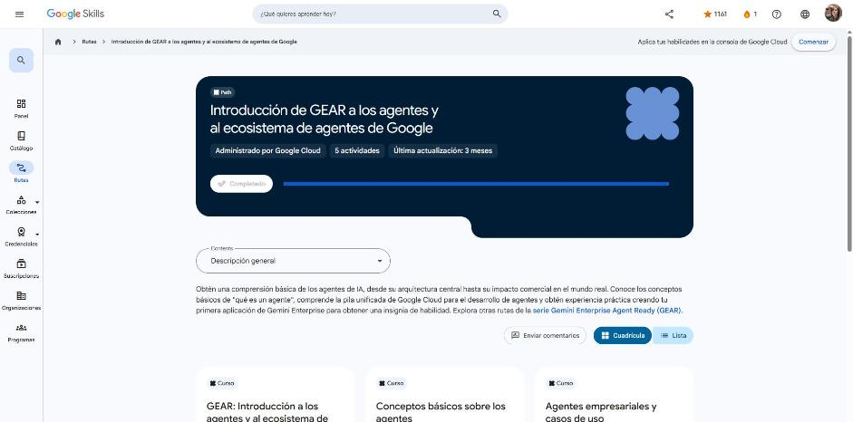
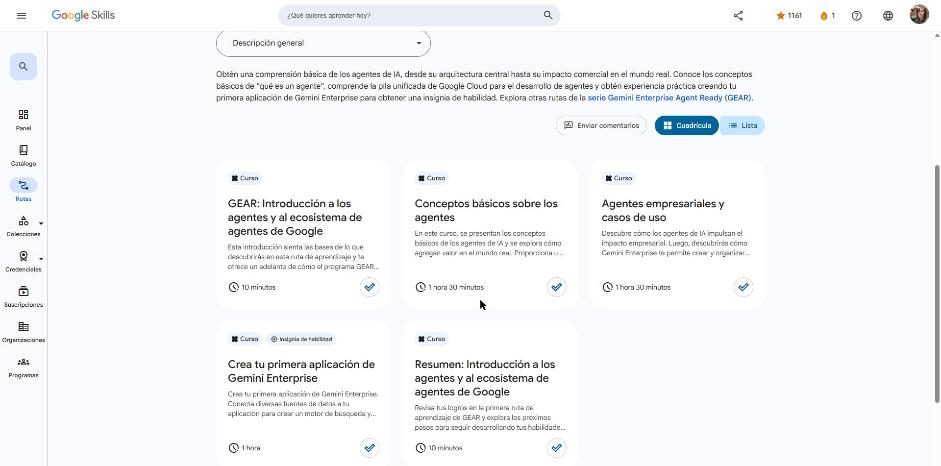

# Google Skills · GEAR: Introducción a los agentes y al ecosistema de agentes de Google

Programa **Google Cloud Career Launchpad – LatAm** (MinTIC) · Plataforma: Google Skills
Ruta: <https://www.skills.google/paths/3546>

Primera ruta de la serie **Gemini Enterprise Agent Ready (GEAR)**. Da una base sobre agentes de IA: qué son, cómo funcionan (modelo, herramientas, organización y memoria), cuándo conviene usarlos, su impacto en el negocio y el ecosistema de Google Cloud para construirlos (Gemini Enterprise, Agent Platform, ADK, MCP). Cierra con un lab simulado para crear la primera app de Gemini Enterprise y obtener una insignia de habilidad.

!!! success "Ruta completada (5/5 actividades · 100 %)"
    Completada el **2026-10-24**. Todos los cuestionarios aprobados con 100 %.

## Actividades

| # | Actividad | Duración | Estado | Fecha | Resultado | Notas |
|---|---|---|---|---|---|---|
| 1 | [GEAR: Introducción a los agentes y al ecosistema de agentes de Google](https://www.skills.google/paths/3546/course_templates/1769) | 10 min | Completado | 2026-10-24 | — | [Notas](01-gear-introduccion.md) |
| 2 | [Conceptos básicos sobre los agentes](https://www.skills.google/paths/3546/course_templates/1562) | 1 h 30 min | Completado | 2026-10-24 | Cuestionario 100 % · insignia *Agent Fundamentals* | [Notas](02-conceptos-basicos-agentes.md) |
| 3 | [Agentes empresariales y casos de uso](https://www.skills.google/paths/3546/course_templates/1587) | 1 h 30 min | Completado | 2026-10-24 | Cuestionario 100 % · insignia *Enterprise Agents and Use Cases* | [Notas](03-agentes-empresariales.md) |
| 4 | [Crea tu primera aplicación de Gemini Enterprise](https://www.skills.google/paths/3546/course_templates/1586) | 1 h | Completado | 2026-10-24 | Cuestionario 100 % · **insignia de habilidad** | [Notas](04-primera-app-gemini-enterprise.md) |
| 5 | [Resumen: Introducción a los agentes y al ecosistema de agentes de Google](https://www.skills.google/paths/3546/course_templates/1772) | 10 min | Completado | 2026-10-24 | — | [Notas](05-resumen.md) |

## Insignias obtenidas

- **Agent Fundamentals** (finalización)
- **Enterprise Agents and Use Cases** (finalización)
- **Create Your First Gemini Enterprise Application** (insignia de habilidad · Introductory)

## Evidencias

## Fuentes y aviso legal

- **Fuente:** cursos de la ruta GEAR de Google Cloud Skills Boost. Sitios oficiales: [cloudskillsboost.google](https://www.cloudskillsboost.google) · [cloud.google.com/docs](https://cloud.google.com/docs).
- **Uso:** apuntes personales de estudio, sin fines comerciales y con redacción propia. Las imágenes del curso son fragmentos breves citados con fines educativos; sus derechos son de sus titulares.
- **Sin afiliación:** sitio no oficial, no afiliado ni respaldado por Google. Las marcas pertenecen a sus dueños.
- Más detalles y cómo pedir el retiro de contenido en el [aviso legal](../../aviso-legal.md).
