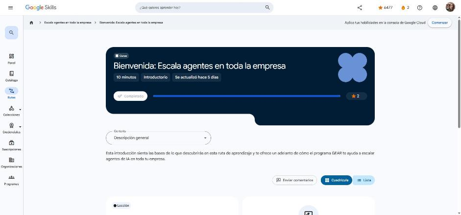

# 1. Bienvenida: Escala agentes en toda la empresa

Curso de bienvenida (10 min). Enlace: <https://www.skills.google/paths/3980/course_templates/1776>

## Te damos la bienvenida

Cuarta ruta de la serie **GEAR**, pensada para un público amplio (desde perfiles no técnicos hasta desarrolladores). Se centra en **crear y coordinar agentes** con **Gemini Enterprise** para resolver retos de negocio en marketing, retail y manufactura, manteniendo a las personas en el centro de las decisiones.

Temas:

- Cómo las organizaciones usan **agentes de IA generativa personalizados** para retos concretos.
- **Potenciación (augmentation) vs. automatización** y cómo equilibrar eficiencia de la máquina con intuición humana.
- El marco operativo de los **asistentes de agentes** frente a herramientas de IA estándar.
- Casos de uso de Gemini Enterprise por industria: investigación profunda con datos propios y de terceros, generación de imágenes y video, y acciones en plataformas externas.
- Lab simulado: actuar como líder de marketing y orquestar una campaña completa con Gemini Enterprise (insignia de habilidad).

!!! tip "Para recordar"
    - Escalar agentes no es solo tecnología: es estrategia + personas + gobierno.
    - Pista: la ruta combina visión de liderazgo (cursos 1–2) con práctica en Gemini Enterprise (curso 3).

*Figura: el curso aparece como completado en Google Skills.*
