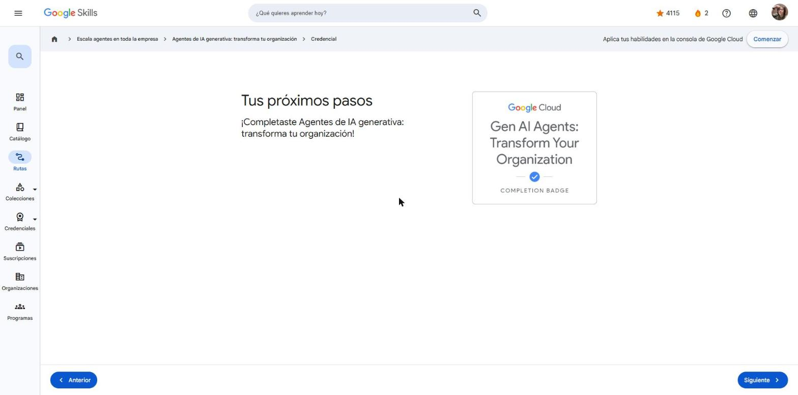

# 2. Agentes de IA generativa: transforma tu organización

Curso de la ruta **GEAR: Escala agentes en toda la empresa** (también es el 5.º curso de la ruta *Generative AI Leader*).
Enlace: <https://www.skills.google/paths/3980/course_templates/1267>

**Módulos:** Agentes modernos · Agentes de construcción · Mejora la experiencia del cliente con los agentes · Estrategia: planificación anticipada.

---

## Introducción

El curso cierra la ruta *Generative AI Leader*: pasa de "qué es la IA generativa" a **cómo los agentes transforman una organización**. Un agente es una aplicación que, dado un objetivo, **razona, planifica y actúa** usando herramientas, en lugar de solo responder texto.

!!! tip "Para recordar"
    - Agente = modelo de base + bucle de razonamiento + herramientas.
    - Pista: no se requiere experiencia técnica; el enfoque es de liderazgo y estrategia.

## Historia breve sobre los agentes

- **Sistemas basados en reglas** y chatbots con árboles de decisión: predecibles pero rígidos.
- **Asistentes con aprendizaje automático**: entienden intención, pero con dominios limitados.
- **Agentes con IA generativa**: entienden lenguaje natural, razonan en varios pasos, usan herramientas y se adaptan.
- **Sistemas multiagente**: varios agentes especializados colaboran (p. ej., uno busca vuelos, otro hoteles y otro arma el itinerario) para un objetivo complejo.

!!! tip "Para recordar"
    - La evolución va de reglas fijas → ML → LLM con herramientas → multiagente.
    - Pista: "varios agentes especializados que colaboran" = sistema multiagente.

## Uso de modelos

**Parámetros de muestreo** que controlan la salida del modelo:

| Parámetro | Qué controla |
|---|---|
| **Temperatura** | Aleatoriedad/creatividad (baja = precisa y repetible; alta = creativa) |
| **Top-K / Top-P** | Cuántos tokens candidatos se consideran en cada paso |
| **Longitud máxima de salida** | Tope de tokens de la respuesta |
| **Configuración de seguridad** | Filtros de contenido dañino |

**Dónde experimentar:**

| | Google AI Studio | Vertex AI Studio |
|---|---|---|
| Público | Principiantes, prototipos rápidos | Profesionales y empresas |
| Escala | Experimentación | Producción, gobierno, seguridad, MLOps |
| Acceso | Clave de API de Gemini | Proyecto de Google Cloud |

!!! tip "Para recordar"
    - Controlar creatividad/aleatoriedad → **temperatura**.
    - Pista: AI Studio = experimentar; Vertex AI Studio = escala empresarial.

## Ingeniería de instrucciones en bucles de razonamiento

El **bucle de razonamiento** guía al agente por ciclos iterativos de **observar → pensar → decidir/actuar → observar el resultado**, hasta cumplir la tarea.

- **ReAct (Reason + Act):** el modelo alterna pensamiento y acción (llamar a una herramienta) y usa la observación para el siguiente paso.
- **Chain-of-Thought (CoT):** pedir razonamiento paso a paso mejora la precisión en problemas de varios pasos.
- Buenas instrucciones definen rol, objetivo, restricciones, formato y ejemplos.

!!! tip "Para recordar"
    - El bucle de razonamiento NO restringe al agente a respuestas fijas: lo hace iterar observando y decidiendo.
    - Pista: ReAct = razonar + actuar con herramientas; CoT = pensar paso a paso.

## Agrega herramientas

Las herramientas conectan al agente con el mundo real:

| Herramienta | Uso |
|---|---|
| **Extensiones** | Conectan con APIs externas de forma estandarizada (el agente llama directamente) |
| **Funciones** | El modelo propone una llamada a una función definida por el desarrollador; la app la ejecuta |
| **Almacenes de datos** | Dan acceso a información (documentos, sitios, bases de datos) para fundamentar respuestas |
| **Complementos (plugins)** | Paquetes que añaden capacidades nuevas (p. ej., acceso a calendarios o envío de invitaciones) |

Google Cloud ofrece además APIs listas (Translation, Speech-to-Text, Vision, Natural Language, etc.) que un agente puede usar como herramientas.

!!! tip "Para recordar"
    - Programar una reunión (leer calendarios, enviar invitaciones) → **extensiones y complementos**.
    - Pista: almacenes de datos = conocimiento; extensiones/funciones = acciones.

## Crea aplicaciones

Formas de llevar un agente a una aplicación en Google Cloud:

- **Cloud Run Functions**: código pequeño que responde a eventos.
- **Cloud Run**: contenedores sin servidor con escalado automático.
- **Apps Script**: automatizaciones sobre Google Workspace.
- **AppSheet**: apps sin código a partir de datos (hojas de cálculo, bases de datos).

!!! tip "Para recordar"
    - Hay opciones desde sin código (AppSheet) hasta contenedores (Cloud Run).
    - Pista: Apps Script se integra de forma nativa con Gmail, Docs, Sheets y Calendar.

## RAG y herramientas

**RAG (generación aumentada por recuperación):** antes de responder, el LLM **consulta almacenes de datos** para recuperar información pertinente y la añade al contexto. Así reduce alucinaciones y usa datos actualizados o privados **sin reentrenar** el modelo (no cambia sus parámetros).

Flujo: pregunta → búsqueda en el almacén (embeddings / búsqueda semántica) → fragmentos relevantes → instrucción enriquecida → respuesta con citas.

!!! tip "Para recordar"
    - RAG enriquece la respuesta; no modifica de forma permanente el conocimiento del modelo.
    - Pista: RAG = recuperar + aumentar + generar.

## Agentes de búsqueda

**Vertex AI Search** crea búsquedas de calidad Google sobre los datos de la empresa:

- **Fundamentación (grounding):** basa los resultados en fuentes confiables y cita de dónde vienen; mitiga las alucinaciones.
- Búsqueda **multimodal** (texto, imágenes, documentos) y sobre datos estructurados y no estructurados.
- Controles de acceso, estadísticas y personalización.

!!! tip "Para recordar"
    - La función que combate alucinaciones en Vertex AI Search es la **fundamentación**.
    - Pista: Vertex AI Search ≈ RAG administrado listo para empresas.

## Interacción con los clientes

**Customer Engagement Suite** de Google Cloud:

| Componente | Función |
|---|---|
| **Agentes conversacionales** | Chat/voz con clientes; combina flujos **determinísticos** con IA generativa |
| **Agent Assist** | Ayuda en tiempo real a agentes humanos (sugerencias, resúmenes) |
| **Conversational Insights** | Analiza conversaciones (sentimiento, temas, tendencias) |
| **Contact Center as a Service (CCaaS)** | Plataforma omnicanal de centro de contacto |

**Enfoque híbrido:** reglas determinísticas para pasos críticos (pagos, verificación) + IA generativa para conversación flexible → control estricto y flexibilidad a la vez. Caso de ejemplo: *Cymbal Taxes* atiende consultas de impuestos combinando ambos.

!!! tip "Para recordar"
    - Híbrido = control del comportamiento + flexibilidad generativa.
    - Pista: Agent Assist ayuda al humano; los agentes conversacionales atienden al cliente directamente.

## Crea tu propio agente

Con agentes conversacionales se definen **guías (playbooks)**: instrucciones en lenguaje natural sobre el objetivo del agente, cómo actuar y qué herramientas usar (almacenes de datos, APIs, funciones). Se prueban, se ajustan y se despliegan en canales (web, telefonía, mensajería).

!!! tip "Para recordar"
    - Una guía = objetivo + instrucciones + herramientas + ejemplos.
    - Pista: se puede construir un agente útil sin programar.

## Gemini Enterprise

Plataforma central para que los **empleados** encuentren información y automaticen tareas con agentes que usan los datos de la empresa, estén donde estén (Drive, Confluence, Jira, ServiceNow, etc.).

Capacidades:

- **NotebookLM Enterprise**: subir fuentes, obtener análisis y resúmenes de audio.
- **Agentes de búsqueda multimodal** fundamentados en datos estructurados y no estructurados.
- **Asistentes con conectores** que realizan acciones (crear eventos de Calendar, editar incidencias en Jira).
- **Agentes personalizados** creados con agentes conversacionales.

Ejemplo: un asesor financiero compara informes de inversión, añade notas del cliente de NotebookLM, evalúa la cartera con un agente y redacta el correo final; o usa un agente de **investigación exhaustiva** que planifica, busca en miles de fuentes y entrega un informe con vínculos y resumen de audio.

**Gemini Enterprise vs. NotebookLM:** NotebookLM profundiza solo en las fuentes que subes; Gemini Enterprise es un asistente integral que busca y actúa en todos los sistemas conectados.

!!! tip "Para recordar"
    - Propósito de Gemini Enterprise: plataforma centralizada para organizar y acceder a agentes que usan los datos de la empresa.
    - Pista: NotebookLM = mis documentos; Gemini Enterprise = toda la empresa + acciones.

## Estrategia: planificación anticipada

**Integrar la IA generativa:**

1. Alinearla con la estrategia corporativa y tener un patrocinador ejecutivo.
2. Priorizar oportunidades por objetivos de negocio, factibilidad técnica y preparación de datos.
3. Desarrollar habilidades (capacitación, contratación, cultura de experimentación).
4. Gestionar el cambio en flujos, roles y mentalidades.
5. Medir y evaluar el impacto.
6. Aplicar un marco de **IA responsable** (equidad, transparencia, privacidad, seguridad).

**Planificar el impacto:** definir métricas clave (ROI, ingresos, costos, eficiencia, experiencia del cliente) → recopilar y analizar datos (p. ej., satisfacción antes y después de un chatbot) → iterar y mejorar (ajustar modelos, datos, instrucciones o integración).

**Planificar el cambio:** revisar la estrategia con frecuencia, seguir novedades de la industria, participar en la comunidad, invertir en capacitación y retener talento.

**Siguiente paso:** examen de certificación *Generative AI Leader* (supervisado, ~90 min).

!!! tip "Para recordar"
    - Impacto = métricas → datos → iteración.
    - Pista: la IA cambia rápido; la estrategia debe ser clara pero flexible.

## Guía de estudio (resumen del curso)

| Tema | Ideas clave |
|---|---|
| **Tipos de agentes** | **Determinísticos**: rutas y acciones predefinidas. **Generativos**: se definen en lenguaje natural con LLM y conversan de forma más natural |
| **Bucle de razonamiento** | **ReAct** (razonar y actuar), **CoT** (ejemplos con pasos intermedios) y **meta-prompting**, donde el modelo genera, modifica o interpreta otras instrucciones |
| **Herramientas** | Extensiones (servicios externos vía API), funciones (acciones concretas), almacenes de datos (acceso a información) y complementos (nuevas habilidades e integraciones) |
| **RAG en 4 pasos** | 1) Recuperar con herramientas → 2) Mejorar la instrucción con lo recuperado → 3) Generar la respuesta → 4) *(opcional)* Iterar la recuperación |
| **Customer Engagement Suite** | Agentes conversacionales, Agent Assist y estadísticas de conversación, integrables con el **CCaaS** de Google |
| **Búsqueda y empleados** | Vertex AI Search (búsqueda y recomendaciones) y Gemini Enterprise (antes Agentspace) para agentes internos sobre los datos de la empresa |
| **Estrategia** | Visión clara → priorizar casos de uso → invertir en capacidades → gestionar el cambio → medir el valor → IA responsable |

Para experimentar con la API de Gemini: Google AI Studio y Vertex AI Studio.

!!! tip "Para recordar"
    - Agente = modelo + bucle de razonamiento + herramientas; puede ser determinístico o generativo.
    - Pista: el paso 4 de RAG (iterar) es opcional y permite buscar de nuevo si falta información.

## Cuestionarios

| Cuestionario | Resultado | Ideas clave |
|---|---|---|
| Cuestionario 1 | **100 %** (mínimo 80 %) | Temperatura · sistema multiagente · extensiones y complementos · bucle de razonamiento · AI Studio vs. Vertex AI Studio |
| Cuestionario 2 | **100 %** (mínimo 80 %) | Gemini Enterprise · fundamentación · RAG · métricas de impacto · enfoque híbrido · componentes de un agente |

**Insignia:** *Gen AI Agents: Transform Your Organization* (completion badge).

