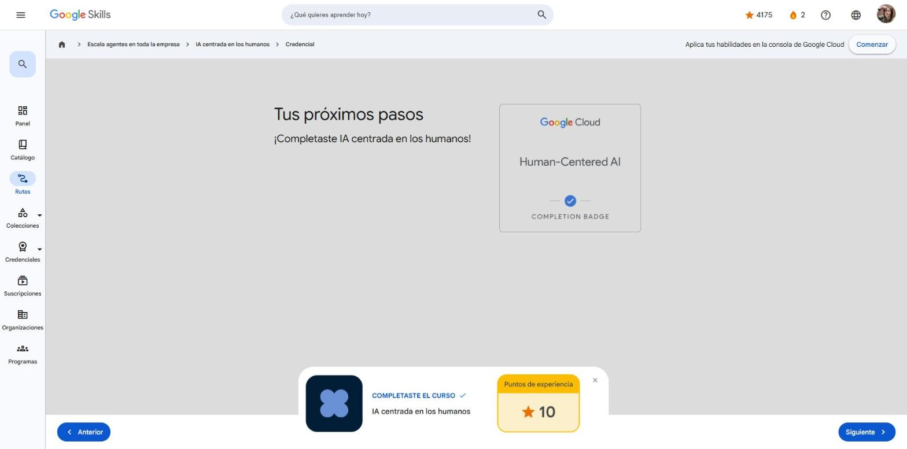

# 3. IA centrada en los humanos

Curso de la ruta **GEAR: Escala agentes en toda la empresa** · 15 min · Introductorio.
Enlace: <https://www.skills.google/paths/3980/course_templates/1643>

---

## Mantén a las personas al frente de la implementación de la IA generativa

Idea central: con IA generativa, el rol de las personas pasa de **ejecutar tareas** a **pensar estratégicamente**.

**Potenciación (augmentation):** la IA amplía capacidades humanas que siguen siendo insustituibles.

| Capacidad humana | Qué aporta la IA | Qué sigue siendo humano |
|---|---|---|
| Pensamiento crítico | Información y datos | Interpretar y decidir |
| Innovación y creatividad | Generar ideas y alternativas | Ingenio para ir más allá |
| Relaciones y colaboración | Facilitar comunicación | Confianza y manejo de dinámicas humanas |
| Visión estratégica | Previsiones y tendencias | Definir rumbo y objetivos a largo plazo |

**Automatización:** tareas **repetitivas y basadas en reglas** (entrada de datos, recuperación de información, formateo, código básico) y tareas **largas o costosas** (investigación, análisis, resúmenes, primeros borradores).

Aun automatizando, las personas siguen siendo necesarias para:

- **Seleccionar y preparar datos** de calidad y representativos.
- **Diseñar y ajustar instrucciones** (prompts).
- **Evaluar y corregir resultados** (exactitud, relevancia, tono de marca).
- **Supervisar y dar retroalimentación** continua.

**Caso real:** Warner Bros. usa subtítulos asistidos por IA en Google Cloud con revisión humana: **−50 %** de costos generales y **−80 %** del tiempo de subtitulado manual.

**Práctica: ¿potenciación o automatización?**

| Situación | Tipo |
|---|---|
| Chatbot que responde preguntas básicas de precios y disponibilidad | Automatización |
| Analista que usa IA para resumir tendencias y luego asesora a clientes | Potenciación |
| IA que genera descripciones de productos a partir de atributos | Automatización |
| Equipo que genera código estándar con IA y luego lo revisa e integra | Potenciación |

!!! tip "Para recordar"
    - Potenciar = la IA ayuda y la persona decide; automatizar = la IA ejecuta la tarea completa.
    - Toda solución de IA generativa tiene un factor humano: diseñarla pensando en las personas (*human in the loop*).
    - Pista: si una persona elige, interpreta o define mejor el resultado de la IA → **potenciación**.

## Cuestionario

**Resultado: 100 %** (mínimo 50 %).

- La interacción humana sigue siendo necesaria en la automatización porque cumple funciones de **supervisión**: definir instrucciones, evaluar resultados y monitorear.
- Un líder que genera ideas de campaña con IA y luego elige y ajusta el mensaje → **potenciación**.

**Insignia:** *Human-Centered AI* (completion badge).

## Fuentes y aviso legal

- **Fuente:** cursos de la ruta GEAR de Google Cloud Skills Boost. Sitios oficiales: [cloudskillsboost.google](https://www.cloudskillsboost.google) · [cloud.google.com/docs](https://cloud.google.com/docs).
- **Uso:** apuntes personales de estudio, sin fines comerciales y con redacción propia. Las imágenes del curso son fragmentos breves citados con fines educativos; sus derechos son de sus titulares.
- **Sin afiliación:** sitio no oficial, no afiliado ni respaldado por Google. Las marcas pertenecen a sus dueños.
- Más detalles y cómo pedir el retiro de contenido en el [aviso legal](../../aviso-legal.md).
